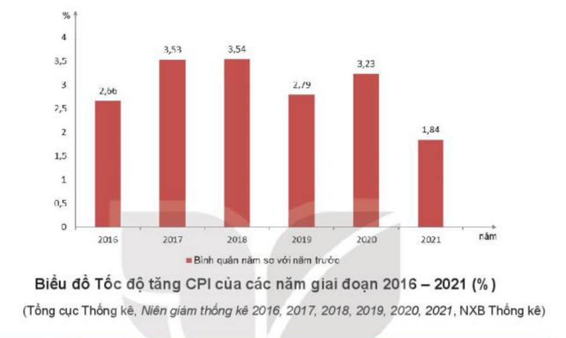

<!-- pdf:16 -->

# BÀI 3: LẠM PHÁT

## 🎯 Yêu cầu cần đạt

- Nêu được khái niệm lạm phát, liệt kê được các loại hình lạm phát.
- Giải thích được nguyên nhân dẫn đến lạm phát.
- Mô tả được hậu quả của lạm phát đối với nền kinh tế và xã hội.
- Nêu được vai trò của Nhà nước trong việc kiểm soát và kiềm chế lạm phát.
- Ủng hộ những hành vi chấp hành và phê phán những hành vi vi phạm chủ trương, chính sách của Nhà nước trong việc kiểm soát và kiềm chế lạm phát.

## 🔴 Mở đầu

Lạm phát là một hiện tượng kinh tế phổ biến đối với mọi quốc gia trên thế giới, có ảnh hưởng đến nhiều mặt của đời sống kinh tế – xã hội. Vì vậy, Chính phủ và người dân luôn quan tâm đến việc kiểm soát, kiềm chế lạm phát để đảm bảo sự ổn định và phát triển kinh tế – xã hội.

Em hãy chia sẻ hiểu biết của mình về vấn đề kinh tế đang diễn ra trong trường hợp dưới đây:

Ngày cuối tuần, H được cùng bố đi chợ. Khác với mọi lần, H thấy bố rất băn khoăn, cân nhắc khi mua sắm vì giá hàng hoá nào cũng tăng cao. H còn được nghe cô bán hàng tạp hoá nói với bố: "Giá cả tăng, khách mua hàng ít hơn nên kinh doanh cũng gặp khó khăn, bác ạ!".

## 1. Khái niệm và các loại hình lạm phát

### a) Khái niệm lạm phát

Em hãy đọc thông tin và quan sát biểu đồ sau để trả lời câu hỏi:

Theo Tổng cục Thống kê, năm 2021, lạm phát ở Việt Nam được kiểm soát ở mức thấp là 1,84%. Trong bối cảnh áp lực lạm phát toàn cầu ngày càng tăng

<!-- pdf:17 -->

cao, giá nguyên nhiên vật liệu đầu vào cho sản xuất, giá cước vận chuyển liên tục tăng nhưng chỉ số giá tiêu dùng (CPI) bình quân năm 2021 của Việt Nam chỉ tăng 1,84% so với năm trước.

(Tổng cục Thống kê, *Niên giám thống kê 2021*, NXB Thống kê, 2022)

*Biểu đồ Tốc độ tăng CPI của các năm giai đoạn 2016 – 2021 (%)*
*(Tổng cục Thống kê, Niên giám thống kê 2016, 2017, 2018, 2019, 2020, 2021, NXB Thống kê)*

> 💡 EM CÓ BIẾT
>
> **Chỉ số giá tiêu dùng** (CPI) đo giá cả một số lượng lớn các loại hàng hoá, dịch vụ thiết yếu như: lương thực, thực phẩm, dịch vụ y tế, giáo dục, năng lượng, nhà ở,... đối với mức tiêu dùng trung bình trong một thời gian nhất định.
>
> **Tỉ lệ lạm phát** $= \dfrac{\text{CPI}_1 - \text{CPI}_0}{\text{CPI}_0} \times 100\%$
>
> Trong đó:
>
> $\text{CPI}_1$: Chỉ số giá tiêu dùng thời điểm hiện tại
>
> $\text{CPI}_0$: Chỉ số giá tiêu dùng ở thời điểm cần so sánh

> ❓
>
> 1/ Em có nhận xét gì về sự biến động chỉ số giá tiêu dùng các năm trong giai đoạn 2016 – 2021?
>
> 2/ Chỉ số 1,84% phản ánh điều gì?

**Lạm phát** là sự tăng mức giá chung các hàng hoá, dịch vụ của nền kinh tế (thường tính bằng chỉ số giá tiêu dùng CPI) một cách liên tục trong một thời gian nhất định.

<!-- pdf:18 -->

### b) Các loại hình lạm phát

Em hãy đọc các thông tin sau để trả lời câu hỏi:

1. Cuối năm 2010, lạm phát hai con số kéo dài 13 tháng đến tháng 10 năm 2011 khiến CPI tăng 11,75% năm 2010 và 18,13% năm 2011. Trước tình hình đó, Chính phủ và các cấp, các ngành đã triển khai quyết liệt đồng bộ các giải pháp kiềm chế và kiểm soát lạm phát nên chỉ số giá tiêu dùng đã giảm xuống mức một con số (6,81% năm 2012; 6,04% năm 2013;...). Đẩy lùi lạm phát cao trong những năm qua là một trong những nhân tố quan trọng góp phần đưa kinh tế vĩ mô Việt Nam đi dần vào thế ổn định.

(Tổng cục Thống kê, *Niên giám thống kê 2015*, NXB Thống kê, 2016)

2. Năm 1985, chỉ số CPI tăng đến 92%, năm 1986 lên tới 775%, nền kinh tế bước vào thời kì lạm phát dữ dội với tỉ lệ tăng 3 con số kéo dài trong 2 năm tiếp theo. Phân phối lưu thông trong tình trạng rối ren, diễn biến theo chiều hướng xấu. Giá cả tiếp tục biến động phức tạp. Đồng tiền mất giá nhanh, tâm lí người tiêu dùng không muốn giữ tiền mặt, tìm cách mua hàng dự trữ để bảo đảm, làm tăng thêm tình trạng căng thẳng về hàng hoá vốn đã thiếu so với nhu cầu.

(*Văn kiện Quốc hội toàn tập, tập VI (quyển 2) 1984 – 1987, Thuyết trình của Uỷ ban Kinh tế, kế hoạch và Ngân sách của Quốc hội về kế hoạch và ngân sách Nhà nước trình bày tại kì họp thứ 12, Quốc hội khoá VII*, ngày 26 – 12 – 1986, NXB Chính trị Quốc gia, 2009)

> ❓
>
> 1/ Em có nhận xét gì về mức độ lạm phát của nước ta năm 1986, 2010 – 2011, 2012 – 2013?
>
> 2/ Ở mỗi mức độ đó, lạm phát tác động đến kinh tế – xã hội nước ta như thế nào?

Căn cứ vào mức độ lạm phát, có các loại lạm phát sau:

– **Lạm phát vừa phải**: mức độ tăng của giá cả ở một con số hằng năm (0% – dưới 10%). Trong điều kiện lạm phát thấp, giá cả thay đổi chậm, nền kinh tế được coi là ổn định.

– **Lạm phát phi mã**: Mức độ tăng của giá cả ở hai con số trở lên hằng năm (10% – 1.000%), gây bất ổn nghiêm trọng trong nền kinh tế. Đồng tiền mất giá một cách nhanh chóng, lãi suất thực tế giảm, người dân tránh giữ tiền mặt.

– **Siêu lạm phát**: giá cả tăng lên với tốc độ vượt xa mức lạm phát phi mã (>1.000%), nền kinh tế lâm vào khủng hoảng.

## 2. Nguyên nhân dẫn đến lạm phát

Em hãy đọc thông tin sau kết hợp với thông tin ở mục Các loại hình lạm phát để trả lời câu hỏi:

Theo Tổng cục Thống kê, CPI bình quân năm 2021 tăng do một số nguyên nhân chủ yếu sau:

<!-- pdf:19 -->

– Giá xăng dầu trong nước tăng 31,74% so với năm trước, giá gas tăng 25,89%.

– Giá gạo tăng 5,79% so với năm trước.

– Giá vật liệu bảo dưỡng nhà ở tăng 7,03% so với năm trước do giá xi măng, sắt, thép, cát tăng.

(Tổng cục Thống kê, *Niên giám Thống kê 2021*, NXB Thống kê, 2022)

> ❓
>
> 1/ Theo em, vì sao giá thực phẩm, giá năng lượng tăng là nguyên nhân khiến lạm phát năm 2021 tăng?
>
> 2/ Thông tin 2 – mục Các loại hình lạm phát – cho biết nguyên nhân nào dẫn đến lạm phát tăng cao ở nước ta giai đoạn 1985 – 1987?

<!-- term: Nguyên nhân dẫn đến lạm phát -->
Một số nguyên nhân cơ bản dẫn đến lạm phát:

<!-- term: Nguyên nhân dẫn đến lạm phát -->
– Chi phí sản xuất tăng cao: việc tăng giá các yếu tố đầu vào của sản xuất (như: xăng, dầu, điện, nguyên liệu,...) đẩy chi phí sản xuất tăng cao khiến cho giá cả nhiều loại hàng hoá trên thị trường tăng gây lạm phát.

<!-- term: Nguyên nhân dẫn đến lạm phát -->
– Cầu tăng cao: do có yếu tố tác động làm tổng cầu tăng cao nhưng tổng cung không thay đổi dẫn đến mức giá chung tăng gây lạm phát.

<!-- term: Nguyên nhân dẫn đến lạm phát -->
– Phát hành thừa tiền trong lưu thông: khi lượng tiền phát hành vượt quá mức cần thiết làm xuất hiện tình trạng người giữ tiền sẵn sàng bỏ ra số tiền lớn hơn để mua một đơn vị hàng hoá, làm cho giá cả hàng hoá leo thang gây lạm phát.

## 3. Hậu quả của lạm phát

Em hãy đọc thông tin sau kết hợp với thông tin ở mục Nguyên nhân dẫn đến lạm phát để trả lời câu hỏi:

Tháng 10 năm 2022, lạm phát các nước khu vực sử dụng đồng tiền chung châu Âu (Eurozone) tăng mức kỉ lục 10,7%. Quỹ Tiền tệ Quốc tế dự báo, mùa đông năm nay hơn một nửa quốc gia trong khu vực này sẽ rơi vào tình trạng suy thoái kinh tế.

(An Huy, *Hai thách thức của kinh tế châu Âu: lạm phát nóng, tăng trưởng lạnh*, Tạp chí Kinh tế Việt Nam, ngày 31 – 10 – 2022)

> ❓
>
> 1/ Em hãy chỉ ra hậu quả do lạm phát tăng cao gây ra trong thông tin trên.
>
> 2/ Theo em, lạm phát tăng do giá lương thực và năng lượng tăng có ảnh hưởng thế nào đến đời sống và các hoạt động kinh tế – xã hội?
>
> 3/ Em hãy kể những hậu quả khác mà lạm phát có thể gây ra đối với nền kinh tế và xã hội.

<!-- pdf:20 -->

<!-- term: Hậu quả của lạm phát -->
Lạm phát cao gây hậu quả tiêu cực đến hoạt động của nền kinh tế và mọi mặt đời sống xã hội:

<!-- term: Hậu quả của lạm phát -->
– Giá cả các yếu tố đầu vào sản xuất tăng cao khiến chi phí tăng, tác động trực tiếp đến việc giảm quy mô đầu tư, sản xuất kinh doanh của các doanh nghiệp làm cho kinh tế suy thoái và thất nghiệp gia tăng. Giá cả các hàng hoá không ngừng tăng dẫn đến tình trạng đầu cơ, tích trữ nhiều hàng hoá, tạo thêm sự khan hiếm, đẩy giá cả hàng hoá tiếp tục tăng gây nhiễu loạn thị trường.

<!-- term: Hậu quả của lạm phát -->
– Giá cả hàng hoá cao, chi phí sinh hoạt đắt đỏ làm cho mức sống của người dân trong xã hội giảm sút. Bên cạnh đó, lạm phát cao thường khiến nhiều người mất việc làm, không có thu nhập, đời sống nhiều gia đình bấp bênh, gặp nhiều khó khăn. Lạm phát tăng cao, kéo dài có thể gây ra khủng hoảng kinh tế, chính trị, xã hội,...

Tuy nhiên, mức độ lạm phát vừa phải sẽ kích thích sản xuất kinh doanh phát triển.

## 4. Vai trò của Nhà nước trong việc kiểm soát và kiềm chế lạm phát

Em hãy đọc các thông tin sau để trả lời câu hỏi:

1. Điều 3 Luật Ngân hàng Nhà nước Việt Nam năm 2010 quy định một số nội dung liên quan đến lạm phát như sau:

“2. Quốc hội quyết định chỉ tiêu lạm phát hằng năm được thể hiện thông qua việc quyết định chỉ số giá tiêu dùng và giám sát việc thực hiện chính sách tiền tệ quốc gia. [...]

4. Chính phủ trình Quốc hội quyết định chỉ tiêu lạm phát hằng năm. Thủ tướng Chính phủ, Thống đốc Ngân hàng Nhà nước quyết định việc sử dụng các công cụ và biện pháp điều hành để thực hiện mục tiêu chính sách tiền tệ quốc gia theo quy định của Chính phủ.”

2. Công tác điều hành kiểm soát lạm phát những năm gần đây đạt được kết quả quan trọng nhờ sự chỉ đạo quyết liệt, kịp thời của Chính phủ, sự phối hợp chặt chẽ giữa các Bộ ngành trong việc xây dựng và thực hiện các kịch bản điều hành giá những mặt hàng quan trọng, thiết yếu như dịch vụ y tế, xăng, dầu, điện,... phù hợp trong từng giai đoạn. Nhờ vậy, giai đoạn 2016 – 2020 là giai đoạn thành công trong việc kiểm soát lạm phát.

(Tổng cục Thống kê, *Niên giám thống kê 2020*, NXB Thống kê, 2021)

> ❓
>
> 1/ Nội dung khoản 2, khoản 4 Điều 3 Luật Ngân hàng Nhà nước Việt Nam thể hiện Nhà nước thực hiện việc kiểm soát lạm phát như thế nào?
>
> 2/ Nhà nước đã có vai trò như thế nào trong việc kiềm chế lạm phát giai đoạn 2016 – 2020?

<!-- pdf:21 -->

<!-- term: Kiểm soát và kiềm chế lạm phát -->
Nhà nước có vai trò quan trọng trong việc kiểm soát và kiềm chế lạm phát:

<!-- term: Kiểm soát và kiềm chế lạm phát -->
– Luôn theo dõi biến động giá cả trên thị trường, duy trì tỉ lệ lạm phát ở mức cho phép.

<!-- term: Kiểm soát và kiềm chế lạm phát -->
– Đưa ra chính sách, biện pháp, sử dụng các công cụ điều tiết để kiềm chế, đẩy lùi lạm phát như: thực hiện chính sách tiền tệ (tăng lãi suất, giảm mức cung tiền,...), thực hiện chính sách tài chính thắt chặt (cắt giảm chi tiêu công), hỗ trợ thu nhập cho người gặp khó khăn, tăng cường quản lí thị trường (chống đầu cơ tích trữ hàng hoá, sử dụng dự trữ quốc gia để bình ổn cung – cầu, bình ổn giá trên thị trường,...).

## ✏️ Luyện tập

1. Em tán thành hay không tán thành với các ý kiến sau? Vì sao?

a. Giá cả một vài hàng hoá tăng chứng tỏ nền kinh tế đang lạm phát.

b. Trong thời kì lạm phát tăng cao, người gửi tiền tiết kiệm sẽ bị thiệt.

c. Lạm phát là biểu hiện đồng tiền của quốc gia bị mất giá.

d. Lạm phát luôn ảnh hưởng xấu đến nền kinh tế.

2. Em hãy cho biết những biến động sau đây có thể làm cho lạm phát tăng hay không. Vì sao?

a. Hoạt động xuất khẩu tăng mạnh.

b. Các doanh nghiệp sử dụng nhiều nguyên, nhiên liệu nhập khẩu trong khi giá của chúng đang tăng cao.

c. Giá xăng tăng cao.

3. Em hãy thể hiện thái độ của mình đối với hành vi của chủ thể ở các trường hợp dưới đây trong việc chấp hành chủ trương, chính sách nhà nước về lạm phát.

a. Ngân hàng Y muốn duy trì mức lãi suất huy động vốn thấp trong khi Chính phủ đang chủ trương thực hiện chính sách tiền tệ để kiềm chế lạm phát.

b. Trong bối cảnh lạm phát tăng cao, Uỷ ban nhân dân huyện C phát động phong trào tiết kiệm, thắt chặt chi tiêu công của các cơ quan sử dụng ngân sách nhà nước.

c. Giá cả hàng hoá tiêu dùng tăng cao, thành phố H tăng cường kiểm soát giá và sử dụng hiệu quả mạng lưới phân phối của các siêu thị để bình ổn giá.

## 🚀 Vận dụng

Em hãy viết bài chia sẻ cách chi tiêu hợp lí khi lạm phát tăng cao.

## 📷 Danh sách hình trong bài

| Mã hình | Trang PDF | Vị trí trong bài | Chú thích gốc |
| --- | --- | --- | --- |
| H11-gd_kt_va_pl-b03-01 | 17 | Mục 1.a | Biểu đồ Tốc độ tăng CPI của các năm giai đoạn 2016 – 2021 (%) |
