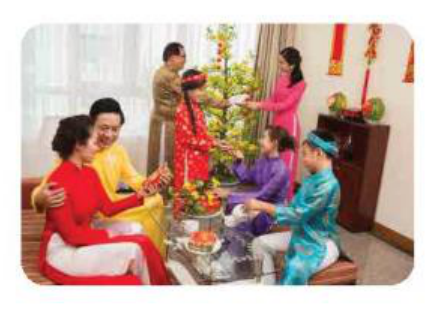
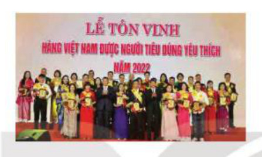

<!-- pdf:45 -->

# BÀI 8: VĂN HOÁ TIÊU DÙNG

## 🎯 Yêu cầu cần đạt

- Nêu được vai trò của tiêu dùng đối với sự phát triển kinh tế.
- Nêu được khái niệm và vai trò của văn hoá tiêu dùng.
- Mô tả được một số đặc điểm trong văn hoá tiêu dùng Việt Nam và các biện pháp xây dựng văn hoá tiêu dùng.
- Thực hiện được các hành vi tiêu dùng có văn hoá.
- Phê phán những biểu hiện không có văn hoá trong tiêu dùng; tuyên truyền, vận động bạn bè, người thân làm người tiêu dùng có văn hoá.

## 🔴 Mở đầu

Văn hoá tiêu dùng là một bộ phận quan trọng của nền văn hoá dân tộc, thể hiện các giá trị văn hoá của con người Việt Nam, đã và đang có những tác động nhất định đến đời sống kinh tế, văn hoá, xã hội của cộng đồng. Xây dựng văn hoá tiêu dùng góp phần xây dựng một xã hội hiện đại, văn minh và hội nhập.

> ❓ Em có suy nghĩ gì về câu nói “Người Việt Nam tiêu dùng hàng Việt Nam là sự thể hiện của lòng yêu nước và tự tôn dân tộc”?

## 1. Vai trò của tiêu dùng đối với sự phát triển kinh tế

Em hãy đọc các thông tin sau để trả lời câu hỏi:

1. Hiện nay, người tiêu dùng quan tâm đến việc tiêu dùng của mình có gây tổn hại đến môi trường, xã hội hay không (từ khâu chọn nguyên vật liệu, vận chuyển,

<!-- pdf:46 -->

<!-- term: Thương hiệu xanh -->
sản xuất đến thương mại, xử lí rác thải,...). Bản thân người lao động trong các công ty cũng là người tiêu dùng hiện đại, ngày càng có ý thức về bảo vệ môi trường. Họ mong muốn được làm việc ở những công ty được đánh giá là có đạo đức, tôn trọng con người và môi trường. Điều này khiến các doanh nghiệp cũng có xu hướng xây dựng chiến lược kinh doanh đẩy mạnh sản xuất xanh, tạo "thương hiệu xanh", thể hiện trách nhiệm xã hội trong việc bảo vệ môi trường,...

(*Khi phát triển xanh không chỉ là xu hướng*, Tạp chí Kinh tế Việt Nam, ngày 16 – 10 – 2022)

2. Xã hội ngày càng phát triển và thu nhập của người dân càng tăng thì khả năng tiêu dùng hàng cao cấp cũng theo đó mà nhân lên cùng với sự đa dạng về chủng loại, tính chất và quy mô. Xu hướng này kích thích phát triển các phân khúc thị trường mới, khiến cơ cấu thị trường trong nước được cải thiện theo hướng đa dạng và đồng bộ hơn, làm tăng nhu cầu có khả năng thanh toán cao, do đó, tăng tính hấp dẫn thị trường đầu tư, tạo thêm công ăn việc làm cho xã hội, tăng thu ngân sách nhà nước.

<!-- term: Tiêu dùng hợp lí -->
Tuy nhiên, việc tiêu dùng hàng xa xỉ quá mức so với thu nhập là một biểu hiện của sự lãng phí. Bởi vậy, việc tiêu dùng hợp lí là điều rất đáng được quan tâm.

(*Tiêu dùng hợp lí*, Tạp chí Cộng sản, ngày 10 – 6 – 2010)

> ❓ Qua các thông tin trên, em hãy cho biết sự thay đổi của tiêu dùng có tác động như thế nào đối với sự phát triển kinh tế – xã hội.

<!-- term: Vai trò của tiêu dùng -->
Tiêu dùng được ví như "đơn đặt hàng" của xã hội đối với sản xuất, là mục đích, động lực thúc đẩy sản xuất phát triển. Mỗi sự thay đổi tích cực của tiêu dùng đều góp phần phát triển kinh tế, nâng cao chất lượng đời sống nhân dân, góp phần thúc đẩy tiến bộ xã hội.

## 2. Khái niệm và vai trò của văn hoá tiêu dùng

### a) Khái niệm văn hoá tiêu dùng

Em hãy đọc thông tin sau để trả lời câu hỏi:

Tết Nguyên đán của Việt Nam được ví như ngày hội mua sắm của người Việt. Không biết tự bao giờ, dịp Tết là khoảng thời gian người tiêu dùng sẵn sàng chi tiền vào nhóm sản phẩm cao cấp: quần áo, giày dép, thực phẩm, bánh kẹo, hoa quả, cây cảnh, đồ trang trí,... Một số mặt hàng có nhu cầu cao trong dịp Tết như: lương thực (gạo tẻ ngon, gạo nếp, đỗ xanh,...), thực phẩm tươi sống (gà ta, thịt lợn, thịt bò,...) và bánh, mứt, kẹo, rượu, bia các loại, các loại đồ uống đóng hộp,... Truyền thống gói bánh chưng, bánh dày, chơi hoa cây cảnh, bày mâm ngũ quả là những phong tục không thể thiếu trong ngày Tết của các gia đình Việt.

<!-- pdf:47 -->

Hầu hết các chợ, siêu thị đều đóng cửa vào ngày mùng Một Tết nên những ngày trước Tết không khí mua sắm rất nhộn nhịp. Điều đặc biệt trong những ngày Tết là mọi người từ già, trẻ, gái, trai đều mặc những bộ áo dài truyền thống hay những bộ trang phục đẹp nhất cùng nhau đi chúc Tết.

> ❓
>
> 1/ Qua thông tin trên, em hãy nêu những tập quán tiêu dùng của người Việt Nam trong dịp tết Nguyên đán. Những tập quán này tạo nên nét đẹp văn hoá gì của dân tộc Việt Nam?
>
> 2/ Em hãy kể một số tập quán, thói quen tiêu dùng có văn hoá của người Việt Nam mà em biết.

**Văn hoá tiêu dùng** là một bộ phận của văn hoá dân tộc, là những nét đẹp trong tập quán, thói quen tiêu dùng của cộng đồng và cả dân tộc được hình thành và phát triển theo thời gian, thể hiện các giá trị văn hoá của con người trong tiêu dùng.

### b) Vai trò của văn hoá tiêu dùng

Em hãy đọc thông tin sau kết hợp với các thông tin ở mục trên để trả lời câu hỏi:

<!-- term: Tiêu dùng bền vững -->
1. Chọn mua nhiều hơn các sản phẩm có yếu tố “xanh”, lựa chọn các phương thức tiêu dùng bền vững, thân thiện với môi trường, sẵn sàng chi trả cho những sản phẩm có yếu tố “bền vững”,... đang là những thay đổi tích cực của xu hướng tiêu dùng được nhiều doanh nghiệp nắm bắt.

<!-- term: Thời trang nhanh -->
Với giới trẻ, thay vì tiêu dùng kiểu “thời trang nhanh” (mua giá rẻ, thay đổi liên tục, loại bỏ nhiều), nhiều bạn đã chọn cách tái chế, tái sử dụng, thanh lí quần áo, phụ kiện thời trang để hạn chế việc bỏ đi các trang phục cũ – một loại rác thải tác động tiêu cực đến môi trường.

Xu hướng này là một phần lí do khiến nhiều hãng thời trang lớn trên toàn cầu thực hiện các chương trình như đổi cũ – lấy mới, hoặc nhận lại đồ cũ từ khách hàng để tái chế hoặc tái sử dụng, giúp kéo dài vòng đời của quần áo từ đó giảm thiểu lượng rác thải khổng lồ của ngành công nghiệp thời trang ra môi trường.

(Lan Anh, *55% người tiêu dùng chọn tính bền vững là yếu tố quan trọng khi lựa chọn thương hiệu*, Tạp chí Kinh tế Việt Nam, ngày 14 – 9 – 2022)

2. Văn hoá tiêu dùng là tập hợp các hành vi tiêu dùng thể hiện ở mọi lúc, mọi nơi, bị chi phối bởi việc tiêu dùng các sản phẩm thương mại. Nó còn là truyền thống chuyển tải các giá trị văn hoá, các chuẩn mực hiện hành và các tập quán, hành động từ thế hệ này sang thế hệ khác, chủ yếu được thực hiện thông qua các

<!-- pdf:48 -->

lựa chọn cá nhân trong cuộc sống hằng ngày, thúc đẩy nền kinh tế bằng cách khuyến khích mọi người tiêu dùng hàng hoá vật chất và hàng hoá tinh thần.

(Lê Thị Trang, *Văn hoá tiêu dùng – một góc nhìn lý luận*, Tạp chí Lý luận chính trị, ngày 24 – 10 – 2017)

> ❓
>
> 1/ Qua các thông tin trên, em hãy cho biết xu hướng tiêu dùng xanh, tiêu dùng hợp lí và bền vững có tác động như thế nào đến chiến lược sản xuất, kinh doanh của các doanh nghiệp và sự phát triển bền vững của xã hội.
>
> 2/ Văn hoá tiêu dùng có tác động như thế nào tới sự phát triển văn hoá dân tộc?

<!-- term: Vai trò của văn hoá tiêu dùng -->
Văn hoá tiêu dùng có vai trò quan trọng đối với sự phát triển kinh tế, văn hoá và xã hội:

<!-- term: Vai trò của văn hoá tiêu dùng -->
– Là cơ sở giúp cho các doanh nghiệp đưa ra chiến lược kinh doanh phù hợp, tạo được ấn tượng, thiện cảm đối với người tiêu dùng để đạt được hiệu quả trong sản xuất kinh doanh.

<!-- term: Vai trò của văn hoá tiêu dùng -->
– Là cơ sở duy trì tiêu dùng bền vững, góp phần tạo nên những sắc thái văn hoá ngày càng phong phú, đa dạng của cộng đồng, dân tộc.

<!-- term: Vai trò của văn hoá tiêu dùng -->
– Không chỉ tác động đến hoạt động kinh tế mà còn có ý nghĩa xã hội sâu sắc: làm thay đổi phong cách tiêu dùng, tác phong lao động của con người, góp phần hình thành tư duy chiến lược trên phạm vi rộng lớn, gắn bó chặt chẽ giữa phát triển sản xuất và tiêu dùng trong bối cảnh hội nhập quốc tế ngày càng sâu rộng.

## 3. Đặc điểm văn hoá tiêu dùng Việt Nam và biện pháp xây dựng văn hoá tiêu dùng

### a) Đặc điểm văn hoá tiêu dùng Việt Nam

Em hãy quan sát hình ảnh và đọc các thông tin sau để trả lời câu hỏi:

1. Trước đây, sống trong môi trường rủi ro và tự cấp, tự túc, người Việt hình thành tính cách cần cù, chăm chỉ đi đôi với tiết kiệm. Dù nền kinh tế thị trường đã hình thành và phát triển ở Việt Nam nhiều năm nhưng văn hoá tiết kiệm vẫn còn thể hiện khá rõ trong quá trình tiêu dùng của người dân, đặc biệt là cư dân ở nông thôn.

(Nguyễn Thị Minh Ngọc, Trần Nguyệt Minh Thu, *Văn hoá tiêu dùng của người Việt Nam trong bối cảnh toàn cầu hoá và hội nhập kinh tế quốc tế*, NXB Khoa học xã hội, 2021, tr. 16)

2. Người Việt hiện nay đang dần văn minh hoá lối sống tiêu dùng theo tầm nhìn và thị hiếu của xã hội công nghiệp. Văn hoá tiêu dùng của người Việt Nam đang có sự dịch chuyển về cơ cấu tiêu dùng theo xu hướng giảm tỉ trọng nhu cầu vật chất

<!-- pdf:49 -->

tối thiểu, dịch chuyển sang những loại hàng hoá hợp thị hiếu và chất lượng cao, dịch chuyển trong tần suất và phương thức mua sắm thiết yếu và tăng tỉ trọng cho nhu cầu tinh thần. Văn hoá tiêu dùng đã và đang có những tác động tích cực đến các lĩnh vực đời sống kinh tế – xã hội, thúc đẩy nền kinh tế bằng cách khuyến khích mọi người tiêu dùng hàng hoá, góp phần xây dựng xã hội hiện đại nhưng không tách rời nền tảng bản sắc và các giá trị truyền thống, hội nhập với thế giới trong bối cảnh ngày nay.

(Nguyễn Thị Minh Ngọc, Trần Nguyệt Minh Thu, *Văn hoá tiêu dùng của người Việt Nam trong bối cảnh toàn cầu hoá và hội nhập kinh tế quốc tế*, NXB Khoa học xã hội, 2021, tr. 231)

> ❓
>
> 1/ Các thông tin và hình ảnh trên thể hiện những đặc điểm gì trong văn hoá tiêu dùng Việt Nam?
>
> 2/ Em hãy kể các đặc điểm khác của văn hoá tiêu dùng Việt Nam mà em biết.

<!-- term: Đặc điểm văn hoá tiêu dùng Việt Nam -->
– Văn hoá tiêu dùng người Việt đương đại vừa trân trọng kế thừa nét đẹp truyền thống vừa không ngừng đổi mới, nỗ lực hoàn thiện để có thể hội nhập sâu hơn với văn hoá tiêu dùng toàn cầu.

<!-- term: Đặc điểm văn hoá tiêu dùng Việt Nam -->
– Văn hoá tiêu dùng Việt Nam gắn với sự lên ngôi của yếu tố chất lượng. Giá trị con người ngày càng được nâng cao. Tiêu dùng xanh, tiêu dùng sạch, tiêu dùng số, tiêu dùng thông minh và có trách nhiệm ngày càng chiếm ưu thế trở thành một xu hướng phát triển của xã hội.

<!-- term: Đặc điểm văn hoá tiêu dùng Việt Nam -->
– Văn hoá tiêu dùng của người Việt Nam có tính di động cao, được hình thành trên cơ sở đa dạng về văn hoá song đều hướng theo trào lưu những giá trị mới. Đó là những giá trị tích cực tạo nên một bề dày trên cơ sở những giá trị truyền thống vẫn còn phù hợp cho tới ngày nay.

<!-- term: Đặc điểm văn hoá tiêu dùng Việt Nam -->
– Văn hoá tiêu dùng Việt Nam đang dần được định hình theo hướng tin tưởng đối với những hàng hoá trong nước thể hiện sự ưu tiên và tôn vinh hàng Việt.

### b) Những biện pháp xây dựng văn hoá tiêu dùng

Em hãy đọc các thông tin sau để trả lời câu hỏi:

1. Năm 2009, để xây dựng văn hoá tiêu dùng của người Việt và thúc đẩy sản xuất những sản phẩm có chất lượng, sức cạnh tranh cao, đáp ứng nhu cầu tiêu dùng

<!-- pdf:50 -->

<!-- term: Cuộc vận động Người Việt Nam ưu tiên dùng hàng Việt Nam -->
trong nước và xuất khẩu, hướng đến sự phát triển bền vững của nền kinh tế, Bộ Công Thương đã phát động cuộc vận động “Người Việt Nam ưu tiên dùng hàng Việt Nam”. Trong suốt 10 năm thực hiện, cuộc vận động đã nhận được sự hưởng ứng tích cực của cộng đồng doanh nghiệp cũng như đông đảo người dân trong cả nước và đã đạt được nhiều kết quả đáng ghi nhận, tạo tiền đề để triển khai hiệu quả cuộc vận động trong những năm tiếp theo.

(Bích Ngọc, *10 năm thực hiện cuộc vận động "Người Việt Nam ưu tiên dùng hàng Việt Nam"*, Tạp chí Con số và Sự kiện, ngày 12 – 12 – 2019)

2. Sở Công thương tỉnh H vừa tổ chức hội chợ “Hàng Việt Nam chất lượng cao”. Hội chợ đã có rất nhiều người dân trong khu vực và các tỉnh lân cận đến tham dự. Ai cũng háo hức đi thăm các gian hàng giới thiệu các mặt hàng nông sản của các vùng. Là một sinh viên du học tại Anh về nghỉ Tết, anh T rất quan tâm đến các gian hàng thủ công, mĩ nghệ, say sưa ngắm các bức tranh thêu truyền thống, những chiếc áo thổ cẩm,... Anh T rất yêu thích và cảm thấy tự hào về các sản phẩm truyền thống nên đã mua rất nhiều để làm quà tặng cho các bạn nước ngoài khi quay trở lại nước Anh học tập.

> ❓
>
> 1/ Qua các thông tin trên, em hãy cho biết cuộc vận động “Người Việt Nam ưu tiên dùng hàng Việt Nam” nhằm mục đích gì?
>
> 2/ Để xây dựng văn hoá tiêu dùng, Nhà nước, các doanh nghiệp và mỗi người dân cần phải làm gì?
>
> 3/ Em hãy nêu một số giải pháp khác góp phần xây dựng văn hoá tiêu dùng.

Để xây dựng văn hoá tiêu dùng cần thực hiện đồng bộ nhiều giải pháp:

– Nhà nước cần có chủ trương, chính sách kinh tế, văn hoá phù hợp cho các doanh nghiệp phát triển sản xuất và thị trường trong nước, thực hiện triệt để Luật Bảo vệ quyền lợi người tiêu dùng.

– Các doanh nghiệp Việt Nam cần chủ động chiến lược sản xuất kinh doanh, đón đầu nhu cầu, thị hiếu tiêu dùng mới của người Việt Nam, hướng tới sản xuất sản phẩm bảo đảm các yếu tố xanh, sạch, bền vững phù hợp với xu hướng toàn cầu.

– Giáo dục nhân dân thay đổi nhận thức và hành động vì cộng đồng hướng tới những giá trị cốt lõi, bền vững. Phát huy lòng yêu nước, niềm tự hào và tự tôn dân tộc trong tiêu dùng để xây dựng văn hoá tiêu dùng hàng Việt. Xây dựng thói quen tiêu dùng thông minh, thân thiện với môi trường.

<!-- pdf:51 -->

## 4. Thực hiện hành vi tiêu dùng có văn hoá

Em hãy đọc các thông tin sau để trả lời câu hỏi:

1. Chị H luôn chủ động lập kế hoạch chi tiêu, tiếp cận kĩ lưỡng thông tin về sản phẩm, lựa chọn hàng hoá một cách hợp lí, tốt cho sức khoẻ, phù hợp với điều kiện của bản thân và gia đình để thu được lợi ích tối đa từ sản phẩm. Đặc biệt, chị luôn ưu tiên chọn sản phẩm hàng Việt Nam chất lượng cao mỗi khi mua sắm.

2. Là người thích đi du lịch và khám phá các vùng miền, anh C đã đặt chân tới nhiều tỉnh thành trên cả nước. Anh được ngắm trang phục của người H'Mông và thưởng thức món gà nướng nóng hổi giữa núi rừng Y Tý ở Lào Cai; được đi chợ nổi Cái Răng ở Cần Thơ; thưởng thức món mì Quảng cay nóng và những trái cây tươi ngon giữa những miệt vườn Nam bộ;... Anh đã viết cuốn sách về du lịch để giới thiệu với bạn bè quốc tế khi đến Việt Nam. Nội dung cuốn sách là các món ăn truyền thống, địa điểm du lịch đẹp, trang phục đặc trưng của các dân tộc,... ở các địa phương trong cả nước.

> ❓
>
> 1/ Các thông tin trên cho thấy người Việt Nam đang thực hiện văn hoá tiêu dùng như thế nào?
>
> 2/ Em đã thực hiện những hành vi tiêu dùng có văn hoá như thế nào?

<!-- term: Tiêu dùng hợp lí -->
– Để thực hiện văn hoá tiêu dùng, người tiêu dùng cần có kế hoạch chi tiêu, thực hiện tiêu dùng hợp lí, phù hợp với điều kiện cá nhân và xã hội.

<!-- term: Hành vi tiêu dùng có văn hoá -->
– Thực hiện tiêu dùng thông minh, tiêu dùng xanh và sạch, tiêu dùng số, tiêu dùng có trách nhiệm, định hướng các nhà sản xuất tạo ra các sản phẩm phù hợp với truyền thống văn hoá dân tộc và bảo vệ được sức khoẻ của con người, bảo vệ được môi trường sống.

<!-- term: Hành vi tiêu dùng có văn hoá -->
– Mỗi người tiêu dùng Việt Nam cần có trách nhiệm trong quá trình xây dựng văn hoá tiêu dùng của người Việt, hưởng ứng cuộc vận động "Người Việt Nam ưu tiên dùng hàng Việt Nam" nhằm bảo vệ bản sắc văn hoá dân tộc, đồng thời mở rộng giao lưu, quảng bá và tiếp thu tinh hoa văn hoá nhân loại.

## ✏️ Luyện tập

1. Em đồng tình hay không đồng tình với các quan điểm sau? Vì sao?

a. Tốt gỗ hơn tốt nước sơn.

b. Dùng hàng hiệu mới thể hiện được phong cách và giá trị bản thân.

<!-- pdf:52 -->

c. Muốn phát triển, doanh nghiệp cần phải nghiên cứu văn hoá tiêu dùng.

d. Người tiêu dùng thông minh là người có lựa chọn hợp lí cho các sản phẩm tiêu dùng trên thị trường.

2. Em hãy cho biết các hành vi tiêu dùng sau đây có phải là tiêu dùng có văn hoá không. Giải thích vì sao.

a. Khi đi du lịch, chị M thường mua các sản phẩm của địa phương về làm quà cho những người thân trong gia đình.

b. Bà Y có thói quen chỉ dùng các loại hoá mĩ phẩm nhập khẩu.

c. Chị B chơi với một nhóm bạn người nước ngoài. Chị thường nấu các món ăn dân dã của người Việt để giới thiệu với các bạn.

3. Em hãy đọc tình huống sau để trả lời câu hỏi:

Bạn Q có thói quen sử dụng các loại thức ăn nhanh vì cho rằng rất tiện lợi và ngon miệng.

– *Em có nhận xét gì về hành vi tiêu dùng này của bạn Q?*

– *Nếu là bạn thân của Q, em sẽ nói gì với bạn về thói quen này?*

## 🚀 Vận dụng

1. Em hãy viết bài hoặc vẽ tranh, gửi thông điệp tuyên truyền "Người Việt Nam ưu tiên dùng hàng Việt Nam".

2. Em hãy viết bài giới thiệu nét đẹp một hành vi tiêu dùng có văn hoá của người Việt và chia sẻ với thầy cô, bạn bè.

## 📷 Danh sách hình trong bài

| Mã hình | Trang PDF | Vị trí trong bài | Chú thích gốc |
| --- | --- | --- | --- |
| H11-gd_kt_va_pl-b08-01 | 47 | Mục 2.a | Gia đình Việt Nam mặc áo dài truyền thống chúc Tết |
| H11-gd_kt_va_pl-b08-02 | 49 | Mục 3.a | Lễ tôn vinh Hàng Việt Nam được người tiêu dùng yêu thích năm 2022 |
