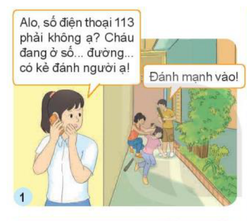
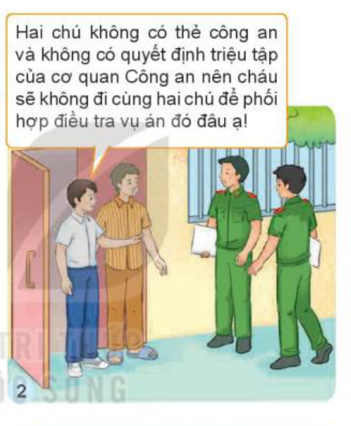
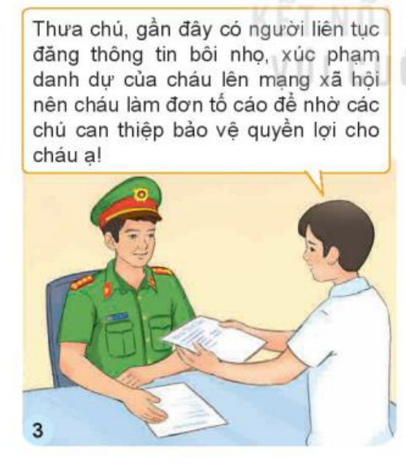
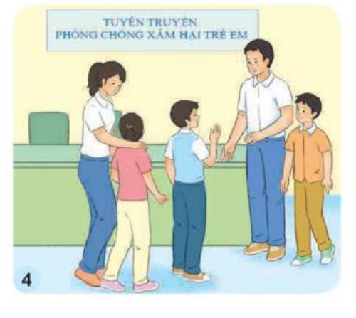

<!-- pdf:108 -->

# BÀI 17: QUYỀN BẤT KHẢ XÂM PHẠM VỀ THÂN THỂ VÀ QUYỀN ĐƯỢC PHÁP LUẬT BẢO HỘ VỀ TÍNH MẠNG, SỨC KHOẺ, DANH DỰ, NHÂN PHẨM CỦA CÔNG DÂN

## 🎯 Yêu cầu cần đạt

- Nêu được một số quy định cơ bản của pháp luật về quyền bất khả xâm phạm về thân thể và quyền được pháp luật bảo hộ về tính mạng, sức khoẻ, danh dự, nhân phẩm của công dân.
- Nhận biết được hậu quả của hành vi vi phạm quyền bất khả xâm phạm về thân thể và quyền được pháp luật bảo hộ về tính mạng, sức khoẻ, danh dự, nhân phẩm của công dân.
- Hiểu được trách nhiệm của học sinh trong việc thực hiện quyền bất khả xâm phạm về thân thể và quyền được pháp luật bảo hộ về tính mạng, sức khoẻ, danh dự, nhân phẩm của công dân.
- Phân tích, đánh giá được các hành vi vi phạm quyền bất khả xâm phạm về thân thể và quyền được pháp luật bảo hộ về tính mạng, sức khoẻ, danh dự, nhân phẩm của công dân trong một số tình huống đơn giản.
- Tự giác thực hiện các quy định của pháp luật về quyền bất khả xâm phạm về thân thể và quyền được pháp luật bảo hộ về tính mạng, sức khoẻ, danh dự, nhân phẩm của công dân bằng những hành vi cụ thể, phù hợp.

## 🔴 Mở đầu

Quyền bất khả xâm phạm về thân thể và quyền được pháp luật bảo hộ về tính mạng, sức khoẻ, danh dự, nhân phẩm là những quyền con người quan trọng được ghi nhận trong Hiến pháp và luật. Các quyền này không thể tách rời đối với mỗi cá nhân.

> ❓ *Em hãy chia sẻ lại một hành vi vi phạm quyền bất khả xâm phạm về thân thể hoặc quyền được pháp luật bảo hộ về tính mạng, sức khoẻ, danh dự, nhân phẩm của công dân mà em biết. Em có suy nghĩ như thế nào về hành vi đó?*

<!-- pdf:109 -->

## 1. Quyền bất khả xâm phạm về thân thể của công dân

### a) Một số quy định cơ bản của pháp luật về quyền bất khả xâm phạm về thân thể của công dân

*Em hãy đọc các thông tin, trường hợp sau để trả lời câu hỏi:*

> 1. Hiến pháp năm 2013
>
> *Điều 20.*
>
> 1. Mọi người có quyền bất khả xâm phạm về thân thể, được pháp luật bảo hộ về sức khoẻ, danh dự và nhân phẩm; không bị tra tấn, bạo lực, truy bức, nhục hình hay bất kì hình thức đối xử nào khác xâm phạm thân thể, sức khoẻ, xúc phạm danh dự, nhân phẩm.
>
> 2. Không ai bị bắt nếu không có quyết định của Toà án nhân dân, quyết định hoặc phê chuẩn của Viện kiểm sát nhân dân, trừ trường hợp phạm tội quả tang. Việc bắt, giam, giữ người do luật định.
>
> 3. Mọi người có quyền hiến mô, bộ phận cơ thể người và hiến xác theo quy định của luật. Việc thử nghiệm y học, dược học, khoa học hay bất kì hình thức thử nghiệm nào khác trên cơ thể người phải có sự đồng ý của người được thử nghiệm.
>
> 2. Bộ luật Tố tụng Hình sự năm 2015 (sửa đổi, bổ sung năm 2021)
>
> Điều 10. Bảo đảm quyền bất khả xâm phạm về thân thể
>
> Mọi người có quyền bất khả xâm phạm về thân thể. Không ai bị bắt nếu không có quyết định của Toà án, quyết định hoặc phê chuẩn của Viện kiểm sát, trừ trường hợp phạm tội quả tang.
>
> Việc giữ người trong trường hợp khẩn cấp, việc bắt, tạm giữ, tạm giam người phải theo quy định của Bộ luật này. Nghiêm cấm tra tấn, bức cung, dùng nhục hình hay bất kì hình thức đối xử nào khác xâm phạm thân thể, tính mạng, sức khoẻ của con người.
>
> 3. Chú Y và anh K chặn đường định bắt anh B đưa về nhà để ép trả nợ. Một số người dân xung quanh khi phát hiện sự việc đã can thiệp, ngăn chặn hành vi của chú Y và anh K, đồng thời khuyên anh B nên trình báo lại sự việc với cơ quan công an để được hỗ trợ.
>
> 4. Nghi ngờ anh T hàng xóm lấy trộm xe máy của mình nên ông X đã trình báo sự việc với công an xã và yêu cầu bắt giữ T để điều tra. Tuy nhiên, công an xã đã từ chối thực hiện việc bắt giữ theo yêu cầu của ông X vì không đủ căn cứ theo quy định của pháp luật.

> ❓
>
> *1/ Trong trường hợp 3 và 4, các chủ thể đã thực hiện đúng hay vi phạm quyền bất khả xâm phạm về thân thể của công dân? Vì sao?*
>
> *2/ Em hãy nêu một số quy định của pháp luật về quyền bất khả xâm phạm về thân thể của công dân. Theo em, các quy định đó của pháp luật có ý nghĩa gì?*

<!-- pdf:110 -->

### b) Hậu quả của hành vi vi phạm quyền bất khả xâm phạm về thân thể của công dân

*Em hãy đọc các thông tin, trường hợp sau để trả lời câu hỏi:*

> 1. Bộ luật hình sự năm 2015 (sửa đổi, bổ sung năm 2017)
>
> *Điều 157. Tội bắt, giữ hoặc giam người trái pháp luật (trích)*

<!-- term: Tội bắt, giữ hoặc giam người trái pháp luật -->
> 1. Người nào bắt, giữ hoặc giam người trái pháp luật, nếu không thuộc trường hợp quy định tại Điều 153 và Điều 377 của Bộ luật này, thì bị phạt cải tạo không giam giữ đến 3 năm hoặc phạt tù từ 6 tháng đến 3 năm.
>
> 2. Phạm tội thuộc một trong các trường hợp sau đây, thì bị phạt tù từ 2 năm đến 7 năm.
>
> a) Có tổ chức;
>
> b) Lợi dụng chức vụ, quyền hạn;
>
> c) Đối với người đang thi hành công vụ;
>
> e) Đối với người dưới 18 tuổi, phụ nữ mà biết là có thai, người già yếu hoặc người không có khả năng tự vệ;
>
> g) Làm cho người bị bắt, giữ, giam hoặc gia đình họ lâm vào hoàn cảnh kinh tế đặc biệt khó khăn;
>
> h) Gây thương tích, gây tổn hại cho sức khoẻ hoặc gây rối loạn tâm thần và hành vi của người bị bắt, giữ, giam mà tỉ lệ tổn thương cơ thể từ 31% đến 60%.
>
> 2. Vừa qua, Phòng Cảnh sát Hình sự công an tỉnh H đã triệt phá đường dây mua bán người và bắt giữ người trái pháp luật để ép làm nhân viên phục vụ tại các quán karaoke trên địa bàn tỉnh. Cảnh sát Hình sự đã bắt giữ 4 đối tượng và giải cứu 7 cô gái trẻ đang bị nhóm người này khống chế, giam giữ trái phép. Việc làm này đã kịp thời ngăn chặn những hành vi vi phạm pháp luật của các đối tượng xấu, góp phần ổn định trật tự, an toàn xã hội, đảm bảo quyền tự do cho các nạn nhân và hạn chế tổn thất về tinh thần, sức khoẻ, tiền bạc cho họ.

> ❓
>
> *1/ Trường hợp 2 đã đề cập đến những hậu quả gì đối với hành vi vi phạm quyền bất khả xâm phạm về thân thể của công dân?*
>
> *2/ Theo em, hành vi vi phạm quyền bất khả xâm phạm về thân thể của công dân có thể gây ra những hậu quả gì đối với bản thân người bị vi phạm, người vi phạm, gia đình và xã hội?*
>
> *3/ Từ hậu quả của hành vi vi phạm quyền bất khả xâm phạm về thân thể của công dân, em cần làm gì để bảo vệ quyền này của mình?*

<!-- term: Quyền bất khả xâm phạm về thân thể của công dân -->
Công dân có quyền bất khả xâm phạm về thân thể. Pháp luật Việt Nam đảm bảo sự tự do và an toàn về thân thể cho mỗi công dân, nghiêm cấm các hành vi tự ý xâm phạm đến thân thể của người khác dưới mọi hình thức.

<!-- pdf:111 -->

<!-- term: Hậu quả của hành vi vi phạm quyền bất khả xâm phạm về thân thể của công dân -->
Hành vi vi phạm quyền bất khả xâm phạm về thân thể của công dân gây tổn hại về sức khoẻ, tính mạng, tinh thần, uy tín, danh dự, kinh tế,... đối với người bị xâm phạm tự do cá nhân; gây mất ổn định an ninh chính trị, trật tự an toàn xã hội; làm sụt giảm uy tín của cán bộ, cơ quan nhà nước,... Người thực hiện hành vi vi phạm quyền bất khả xâm phạm về thân thể của công dân sẽ bị xử lí theo quy định của pháp luật. Tuỳ theo tính chất, mức độ vi phạm mà xử lí kỉ luật, xử phạt vi phạm hành chính, truy cứu trách nhiệm hình sự hoặc bồi thường thiệt hại (nếu có).

## 2. Quyền được pháp luật bảo hộ về tính mạng, sức khoẻ, danh dự và nhân phẩm của công dân

### a) Một số quy định cơ bản của pháp luật về quyền được pháp luật bảo hộ về tính mạng, sức khoẻ, danh dự, nhân phẩm của công dân

*Em hãy đọc các thông tin, trường hợp sau để trả lời câu hỏi:*

> 1. Bộ luật Dân sự năm 2015
>
> *Điều 33. Quyền sống, quyền được bảo đảm an toàn về tính mạng, sức khoẻ, thân thể (trích)*

<!-- term: Quyền sống, quyền được bảo đảm an toàn về tính mạng, sức khoẻ, thân thể -->
> 1. Cá nhân có quyền sống, quyền bất khả xâm phạm về tính mạng, thân thể, quyền được pháp luật bảo hộ về sức khoẻ. Không ai bị tước đoạt tính mạng trái luật.
>
> 2. Khi phát hiện người bị tai nạn, bệnh tật mà tính mạng bị đe doạ thì người phát hiện có trách nhiệm hoặc yêu cầu cá nhân, cơ quan, tổ chức khác có điều kiện cần thiết đưa ngay đến cơ sở khám bệnh, chữa bệnh nơi gần nhất; cơ sở khám bệnh, chữa bệnh có trách nhiệm thực hiện việc khám bệnh, chữa bệnh theo quy định của pháp luật về khám bệnh, chữa bệnh.
>
> 3. Việc gây mê, mổ, cắt bỏ, cấy ghép mô, bộ phận cơ thể người; thực hiện kĩ thuật, phương pháp khám, chữa bệnh mới trên cơ thể người; thử nghiệm y học, dược học, khoa học hay bất cứ hình thức thử nghiệm nào khác trên cơ thể người phải được sự đồng ý của người đó và phải được tổ chức có thẩm quyền thực hiện...
>
> *Điều 34. Quyền được bảo vệ danh dự, nhân phẩm, uy tín*

<!-- term: Quyền được bảo vệ danh dự, nhân phẩm, uy tín -->
> 1. Danh dự, nhân phẩm, uy tín của cá nhân là bất khả xâm phạm và được pháp luật bảo vệ.
>
> 2. Cá nhân có quyền yêu cầu Toà án bác bỏ thông tin làm ảnh hưởng xấu đến danh dự, nhân phẩm, uy tín của mình.
>
> 3. Thông tin ảnh hưởng xấu đến danh dự, nhân phẩm, uy tín của cá nhân được đăng tải trên phương tiện thông tin đại chúng nào thì phải được gỡ bỏ, cải chính bằng chính phương tiện thông tin đại chúng đó. Nếu thông tin này được cơ quan, tổ chức, cá nhân cất giữ thì phải được huỷ bỏ.

<!-- pdf:112 -->

> 5. Cá nhân bị thông tin làm ảnh hưởng xấu đến danh dự, nhân phẩm, uy tín thì ngoài quyền yêu cầu bác bỏ thông tin đó còn có quyền yêu cầu người đưa ra thông tin xin lỗi, cải chính công khai và bồi thường thiệt hại.
>
> 2. Bộ luật Tố tụng Hình sự năm 2015 (sửa đổi, bổ sung năm 2021)
>
> Điều 11. Bảo hộ tính mạng, sức khoẻ, danh dự, nhân phẩm, tài sản của cá nhân; danh dự, uy tín, tài sản của pháp nhân
>
> Mọi người có quyền được pháp luật bảo hộ về tính mạng, sức khoẻ, danh dự, nhân phẩm, tài sản.
>
> Mọi hành vi xâm phạm trái pháp luật tính mạng, sức khoẻ, danh dự, nhân phẩm, tài sản của cá nhân; xâm phạm danh dự, uy tín, tài sản của pháp nhân đều bị xử lí theo pháp luật.
>
> Công dân Việt Nam không thể bị trục xuất, giao nộp cho Nhà nước khác.
>
> 3. Phát hiện M đăng tải nhiều thông tin sai sự thật, vu khống mình lên mạng xã hội, A đã yêu cầu M gỡ bỏ, đính chính nhưng M không đồng ý. A đã làm đơn trình báo sự việc tới cơ quan công an địa phương, đề nghị can thiệp để bảo vệ quyền công dân.
>
> 4. Trong khi tuần tra, các chiến sĩ công an quận K phát hiện một đối tượng có biểu hiện sử dụng chất kích thích đang cầm hung khí đe doạ, tấn công người dân đi đường nên đã can thiệp khống chế, bắt giữ để đảm bảo an toàn cho mọi người, ngăn chặn những hậu quả đáng tiếc xảy ra.

> ❓
>
> *1/ Trong trường hợp 3 và 4, các chủ thể đã thực hiện đúng hay vi phạm quyền được pháp luật bảo hộ về tính mạng, sức khoẻ, danh dự, nhân phẩm của công dân? Vì sao?*
>
> *2/ Em hãy nêu một số quy định của pháp luật về quyền được pháp luật bảo hộ về tính mạng, sức khoẻ, danh dự, nhân phẩm của công dân. Theo em, các quy định đó có ý nghĩa như thế nào?*

### b) Hậu quả của hành vi vi phạm quyền được pháp luật bảo hộ về tính mạng, sức khoẻ, danh dự, nhân phẩm của công dân

*Em hãy đọc các thông tin, trường hợp sau để trả lời câu hỏi:*

> 1. Bộ luật Hình sự năm 2015 (sửa đổi, bổ sung năm 2017)
>
> *Điều 156. Tội vu khống (trích)*

<!-- term: Tội vu khống -->
> 1. Người nào thực hiện một trong các hành vi sau đây, thì bị phạt tiền từ 10 000 000 đồng đến 50 000 000 đồng, phạt cải tạo không giam giữ đến 2 năm hoặc phạt tù từ 3 tháng đến 1 năm:
>
> a) Bịa đặt hoặc loan truyền những điều biết rõ là sai sự thật nhằm xúc phạm nghiêm trọng nhân phẩm, danh dự hoặc gây thiệt hại đến quyền, lợi ích hợp pháp của người khác;

<!-- pdf:113 -->

<!-- term: Tội vu khống -->
> b) Bịa đặt người khác phạm tội và tố cáo họ trước cơ quan có thẩm quyền.
>
> 2. Phạm tội thuộc một trong các trường hợp sau đây, thì bị phạt tù từ 1 năm đến 3 năm:
>
> b) Lợi dụng chức vụ, quyền hạn;
>
> d) Đối với ông, bà, cha, mẹ, người dạy dỗ, nuôi dưỡng, chăm sóc, giáo dục, chữa bệnh cho mình;
>
> e) Sử dụng mạng máy tính hoặc mạng viễn thông, phương tiện điện tử để phạm tội;
>
> h) Vu khống người khác phạm tội rất nghiêm trọng hoặc đặc biệt nghiêm trọng.
>
> 2. Nhận được tin báo từ quần chúng nhân dân, công an xã B đã kịp thời can thiệp và ngăn chặn một vụ đánh nhau để giải quyết mâu thuẫn của hai nhóm thanh thiếu niên trên địa bàn, nhờ đó hạn chế được những tổn thất về sức khoẻ, tính mạng, tài sản cho những người liên quan.
>
> 3. Từ trước đến nay, O luôn cho rằng hành vi bạo lực học đường chỉ gây nên những tổn thương về sức khoẻ trên thân thể người bị bạo lực. Tuy nhiên, sau khi xem phóng sự về tình trạng bạo lực học đường hiện nay, O nhận ra những hành vi đó còn có thể khiến các nạn nhân bị khủng hoảng tâm lí, tuyệt vọng và có những hành vi tiêu cực, ảnh hưởng xấu đến tính mạng, tương lai. O tự nhủ bản thân sẽ không thực hiện những hành vi gây tổn thương cho bạn bè, đồng thời sẽ chủ động tham gia vào các hoạt động tuyên truyền, phổ biến để giúp mọi người hiểu hơn về bạo lực học đường và có ý thức phòng tránh, không vi phạm pháp luật.

> ❓
>
> *1/ Em hãy cho biết, các thông tin, trường hợp trên đề cập đến những hậu quả gì của hành vi vi phạm quyền được pháp luật bảo hộ về tính mạng, sức khoẻ, danh dự, nhân phẩm của công dân.*
>
> *2/ Ngoài những hậu quả đã đề cập đến trong trên, hành vi vi phạm quyền bất khả xâm phạm về thân thể của công dân còn có thể gây ra những hậu quả nào khác? Giải thích và nêu ví dụ minh hoạ.*
>
> *3/ Em hãy chia sẻ về một trường hợp vi phạm quyền được pháp luật bảo hộ về tính mạng, sức khoẻ, danh dự, nhân phẩm của công dân mà em biết. Qua trường hợp đó em đã rút ra bài học gì cho bản thân?*

<!-- term: Quyền được pháp luật bảo hộ về tính mạng, sức khoẻ, danh dự, nhân phẩm của công dân -->
Công dân được pháp luật bảo hộ về tính mạng, sức khoẻ, danh dự, nhân phẩm. Các hành vi xâm phạm trái phép tới tính mạng, sức khoẻ, danh dự, nhân phẩm của công dân bị nghiêm cấm và xử lí theo quy định của pháp luật.

<!-- term: Hậu quả của hành vi vi phạm quyền được pháp luật bảo hộ về tính mạng, sức khoẻ, danh dự, nhân phẩm của công dân -->
Hành vi vi phạm quyền được pháp luật bảo hộ về tính mạng, sức khoẻ, danh dự, nhân phẩm của công dân gây nên những hậu quả tiêu cực như: gây tổn hại về sức khoẻ (thương tích, tàn tật, sảy thai,...), tính mạng, tâm lí (lo lắng, sợ hãi, rối loạn tâm thần,...), kinh tế, học tập, công việc, danh dự, uy tín của công dân; gây mất ổn định an ninh chính trị, trật tự, an toàn xã hội; ảnh hưởng đạo đức lối sống; gây tổn hại đến uy tín của cơ quan nhà nước; ảnh hưởng xấu đến tính tôn nghiêm của pháp luật,...

<!-- pdf:114 -->

<!-- term: Hậu quả của hành vi vi phạm quyền được pháp luật bảo hộ về tính mạng, sức khoẻ, danh dự, nhân phẩm của công dân -->
Người thực hiện hành vi vi phạm quyền được pháp luật bảo hộ về tính mạng, sức khoẻ, danh dự, nhân phẩm của công dân, tuỳ theo tính chất, mức độ vi phạm có thể bị kỉ luật, xử phạt hành chính, truy cứu trách nhiệm hình sự hoặc phải bồi thường thiệt hại (nếu có) theo quy định của pháp luật.

## 3. Trách nhiệm của học sinh trong việc thực hiện quyền bất khả xâm phạm về thân thể và quyền được pháp luật bảo hộ về tính mạng, sức khoẻ, danh dự, nhân phẩm của công dân

*Em hãy quan sát các bức tranh sau và trả lời câu hỏi:*

*Tranh 1: “Alo, số điện thoại 113 phải không ạ? Cháu đang ở số... đường... có kẻ đánh người ạ!” – “Đánh mạnh vào!”*
<!-- ocr-ok: đối chiếu ảnh trang PDF 114 lời thoại trong tranh 1 khớp nguyên văn SGK -->

*Tranh 2: “Hai chú không có thẻ công an và không có quyết định triệu tập của cơ quan Công an nên cháu sẽ không đi cùng hai chú để phối hợp điều tra vụ án đó đâu ạ!”*

*Tranh 3: “Thưa chú, gần đây có người liên tục đăng thông tin bôi nhọ, xúc phạm danh dự của cháu lên mạng xã hội nên cháu làm đơn tố cáo để nhờ các chú can thiệp bảo vệ quyền lợi cho cháu ạ!”*

*Tranh 4: Tuyên truyền phòng chống xâm hại trẻ em.*
<!-- ocr-ok: đối chiếu ảnh trang PDF 114 chữ trên băng rôn tranh 4 -->

<!-- pdf:115 -->

> ❓
>
> *1/ Các học sinh trong những bức tranh trên đã làm gì để thực hiện quyền bất khả xâm phạm về thân thể và quyền được pháp luật bảo hộ về tính mạng, sức khoẻ, danh dự, nhân phẩm của công dân?*
>
> *2/ Theo em, học sinh có trách nhiệm như thế nào trong việc thực hiện quyền bất khả xâm phạm về thân thể và quyền được pháp luật bảo hộ về tính mạng, sức khoẻ, danh dự, nhân phẩm của công dân? Hãy kể những việc em đã làm để thực hiện tốt các quyền này.*

Học sinh cần tích cực, chủ động tìm hiểu các quy định của pháp luật về quyền bất khả xâm phạm thân thể và quyền được pháp luật bảo hộ về tính mạng, sức khoẻ, danh dự, nhân phẩm của công dân; có ý thức tôn trọng thân thể, tính mạng, sức khoẻ, danh dự, nhân phẩm của mình và của người khác; tuân thủ các quy định của Hiến pháp và pháp luật về quyền bất khả xâm phạm thân thể và quyền được pháp luật bảo hộ về tính mạng, sức khoẻ, danh dự, nhân phẩm của công dân; đấu tranh, phê phán, tố cáo những hành vi vi phạm quyền bất khả xâm phạm thân thể và quyền được pháp luật bảo hộ về tính mạng, sức khoẻ, danh dự, nhân phẩm của công dân; tích cực tham gia các hoạt động tuyên truyền phổ biến kiến thức pháp luật về quyền bất khả xâm phạm thân thể và quyền được pháp luật bảo hộ về tính mạng, sức khoẻ, danh dự, nhân phẩm của công dân đến những người xung quanh.

## ✏️ Luyện tập

1. Em hãy cho biết, các ý kiến sau đây đúng hay sai? Vì sao?

a. Quyền bất khả xâm phạm về thân thể của công dân chỉ được thực hiện khi cơ quan công an tiến hành bắt, giam, giữ người.

b. Chỉ có công dân Việt Nam mới được nhà nước đảm bảo quyền bất khả xâm phạm thân thể và quyền được pháp luật bảo hộ về tính mạng, sức khoẻ, danh dự, nhân phẩm.

c. Thực hiện tốt quyền bất khả xâm phạm về thân thể và quyền được pháp luật bảo hộ về tính mạng, sức khoẻ, danh dự, nhân phẩm của công dân góp phần duy trì an ninh, trật tự xã hội.

d. Thực hiện quyền được pháp luật bảo hộ về tính mạng, sức khoẻ, danh dự, nhân phẩm của công dân là trách nhiệm riêng của các cơ quan trong bộ máy nhà nước.

<!-- pdf:116 -->

2. Em hãy đọc các tình huống sau và trả lời câu hỏi:

a. M là học sinh trường trung học phổ thông dân tộc nội trú của tỉnh. Vào dịp tết, M trở về bản thăm gia đình thì bị anh P cùng một số người thân chặn đường, bắt về nhà làm vợ. M kiên quyết phản đối nhưng vẫn bị anh P và người thân giữ lại, không cho trở về nhà.

*Theo em, hành vi của anh P và người thân có vi phạm quyền bất khả xâm phạm về thân thể của M hay không? Vì sao?*

b. Nghe tin em trai mình thường xuyên bị bạn cùng lớp là T bắt nạt, V đã rủ bạn chặn đường đánh T để dạy dỗ và cấm T không được tiếp tục bắt nạt bạn bè nữa.

*Theo em, hành vi của V có vi phạm quyền được pháp luật bảo hộ về tính mạng, sức khoẻ, danh dự, nhân phẩm của T không? Vì sao?*

3. Em hãy đưa ra các phương án xử lí phù hợp để thực hiện tốt quyền bất khả xâm phạm về thân thể và quyền được pháp luật bảo hộ về tính mạng, sức khoẻ, danh dự, nhân phẩm của công dân trong những tình huống sau:

a. Em thấy một bạn học cùng lớp đang bị một nhóm học sinh lạ chặn đường đánh.

b. Em bị bạn học đăng tin vu khống, sai sự thật trên mạng xã hội.

c. Em thấy một người phụ nữ đang cố gắng lôi kéo, ép buộc một bé gái đi theo dù bé gái gào khóc, không đồng ý.

d. Bạn thân của em chia sẻ muốn bỏ học vì bị một số bạn học trong lớp ghép ảnh chế giễu ngoại hình.

e. Em phát hiện trên cơ thể em bé nhà hàng xóm có nhiều thương tích do bị đánh.

## 🚀 Vận dụng

Em hãy viết một đoạn văn ngắn về ý nghĩa của quyền bất khả xâm phạm về thân thể và quyền được pháp luật bảo hộ về tính mạng, sức khoẻ, danh dự, nhân phẩm của công dân.

## 📷 Danh sách hình trong bài

| Mã hình | Trang PDF | Vị trí trong bài | Chú thích gốc |
| --- | --- | --- | --- |
| H11-gd_kt_va_pl-b17-01 | 114 | Mục 3 | Tranh 1: “Alo, số điện thoại 113 phải không ạ? Cháu đang ở số... đường... có kẻ đánh người ạ!” – “Đánh mạnh vào!” |
| H11-gd_kt_va_pl-b17-02 | 114 | Mục 3 | Tranh 2: “Hai chú không có thẻ công an và không có quyết định triệu tập của cơ quan Công an nên cháu sẽ không đi cùng hai chú để phối hợp điều tra vụ án đó đâu ạ!” |
| H11-gd_kt_va_pl-b17-03 | 114 | Mục 3 | Tranh 3: “Thưa chú, gần đây có người liên tục đăng thông tin bôi nhọ, xúc phạm danh dự của cháu lên mạng xã hội nên cháu làm đơn tố cáo để nhờ các chú can thiệp bảo vệ quyền lợi cho cháu ạ!” |
| H11-gd_kt_va_pl-b17-04 | 114 | Mục 3 | Tranh 4: Tuyên truyền phòng chống xâm hại trẻ em |
