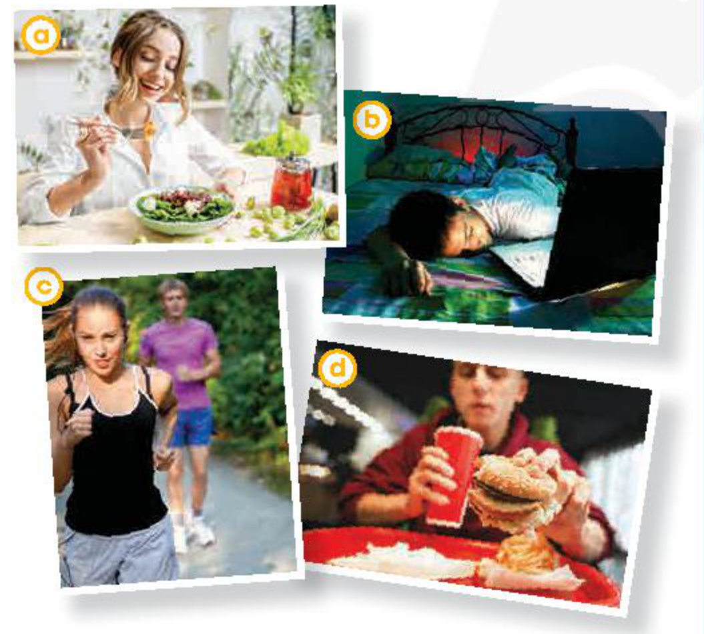
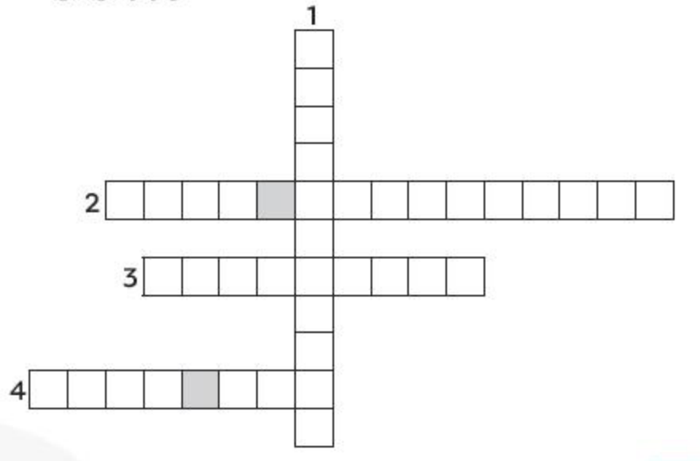
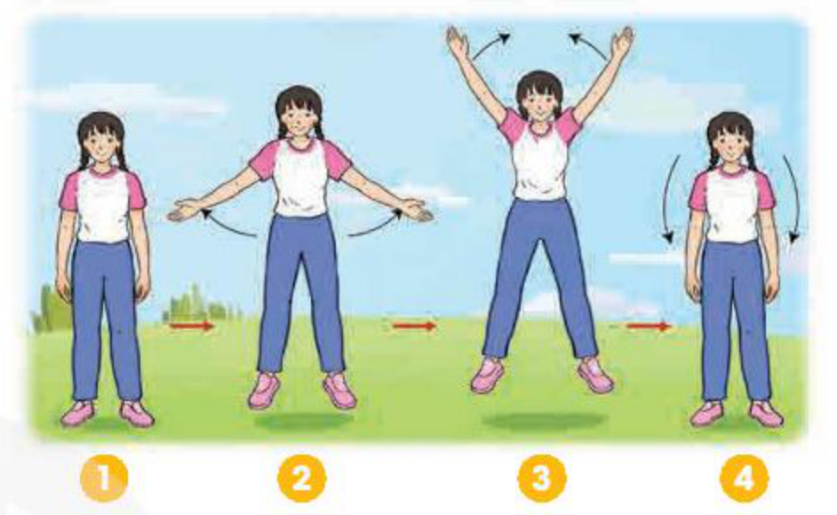
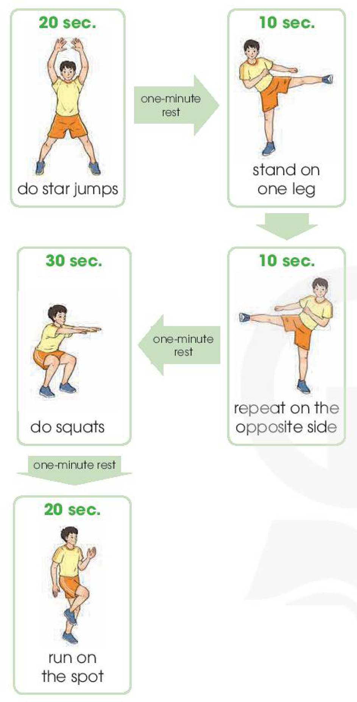

<!-- pdf:9 -->

# UNIT 1: A LONG AND HEALTHY LIFE

> **This unit includes:**
> - **LANGUAGE:**
>   - **Pronunciation:** Strong and weak forms of auxiliary verbs
>   - **Vocabulary:** Words and phrases related to health and fitness
>   - **Grammar:** Past simple vs. Present perfect
> - **SKILLS:**
>   - **Reading:** Reading for main ideas and specific information in an article about living a long and healthy life
>   - **Speaking:** Giving instructions for an exercise routine
>   - **Listening:** Listening for main ideas and specific information in a TV chat show about food and health
>   - **Writing:** Writing a short message
> - **COMMUNICATION AND CULTURE / CLIL:**
>   - **Everyday English:** Offering help and responding
>   - **CLIL:** Bacteria and viruses
> - **PROJECT:**
>   - Designing a poster about a healthy habit

## I. GETTING STARTED

**A healthy lifestyle**

**1. Listen and read.**

**Mark:** Hi, Nam!

**Nam:** Hi, Mark! Long time no see. How are you?

**Mark:** I'm fine, thanks, but you look so fit and healthy! Have you started **working out** again?

**Nam:** Yes, I have. I've also stopped eating fast food and **given up** bad habits, such as staying up late.
<!-- term: bad habits -->
<!-- term: stay up late -->

**Mark:** I can't believe it! I thought you can't live without burgers and chips!

**Nam:** I know. I ate a lot of fast food, but now I prefer fresh fruits and vegetables.
<!-- ocr-ok: đã đối chiếu ảnh trang gốc, OCR đọc nhầm chữ I thành dấu | -->

**Mark:** So what happened?

**Nam:** Well, it was my grandfather. I visited him during my last summer holiday and have learnt a lot of important life lessons from him.

**Mark:** Really?

**Nam:** Yes. He's a wonderful person. He has just had his 90th birthday, but he's still full of **energy**!
<!-- term: full of energy -->

**Mark:** Amazing! How does he stay so active?

**Nam:** Well, he does exercise every morning, goes to bed early, and eats a lot of vegetables. We spent a lot of time together cooking, working in his garden, and walking in the parks. I've learnt from him that taking **regular** exercise and eating a **balanced** diet are the key to a long and healthy life.
<!-- term: regular exercise -->
<!-- term: balanced diet -->

<!-- pdf:10 -->

**2. Read the conversation again and decide whether the following statements are true (T) or false (F).**

| | T | F |
| --- | --- | --- |
| 1. Nam has always had healthy habits. | | |
| 2. He has learnt the importance of exercise and healthy food. | | |
| 3. Nam's grandfather goes to sleep early, exercises every day, and eats healthily. | | |

**3. Fill in the blanks to make phrases from 1 with the following meanings.**

| | Phrases | Meanings |
| --- | --- | --- |
| **1.** | full of \_\_\_\_\_\_\_ | having the strength and enthusiasm we need for physical or mental activity |
| **2.** | bad \_\_\_\_\_\_\_ | things we often do that are not good for our health |
| **3.** | \_\_\_\_\_\_\_ exercise | physical or mental activity that we do frequently to stay healthy |
| **4.** | \_\_\_\_\_\_\_ diet | the correct types and amounts of food that we need to stay healthy |
<!-- term: full of energy -->
<!-- term: bad habits -->
<!-- term: regular exercise -->
<!-- term: balanced diet -->
<!-- ocr-ok: đã đối chiếu ảnh trang gốc, OCR bỏ sót chữ full of và bad trong khung điền từ -->

**4. Complete the text based on the conversation in 1. Use the correct forms of the verbs in brackets.**

In the past, Nam (1. eat) \_\_\_\_\_\_\_ fast food and often stayed up late. But he (2. start) \_\_\_\_\_\_\_ eating healthy food and (3. give) \_\_\_\_\_\_\_ up bad habits. He has changed his lifestyle since he (4. visit) \_\_\_\_\_\_\_ his grandfather, who (5. just, celebrate) \_\_\_\_\_\_\_ his 90th birthday.
<!-- term: stay up late -->

## II. LANGUAGE

### Pronunciation

**Strong and weak forms of auxiliary verbs**

**Remember!**

- Auxiliary verbs at the beginning of *Yes/No* questions do not receive stress and are pronounced in their weak forms.
- At the end of short answers, they often receive stress and are pronounced in their strong forms.

**1. Listen and repeat. Pay attention to the strong and weak forms of the auxiliary verbs. Then practise saying them.**

| Weak forms | Strong forms | Weak forms | Strong forms |
| --- | --- | --- | --- |
| Do you ...? /də/ | I do. /duː/ | Could we ...? /kəd/ | We could. /kʊd/ |
| Does she ...? /dəz/ | She does. /dʌz/ | Were they ...? /wə/ | They were. /wɜː/ |
| Can I ...? /kən/ | You can. /kæn/ | Has he ...? /həz/ | He has. /hæz/ |
<!-- ocr-ok: đã đối chiếu ảnh trang gốc, OCR không nhận diện chính xác kí hiệu phiên âm IPA trong bảng -->

**Mark:** *Have* (/həv/) you started working out again?

**Nam:** Yes, I *have* (/hæv/).
<!-- ocr-ok: đã đối chiếu ảnh trang gốc, OCR đọc nhầm I thành | và không nhận diện IPA /hæv/ -->

**Mark:** *Was* (/wəz/) it your grandfather who taught you?
<!-- ocr-ok: đã đối chiếu ảnh trang gốc, OCR đọc nhầm Was thành WOs và không nhận diện IPA /wəz/ -->

**Nam:** Yes, it *was* (/wɒz/).
<!-- ocr-ok: đã đối chiếu ảnh trang gốc, OCR không nhận diện chính xác kí hiệu phiên âm IPA -->

**2. Work in pairs. Read these sentences out loud. Pay attention to the strong and weak forms of the auxiliary verbs. Then listen and check.**

1. *Does* she exercise? – Yes, she *does*.
2. *Were* you eating healthily? – Yes, I *was*.
3. *Do* you eat vegetables? – Yes, I *do*.
4. *Can* he get up early? – Yes, he *can*.

<!-- pdf:11 -->

### Vocabulary

**Health and fitness**

**1. Match each word (1–5) with its meaning (a–e).**

| Words | Meanings |
| --- | --- |
| 1. **treatment** (n) | a. pieces of flesh in our body that allow the movement of our arms, legs, etc. |
| 2. **strength** (n) | b. something that helps to cure an illness or injury |
| 3. **muscles** (n) | c. the quality of being physically strong |
| 4. **suffer** (from) (v) | d. to have a health problem |
| 5. **examine** (v) | e. to look at someone's body carefully to find out if there is a health problem |
<!-- ocr-ok: đã đối chiếu ảnh trang gốc, OCR bỏ sót mục 5 examine (v) trong khung hình bên phải -->

**2. Complete the following sentences using the correct forms of the words in 1.**

1. The doctor \_\_\_\_\_\_\_ her carefully, but could not find anything wrong.
2. He is receiving \_\_\_\_\_\_\_ for his health problem.
3. Regular exercise can help you improve your muscle \_\_\_\_\_\_\_.
4. To build your \_\_\_\_\_\_\_, you can try lifting weights.
5. Nam can't sleep well. He is \_\_\_\_\_\_\_ stress.
<!-- ocr-ok: đã đối chiếu ảnh trang gốc, OCR ghép chữ câu 1 và câu 4 -->

### Grammar

**Past simple vs. Present perfect**

**Remember!**

- We use the past simple to describe:
  - something that started and finished in the past.
    *Example:* You *did* a great job yesterday.
  - something that was completed in the past (often used with a time phrase).
    *Example:* We *lived* in Ha Noi when I was little. Now we live in Hai Phong.
- We use the present perfect to describe:
  - something that started in the past, and is still happening now (often used with *since*, *for*, *so far*).
    *Example:* You *have done* a great job so far.
  - something that was completed in the very recent past (often used with *just* or *recently*).
    *Example:* We *have just moved* to Hai Phong.
<!-- term: Past simple -->
<!-- term: Present perfect -->

<!-- pdf:12 -->

**1. Put the verbs in brackets in either the past simple or the present perfect.**

1. He (see) \_\_\_\_\_\_\_ the doctor yesterday.
2. She (suffer) \_\_\_\_\_\_\_ from a serious headache, but after treatment, she felt better.
3. Our living conditions (improve) \_\_\_\_\_\_\_ over the last few decades. Now people live much better.
4. The doctor (just, examine) \_\_\_\_\_\_\_ her. Fortunately, the treatment is working.

**2. Work in pairs. Talk about what you do to keep fit and healthy. Use the past simple and the present perfect.**

*Example:* I *have exercised* regularly for a year. I *went* swimming last weekend.

## III. READING

**How to live a long and healthy life**

**1. Work in pairs. Look at the photos and discuss the questions.**

*Which photos show healthy habits? Which ones show unhealthy habits? Why?*

**2. Read the article. Solve the crossword with words and phrases from it.**

**DOWN**
1. (Section A, noun) the things from which something is made

**ACROSS**
2. (First paragraph before Section A, noun phrase) the number of years that a person is likely to live
3. (Section A, noun) things to keep a living thing alive and help it grow
4. (Section B, phrasal verb) do physical exercise

**Life expectancy** has generally increased over the past few decades, and some people enjoy a longer and healthier life than others. One possible explanation is that they have healthy lifestyle habits. So how can you develop these habits?

A. \_\_\_\_\_\_\_
Start by looking at food labels, paying attention to **ingredients** and **nutrients**, such as vitamins and minerals. Avoid having food with too much salt or sugar, such as fast food. Furthermore, add more fresh fruits and vegetables to your diet, and remember to eat a big breakfast and a small dinner.

B. \_\_\_\_\_\_\_
If you have not been very active, start exercising slowly, but **regularly**. To begin with, choose the type of exercise that is suitable for you. Then, start slowly, for example, by doing exercise for only 5 to 10 minutes a day. When your body is ready for more exercise, you can **work out** longer. Finally, exercise regularly to always keep your body fit and your mind happy.

C. \_\_\_\_\_\_\_
A good night's sleep is very important. Before you go to bed, avoid having coffee or energy drinks. Exercise can help you have a better sleep, but avoid exercising right before bedtime. Never use your mobile phone or laptop in bed and turn off all your electronic devices at least 30 minutes before you go to bed. Their screens give off blue light that can prevent you from sleeping well. Finally, if you still can't fall asleep, do something repetitive or listen to some soft music to relax before trying to sleep again.

<!-- pdf:13 -->

**3. Read the article again. Match the sections (A–C) with the headings (1–5) below. There are TWO extra headings.**

1. Eat better
2. Exercise regularly
3. Go to bed earlier
4. Develop healthy habits
5. Sleep well

**4. Read the article again. Complete the diagrams with information from the text. Use no more than TWO words for each gap.**

| A | B | C |
| --- | --- | --- |
| - Study food labels - Avoid too much salt or sugar - Add fresh fruits and vegetables - Eat a big (1) \_\_\_\_\_\_\_ | Choose (2) \_\_\_\_\_\_\_ exercise ↓ Start slowly ↓ Work out longer ↓ Exercise (3) \_\_\_\_\_\_\_ | Before bed: - Avoid having coffee or (4) \_\_\_\_\_\_\_ - Turn off (5) \_\_\_\_\_\_\_ ↓ Unable to sleep: do something repetitive or listen to music |
<!-- ocr-ok: đã đối chiếu ảnh trang gốc, sơ đồ 3 cột A, B, C hoàn thành từ bài đọc -->

**5. Work in pairs. Discuss the following questions.**

*Do you find the advice in the article useful? Have you tried following any of the suggestions above?*

## IV. SPEAKING

**Giving instructions for an exercise routine**

**1. Look at the diagram. Match the two parts of each sentence to complete the instructions.**

To do **star jumps** **properly**, you should follow four steps.

| | |
| --- | --- |
| 1. To begin with, | a. jump back to your starting position and repeat. |
| 2. Then, | b. stand with your arms down at your sides and your feet slightly apart. |
| 3. As you jump, | c. open your legs wider than your shoulders and move your arms out, creating a star shape while in the air. |
| 4. Finally, | d. jump with your feet apart and your arms spread out. |
<!-- ocr-ok: đã đối chiếu ảnh trang gốc, OCR bỏ sót số 1-4, chữ cái a-d và đọc nhầm apart and thành apar bid -->

**Tips**

To give instructions, you should:
- start by introducing the process.
  *Example:* To do **press-ups** properly, you should follow three steps. / You can develop your arm muscles by doing some press-ups.
- sequence the steps, using linking words or phrases (e.g. *first*, *second*, *next*, *after that*, *as/when/while*, *finally*).
  *Example:* First, lie on your stomach with your hands under your shoulders. Next, push up with your arms to lift your upper body.
- give one direction at a time.

<!-- pdf:14 -->

**2. Look at the 'How to burn fat' exercise. Fill in each blank with ONE word to complete the first part of the instructions.**

You can burn fat by doing this simple exercise routine. (1) \_\_\_\_\_\_\_, do star jumps for 20 seconds. (2) \_\_\_\_\_\_\_, take a one-minute rest. (3) \_\_\_\_\_\_\_, stand on one leg for 10 seconds ...

**3. Work in pairs. Practise giving the instructions for the rest of the exercise routine in 2.**

**4. Work in groups. Take turns demonstrating the exercise routine and giving instructions to the rest of your group so they can do the exercise with you.**

## V. LISTENING

**Food and health**

**1. Choose the correct meanings of the underlined word and phrase.**

1. Regular exercise can increase your **fitness**.
   - A. being healthy and physically strong
   - B. being intelligent
2. To stay healthy, you should **cut down on** sugar and fast food.
   - A. increase
   - B. reduce

**2. Listen to a TV chat show about teen health. Circle the topic of the show.**

- A. Health products and fitness programmes for young people
- B. Food for skincare and brain development
- C. Healthy food for young people
- D. Food that can replace exercise

**3. Listen again. Tick (✓) the food which is recommended in the talk.**

| Good for skin & brain | Good for bones & muscles |
| --- | --- |
| \_\_\_ food with a lot of sugar \_\_\_ white rice \_\_\_ yoghurt \_\_\_ lemons \_\_\_ green vegetables | \_\_\_ eggs \_\_\_ fish \_\_\_ butter \_\_\_ carrots \_\_\_ potato chips |
<!-- ocr-ok: đã đối chiếu ảnh trang gốc, OCR đọc nhầm eggs và potato chips trong bảng -->

<!-- pdf:15 -->

**4. Listen again and complete the sentences. Use ONE word for each answer.**

1. Teens should avoid food that contains a lot of \_\_\_\_\_\_\_.
2. Green vegetables can help teens \_\_\_\_\_\_\_ better.
3. Food such as eggs and fish can help teens become taller and \_\_\_\_\_\_\_.
4. Eating a healthy diet can't replace \_\_\_\_\_\_\_.

**5. Work in groups. Make a healthy meal plan for one day and explain why you have selected the foods.**

## VI. WRITING

**A short message**

**1. Below is a short message. Put the parts in the correct order.**

- A. Can you bring some fresh mangos from your garden? We'll need them for one of the **recipes**.
- B. Hi Linda,
- C. How about coming to my house this Sunday? We can try some recipes from the book.
- D. Thanks for lending me your book about healthy cooking. It's great!
- E. See you soon,
- F. Mai

**Tips**

We write short messages in the form of emails, notes, postcards, etc. A short message usually has the following structure:
1. Greeting: *Example: Dear/Hi Mary,*
2. Main body: (usually one line or paragraph for each of the points you want to make).
   You can invite people to events, make suggestions, remind people about things, accept invitations, ask for information, etc. Remember to use clear and simple language, and short sentences.
3. Closing: *Example: See you soon, Write back soon.*

**2. Write a sentence to express each message below. Begin with the words given.**

1. You want to invite someone to your birthday party next week.
   → Why don't *you come to my birthday party next week*?
2. You want to suggest that someone should join the reading club with you.
   → How about \_\_\_\_\_\_\_?
3. You want to remind someone that he or she should return a book to the library.
   → Don't forget to \_\_\_\_\_\_\_.
4. You want to accept an invitation to your friend's birthday party.
   → I'm pleased to \_\_\_\_\_\_\_.
5. You want to ask if you have to dress formally for the party.
   → Do \_\_\_\_\_\_\_?

<!-- pdf:16 -->

**3. Write a short message (35–45 words) to reply to the one in 1. Use the tips in 1 and the expressions in 2 to help you.**

In your message, you should:
- thank for and accept the invitation.
- ask what time you should go to Mai's place or suggest a time to meet.
- ask if you need to bring or buy anything else in advance.

## VII. COMMUNICATION AND CULTURE / CLIL

### Everyday English

*Offering help and responding*

**1. Listen and complete the conversation with the expressions in the box. Then practise it in pairs.**

| A. Can I help you with that | B. Is there anything else I can do for you |
| --- | --- |
| C. Thank you very much | D. Thanks, but I think I'm fine |

**Trainer:** Good morning. (1) \_\_\_\_\_\_\_?

**Tam:** Oh, please. I want to change the speed on this treadmill, but I don't know how.

**Trainer:** You can just press this button. Here, let me show you.

**Tam:** Oh, it's working. (2) \_\_\_\_\_\_\_.

**Trainer:** (3) \_\_\_\_\_\_\_?

**Tam:** (4) \_\_\_\_\_\_\_ now.

**Trainer:** Great! Have a good **workout**.
<!-- term: Offering help and responding -->

**2. Work in pairs. Use the model in 1 to make similar conversations for these situations. One of you is Student A, the other is Student B. Use the expressions below to help you.**

1. Student A is a PE teacher; Student B is a student. Student B is trying to do an exercise routine, and Student A is offering help.
2. Student B is a supermarket assistant; Student A is a customer. Student A is trying to find some healthy foods for his/her family, and Student B is offering help.

| **Useful expressions** | |
| --- | --- |
| **Offering help** | **Responding to offers** |
| Can I give you a hand? Can I help you with ...? Let me help you with ... Is there anything (else) I can do for you? | That's very kind/nice of you. Thanks for your help. Thanks, but I think I'm fine. |
<!-- term: Offering help and responding -->
<!-- ocr-ok: đã đối chiếu ảnh trang gốc, OCR bỏ sót dòng tiêu đề Useful expressions và đọc nhầm I thành | -->

<!-- pdf:17 -->

### CLIL

**1. Read the text and complete the comparison table below.**

**BACTERIA AND VIRUSES**

Both **bacteria** and **viruses** can cause **diseases**, but they are different in many ways.

Bacteria are living **organisms**. They can live in many places, such as soil, water, and the human body. The smallest bacteria are about 0.4 micron\* in **diameter**. Some bacteria in our bodies are helpful, but some can cause infectious diseases such as **tuberculosis**\*\* or **food poisoning**. **Antibiotics** are often used to treat **infections** caused by bacteria.

*\* 1 metre = 1 million microns*
*\*\* a serious lung disease*
<!-- ocr-ok: đã đối chiếu ảnh trang gốc, OCR ghép chữ 1metre và 1million -->

Viruses are tiny **germs** that cause diseases in people, animals, and plants. They can cause a range of **illnesses**, from the common cold or the flu to more serious diseases such as AIDS and Covid-19. As they are very small (0.02 to 0.25 micron), viruses can get into our bodies easily. They are not living things, so they need to enter our bodies to become active. Then, they start to grow and cause the infected cell to make millions of copies of the **virus**. Vaccines are often used to prevent the **spread** of diseases caused by viruses.

| | Bacteria | Viruses |
| --- | --- | --- |
| 1. Living or not when entering the human body? | | |
| 2. Which is smaller? | | |
| 3. Examples of diseases they can cause | | |
| 4. How to treat/prevent diseases caused by them? | | |

**2. Discuss in pairs. What would you say to these people?**

- **Anne:** I'm buying lots of antibiotics because I heard that they can treat Covid-19.
- **Joe:** Bacteria are so dangerous. Scientists should find a way to get rid of them all!

## VIII. LOOKING BACK

### Pronunciation

**Circle the common pronunciation of the underlined auxiliary verbs. Then listen and check. Practise saying the conversations in pairs.**

1. **Doctor:** *Have* you been **examined** yet?
   - A. /hæv/
   - B. /həv/
   **Nam:** Yes, I *have*.
   - A. /hæv/
   - B. /həv/
2. **Trainer:** *Can* you do this exercise routine?
   - A. /kæn/
   - B. /kən/
   **Nam:** Yes, I *can*.
   - A. /kæn/
   - B. /kən/
<!-- ocr-ok: đã đối chiếu ảnh trang gốc, OCR không nhận diện chính xác kí hiệu phiên âm IPA -->

### Vocabulary

**Fill in each gap with ONE word. Use the words you have learnt in this unit.**

1. We need to (1) \_\_\_\_\_\_\_ down on fast food if we don't want to (2) \_\_\_\_\_\_\_ from heart diseases in the future.
2. (3) \_\_\_\_\_\_\_ out regularly and having a (4) \_\_\_\_\_\_\_ diet are the key to a healthy lifestyle.
3. Antibiotics are not used in the (5) \_\_\_\_\_\_\_ of diseases caused by viruses.
<!-- ocr-ok: đã đối chiếu ảnh trang gốc, OCR ghép chữ và đọc sai số thứ tự chỗ trống (1)-(5) -->

<!-- pdf:18 -->

### Grammar

**Circle the underlined part that is incorrect in each of the following sentences. Then correct it.**

1. My grandfather *has gone* (A) to hospital last month. He *is* (B) fine now.
2. Life expectancy *has been* (A) very low *in* (B) the past.
3. My father used to do a lot of *exercise* (A) *since* (B) he was young.
4. I *was* (A) ill last week, and *didn't do* (B) much exercise so far this week.

## IX. PROJECT

**HEALTHY HABITS POSTERS**

**Work in groups. Design a poster to help teens to develop a healthy habit (e.g. having a balanced diet, taking regular exercise, protecting themselves against certain diseases).**

**Present your poster to the class. Use these questions as cues for your presentation.**

- What is the healthy habit?
- What are the benefits of this habit?
- How can we develop this habit?

### Now I can ...

- identify and pronounce strong and weak forms of auxiliary verbs.
- understand and use words and phrases related to health and fitness.
- use the past simple and the present perfect correctly.
- read for main ideas and specific information in an article about living a long and healthy life.
- give instructions for an exercise routine.
- listen for main ideas and specific information in a TV chat show about food and health.
- write a short message.
- offer help and respond to offers.
- identify the main differences between bacteria and viruses.
- design a poster about a healthy habit and give a poster presentation about it.

## 📷 Danh mục hình minh hoạ

| Mã hình | Trang PDF | Trang sách | Chú thích / Mô tả |
| --- | --- | --- | --- |
| H11-tieng_anh-u01-01 | 12 | 11 | Bốn bức ảnh minh hoạ thói quen sinh hoạt lành mạnh và chưa lành mạnh ở mục Reading 1: (a) ăn rau trộn lành mạnh, (b) thức khuya dùng máy tính trên giường, (c) chạy bộ ngoài trời, (d) ăn đồ ăn nhanh và uống nước ngọt |
| H11-tieng_anh-u01-02 | 12 | 11 | Khung ô chữ (*crossword*) gồm 1 cột dọc (*Down*: 1) và 3 hàng ngang (*Across*: 2, 3, 4) ở mục Reading 2 |
| H11-tieng_anh-u01-03 | 13 | 12 | Sơ đồ minh hoạ 4 bước thực hiện động tác nhảy dang tay chân (*star jumps*) từ bước 1 đến bước 4 ở mục Speaking 1 |
| H11-tieng_anh-u01-04 | 14 | 13 | Sơ đồ quy trình bài tập thể dục đốt mỡ (*How to burn fat*: *20 sec. do star jumps* → *one-minute rest* → *10 sec. stand on one leg* → *10 sec. repeat on the opposite side* → *one-minute rest* → *30 sec. do squats* → *one-minute rest* → *20 sec. run on the spot*) ở mục Speaking 2 |
