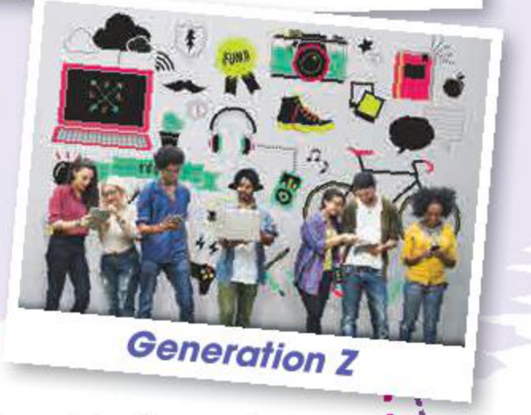
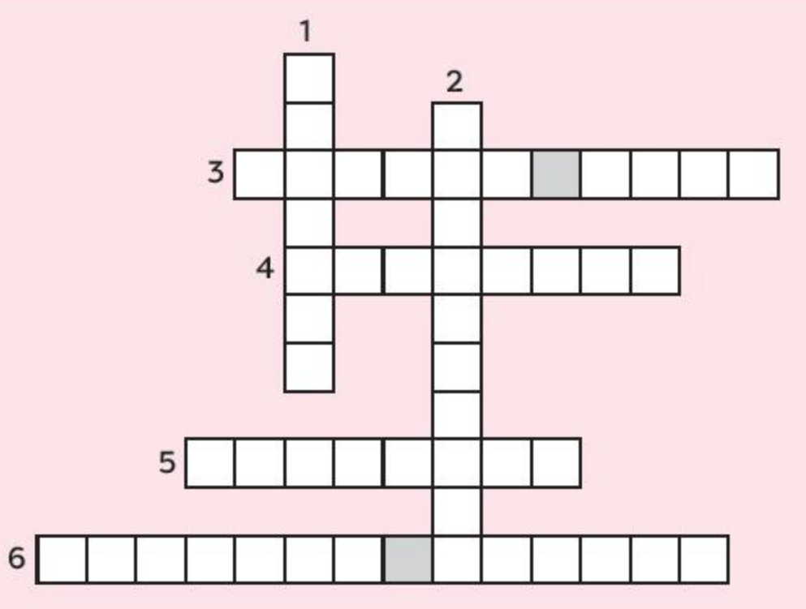

<!-- pdf:19 -->

# UNIT 2: THE GENERATION GAP

> **This unit includes:**
> - **LANGUAGE:**
>   - **Pronunciation:** Contracted forms
>   - **Vocabulary:** Words and phrases related to generational differences
>   - **Grammar:** Modal verbs: *must*, *have to*, and *should*
> - **SKILLS:**
>   - **Reading:** Reading for main ideas and specific information in an article about different generations
>   - **Speaking:**
>     - Talking about the different generations of the family
>     - Starting a conversation or discussion
>   - **Listening:** Listening for specific information in a conversation about family conflicts
>   - **Writing:** Writing an opinion essay about limiting teenagers' screen time
> - **COMMUNICATION AND CULTURE / CLIL:**
>   - **Everyday English:** Asking for and giving permission
>   - **Culture:** The generation gap in Asian American families
> - **PROJECT:**
>   - Carrying out a survey to find out generational differences in families

## I. GETTING STARTED

**What is a generation gap?**

**1. Listen and read.**

**Ms Hoa:** Good morning, class. Today, we'll talk about the **generation gap**. So, what is the generation gap?

**Mark:** Well, I think it's the difference in beliefs and behaviours between young and older people.

**Ms Hoa:** You're right, Mark. So, is there a generation gap in your family?

**Mark:** Not really, Ms Hoa. I live in a **nuclear family** with my parents and brother. We understand each other quite well though we still argue over small things.

**Ms Hoa:** Right. We can't avoid daily **arguments**. What about you, Mai?

**Mai:** Well, I live with my **extended family**, and I have to learn to accept the differences between the generations.

**Ms Hoa:** That's a good point. Can you give us an example?

**Mai:** Well, my grandparents hold traditional **views** about male jobs and gender roles. For example, my grandfather wants my brother to be an engineer, but my brother hopes to become a musician. And my grandmother thinks women have to do all the housework.
<!-- term: traditional view -->

**Ms Hoa:** How about your parents? Do they share your grandparents' views?

**Mai:** No, they don't. They think that we should follow our dreams. They give us advice, but never force us to follow in their footsteps.
<!-- term: follow in their footsteps -->

<!-- pdf:20 -->

**Ms Hoa:** Thank you, Mai, for sharing your **experiences**. You must respect your parents and grandparents, but you should also express your opinion. Now let's continue our discussion with ...

**2. Read the conversation again. Tick (✓) the true information about Mark and Mai.**

| | Mark | Mai |
| --- | --- | --- |
| 1. has some arguments over small things with family members. | | |
| 2. lives with grandparents who have traditional views. | | |
| 3. lives in a nuclear family. | | |
| 4. has parents who don't force their children to follow in their footsteps. | | |
<!-- term: follow in their footsteps -->

**3. Find words or phrases in 1 that have the following meanings.**

| Meanings | Words / Phrases |
| --- | --- |
| 1. all people who were born at about the same time | \_\_\_\_\_\_\_ |
| 2. a family that consists of a father, a mother, and children | \_\_\_\_\_\_\_ |
| 3. a family that includes not only parents and children but also uncles, aunts, grandparents, etc. | \_\_\_\_\_\_\_ |
| 4. disagreements about things | \_\_\_\_\_\_\_ |

**4. Choose the modal verbs used in 1 to complete the sentences.**

1. Mai lives with her extended family, and she *has to* / *should* learn to accept the differences between the generations.
2. Mai's grandmother thinks women *have to* / *should* do all the housework.
3. Mai's parents believe that children *must* / *should* follow their dreams.
4. Ms Hoa thinks that children *have to* / *must* respect their parents and grandparents.

## II. LANGUAGE

### Pronunciation

**Contracted forms**

**1. Listen and repeat. Pay attention to the contracted forms in the following sentences. What are their full forms?**

1. Today, *we'll* talk about the generation gap.
2. *You're* right, Mark.
3. We *can't* avoid daily arguments.
4. *That's* a good point.
5. No, they *don't*.
6. Now *let's* continue our discussion with ...

**2. Listen and circle what you hear: contracted or full forms. Then practise saying these conversations in pairs.**

1. **A:** *What's* / *What is* the topic of today's discussion?
   **B:** *We'll* / *We will* talk about the generation gap.
2. **A:** *Don't you* / *Do you not* live with your grandparents?
   **B:** No, I *don't* / *do not*.
3. **A:** I'm not sure *who'll* / *who will* be the next presenter? Will you speak next?
   **B:** Yes, *I'll* / *I will*.

<!-- pdf:21 -->

### Vocabulary

**Generational differences**

**1. Match the words to make phrases that mean the following.**

| | | Meanings |
| --- | --- | --- |
| 1. traditional | a. **characteristics** | special qualities that belong to a group of people or things |
| 2. common | b. **conflict** | a disagreement between different generations |
| 3. generational | c. **values** | beliefs about what is important in the culture of a particular society |
| 4. cultural | d. **view** | a belief or an opinion that has existed for a long time without changing |
<!-- term: common characteristics -->
<!-- term: generational conflict -->
<!-- term: cultural values -->
<!-- term: traditional view -->

**2. Complete the sentences using the correct forms of the phrases in 1.**

1. We all have \_\_\_\_\_\_\_, and they can **influence** the way we treat other people.
2. When you live with your extended family, you have to deal with \_\_\_\_\_\_\_.
3. Each generation has its \_\_\_\_\_\_\_ that are **influenced** by social and economic conditions.
4. A \_\_\_\_\_\_\_ is that men are the breadwinners in the family.
<!-- term: generational conflict -->

### Grammar

**Modal verbs: *must*, *have to*, and *should***

**Remember!**

- We use *must* and *have to* to say it is necessary to do something at present.
  *Example:* Oh, it's 10 p.m. I *must* go home now. / I *have to* go home now.
- We use *have to* to talk about the past or future.
  *Example:* My grandmother *had to* do all household chores.
  We *will have to* accept these generational differences.
- When the speaker decides what is necessary, we use *must*. When someone else makes the decision, we use *have to*.
  *Example:* I *must* clean my room before my friend comes to stay with me.
  I *have to* clean my room every day. (*My mother forces me to do it.*)
- We use *mustn't* to express something we are not allowed to do.
  *Example:* You *mustn't* behave rudely towards other people.
- We use *don't have to* to say that something is not necessary.
  *Example:* They *don't have to* wear uniforms at the weekend.
- We use *should* or *shouldn't* to give advice, make a recommendation, or offer an opinion about what is right or wrong.
  *Example:* I think parents *should* **limit** their children's **screen time**.
<!-- term: Modal verbs: must, have to, and should -->

**1. Circle the correct answers to complete the sentences.**

1. You *must* / *mustn't* respect older people. You can learn some valuable lessons from them.
2. We *don't have to* / *have to* wear uniforms on weekdays. It's the rule at our school.
3. You *should* / *mustn't* ask your parents for permission if you want to colour your hair.
4. In the past, women *had to* / *must* do all housework. It was one of their duties.

<!-- pdf:22 -->

**2. Work in pairs. Are there any rules in your family or things that you or your parents think are necessary? Share them with your partner. Use *must*, *have to*, and *should*.**

*Example:*
**A:** I *have to* be back home by 9 p.m.
**B:** Really? I *don't have to*. But my parents think I *shouldn't* stay out after 10 p.m.

## III. READING

**Different generations**

**1. Work in pairs. Look at the photos. Discuss what you know about the generation in each picture (e.g. age, characteristics, interests, life experiences).**

**2. Read the article. Match the highlighted words with their meanings.**

Over the past two centuries, different generations were born and given different names. Each generation comes with its **characteristics**, which are largely influenced by the historical, economic, and social conditions of the country they live in. However, in many countries the following three generations have common characteristics.
<!-- term: common characteristics -->
<!-- ocr-ok: đã đối chiếu ảnh trang gốc, ảnh Generation Z nằm chèn bên phải đoạn đầu làm OCR cắt dòng -->

Generation X refers to the generation born between 1965 and 1980. When Gen Xers grew up, they **experienced** many social changes and developments in history. As a result, they are always ready for changes and prepared to work through changes. Gen Xers are also known as critical thinkers because they achieved higher levels of education than previous generations.
<!-- ocr-ok: đã đối chiếu ảnh trang gốc, OCR bị mất cột chữ bên phải bài đọc -->

Generation Y, also known as Millennials, refers to those born between the early 1980s and late 1990s. They are **curious** and ready to accept changes. If there is a faster, better way of doing something, Millennials want to try it out. They also **value** teamwork. When working in a team, Millennials welcome different points of view and ideas from others.
<!-- ocr-ok: đã đối chiếu ảnh trang gốc, OCR bị mất cột chữ bên phải bài đọc -->

Generation Z includes people born between the late 1990s and early 2010s, a time of great technological developments and changes. That is why Gen Zers are also called **digital natives**. They grew up online and never knew the world before digital and **social media**. They are very creative and able to experiment with platforms to suit their needs. Many Gen Zers are also interested in starting their own businesses and companies. They saw so many people lose their jobs, so they think it is safer to be your own boss than relying on someone else to **hire** you.
<!-- term: experiment -->
<!-- ocr-ok: đã đối chiếu ảnh trang gốc, OCR bị mất cột chữ bên phải bài đọc -->

Soon a new generation, labelled Gen Alpha, will be on the scene. Let's wait and see if we will notice the generation gap.
<!-- ocr-ok: đã đối chiếu ảnh trang gốc, OCR bị mất cột chữ bên phải bài đọc -->

| Highlighted words | Meanings |
| --- | --- |
| 1. **experienced** | a. to try or test new ideas or methods |
| 2. **curious** | b. went through |
| 3. **digital natives** | c. to employ |
| 4. experiment | d. wanting to know about something |
| 5. **hire** | e. people born in the era of technology |
<!-- term: experiment -->
<!-- ocr-ok: đã đối chiếu ảnh trang gốc, bảng nối từ trang 21 bị OCR bỏ sót cột phải -->

<!-- pdf:23 -->

**3. Read the article again and choose the best title.**

- A. The study of different generations
- B. Generational differences in different societies
- C. Characteristics of different generations

**4. Read the article again. Tick (✓) the characteristics of each generation according to the article.**

| | Generation X | Generation Y | Generation Z |
| --- | --- | --- | --- |
| 1. They enjoy working in a team with others. | | | |
| 2. They can use apps and digital devices in creative ways. | | | |
| 3. Critical thinking is one of their common characteristics. | | | |
| 4. Most of them plan to have their own businesses. | | | |
| 5. They are known for their **curiosity**. | | | |

**5. Work in groups. Discuss the following question.**

*Do you agree with the descriptions of each generation?*

## IV. SPEAKING

**Talking about different generations**

**1. Put the sentences (A–D) in order to complete the conversation. Then practise it in pairs.**

- A. Yes. My grandparents are over 60 now. They hold very traditional views about everything.
- B. I see. What about your parents?
- C. Yes, I do. I live with my grandparents, my parents, and my younger sister.
- D. That's interesting. Have you noticed any differences between the generations?

**Kevin:** Ly, do you live with your extended family?

**Ly:** (1) \_\_\_\_\_\_\_

**Kevin:** (2) \_\_\_\_\_\_\_

**Ly:** (3) \_\_\_\_\_\_\_

**Kevin:** (4) \_\_\_\_\_\_\_

**Ly:** Well, they're only in their 40s. I think they're quite open to new ways of thinking. I can share lots of things with my parents.

**Tips**

To start a conversation or discussion, you can:
- present the topic.
  *Example:* *Let's talk about ...*
- ask your partner for personal information related to the topic.
  *Example:* *Ly, do you live with your extended family? / Ly, what kind of family do you have?*
- ask for an opinion.
  *Example:* *Ly, do you think there are any differences between the generations of your family? / Ly, what do you think about your generation?*

<!-- pdf:24 -->

**2. Work in pairs. Talk about the different generations of your family. Use the model and tips in 1, and the ideas below to help you.**

*Suggested ideas:*
- be open to new ways of thinking
- have fixed ideas about the world
- want to make their own decisions
- hold traditional views about many issues
- not want big changes in life
- be good at using electronic devices

**3. Work in groups. Discuss the following question and then report to the whole class.**

*What are the most common **generation gaps** in your families?*

## V. LISTENING

**Family conflicts**

**1. Complete the following table about you. Work in pairs and compare your answers.**

| | Always | Sometimes | Never |
| --- | --- | --- | --- |
| 1. My parents complain about my clothes and hairstyle. | | | |
| 2. My parents let me colour my hair. | | | |
| 3. My parents **limit** the time I spend on electronic devices. | | | |
| 4. My parents take away my electronic devices after 9 p.m. | | | |
| 5. My parents control everything I do. | | | |

**2. Listen to a conversation between Kevin and Mai. Number the things they talk about in the order they are mentioned.**

| | Order |
| --- | --- |
| a. Kevin's parents limit his screen time. | \_\_\_\_\_\_\_ |
| b. Mai asks Kevin if he has any disagreements with his parents. | \_\_\_\_\_\_\_ |
| c. Mai is not allowed to colour her hair. | \_\_\_\_\_\_\_ |
| d. Mai's choice in clothes and hairstyle upsets her mother. | \_\_\_\_\_\_\_ |

**3. Listen to the conversation again and answer the following questions using no more than TWO words.**

1. What does Mai's mother keep complaining about?
2. Where doesn't Mai's mother allow her to wear tight jeans?
3. What does Kevin mainly use his smartphone and laptop for?
4. According to Mai, what might Kevin's parents worry about?
5. What time do Kevin's parents take away his smartphone and laptop?

**4. Work in groups. Discuss the following questions.**

*Do you agree with Mai's mother and Kevin's parents? Why/Why not?*

<!-- pdf:25 -->

## VI. WRITING

**An opinion essay about limiting teenagers' screen time**

**1. Work in pairs. Complete the notes using the sentences (A–D) in the box.**

- A. The gap between teenagers and parents may become wider.
- B. Too much screen time is bad for teenagers' health.
- C. Too much screen time can damage eyesight, reduce sleep time, and cause weight gain.
- D. Teenagers may think their parents are not fair to them.

**SHOULD PARENTS STRICTLY LIMIT TEENAGERS' SCREEN TIME?**

| SHOULD | SHOULDN'T |
| --- | --- |
| **Reason 1:** Teenagers have little time left for homework. **Examples/Facts/Explanations:** *Teenagers spend too much time watching online videos, checking social media, or playing computer games.* **Reason 2:** (1) \_\_\_\_\_\_\_ **Examples/Facts/Explanations:** (2) \_\_\_\_\_\_\_ | **Reason 1:** Quality of screen time is more important than quantity. **Examples/Facts/Explanations:** *Teenagers can learn a lot of useful knowledge and necessary skills through online educational games and videos.* **Reason 2:** (3) \_\_\_\_\_\_\_ **Examples/Facts/Explanations:** (4) \_\_\_\_\_\_\_ |

**2. Read an opinion essay and match each paragraph with the correct description.**

- A. Second reason for supporting this view with examples and facts
- B. Conclusion summarising the writer's point of view
- C. First reason for supporting this view with examples and facts
- D. Introduction to the issue and the writer's point of view

**Should parents strictly limit teenagers' screen time?**

1. \_\_\_\_\_\_\_ Many teenagers nowadays spend too much time on digital devices. I firmly believe that parents should strictly **limit** their **screen time** for two reasons.

2. \_\_\_\_\_\_\_ First of all, teenagers who spend a lot of time on screens are less likely to finish their homework. If parents limit their screen time, teenagers will have more time not only for learning, but also for outdoor activities.

3. \_\_\_\_\_\_\_ In addition, too much screen time is bad for teenagers' health. Looking at a computer or smartphone screen for a long time can damage their eyesight and cause headaches. Too much screen time may also lead to sleep and weight problems.

4. \_\_\_\_\_\_\_ In conclusion, I think that parents need to control the time their teenage children spend on digital devices. This will ensure that their children have time for homework and outdoor activities, and will protect children's health.

**3. Write an opinion essay (120–150 words) stating the opposite view.**

*Digital devices play an essential part in teenagers' lives nowadays. I strongly believe that parents should not strictly limit their children's screen time for the following reasons.*
*First of all,* \_\_\_\_\_\_\_.
*In addition,* \_\_\_\_\_\_\_.
*In conclusion,* \_\_\_\_\_\_\_.

<!-- pdf:26 -->

## VII. COMMUNICATION AND CULTURE / CLIL

### Everyday English

*Asking for and giving permission*

**1. Listen and complete the conversation with the expressions in the box. Then practise it in pairs.**

| A. Is it OK | B. I'm afraid not | C. Certainly | D. can I |
| --- | --- | --- | --- |

**Lan:** Mum, (1) \_\_\_\_\_\_\_ go to my friend's birthday party this Saturday evening?

**Lan's mother:** (2) \_\_\_\_\_\_\_. Whose birthday is it?

**Lan:** It's Mai's birthday, Mum. (3) \_\_\_\_\_\_\_ if I stay the night at her house after the party?

**Lan's mother:** Oh, (4) \_\_\_\_\_\_\_. You must come back home before 10 p.m. We're going to visit your grandparents early on Sunday morning.

**Lan:** OK, Mum. I'll be home before 10 p.m. then.
<!-- term: Asking for and giving permission -->

**2. Work in pairs. Use the model in 1 to make similar conversations for these situations. One of you is Student A, the other is Student B. Provide reasons for not giving permission. Use the expressions below to help you.**

1. Student A is a teenager; Student B is his/her parent. Student A is asking for permission to invite friends to a party. Student B can decide to give permission or not.
2. Student B is a teenager; Student A is his/her parent. Student B is asking for permission to colour his/her hair. Student A can decide to give permission or not.

| **Useful expressions** | | |
| --- | --- | --- |
| **Asking for permission** | **Giving permission** | **Refusing permission** |
| - (Please) Can I ...? - Do you mind if I (go) ...? - Would you mind if I (went) ...? - Is it OK if I (go) ...? | - Sure. - Of course you can. - No problem. - Please feel free to ... | - I'm afraid not. - No, please don't. - I'm afraid you can't. - I'm sorry, but that's not possible. |
<!-- term: Asking for and giving permission -->
<!-- ocr-ok: đã đối chiếu ảnh trang gốc, bảng Useful expressions 3 cột bị OCR bỏ sót -->

### Culture

**The generation gap in Asian American families**

**1. Read the text and complete the notes. Use no more than TWO words for each gap.**

For people in most cultures, the generation gap in their family is mainly about differences in musical tastes, career choices, and lifestyles. In Asian American families, however, the process of **adapting** to American culture makes the generation gap wider.

Naturally, children of Asian American immigrants **adapt** to American culture much faster than their parents. English quickly becomes their first language. They accept American **values** such as **individualism**, **freedom**, **honesty**, and competition. They also start to follow American traditions in their daily lives.

On the other hand, many first-generation Asian American parents fail to adapt to the new culture. They continue to use their native language. They keep practising their traditional lifestyle and old culture. They often try to force their children to follow their native country's cultural values, such as the importance of family, respect for the elders and the community.
<!-- term: cultural values -->

Due to their different attitudes to the new culture, Asian American children may have cultural values different from their parents' Asian cultural values. They may not do what their parents want them to do or what they are expected to do. As a result, Asian American parents may fail to have their children follow the family traditional values.

<!-- pdf:27 -->

| ASIAN AMERICAN CHILDREN | FIRST-GENERATION ASIAN AMERICAN PARENTS |
| --- | --- |
| - Adapt to American culture faster - Speak (1) \_\_\_\_\_\_\_ as their first language - Accept American values: individualism, freedom, honesty, and competition - Start to follow (2) \_\_\_\_\_\_\_ in their daily lives | - Fail to adapt to American culture - Use their (3) \_\_\_\_\_\_\_ language - Practise a traditional lifestyle and their old culture - Try to force children to follow native country's (4) \_\_\_\_\_\_\_: importance of family, respect for the elders and community |

**2. Work in groups. Discuss the following questions.**

*Do you think your family would experience the same generation gap if you moved to a Western country? Why/Why not?*

## VIII. LOOKING BACK

### Pronunciation

**Listen and circle what you hear: contracted or full forms. Practise saying these conversations in pairs.**

1. **A:** You (1) *mustn't* / *must not* be rude to your parents.
   **B:** Yes, Grandma. But my parents (2) *don't* / *do not* listen to me.
2. **A:** (3) *It's* / *It is* 11 o'clock. Have you done your homework yet?
   **B:** Yes, (4) *I've* / *I have*.

### Vocabulary

**Solve the crossword. Use the words or phrases you have learnt in this unit.**

**DOWN**
1. Lan lives in a \_\_\_\_\_\_\_ family that consists of her parents and younger sister.
2. The older \_\_\_\_\_\_\_ usually has more traditional views.

**ACROSS**
3. My father **limits** my \_\_\_\_\_\_\_. I can only use my laptop and smartphone to watch videos or check social media for two hours a day.
4. I live with my \_\_\_\_\_\_\_ family in a big house, and I'm very close not only to my parents, but also to my grandparents, aunt, and uncle.
5. Teenagers often come into \_\_\_\_\_\_\_ with their parents.
6. My sister is a true \_\_\_\_\_\_\_. She has used computers and smartphones since she was young and is very good at using them.

<!-- pdf:28 -->

### Grammar

**Choose the correct answers A, B, C or D to complete the following sentences.**

1. You \_\_\_\_\_\_\_ learn to keep your bedroom tidy. No one can clean it for you.
   - A. must
   - B. had to
   - C. mustn't
   - D. shouldn't
2. Fifty years ago, my grandmother \_\_\_\_\_\_\_ stay at home and do all housework. She couldn't go to school like her brothers.
   - A. must
   - B. had to
   - C. didn't have to
   - D. should
3. You \_\_\_\_\_\_\_ wear shorts to school. It's against the school rules.
   - A. should
   - B. have to
   - C. mustn't
   - D. don't have to
4. I think parents \_\_\_\_\_\_\_ compare their children to other's. They will become less confident in their abilities.
   - A. should
   - B. have to
   - C. must
   - D. shouldn't
5. My parents respect my choices. I \_\_\_\_\_\_\_ follow in their footsteps.
   - A. don't have to
   - B. mustn't
   - C. should
   - D. have to
<!-- term: follow in their footsteps -->

## IX. PROJECT

**GENERATIONAL DIFFERENCES AMONG US**

**Work in groups. Each member of your group should ask three people from different generations to complete the survey below.**

**These people could include:**
1) a classmate or brother/sister,
2) a mother/father, or someone of their generation,
3) a grandma/grandpa, or someone of their generation.

**Your presentation should summarise the survey results.**

| | Questions | Person 1 | Person 2 | Person 3 |
| --- | --- | --- | --- | --- |
| **1.** | *What is/are your favourite ...?* | | | |
| | music | | | |
| | clothes | | | |
| | TV programmes | | | |
| | hobbies | | | |
| | place to live | | | |
| **2.** | *Do you think there is a generation gap in your family? If yes, how do you deal with it?* | | | |

### Now I can ...

- identify and pronounce contracted forms correctly in sentences.
- understand and use words and phrases related to generational differences.
- use the modal verbs *must*, *have to*, and *should* correctly.
- read for main ideas and specific information in an article about different generations.
- talk about the different generations of my family, and start a conversation or discussion.
- listen for specific information in a conversation about family **conflicts**.
- write an opinion essay about **limiting** teenagers' screen time.
- ask for and give permission.
- understand the generation gap in Asian American families.
- carry out a survey to find out generational differences in families and give a group presentation about them.

## 📷 Danh mục hình minh hoạ

| Mã hình | Trang PDF | Trang sách | Chú thích / Mô tả |
| --- | --- | --- | --- |
| H11-tieng_anh-u02-01 | 22 | 21 | Hai bức ảnh minh hoạ Thế hệ X (*Generation X*) và Thế hệ Y (*Generation Y*) ở mục Reading 1 |
| H11-tieng_anh-u02-02 | 22 | 21 | Bức ảnh minh hoạ Thế hệ Z (*Generation Z*) gắn liền với các thiết bị số và ứng dụng trực tuyến ở mục Reading 1 |
| H11-tieng_anh-u02-03 | 27 | 26 | Khung ô chữ (*crossword*) gồm 2 cột dọc (*Down*: 1, 2) và 4 hàng ngang (*Across*: 3, 4, 5, 6) ở mục Looking Back – Vocabulary |
