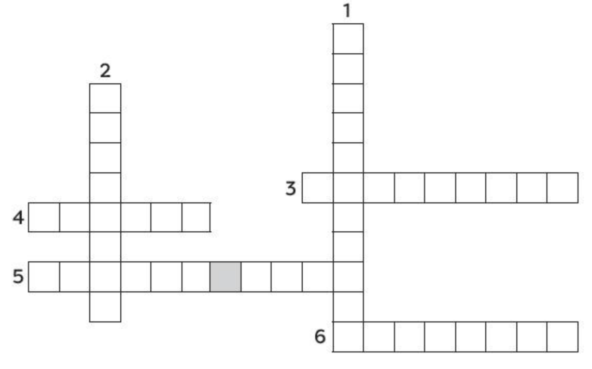
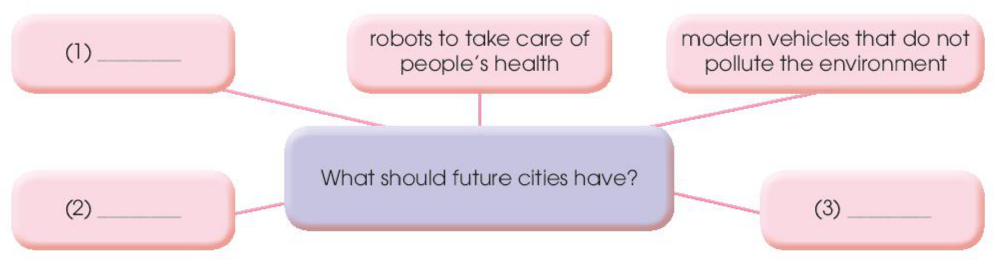

<!-- pdf:39 -->

# REVIEW 1

## I. LANGUAGE

### Pronunciation

**Listen and complete the conversation. Then underline the weak forms of the auxiliary verbs, circle the contracted forms, and mark the consonant-to-vowel linking with (‿). Practise saying the conversation in pairs.**

**A:** What's it like living (1) \_\_\_\_\_\_\_ skyscraper?

**B:** (2) \_\_\_\_\_\_\_ great. I (3) \_\_\_\_\_\_\_ enjoy the best views (4) \_\_\_\_\_\_\_ the city from my sofa.

**A:** (5) \_\_\_\_\_\_\_ have a balcony?

**B:** No, (6) \_\_\_\_\_\_\_. (7) \_\_\_\_\_\_\_ huge windows.

*Example:*
**A:** What's‿it like living (1) *in‿a* skyscraper?
<!-- ocr-ok: đã đối chiếu ảnh trang gốc, kí hiệu nối âm và khoanh tròn trong dòng Example làm OCR đọc nhầm -->

### Vocabulary

**1. Choose the correct answers A, B, C, or D to complete the following sentences.**

1. If you want to stay healthy, you should have a balanced diet and \_\_\_\_\_\_\_ regularly.
   - A. work out
   - B. take out
   - C. speak out
   - D. stand out
2. For a healthy diet, you should \_\_\_\_\_\_\_ sugar and eat more vegetables.
   - A. take on
   - B. cut down on
   - C. go on
   - D. cut with
3. Many experts believe that good \_\_\_\_\_\_\_ transport will solve traffic problems in big cities.
   - A. individual
   - B. private
   - C. public
   - D. national
4. People feel safe in this neighbourhood because \_\_\_\_\_\_\_ are installed everywhere.
   - A. smart cities
   - B. smartphones
   - C. smart cars
   - D. smart sensors
5. People of different generations often come into \_\_\_\_\_\_\_ with one another.
   - A. belief
   - B. conflict
   - C. agreement
   - D. support
6. My brother is a true \_\_\_\_\_\_\_. He grew up with technology, and started using a computer at an early age.
   - A. curious boy
   - B. critical thinker
   - C. digital native
   - D. book lover

<!-- pdf:40 -->

**2. Solve the crossword. Use words and phrase you have learnt in Units 1, 2, and 3. The first letters are given to help you.**

**DOWN**
1. Hong Kong aims to replace the old high-rise buildings with sustainable s\_\_\_\_\_\_\_.
2. The high cost of living is a problem for many city d\_\_\_\_\_\_\_.

**ACROSS**
3. Thanks to the new t\_\_\_\_\_\_\_, his health has improved quickly.
4. It is important to pass cultural v\_\_\_\_\_\_\_ from one generation to the next.
5. Many parents limit their children's s\_\_\_\_\_\_\_ to less than two hours per day.
6. If you want to build up your muscle s\_\_\_\_\_\_\_, you need to lift weights.

### Grammar

**1. Complete the sentences with the correct forms of the verbs in brackets.**

1. My mother (take up) \_\_\_\_\_\_\_ aerobics ten years ago.
2. The government (just, decide) \_\_\_\_\_\_\_ to increase taxes on fast food.
3. I (win) \_\_\_\_\_\_\_ several races since I started a new workout routine.
4. The idea of smart cities (start) \_\_\_\_\_\_\_ in the 21st century.
5. So far, more than 70 million people (receive) \_\_\_\_\_\_\_ vaccines to build protection against the virus.
6. I (already, show) \_\_\_\_\_\_\_ my grandmother how to use her new smartphone.

**2. Choose the correct words or phrases.**

1. You look so *angry* / *angrily*. What's wrong?
2. *I think* / *I'm thinking* of taking up yoga. I feel a bit *stressed* / *stress* these days.
3. *Do you remember* / *Are you remembering* Ms Wilson? She's a great yoga instructor.
4. The traffic *gets* / *is getting* worse. What *do you think* / *are you thinking* we should do?

**3. Choose the correct answers A, B, C, or D to complete the following sentences.**

1. If you want to maintain a healthy weight, you \_\_\_\_\_\_\_ have snacks between meals.
   - A. shouldn't
   - B. should
   - C. must
   - D. don't have to
2. I \_\_\_\_\_\_\_ strictly follow the doctor's instructions if I want to get better quickly.
   - A. shouldn't
   - B. must
   - C. can
   - D. don't have to
3. The government \_\_\_\_\_\_\_ improve the infrastructure of big cities to boost the economy.
   - A. mustn't
   - B. doesn't have to
   - C. should
   - D. didn't have to
4. People living in high-rise buildings \_\_\_\_\_\_\_ obey the safety rules and regulations strictly.
   - A. shouldn't
   - B. mustn't
   - C. may
   - D. have to
5. Lots of women in the past \_\_\_\_\_\_\_ stay at home, look after their children, and do all housework.
   - A. must
   - B. should
   - C. had to
   - D. have to
6. My parents respect my career choice, so I \_\_\_\_\_\_\_ follow in their footsteps.
   - A. mustn't
   - B. don't have to
   - C. should
   - D. shouldn't

<!-- pdf:41 -->

## II. SKILLS

### Listening

**1. Listen to a talk about life expectancy. Put the information in the order you hear it.**

- \_\_\_\_ A. Getting access to better medical care
- \_\_\_\_ B. Understanding age-related diseases better
- \_\_\_\_ C. Giving facts about life expectancy in some countries
- \_\_\_\_ D. Understanding the importance of good health

**2. Listen again and choose the correct answers A, B, or C.**

1. What is the life expectancy in many of the richest countries?
   - A. More than 80.
   - B. Less than 80.
   - C. More than 85.
2. What was the life expectancy in Japan in 2022?
   - A. Over 94.
   - B. About 84.
   - C. Over 85.
3. According to the speaker, what is the first reason for the increased life expectancy?
   - A. People get access to better food.
   - B. Better medical care is available.
   - C. People live in a better environment.
4. What do people do when they realise the importance of good health?
   - A. They continue unhealthy habits such as smoking and drinking.
   - B. They stop doing things that are bad for their health.
   - C. They ignore what they eat or drink every day.
5. What is the benefit of understanding age-related diseases better?
   - A. People can live as long as they want.
   - B. People can treat their diseases.
   - C. People can take better care of themselves.

### Speaking

**1. Work in pairs. Discuss what future cities should have so that city dwellers can live a long and healthy life. Fill in the diagram.**

**What should future cities have?**

- (1) \_\_\_\_\_\_\_
- robots to take care of people's health
- modern vehicles that do not pollute the environment
- (2) \_\_\_\_\_\_\_
- (3) \_\_\_\_\_\_\_
<!-- ocr-ok: đã đối chiếu ảnh trang gốc, OCR đọc đứt chữ people's và pollute trong sơ đồ -->

**2. Work in groups. Compare your diagrams. Discuss which is the most important thing that will help people to live a long and healthy life in the cities of the future.**

<!-- pdf:42 -->

### Reading

**1. Read the text. Match the headings (1–3) with the paragraphs (A–C).**

| 1. Comparing to others | 2. Lack of understanding | 3. Lack of interaction |
| --- | --- | --- |

In most cultures, there is a generation gap between parents and their children. There are many reasons for this gap. Below are three of them.

A. \_\_\_\_\_\_\_
As each generation is strongly influenced by changes in society, parents and children may see the world differently. In addition, different lifestyles make it difficult for parents and their children to fully understand each other's way of thinking. Many adult children even cut all ties with their parents.

B. \_\_\_\_\_\_\_
Busy work and school schedules often prevent parents and children from spending time together. After a long and stressful day at work, parents come home, often feeling exhausted, and have little time to spend with their children. This leads to a lack of communication and widens the generation gap.

C. \_\_\_\_\_\_\_
Many parents keep comparing their children to other children, or even to how they behaved as children. They think it is good for their children to see these good examples and try to improve. However, this only makes the gap wider and causes their children to lose confidence in themselves. Some children may even start hating those people that they are compared to.

**2. Read the text again and decide whether the following statements are true (T) or false (F).**

| | T | F |
| --- | --- | --- |
| 1. Three reasons for the generation gap between parents and children are mentioned in the text. | | |
| 2. Changes in society help parents and children get closer to each other. | | |
| 3. Despite their busy schedules, all parents and children spend a lot of time together. | | |
| 4. Parents don't have enough time for their children because they work long hours. | | |
| 5. Many parents believe that comparing their children to others is good for them. | | |

### Writing

**Write an opinion essay (120–150 words) on the following topic. You may use the ideas in the reading to help you.**

**Some parents often compare their own childhood to their children's experiences today with the intention of teaching them good behaviour. Do you think this is a good idea?**

## 📷 Danh mục hình minh hoạ

| Mã hình | Trang PDF | Trang sách | Chú thích / Mô tả |
| --- | --- | --- | --- |
| H11-tieng_anh-r01-01 | 40 | 39 | Khung ô chữ (*crossword*) gồm 2 cột dọc (*Down*: 1, 2) và 4 hàng ngang (*Across*: 3, 4, 5, 6) thuộc phần Vocabulary của Review 1 |
| H11-tieng_anh-r01-02 | 41 | 40 | Sơ đồ tư duy *What should future cities have?* gồm 5 nhánh gợi ý và các chỗ trống (1)–(3) thuộc phần Speaking của Review 1 |
