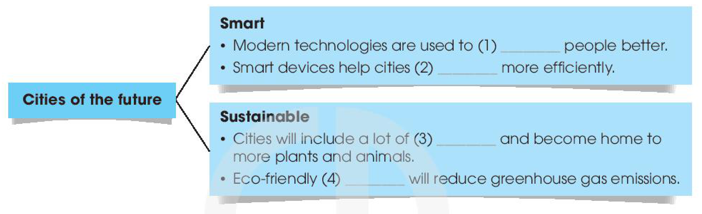
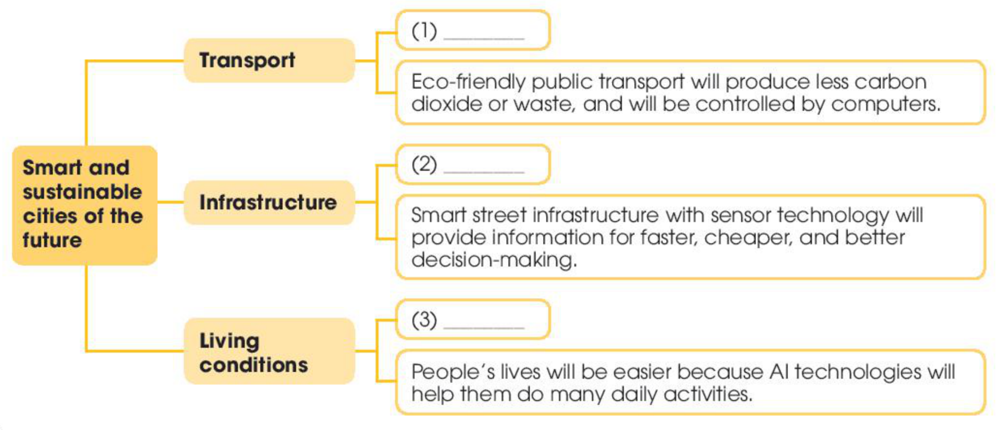

<!-- pdf:29 -->

# UNIT 3: CITIES OF THE FUTURE

> **This unit includes:**
> - **LANGUAGE:**
>   - **Pronunciation:** Linking final consonants to initial vowels
>   - **Vocabulary:** Words and phrases related to cities and smart living
>   - **Grammar:**
>     - Stative verbs in the continuous form
>     - Linking verbs
> - **SKILLS:**
>   - **Reading:** Reading for specific information in an article about the characteristics of future cities
>   - **Speaking:**
>     - Discussing cities of the future
>     - Keeping a conversation going by asking *Wh*-questions
>   - **Listening:** Listening for main ideas and specific information in an interview about the disadvantages of living in a smart city
>   - **Writing:** Writing an article about the advantages and disadvantages of living in a smart city
> - **COMMUNICATION AND CULTURE / CLIL:**
>   - **Everyday English:** Expressing certainty and uncertainty
>   - **Culture:** Smart cities around the world
> - **PROJECT:**
>   - Designing a poster of the ideal city of the future

## I. GETTING STARTED

**An exhibition of future cities**

**1. Listen and read.**

**Ms Smith:** Good morning. Welcome to our exhibition: Future Cities. Here you can see models of our cities of the future. Please take a look around and feel free to ask me any questions.

**Nam:** This model looks very interesting. Can you tell me more about it, Ms Smith?

**Ms Smith:** Yes. This is a 'green city' designed to reduce its negative impact on the environment. As you can see, more than fifty per cent of it is made up of green areas.

**Nam:** I don't see any private vehicles on the roads.
<!-- term: private vehicles -->

**Ms Smith:** Most people will use public transport such as trams and electric buses. There will be fewer traffic jams and less pollution.
<!-- term: public transport -->

**Nam:** So **city dwellers** will stop using their cars in urban areas.

**Ms Smith:** That's the idea.

**Nam:** I like it. It seems a good solution to many environmental problems.

(...)

**Mai:** Let's look at the city over there. I can see robots and lots of cameras in the streets. What's special about this city?

**Ms Smith:** It's called a '**smart city**'. AI technologies, such as cameras and smart **sensors**, will be installed to help the city **operate** more **efficiently**.

**Mai:** The modern **infrastructure** of the city looks beautiful. I'm really impressed with the **high-rise** buildings.
<!-- term: high-rise buildings -->

<!-- pdf:30 -->

**Ms Smith:** Tall buildings can actually limit the carbon footprint of the built environment and help solve housing problems in big cities.
<!-- term: carbon footprint -->

**Mai:** Mmm, I'm thinking of living in a smart city in the future.

**2. Read the conversation again and complete the notes. Use no more than TWO words for each blank.**

| **Future cities** | |
| --- | --- |
| **Green city** | **Smart city** |
| - More than 50% of it is made up of (1) \_\_\_\_\_\_\_. - Using public transport will help reduce (2) \_\_\_\_\_\_\_ and pollution. | - AI (3) \_\_\_\_\_\_\_ will help the city operate more efficiently. - High-rise buildings will help solve the (4) \_\_\_\_\_\_\_ problems. |
<!-- term: public transport -->
<!-- term: high-rise buildings -->
<!-- ocr-ok: đã đối chiếu ảnh trang gốc, OCR đọc nhầm AI thành Al và ghép hai cột bảng -->

**3. Match the words to make phrases mentioned in 1.**

| | |
| --- | --- |
| 1. public | a. city |
| 2. private | b. infrastructure |
| 3. modern | c. transport |
| 4. high-rise | d. vehicles |
| 5. smart | e. buildings |
<!-- term: public transport -->
<!-- term: private vehicles -->
<!-- term: high-rise buildings -->
<!-- ocr-ok: đã đối chiếu ảnh trang gốc, OCR bỏ sót số 1-5 và chữ cái a-e trong các nhãn màu -->

**4. Complete the sentences with phrases from 1.**

1. It \_\_\_\_\_\_\_ to many environmental problems.
2. The modern infrastructure of the city \_\_\_\_\_\_\_.
3. I \_\_\_\_\_\_\_ living in a smart city in the future.

## II. LANGUAGE

### Pronunciation

**Linking final consonants to initial vowels**
<!-- ocr-ok: đã đối chiếu ảnh trang gốc, OCR đọc nhầm to initial thành fo inificl -->

**Remember!**

- When we speak naturally, we don't pause between most words. We usually link the end and beginning of some words so that they are easy to say and flow together smoothly.
- Consonant-to-vowel linking is very common and occurs between a word ending with a consonant sound and a word beginning with a vowel sound.

**1. Listen and repeat. Pay attention to the linking (‿) between the words in the sentences.**

1. He lives‿in the city centre.
2. Cities‿of the future will be more‿exciting.
3. The new high-rise building is‿in the west‿of the city.
4. A lot‿of people come to the city to walk‿across the famous bridge.

**2. Listen and mark (‿) the consonant and vowel sounds that are linked. Then practise saying the sentences.**

1. Traffic jams are the city's biggest problem, especially during rush hour.
2. This is the most beautiful city I've ever visited.
3. Would you like a guided tour of the city this afternoon?
4. The Fine Art Museum was built in the new urban area last year.

<!-- pdf:31 -->

### Vocabulary

**Cities and smart living**

**1. Match the words and phrases with their meanings.**

| Words and phrases | Meanings |
| --- | --- |
| 1. **city dweller** (np) | a. a garden built on the top of a building |
| 2. **infrastructure** (n) | b. a very tall, modern building, usually in a city |
| 3. **urban centre** (np) | c. a person who lives in the city |
| 4. **roof garden** (n) | d. basic systems such as transport, banks, etc. needed for a city, country or organisation to run smoothly |
| 5. **skyscraper** (n) | e. an area in a city where a large number of people live |

**2. Complete the sentences using the correct forms of the words and phrases in 1.**

1. Building a good \_\_\_\_\_\_\_ is important for the country's economy.
2. The new underground has allowed \_\_\_\_\_\_\_ to get around more easily.
3. With the help of technology, people can now grow vegetables in \_\_\_\_\_\_\_ of high-rise buildings.
4. The \_\_\_\_\_\_\_ attracts people's attention because of its unusual architecture.
5. More people are moving away from the \_\_\_\_\_\_\_ of large cities to the suburbs.

### Grammar

*Stative verbs in the continuous form*

**Remember!**

Stative verbs describe a state rather than an action.
They often refer to thoughts and opinions (e.g. *agree*, *believe*, *remember*, *think*, *understand*), feelings and emotions (e.g. *hate*, *love*, *prefer*), senses (e.g. *appear*, *feel*, *hear*, *look*, *see*, *seem*, *smell*, *taste*) and possession (e.g. *belong*, *have*, *own*).
They are not normally used in the continuous form. However, some stative verbs can be used in the continuous form to describe actions, depending on the context.
*Example:* My dad *has* a new car.
He *is having* a good time.
<!-- term: Stative verbs in the continuous form -->

**1. Choose the correct forms of the verbs to complete the following sentences.**

1. I *think* / *am thinking* that living in the city is good for young people.
2. We *are thinking* / *think* of moving out of the city.
3. I *don't see* / *am not seeing* the building. It's too far away.

*Linking verbs*

**Remember!**

A linking verb is used to link the subject with an adjective or a noun that describes or identifies the subject. Common linking verbs include *be*, *seem*, *look*, *become*, *appear*, *sound*, *taste*, and *smell*.
*Example:* My mum *looks* very tired.
We *became* friends.
<!-- term: Linking verbs -->

**2. Find and correct the mistakes in the following sentences.**

1. The urban lifestyle seems more excitingly to young people.
2. The museum looks beauty from a distance.
3. Widening the road sounds a good solve to traffic problems in the area.

<!-- pdf:32 -->

**3. Work in pairs. Talk about future developments in your neighbourhood. Use stative verbs in continuous form and linking verbs.**

*Example:*
**A:** The government *is thinking* of building a new **skyscraper** here.
**B:** Fantastic! Our city *will look* more modern.

## III. READING

**Characteristics of future cities**

**1. Work in groups. Discuss the questions.**

1. What will future cities look like?
2. Do you think they will be 'smarter' and more **sustainable**? Why/Why not?

**2. Read the article. Circle the correct meanings of the highlighted words and phrases.**

By 2050 the world's population is expected to reach 10 billion, and nearly 70 per cent of these people will live in cities. The cities of the future will be 'smarter' and more **sustainable** to cope with a growing population and improve people's lives.

A **smart city** is a modern urban area that uses a range of technologies to provide services, solve problems, and support people better. The new technologies can help save time by predicting changes in the traffic and warning people of possible traffic jams. They will also help cities **operate** more **efficiently**. For example, street lights can turn off when the streets are empty, and **sensors** can inform waste collection teams when the bins are full. These smart technologies will help save energy, reduce air pollution, and fight climate change.

Cities in the future will also be sustainable. They will include a lot of green space and become home to more plants and animals. Making room for biodiversity and nature can be done in various ways including underground and rooftop farming, green roofs, and **roof gardens**. As people will care more about the environment, most cities will use renewable and clean energy. Modern **infrastructure** will also be more eco-friendly. Computer-controlled transport systems like electric buses and trains will produce less greenhouse gas emissions. In addition, more **pedestrian** zones for walking and **cycle paths** will be made available for people in all **neighbourhoods**.
<!-- term: pedestrian zones -->

These features will make future cities more **liveable** and will provide a high quality of life to **city dwellers**.

1. operate more efficiently
   - A. to work better without wasting time, money, or energy
   - B. to control a machine without wasting resources
   - C. to cut a body open for medical reasons in a more careful way
2. sensors
   - A. devices that can react to light, heat, or pressure
   - B. instruments that can be played by people
   - C. devices for discovering rubbish
3. pedestrian zones
   - A. areas for cars only
   - B. areas for electric buses
   - C. areas for walking only
4. liveable
   - A. suitable for farming
   - B. nice to live in
   - C. good for the environment
<!-- term: pedestrian zones -->

<!-- pdf:33 -->

**3. Read the article again and decide whether the statements are true (T) or false (F).**

| | T | F |
| --- | --- | --- |
| 1. About 70 million people will live in cities by 2050. | | |
| 2. Smart cities use modern technologies to save time and provide better services. | | |
| 3. City dwellers will be able to grow vegetables underground or in roof gardens. | | |
| 4. Space for walking and cycling will be replaced with computer-controlled transport systems. | | |

**4. Read the article again and complete the diagram with information from the text. Use no more than TWO words for each answer.**

- **Cities of the future:**
  - **Smart:**
    - Modern technologies are used to (1) \_\_\_\_\_\_\_ people better.
    - Smart devices help cities (2) \_\_\_\_\_\_\_ more efficiently.
  - **Sustainable:**
    - Cities will include a lot of (3) \_\_\_\_\_\_\_ and become home to more plants and animals.
    - Eco-friendly (4) \_\_\_\_\_\_\_ will reduce greenhouse gas emissions.

**5. Work in groups. Discuss the following questions.**

*Would you like to live in a smart and sustainable city? Why/Why not?*

## IV. SPEAKING

**Discussing cities of the future**

**1. Work in pairs. Complete the diagram with the ideas below.**

- A. Quality of life will be improved thanks to the cleaner environment.
- B. There will be no private vehicles because people will use public transport.
- C. Green **skyscrapers** will replace old blocks of flats and offices in crowded **urban centres**.
<!-- term: private vehicles -->
<!-- term: public transport -->

- **Smart and sustainable cities of the future:**
  - **Transport:**
    - (1) \_\_\_\_\_\_\_
    - Eco-friendly public transport will produce less carbon dioxide or waste, and will be controlled by computers.
  - **Infrastructure:**
    - (2) \_\_\_\_\_\_\_
    - Smart street infrastructure with **sensor** technology will provide information for faster, cheaper, and better decision-making.
  - **Living conditions:**
    - (3) \_\_\_\_\_\_\_
    - People's lives will be easier because AI technologies will help them do many daily activities.

<!-- pdf:34 -->

**2. Match the questions with the answers to make a conversation. Then practise it in pairs.**

| Questions | Answers |
| --- | --- |
| 1. What do you think transport will be like in the cities of the future? | a. They will use public transport instead of their own vehicles. |
| 2. So, how will people travel in the city? | b. Because technology will make public transport faster, more convenient, and more eco-friendly. |
| 3. Really? Why do you think public transport will be popular with city dwellers? | c. Well, I think there will be no private vehicles in the cities. |

**Tips**

To keep a conversation going, use *Wh*-questions. They can help you find out important information about people, places, and things, and develop ideas.
*Example: Where will people live? What jobs will they do? How will technology help city dwellers?*

**3. Work in pairs. Ask and answer questions about one of the features of future cities in 1. Use the model and the tips in 2 to help you.**

**4. Work in groups. Discuss what the cities of the future will be like and present your groups' ideas to the whole class.**

## V. LISTENING

**Living in a smart city**

**1. Match the words and phrase with their meanings.**

| Words and phrase | Meanings |
| --- | --- |
| 1. **interact** | a. an area of a town |
| 2. **privacy** | b. the feeling of belonging to a group |
| 3. **sense of community** | c. to talk or do things with other people |
| 4. **neighbourhood** | d. the state of being alone and not watched or interrupted by other people |

**2. Listen to an interview and choose the correct answers A, B, or C.**

1. What is the interview mainly about?
   - A. Advantages of living in a smart city.
   - B. Problems of living in a smart city.
   - C. Attractions of urban lifestyles.
2. How are cameras and sensors used in a smart city?
   - A. To collect information about city dwellers and their activities.
   - B. To collect information about the government and some companies.
   - C. To improve city dwellers' safety and security.
3. Why does Ms Stevens feel lonely?
   - A. Because she doesn't **interact** with many people.
   - B. Because she can't use the smart devices.
   - C. Because she doesn't like her **neighbourhood**.

**3. Listen to the interview again and complete the table. Use no more than THREE words for each answer.**

| Situations | Problems |
| --- | --- |
| There are cameras and sensors everywhere. | City dwellers may lose their (1) \_\_\_\_\_\_\_ in public areas. |
| People use (2) \_\_\_\_\_\_\_ to help them with household chores. | It is not easy for some people to get familiar with and use the smart devices. |
| Some city dwellers (3) \_\_\_\_\_\_\_ with each other face to face less. | There is no (4) \_\_\_\_\_\_\_ in the neighbourhood. |
<!-- ocr-ok: đã đối chiếu ảnh trang gốc, OCR đọc lỗi đường kẻ chấm trong bảng -->

<!-- pdf:35 -->

**4. Work in groups. Discuss the following questions.**

*Do you agree with Ms Stevens? Which of the disadvantages she mentioned do you think is the most serious? Why?*

## VI. WRITING

**An article about the advantages and disadvantages of living in a smart city**

**1. Read the following ideas and decide whether they are advantages or disadvantages of living in a smart city. Tick (✓) the appropriate box.**

| | Advantages | Disadvantages |
| --- | --- | --- |
| 1. Smart technologies make people's lives easier by reducing household chores. | | |
| 2. Without training, people will not know how to use the technologies in the smart city. | | |
| 3. People have limited **privacy** due to the cameras installed everywhere in the city. | | |
| 4. The negative impact on the environment is less. | | |
| 5. Smart technologies help the city operate more efficiently. | | |
| 6. People become worried because their personal information might not be protected. | | |

**2. Read the article below and match its parts with the correct descriptions.**

- \_\_\_\_ A. Introduction – A short paragraph stating the issue and what the **article** will cover
- \_\_\_\_ B. Title – The topic of the article in a few words
- \_\_\_\_ D. Conclusion – A summary of the main points and sometimes the writer's opinion
- \_\_\_\_ C. Body paragraphs – Each presenting a main point for or against the issue, supported by facts, examples, or explanations

**NEWS WORLD**
*September — Economy • Society • Technology • Culture*
<!-- ocr-ok: đã đối chiếu ảnh trang gốc, thanh măng-sét tờ báo NEWS WORLD có chữ nhỏ bị OCR bỏ sót -->

**1. LIVING IN A SMART CITY: GOOD OR BAD?**

[2] If you live in a smart city, you will probably agree with me that life is not all good as some people may think. So what are the pros and cons of living in a smart city?

[3] The good thing about smart cities is that they are very modern. Smart technologies make people's lives easier by reducing household chores. Besides, the city infrastructure which includes sensors and cameras collects information about people and their activities, and uses it to provide faster, cheaper, and better services.

[4] On the other hand, living in a smart city has some disadvantages. Some smart technologies are difficult to use and without training, city dwellers might find them useless. With cameras everywhere in public spaces, people also have limited privacy. They are worried that their personal information might not be protected, and they might become victims of cybercrime.

[5] In conclusion, living in a smart city has both advantages and disadvantages. However, I think these urban areas offer great promise. The issues should be dealt with in the years ahead as the world's population keeps growing, and more people are moving to big cities.

<!-- pdf:36 -->

**3. Write an article (120–150 words) about other advantages and disadvantages of living in a smart city. Use the suggested ideas in 1, the sample in 2, and the outline below to help you.**

**THE ADVANTAGES AND DISADVANTAGES OF SMART CITIES**

Smart cities are built on new technologies to improve people's lives. The idea of living in one of them sounds very exciting. But is a life controlled by smart technologies good or bad for us?

Let's start with the advantages. \_\_\_\_\_\_\_

What about the disadvantages? \_\_\_\_\_\_\_

In conclusion, there are both advantages and disadvantages of living in a smart city. In my opinion, \_\_\_\_\_\_\_

## VII. COMMUNICATION AND CULTURE / CLIL

### Everyday English

*Expressing certainty and uncertainty*

**1. Listen and complete the conversations with the expressions in the box. Then practise them in pairs.**

| A. I'm not really sure about it | B. I have no doubt about it |
| --- | --- |

**1**
**Minh:** I heard that in the future people will build cities on the ocean. Do you think that will be possible?

**Anna:** (1) \_\_\_\_\_\_\_. With the help of modern technologies, we can build cities on water, and people can live there safely.

**2**
**Mike:** Do you think the government can build our first smart city in this area?

**Long:** (2) \_\_\_\_\_\_\_. Smart technologies are very expensive. We don't have AI experts either.
<!-- term: Expressing certainty and uncertainty -->

**2. Work in pairs. Use the models in 1 to make similar conversations about these predictions for the future. One of you is Student A, the other is Student B. Use the expressions below to help you.**

1. Student A thinks we'll use driverless buses and flying cars. Student B expresses certainty or uncertainty, and gives reasons.
2. Student B thinks AI robots will do all the household chores. Student A expresses certainty or uncertainty, and gives reasons.

| **Useful expressions** | |
| --- | --- |
| **Expressing certainty** | **Expressing uncertainty** |
| I'm sure about it. I'm absolutely sure about it. There can't be any doubt that ... | I don't know for sure that ... I'm not sure this is true. There's some doubt in my mind that ... |
<!-- term: Expressing certainty and uncertainty -->

### Culture

**1. Read the text on page 36 and decide in which city you can do the following.**

| | City |
| --- | --- |
| 1. book a parking space via a mobile app | *Singapore* |
| 2. have a medical check-up online | |
| 3. use your bank card to pay for travelling on the bus or underground | |
| 4. unlock your bike from one station and return it to any other station in the city | |
| 5. use a mobile app to help you choose the best route to cycle in the city | |

<!-- pdf:37 -->

**SMART CITIES AROUND THE WORLD**

Cities around the world are becoming smarter, and you can do many things that seemed impossible in the past.

In Singapore, the mobile app Parking.sg allows you to locate a nearby car park easily, book a parking space, and make a payment. You can also extend your booking or receive a refund if you leave early.

New York City (US) has one of the largest bike-sharing systems called Citi Bike. Using a mobile app, you can unlock bikes from one station and return them to any other station in the system, making them ideal for one-way trips.

In Copenhagen (Denmark), you can use a mobile app to guide you through the city streets and tell how fast you need to pedal to make the next green light. The app can also give you route recommendations and work out the calories you burn.

In London (UK), you don't have to buy public transport tickets. You can just touch your bank card on the **card reader** when you get on and off the bus or the underground to pay for your trip.
<!-- term: public transport -->

In Toronto (Canada), you can book an appointment and see a doctor online from your own home. You can also receive prescriptions and any other documents you need, all online.

**2. Work in groups. Discuss the following questions.**

*Which of the technologies in the text would you like to have in your city or neighbourhood? Why?*

## VIII. LOOKING BACK

### Pronunciation

**Listen and mark (‿) the consonant and vowel sounds that are linked. Then practise saying the sentences.**

1. Many young people want to live in the city.
2. It's a busy street with great shops and restaurants.
3. The government wants to build a smart city in the south of the country.
4. The apartment was expensive, but my parents could afford it.

### Vocabulary

**Complete the sentences. Use words and phrases you have learnt in this unit.**

1. The project aims to improve the city's old i\_\_\_\_\_\_\_ by creating more pedestrian zones and cycle paths.
2. My city was ranked as the most l\_\_\_\_\_\_\_ city in the country thanks to its excellent facilities and clean air.
3. Cities in the future will have a lower carbon footprint and will be more s\_\_\_\_\_\_\_.
4. Smart technologies have made lives of c\_\_\_\_\_\_\_ d\_\_\_\_\_\_\_ more convenient.
<!-- term: pedestrian zones -->
<!-- term: carbon footprint -->

### Grammar

**Choose the correct words and phrases to complete these sentences.**

1. Please don't talk. I *think* / *am thinking*.
2. People living in crowded cities feel *unhappily* / *unhappy*.
3. You should try this soup. It *tastes* / *is tasting* delicious.
4. James seems *an intelligent person* / *intelligently*, but he sometimes asks silly questions.

<!-- pdf:38 -->

## IX. PROJECT

**The ideal city of the future**

**Work in groups. Design a poster of the ideal city of the future.**

**Present your poster to the class. Use these questions as cues for your presentation.**

- Where will it be located?
- How big will it be? How many people will live in it?
- How will people travel?
- What kind of buildings will people live in?
- Will people use AI technologies? If yes, how will they be used?

### Now I can ...

- link final consonants to initial vowels in sentences.
- understand and use words and phrases related to cities and smart living.
- use stative verbs in the continuous form, and linking verbs.
- read for specific information in an **article** about the characteristics of future cities.
- discuss cities of the future and keep a conversation going by asking *Wh*-questions.
- listen for main ideas and specific information in an interview about the disadvantages of living in a smart city.
- write an article about the advantages and disadvantages of living in a smart city.
- express certainty and uncertainty.
- recognise features of smart cities around the world.
- design a poster of the ideal city of the future and give a poster presentation about it.

## 📷 Danh mục hình minh hoạ

| Mã hình | Trang PDF | Trang sách | Chú thích / Mô tả |
| --- | --- | --- | --- |
| H11-tieng_anh-u03-01 | 33 | 32 | Sơ đồ tư duy *Cities of the future* gồm hai nhánh *Smart* và *Sustainable* có các chỗ trống (1)–(4) ở mục Reading 4 |
| H11-tieng_anh-u03-02 | 33 | 32 | Sơ đồ cấu trúc *Smart and sustainable cities of the future* gồm ba nhánh *Transport*, *Infrastructure* và *Living conditions* có các chỗ trống (1)–(3) ở mục Speaking 1 |
