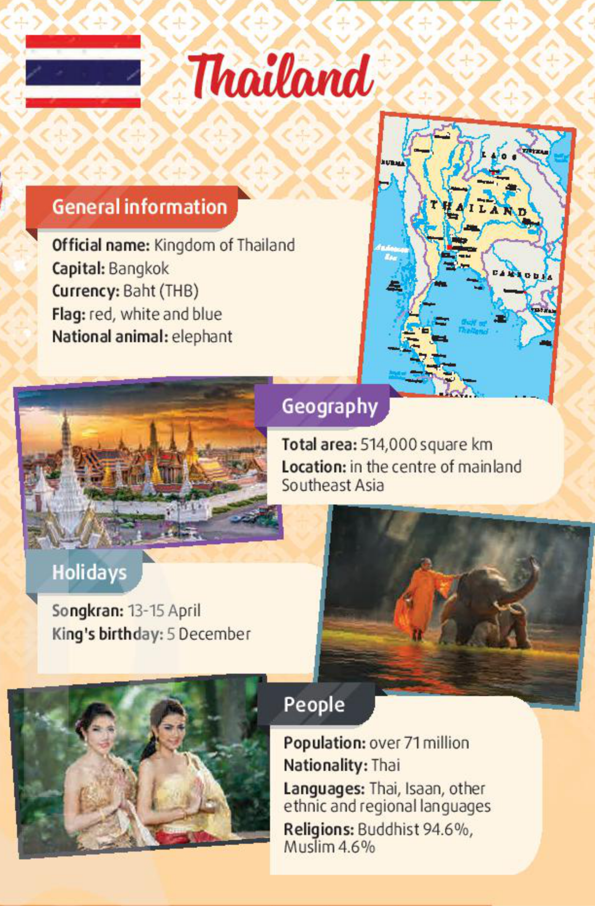

<!-- pdf:43 -->

# UNIT 4: ASEAN AND VIET NAM

> **This unit includes:**
> - **LANGUAGE:**
>   - **Pronunciation:** Elision of vowels
>   - **Vocabulary:** Words and phrases related to ASEAN
>   - **Grammar:** Gerunds as subjects and objects
> - **SKILLS:**
>   - **Reading:** Reading for main ideas and specific information in news items about ASEAN countries
>   - **Speaking:**
>     - Discussing the skills and experience needed for the ASEAN Youth Programme
>     - Asking for and giving opinions
>   - **Listening:** Listening for main ideas and specific information in a conversation about an ASEAN school tour programme
>   - **Writing:** Writing a proposal for a welcome event
> - **COMMUNICATION AND CULTURE / CLIL:**
>   - **Everyday English:** Giving and responding to compliments
>   - **Culture:** New Year Festivals in ASEAN
> - **PROJECT:**
>   - Doing research about an ASEAN member

## I. GETTING STARTED

**At the ASEAN Youth Volunteer Programme (AYVP) office**

**1. Listen and read.**

**Mai:** Good afternoon. My name's Mai Nguyen. Are you Ms Pang? You replied to my email and invited me to visit your office.

**Ms Pang:** Yes, I'm Ms Pang. It's nice to meet you, Mai. So how did you hear about us?

**Mai:** My cousin was an AYVP **volunteer**. He often said **taking part in** the programme was an experience he would never forget.

**Ms Pang:** Glad to hear that. The main goals of AYVP are **promoting** **youth** **volunteering** and helping the **development** of the ASEAN **community**.
<!-- term: goals -->

**Mai:** What can I do to prepare for the programme?

**Ms Pang:** Well, to become an AYVP volunteer, you must be **qualified** for the programme, and this depends on the themes for the year.

**Mai:** What are the areas covered by AYVP?

**Ms Pang:** There are eight themes. I suggest checking our website to find out this year's themes.

**Mai:** How are volunteers selected?

**Ms Pang:** To be selected, you should be over 18. Then you may need to **propose** a community project related to the theme. And we'll probably interview you to make sure you speak English well and are very keen on participating in the programme.

**Mai:** That doesn't sound too difficult. Thanks so much for meeting me.

**Ms Pang:** You're welcome.

<!-- pdf:44 -->

**2. Read the conversation again and decide whether the following statements are true (T) or false (F).**

| | T | F |
| --- | --- | --- |
| 1. Mai is a member of the ASEAN Youth Volunteer Programme. | | |
| 2. One of the aims of AYVP is to help young people volunteer. | | |
| 3. Mai can only find last year's themes on the AYVP's website. | | |
| 4. Mai can apply to join the AYVP when she turns 18. | | |

**3. Match each word with its definition.**

| Words | Definitions |
| --- | --- |
| 1. **volunteer** | a. things that you hope to achieve |
| 2. **qualified** | b. the process of becoming bigger and better |
| 3. **development** | c. someone who does a job without payment |
| 4. goals | d. having the training or experience to do a particular job |
<!-- term: goals -->
<!-- ocr-ok: đã đối chiếu ảnh trang gốc, OCR đọc sai kí tự đầu dòng và chữ job without payment -->

**4. Complete the sentences using words and a phrase from 1.**

1. \_\_\_\_\_\_\_ in the programme was an unforgettable experience for Mai's cousin.
2. The main goals of AYVP are \_\_\_\_\_\_\_ youth volunteering and \_\_\_\_\_\_\_ the development of the ASEAN community.
3. Ms Pang suggested \_\_\_\_\_\_\_ their website.
4. Mai thanked Ms Pang for \_\_\_\_\_\_\_ her.

## II. LANGUAGE

### Pronunciation

**Elision of vowels**

**Remember!**

Elision is the omission of sounds or syllables in fast, informal speech.
Weak vowels, such as the schwa sound /ə/, can be omitted before /l/, /n/, or /r/. As a result, the words have one less syllable than the spelling suggests.

**1. Listen and repeat. Pay attention to the elision of the vowels in the words in the second column.**

| | |
| --- | --- |
| 1. history | hist(o)ry |
| 2. different | diff(e)rent |
| 3. tonight | t(o)night |
| 4. correct | c(o)rrect |
| 5. police | p(o)lice |
| 6. dictionary | diction(a)ry |
<!-- ocr-ok: đã đối chiếu ảnh trang gốc, OCR bỏ sót dòng 2 different và dòng 3 tonight trong bảng -->

**2. Listen and repeat. Pay attention to the words with elision.**

1. Let's find the *correct* answer!
2. We also provide mobile *library* services in rural areas.
3. My family will move to a *different* country.
4. Please bring your *dictionary* to the *history* class.

<!-- pdf:45 -->

### Vocabulary

**ASEAN**

**1. Match the word and phrases with their meanings.**

| Word and phrases | Meanings |
| --- | --- |
| 1. **cultural exchange** (np) | a. the abilities to organise other people to reach a common goal |
| 2. current issues (np) | b. the act of sharing traditions and knowledge with people from different countries |
| 3. **contribution** (n) | c. important things that are happening now |
| 4. **leadership skills** (np) | d. something that you give or do to help make something successful |
<!-- term: current issues -->

**2. Complete the sentences using the word and phrases in 1.**

1. Communicating with people and managing teamwork well are important \_\_\_\_\_\_\_.
2. ASEAN has made a major \_\_\_\_\_\_\_ to peace in the **region**.
3. A \_\_\_\_\_\_\_ is the best way for young people to understand other countries' values and ideas.
4. The aim of this meeting is to discuss \_\_\_\_\_\_\_ such as climate change and pollution.

### Grammar

*Gerunds as subjects and objects*

**Remember!**

A gerund is a verb form that ends in *-ing* and functions as a noun. It can be used as:
- the subject of a sentence.
  *Example:* *Travelling* might satisfy your desire for new experiences.
- a complement after the verb *be*.
  *Example:* Her dream job is *teaching* English.
- an object after some verbs such as *like*, *enjoy*, *mind*, *involve*, *suggest*, etc. or after prepositions.
  *Examples:* My father's work involves *travelling* around the region.
  He apologised for not *attending* the meeting.
<!-- term: Gerunds as subjects and objects -->

**1. Rewrite the following sentences using gerunds.**

1. It is more convenient for students to **apply for** ASEAN scholarships online.
   → \_\_\_\_\_\_\_ is more convenient for students.
2. My sister usually listens to music in her free time.
   → My sister's hobby is \_\_\_\_\_\_\_ in her free time.
3. Could you help me translate the documents for the workshop?
   → Do you mind \_\_\_\_\_\_\_ for the workshop?
4. They managed to start a youth programme in Southeast Asia.
   → They succeeded in \_\_\_\_\_\_\_ in Southeast Asia.
5. Maria can't forget the conference she participated last year.
   → \_\_\_\_\_\_\_ was an unforgettable experience for Maria.

**2. Work in pairs. Take turns to make sentences about your partner, using gerunds. He or she should tell you if they are true.**

*Example:*
**A:** You enjoy travelling around the region.
**B:** Sorry, that's not true. Your dream job is working for the AYVP.
**A:** You're right! Now, it's my turn again. ...

<!-- pdf:46 -->

## III. READING

**ASEAN news**

**1. Work in pairs. Discuss the following questions.**

1. Where do you most often read the news?
2. What is your favourite news section: **Politics**, Education, Sports or Culture?

**2. Read the news items and choose the most suitable headline for each one. There are TWO extra headlines.**

- A. Don't miss this opportunity to **represent** your country!
- B. Travelling to ASEAN countries
- C. Equality in sport for ASEAN women
- D. Korean and ASEAN students
- E. **Volunteers** needed to **take part in** **cultural exchanges**

1. \_\_\_\_\_\_\_
To raise awareness of ASEAN and **promote** cultural exchanges between the **youths** of Korea and ASEAN, the ASEAN-Korea Centre (AKC) regularly organises an ASEAN School Tour Programme. Last week, the AKC welcomed 121 Korean and Asian students from six schools. They learnt about ASEAN members, and discussed why ASEAN was important to Korea, and how to **strengthen** ASEAN-Korea **relations**. The students also **took part in** a variety of cultural activities such as singing traditional songs and making ASEAN posters.

2. \_\_\_\_\_\_\_
The Ship for Southeast Asian and Japanese Youth Programme (SSEAYP) is looking for participants. Organised by the government of Japan and **supported** by the governments of Southeast Asia, this journey will last for 50 days and will bring together over 300 youths from ASEAN countries and Japan. Young people will have the opportunity to take part in exciting discussions on **current** social and youth **issues**, and **eye-opening** cultural exchanges. They will also receive training to help them develop problem-solving and **leadership skills**. The journey starts in Japan and participants travel to five ASEAN countries.

3. \_\_\_\_\_\_\_
An ASEAN talk show on women in sport took place in December. Its goal was promoting gender equality in and through sport. It featured 10 female sports **representatives** from 10 ASEAN countries. The talk show also discussed the rights of sports people with disabilities. All participants agreed that women and girls should be given more opportunities to play sports and represent their countries at international events. The talk show was **live-streamed** on the ASEAN webpage.

**3. Read the news items again and match the highlighted words with their meanings.**

| Highlighted words | Meanings |
| --- | --- |
| 1. **relations** | a. shown over the Internet |
| 2. **eye-opening** | b. to act officially for another person or organisation |
| 3. **represent** | c. the way in which people or groups of people behave towards each other |
| 4. **live-streamed** | d. surprising because you learn something new |
<!-- ocr-ok: đã đối chiếu ảnh trang gốc, OCR bỏ sót số 1-4 và chữ cái a-d trong các nhãn màu -->

<!-- pdf:47 -->

**4. Read the news items again and answer each question below with no more than FOUR words and/or a number.**

*Example:* Who organises the ASEAN School Tour Programme? *The ASEAN-Korea Centre.*

1. How many students visited the AKC last week?
2. How long will SSEAYP participants stay together on board the ship?
3. What will participants in SSEAYP discuss besides youth issues?
4. When did the ASEAN talk show on women in sport happen?
5. Where was the talk show shown live?

**5. Work in groups. Discuss the following questions.**

*Do you want to find more information about any of the news items in 2? Which one? Why?*

## IV. SPEAKING

**Discussing necessary qualifications for joining a programme**

**1. Read the types of skills and experience participants in the SSEAYP should have. Match them with the possible reasons.**

| Skills and experience | Reasons |
| --- | --- |
| 1. understanding the current issues in ASEAN countries | a. showing they have practical skills and knowledge |
| 2. having community work experience | b. being able to work in a team to solve problems |
| 3. speaking good English | c. discussing and offering solutions to the issues |
| 4. being confident speakers | d. meeting new people and making friends from different countries |
| 5. having teamwork skills | e. using English as the working language |
| 6. understanding different cultures | f. being able to present ideas clearly in front of an audience |
<!-- term: current issues -->

**2. Use the sentences in the box to complete the conversation. Then practise it in pairs.**

- A. Don't you agree
- B. I'm afraid I have to disagree with you
- C. I think they need to understand the current issues in ASEAN countries
- D. the most important thing is to speak English fluently
- E. Why do you think so

**Nick:** What do you think is the most important skill or experience for SSEAYP participants to have?

**Mai:** (1) \_\_\_\_\_\_\_.

**Nick:** (2) \_\_\_\_\_\_\_?

**Mai:** Because they'll have to discuss and try to find solutions to these issues. (3) \_\_\_\_\_\_\_?

**Nick:** (4) \_\_\_\_\_\_\_. The working language is English so (5) \_\_\_\_\_\_\_. How will they take part in discussions if their English is not good enough?

**Mai:** OK, I agree with you, Nick.

<!-- pdf:48 -->

**Tips**

To give your opinion in a conversation or discussion, you should:
- state your opinion clearly, e.g. *I think/I believe/In my opinion, ...*
- ask for an opinion and explanation from other speakers, e.g. *What about you?/Why do you think so?*
- express your agreement or disagreement politely, e.g. *I agree with you./(I'm afraid) I have to disagree.*

**3. Work in pairs. Talk about the most important skill or experience for SSEAYP participants. Use the ideas in 1, and the model and tips in 2 to help you.**

**4. Work in groups. Discuss the skills and experience SSEAYP participants should have. Rank them in order of importance (1 - most important to 6 - least important). Report to the whole class.**

## V. LISTENING

**ASEAN School Tour Programme**

**1. Work in groups. Look back at the first news item in the reading text on page 45. Discuss the following questions.**

*Would you like to participate in the ASEAN School Tour Programme? Why/Why not?*

**2. Listen to a conversation between two students. What are they talking about?**

- A. Preparing for a cultural exchange event
- B. Preparing for a school tour in Indonesia
- C. Types of activities for ASEAN students

**3. Listen to the conversation again and choose the correct answers A, B, or C.**

1. Phong and other \_\_\_\_\_\_\_ are preparing a welcome event for the foreign students.
   - A. teachers
   - B. Youth Union members
   - C. classmates
2. The group of Korean and ASEAN students will spend \_\_\_\_\_\_\_ at their school.
   - A. one day
   - B. three days
   - C. five days
3. Phong thinks the event will be an excellent opportunity for students to make friends with young people from \_\_\_\_\_\_\_.
   - A. Indonesia
   - B. ASEAN countries
   - C. Korea and ASEAN countries
4. During the visit, students will discuss how they can help \_\_\_\_\_\_\_.
   - A. contribute to the event
   - B. develop their local **communities**
   - C. build an ASEAN community
5. Lan suggests calling on \_\_\_\_\_\_\_ to send in ideas for activities.
   - A. young people in the region
   - B. all the students from his school
   - C. ASEAN students

**4. Work in groups. Discuss the following questions.**

*Can you think of any suitable activities for the event at Lan and Phong's school? How will they benefit the participants?*

<!-- pdf:49 -->

## VI. WRITING

**A proposal for a welcome event**

**1. Read the following proposal and match the headings (1–4) with the paragraphs (A–D).**

| 1. Details about the event | 2. Conclusion | 3. Introduction | 4. Goals and benefits |
| --- | --- | --- | --- |

**Title:** VIETNAMESE TRADITIONAL GAMES FESTIVAL
**To:** The Head teacher of Ha Noi High School
**Date:** 10 January
**Prepared by:** Youth Union

A. \_\_\_\_\_\_\_
Next month, a group of students from ASEAN countries will visit our school. We put out a call for ideas for activities to welcome our guests. One of the best ideas is holding a Vietnamese Traditional Games Festival.

B. \_\_\_\_\_\_\_
The event will take place in the school stadium. It will start at 9 a.m. and will last for three hours. The event will be hosted by grade 11 students, who will make all the arrangements for the activities. These will include Vietnamese traditional games such as bamboo dancing, tug of war, and stilt walking.

C. \_\_\_\_\_\_\_
The event will help our guests learn about our culture by watching and playing Vietnamese traditional games. Taking part in fun games is also the best way to break the ice, make friends and create bonds with people.
<!-- term: break the ice -->

D. \_\_\_\_\_\_\_
We really hope you will consider this **proposal** as we think that it will be beneficial to both local students and guests.

**Tips**

A proposal gives details about an idea or a project, and convinces the readers to **support** it by giving reasons as to why it is a good one. It consists of:
- *Title:* to introduce the name of the idea/project
- *Recipient (To: \_\_\_):* to give the names of the people you want to support/approve the proposal
- *Date:* to give the date of writing the proposal
- *Writer (Prepared by: \_\_\_):* to give the name of the person/group who puts forward the proposal
- *Introduction:* to briefly introduce the idea/project
- *Details about the idea/project:* to state the time, location, activities, etc.
- *Goals and benefits:* to state the goals and give reasons why the idea/project is a good one
- *Conclusion:* to urge the recipient to consider and approve the proposal

**2. Work in groups. You want to propose an ASEAN poster making event to welcome a group of ASEAN students. Discuss and add more ideas to the following notes.**

| | |
| --- | --- |
| Title: | **ASEAN POSTER MAKING EVENT** |
| Place: | ... |
| Date: | ... |
| Duration: | One day |
| Participants: | ... |
| Activities: | - training workshops on poster design - presentations on current issues in ASEAN - ... |
| Goals: | - to help young people from ASEAN countries meet and build a community - ... |
| Benefits: | - developing the ability to work with people from other countries - creating shared values - ... |

<!-- pdf:50 -->

**3. Write a proposal (120–150 words) about a welcome event. Use the suggested ideas in 2, the sample in 1, and the outline below to help you.**

**Title:** ASEAN POSTER MAKING EVENT
**To:** Ha Noi High School Youth Union Board
**Date:** \_\_\_\_\_\_\_
**Prepared by:** \_\_\_\_\_\_\_
**Introduction:**
We would like to propose \_\_\_\_\_\_\_.
**Details about the event:**
The event will take place in \_\_\_\_\_\_\_.
**Goals and benefits:**
The event will help \_\_\_\_\_\_\_.
**Conclusion:**
We really hope you will consider our proposal as \_\_\_\_\_\_\_.

## VII. COMMUNICATION AND CULTURE / CLIL
<!-- ocr-ok: đã đối chiếu ảnh trang gốc, thanh tiêu đề cam VII COMMUNICATION AND CULTURE / CLIL bị OCR bỏ sót -->

### Everyday English

*Giving and responding to compliments*

**1. Listen and complete the conversation with the expressions in the box. Then practise it in pairs.**

| A. I'm glad you like it | B. I appreciate the compliment |
| --- | --- |
| C. You gave the best presentation | D. It's excellent |

**Linda:** I was at the workshop at the ASEAN Youth Volunteer Conference. (1) \_\_\_\_\_\_\_!

**Hoa:** (2) \_\_\_\_\_\_\_, Linda. I worked really hard to prepare for it.

**Linda:** It was also well organised. And I noticed that your English has improved a lot. (3) \_\_\_\_\_\_\_!

**Hoa:** Thank you. (4) \_\_\_\_\_\_\_.
<!-- term: Giving and responding to compliments -->

**2. Work in pairs. Use the model in 1 to make similar conversations for these situations. One of you is Student A, the other is Student B. Use the expressions below to help you.**

1. Student A has completed an excellent report on ASEAN. Student B gives **compliments** and Student A responds.
2. Student B has organised a workshop on skills for future leaders in ASEAN. Student A gives compliments and Student B responds.

| **Useful expressions** | |
| --- | --- |
| **Giving compliments** | **Responding to compliments** |
| Nice work! Well done! You did a really good job! This is excellent. You are so good with ...! You are a great presenter! I love your ...! | Thanks for saying that. I appreciate that. Thank you. That means a lot to me. I'm grateful for the kind words. I'm (so) pleased to hear that. |
<!-- term: Giving and responding to compliments -->

<!-- pdf:51 -->

### Culture

**1. Read the text and complete the table below.**

**New Year Festivals in ASEAN**

In ASEAN, besides welcoming the New Year on January 1, there are several cultures that celebrate New Year's Day later in the year. For example, Viet Nam, Singapore, Indonesia and parts of Malaysia follow the lunar calendar so their New Year festivities often take place in January or February. Lunar New Year is a time for them to **honour** ancestors, get together with family and friends, have a big family meal, and wish one another prosperity for the year to come. The streets and houses are decorated, and fireworks are lit to scare away bad luck. There are also parades, street parties, and art performances in the new year **celebrations**.

People in Laos, Cambodia, Thailand, and Myanmar celebrate the arrival of the New Year according to the Buddhist calendar. Their New Year's celebrations are in April. People in these countries follow traditions such as offering rice to Buddhist monks to show their respect and receiving wishes for good luck and health from them. They decorate their homes, cook traditional dishes, and splash each other with water. There are also art performances, folk games, and dancing. In these cultures, it is believed that water will wash away bad luck and ill health from the old year and allow people to start the new year fresh.

| | Lunar New Year | Buddhist calendar |
| --- | --- | --- |
| **Countries** | (1) \_\_\_\_\_\_\_ | Laos, Cambodia, Thailand & Myanmar |
| **Time** | January or February | (2) \_\_\_\_\_\_\_ |
| **Activities** | (3) \_\_\_\_\_\_\_ | (4) \_\_\_\_\_\_\_ |

**2. Work in pairs. Discuss the similarities and differences between the New Year Festivals in Viet Nam and other ASEAN countries.**

## VIII. LOOKING BACK

### Pronunciation

**Listen and underline words with elision. Then practise saying the sentences in pairs.**

1. There are no correct answers on her test paper.
2. He's going to fly to Bangkok tonight.
3. The participants were probably excited about the palace history.
4. I believe that members expressed different opinions about the **issue**.

### Vocabulary

**Choose the correct words to complete the sentences.**

1. Talking to the young volunteers was *an eye-opening* / *a live-streamed* experience.
2. Mark was awarded for his *contribute* / *contribution* to promoting traditional music.
3. You need to have strong *leader* / *leadership* skills to manage the project.
4. This programme tries to encourage *culture* / *cultural* exchanges among ASEAN countries.

### Grammar

**Circle the underlined part that is incorrect in each of the following sentences. Then correct it.**

1. *This* (A) conference *focused* (B) on *discuss* (C) local and **regional** *issues* (D).
2. *Organise* (A) the ASEAN *workshop* (B) was *harder* (C) than I *expected* (D).
3. His job *involves* (A) *to translate* (B) documents *about* (C) ASEAN *events* (D).
4. I am *thinking* (A) of *participate* (B) *in* (C) a *youth* (D) competition.
<!-- ocr-ok: đã đối chiếu ảnh trang gốc, các chữ cái A, B, C, D nằm dưới chân từ gạch chân nên thứ tự dòng khác OCR -->

<!-- pdf:52 -->

## IX. PROJECT

**THE COLOURS OF ASEAN**

**Work in groups. Find information about a member country of ASEAN. Present your research to the class. You can make a poster, a video, or presentation slides.**

**Think about the following points:**
- General information (*name, capital, currency, national flag, national animal/flower*)
- Geography (*area, location*)
- Holidays (*e.g. Independence Day, National Holiday*)
- People (*population, culture, language(s) spoken, religions*)

**Thailand**
- **General information:**
  - Official name: Kingdom of Thailand
  - Capital: Bangkok
  - Currency: Baht (THB)
  - Flag: red, white and blue
  - National animal: elephant
- **Geography:**
  - Total area: 514,000 square km
  - Location: in the centre of mainland Southeast Asia
- **Holidays:**
  - Songkran: 13–15 April
  - King's birthday: 5 December
- **People:**
  - Population: over 71 million
  - Nationality: Thai
  - Languages: Thai, Isaan, other ethnic and regional languages
  - Religions: Buddhist 94.6%, Muslim 4.6%

### Now I can ...

- identify and pronounce words with elision of vowels in isolation and in sentences.
- understand and use words and phrases related to ASEAN.
- use gerunds as subjects and objects.
- read for main ideas and specific information in news items about ASEAN countries.
- discuss the skills and experience needed for the ASEAN Youth Programme, and ask for and give opinions.
- listen for main ideas and specific information in a conversation about an ASEAN school tour programme.
- write a proposal for a welcome event.
- give and respond to compliments.
- understand when and how people celebrate the New Year in ASEAN.
- do research about an ASEAN member and give a presentation about it.

## 📷 Danh mục hình minh hoạ

| Mã hình | Trang PDF | Trang sách | Chú thích / Mô tả |
| --- | --- | --- | --- |
| H11-tieng_anh-u04-01 | 52 | 51 | Áp phích mẫu tìm hiểu quốc gia thành viên ASEAN (*Thailand*) gồm bản đồ Thái Lan và bốn mục thông tin (*General information*, *Geography*, *Holidays*, *People*) ở mục Project |
