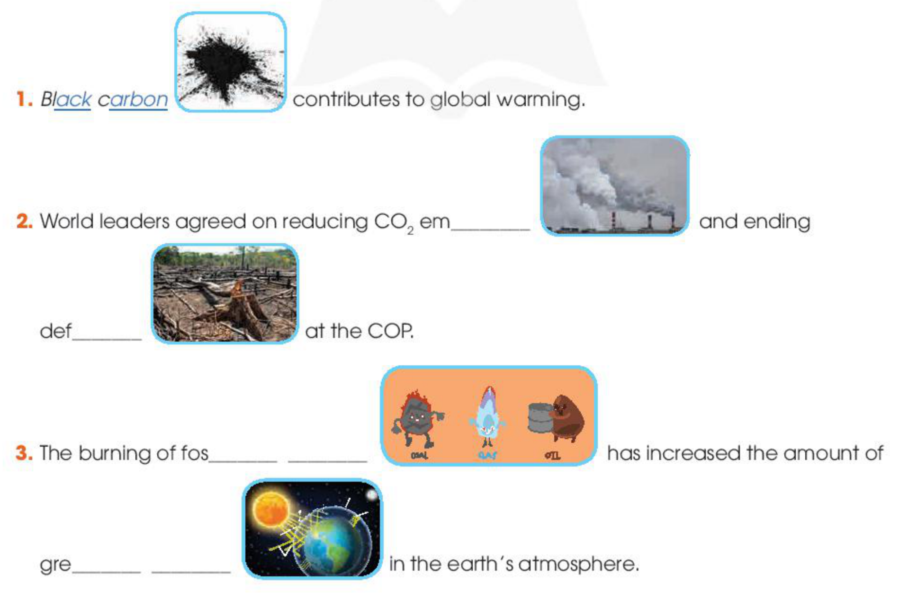

<!-- pdf:63 -->

# REVIEW 2

## I. LANGUAGE

### Pronunciation

**1. Read the following sentences. Underline the stressed words in each one. Then mark the stressed syllables in these words. Listen and check.**

1. The earth is getting warmer and warmer.
2. There will be more floods and storms in the coming years.
3. ASEAN has helped its members to achieve economic growth.
4. The burning of coal and oil releases a lot of carbon dioxide into the air.

**2. Underline words with elision in the following sentences. Listen and check.**

5. The young ASEAN leaders had many different ideas.
6. It's very easy to use digital cameras.
7. She's giving a talk about the history of chocolate.
8. We'll have our discussion on ASEAN in the library tonight.

### Vocabulary

**1. What are the missing letters? Complete the sentences using the pictures to help you. The first sentence is done for you.**

1. *Black* *carbon* contributes to global warming.
2. World leaders agreed on reducing CO₂ em\_\_\_\_\_\_\_ and ending def\_\_\_\_\_\_\_ at the COP.
3. The burning of fos\_\_\_\_\_\_\_ \_\_\_\_\_\_\_ has increased the amount of gre\_\_\_\_\_\_\_ \_\_\_\_\_\_\_ in the earth's atmosphere.
<!-- ocr-ok: đã đối chiếu ảnh trang gốc, các hình gợi ý chèn xen giữa câu làm OCR bỏ sót chữ -->

<!-- pdf:64 -->

**2. Complete the sentences using these words and phrases.**

| leadership skills | current issues | greenhouse gas | pollutants | contribution |
| --- | --- | --- | --- | --- |

1. Country leaders are meeting to discuss \_\_\_\_\_\_\_, such as climate change and land use, in the region.
2. Using renewable energy is the best way to reduce \_\_\_\_\_\_\_ emissions.
3. The company provides training sessions to improve the managers' \_\_\_\_\_\_\_.
4. Young people need the right skills and knowledge to be able to make a \_\_\_\_\_\_\_ to the economy.
5. \_\_\_\_\_\_\_, such as carbon dioxide and methane, are known as greenhouse gases.

### Grammar

**1. Put the verbs in brackets in the correct forms.**

1. Tourists enjoy (buy) \_\_\_\_\_\_\_ handmade souvenirs on their trips to ASEAN countries.
2. (feel) \_\_\_\_\_\_\_ confident about her English, Mia decided to enter the English-speaking competition at her school.
3. I decided (reduce) \_\_\_\_\_\_\_ my carbon footprint by cycling to school.
4. Because air pollution levels rise in the city, doctors recommend (wear) \_\_\_\_\_\_\_ masks outdoors.
5. World leaders need (work) \_\_\_\_\_\_\_ together to solve big health and environmental problems.

**2. Rewrite the sentences using gerunds or participle clauses.**

1. If you use an online dictionary in this way, you can learn many new words.
   → \_\_\_\_\_\_\_, an online dictionary can help you learn many new words.
2. It was wonderful to go on the ASEAN tour.
   → \_\_\_\_\_\_\_ was a wonderful experience.
3. The farmers cut down the trees, and started using the land for growing crops.
   → \_\_\_\_\_\_\_, the farmers started using the land for growing crops.
4. The sun warms the earth's surface, which releases heat into the air.
   → \_\_\_\_\_\_\_, the earth's surface releases heat into the air.
5. She usually prepares the guest list for all conferences.
   → She is responsible for \_\_\_\_\_\_\_ for all conferences.

**3. Circle the underlined part that is incorrect in each of the following sentences. Then correct it.**

1. *One* (A) of his *hobbies* (B) is *collect* (C) *stamps* (D).
2. The *building* (A) suddenly *fell* (B) down, *injured* (C) two *people* (D).
3. *Embarrass* (A) by all the *attention* (B), he *thanked* (C) *everyone* (D) for the presents.
4. They *congratulated* (A) him on *get* (B) the first prize in the *writing* (C) competition *about* (D) ASEAN.
5. The famous singer *came* (A) on stage, *cheering* (B) by *hundreds* (C) of *screaming* (D) fans.
<!-- ocr-ok: đã đối chiếu ảnh trang gốc, các chữ cái A, B, C, D đặt dưới từ gạch chân nên thứ tự dòng khác OCR -->

<!-- pdf:65 -->

## II. SKILLS

### Listening

**1. Listen to a conversation between Nick and Ann. What are they talking about?**

- A. The effect of greenhouse gas emissions on climate
- B. Ways to reduce greenhouse gas emissions
- C. Ways to build green plants

**2. Listen again. Decide whether the following statements are true (T) or false (F).**

| | T | F |
| --- | --- | --- |
| 1. Our planet is not as warm as usual. | | |
| 2. Methane emissions from cows can be changed into usable energy. | | |
| 3. Methane emissions will increase as a result of population growth. | | |
| 4. Scientists think that green oceans can't reduce the amount of CO₂. | | |
| 5. The NZT project involves the transport and storage of CO₂. | | |

### Speaking

**Work in groups. Discuss if the following technologies mentioned in the Listening can be used in Viet Nam. Think about how they can help slow global warming.**

- Turning methane emissions from cows into energy
- Growing plants in the ocean
- Keeping CO₂ in storage sites

### Reading

**1. Read the text and choose the best title for it.**

- A. Youth activities in ASEAN
- B. A forum for ASEAN Youth
- C. ASEAN and its forum

ASEAN Youth Forum (AYF) is a programme for young people in ASEAN, which allows them to express their opinions and fight for their right to live in a sustainable and caring regional community. Its members regularly hold meetings and workshops to discuss the problems facing young people in ASEAN and how to address them. AYF also organises *Youth: Open Space* – an online space for young Southeast Asians to meet, connect, share and talk about current issues such as climate change, health, education, technology and online security.

Over the past decade, AYF has had meetings in all ASEAN countries. It has connected thousands of young leaders from Southeast Asia, who meet to discuss and suggest strategies for making ASEAN a better community. These conferences aim to improve young people's leadership skills and strengthen regional unity.

<!-- pdf:66 -->

**2. Read the text again and answer each question below with no more than THREE words.**

1. In what kind of community do young people in ASEAN want to live?
2. What do AYF members regularly have?
3. What's the name of their online platform?
4. In which countries has AYF had meetings?
5. What do the AYF conferences aim to strengthen?

### Writing

**Write a proposal (120–150 words) to *Youth: Open Space* for a youth event to slow climate change in ASEAN countries. Use the following notes and outline to help you.**

| | |
| --- | --- |
| **Title:** | **ASEAN GREEN WEEK** |
| **Place:** | In ASEAN countries |
| **Time:** | The first week of August / every year |
| **Duration:** | One week |
| **Participants:** | Young people in all ASEAN countries |
| **Activities:** | - cycling or going to school or work by public transport - planting trees - organising clean-up events in the community |
| **Goals:** | - to reduce the amount of carbon dioxide - to raise young people's awareness of environmental protection |
| **Benefits:** | - healthier lifestyles - a cleaner environment |

**Title:** \_\_\_\_\_\_\_
**To:** Youth: Open Space
**Time:** \_\_\_\_\_\_\_
**Prepared by:** \_\_\_\_\_\_\_
<!-- ocr-ok: đã đối chiếu ảnh trang gốc, khung viền trang trí tờ mẫu đề xuất làm OCR bỏ sót dòng Title -->

**Introduction:**
Climate change is a serious problem in ASEAN because it is one of the regions most affected by it. We'd like to organise an ASEAN Green Week to help slow climate change in ASEAN countries.

**Details about the event:**
\_\_\_\_\_\_\_

**Goals and benefits:**
\_\_\_\_\_\_\_

**Conclusion:**
We really hope you will consider our proposal as we think that climate change is a pressing issue in ASEAN that needs to be solved as soon as possible.

## 📷 Danh mục hình minh hoạ

| Mã hình | Trang PDF | Trang sách | Chú thích / Mô tả |
| --- | --- | --- | --- |
| H11-tieng_anh-r02-01 | 63 | 62 | Bài tập từ vựng điền chữ cái còn thiếu kèm 5 hình minh hoạ gợi ý (*black carbon*, *CO₂ emissions*, *deforestation*, *fossil fuels*, *greenhouse gases*) thuộc phần Vocabulary của Review 2 |
