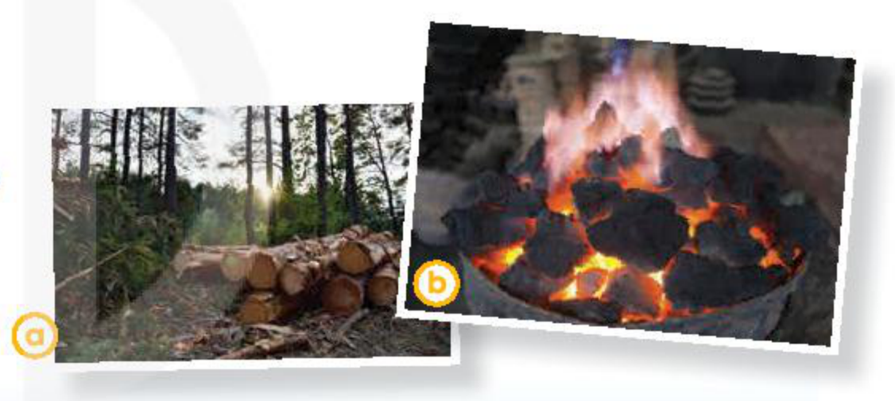
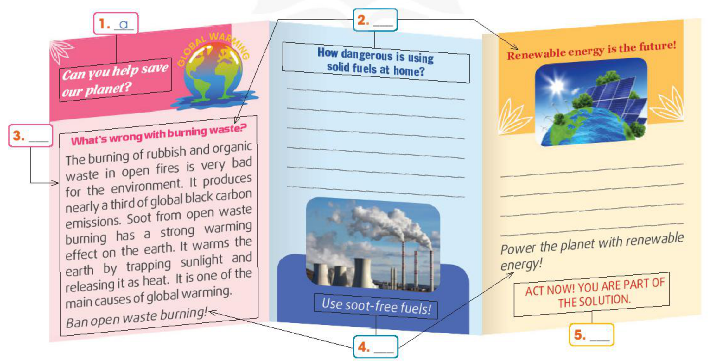
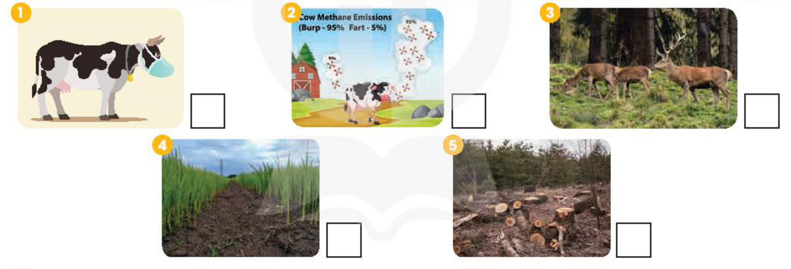

<!-- pdf:53 -->

# UNIT 5: GLOBAL WARMING

> **This unit includes:**
> - **LANGUAGE:**
>   - **Pronunciation:** Sentence stress and rhythm
>   - **Vocabulary:** Words and phrases related to global warming
>   - **Grammar:** Present participle and past participle clauses
> - **SKILLS:**
>   - **Reading:** Reading for main ideas and specific information in an article about the UN Climate Change Conference
>   - **Speaking:**
>     - Talking about human activities and global warming
>     - Presenting ideas clearly in a discussion
>   - **Listening:** Listening for main ideas and specific information in a talk about black carbon and global temperature
>   - **Writing:** Writing a leaflet to persuade people to reduce black carbon emissions
> - **COMMUNICATION AND CULTURE / CLIL:**
>   - **Everyday English:** Giving and responding to warnings
>   - **CLIL:** Reducing the environmental impact of farming
> - **PROJECT:**
>   - Carrying out a survey to find out how local people try to limit global warming

## I. GETTING STARTED

**A presentation about global warming**

**1. Listen and read.**

**Mr Quang:** Good morning, class. Today's lesson will start with Mai and Nam's talk about some of the causes and **consequences** of **global warming**. Would you like to go first, Mai?

**Mai:** Yes, thank you. First, let me remind you what global warming refers to – it's the increase in the earth's **temperature** because of certain gases in the **atmosphere**.

**Nam:** Exactly. These gases are mainly produced through **human activities**. For example, burnt for energy, **fossil fuels** **release** large amounts of **carbon dioxide** into the atmosphere.

**Mr Quang:** But how do these gases make the earth warmer?

**Mai:** Well, they act like the glass in a greenhouse. Trapping too much of the sun's heat, they stop it from escaping back into space. This makes the planet hotter and hotter.

**Nam:** That's right. That's why these **heat-trapping** **pollutants** are known as greenhouse gases, and their **impact** is called the greenhouse effect.
<!-- term: greenhouse gases -->
<!-- term: greenhouse effect -->

**Mai:** Global warming is also linked to rising **sea levels**. As **temperatures** rise, polar ice caps melt faster, adding more water to oceans. Higher sea levels can also lead to floods.
<!-- term: melt -->

**Nam:** Each year, the consequences of global warming become more serious, and its negative impact on the **environment** and people gets stronger.

**Mr Quang:** Good job! Thank you for sharing the information.

<!-- pdf:54 -->

**2. Read the conversation again and complete the diagram, using the following phrases.**

- a. Trapping the sun's heat
- b. Making the planet warmer
- c. Producing certain gases (e.g. CO₂)
- d. Stopping the heat from escaping

1. \_\_\_\_\_\_\_ → 2. \_\_\_\_\_\_\_ → 3. \_\_\_\_\_\_\_ → 4. \_\_\_\_\_\_\_

**3. Match the words to make phrases used in 1.**

| | |
| --- | --- |
| 1. global | a. activities |
| 2. heat-trapping | b. gases |
| 3. greenhouse | c. warming |
| 4. human | d. levels |
| 5. sea | e. pollutants |
<!-- term: greenhouse gases -->
<!-- ocr-ok: đã đối chiếu ảnh trang gốc, OCR bỏ sót dòng 5 sea - e. pollutants -->

**4. Complete the sentences with the correct verb forms from 1.**

1. \_\_\_\_\_\_\_ for energy, fossil fuels release large amounts of carbon dioxide into the atmosphere.
2. \_\_\_\_\_\_\_ too much of the sun's heat, greenhouse gases stop it from escaping back into space.
3. As temperatures rise, polar ice caps melt faster, \_\_\_\_\_\_\_ more water to oceans.
<!-- term: greenhouse gases -->

## II. LANGUAGE

### Pronunciation

**Sentence stress and rhythm**

**Remember!**

- Content words (e.g. main verbs, nouns, adjectives, and adverbs) are often stressed, while grammatical words (e.g. conjunctions, pronouns, prepositions, auxiliaries, articles) are not.
- This combination of stressed and unstressed syllables produces the rhythm of spoken English.
- To sound natural and fluent, you should try to stress the correct words in your spoken sentences.

**1. Listen and repeat. Pay attention to the sentence stress and rhythm.**

1. The *planet* is *getting* *hotter* and *hotter*.
2. We *talked* about the *causes* of *floods*.
3. *Burning* **coal** is *bad* for our *health*.
4. *Why* is **farming** a *big* *source* of *greenhouse* *gases*?

**2. Underline the stressed words in the sentences. Listen and check. Then practise saying the sentences with a natural rhythm.**

1. The village was completely destroyed by floods.
2. Some gases are **released** into the air through human activities.
3. Has the earth's temperature increased in the past few years?
4. Some **environmental** disasters will become more frequent.

<!-- pdf:55 -->

### Vocabulary

**Global warming**

**1. Match the words with their meanings.**

| Words | Meanings |
| --- | --- |
| 1. **coal** (n) | a. that can be replaced naturally without being used up |
| 2. **fossil fuel** (n) | b. materials that are not needed and are thrown away |
| 3. **release** (v) | c. a substance that was formed millions of years ago from dead animals or plants |
| 4. **renewable** (adj) | d. to let a substance flow out |
| 5. **waste** (n) | e. a black rock that is found under the ground and is burnt to produce heat |
<!-- ocr-ok: đã đối chiếu ảnh trang gốc, OCR bỏ sót từ 4 renewable (adj) và 5 waste (n) trong các khung tranh -->

**2. Complete the sentences using the correct forms of the words in 1.**

1. Wind and sunlight are examples of \_\_\_\_\_\_\_ sources of energy.
2. The world produces more than two billion tonnes of solid \_\_\_\_\_\_\_ every year.
3. Governments need to limit the amount of greenhouse gases that is \_\_\_\_\_\_\_ into the air.
4. Her grandpa is now suffering from ill health after many years of working in the \_\_\_\_\_\_\_ industry.
5. The burning of \_\_\_\_\_\_\_ like coal and gas has led to an increase in the amount of CO₂ in the atmosphere.

### Grammar

*Present participle clauses*

**Remember!**

The present participle is used to form a participle clause when the participle and the verb in the main clause have the same subject and the action is done by the same person or thing.
The present participle is a verb form ending in *-ing* and it has an active meaning. Present participle clauses are used to:
- explain the reason for an action.
  *Example:* *Trapping* too much of the sun's heat, greenhouse gases stop it from escaping back into space.
- talk about two actions happening at the same time.
  *Example:* *Walking* on the beach, they picked up litter.
<!-- term: Present participle clauses -->

**1. Find and correct the mistakes in the following sentences.**

1. Was waiting for the train, I read some articles about global warming.
2. Saw the forest fire, the children immediately called the police.
3. The students took part in green activities, were planting more than 100 trees.

*Past participle clauses*

**Remember!**

The past participle is a verb form usually ending in *-ed*, which normally has a passive meaning. Similar to present participles, past participles can form past participle clauses, but with a passive meaning. They are used to:
- give the reason for an action.
  *Example:* *Worried* about climate change, many young people joined the environmental protests. (*Many young people are worried about climate change, so they joined the environmental protests.*)
- express a condition.
  *Example:* *Burnt* for energy, fossil fuels release carbon dioxide into the atmosphere. (*If fossil fuels are burnt for energy, they release carbon dioxide into the atmosphere.*)
<!-- term: Past participle clauses -->

<!-- pdf:56 -->

**2. Rewrite these sentences using past participle clauses.**

*Example:* We were given enough information about the causes of global warming, so we started our report.
→ *Given enough information about the causes of global warming, we started our report.*

1. If farm animals are not kept cool in hot weather, they can suffer from heat stress.
   → \_\_\_\_\_\_\_, farm animals can suffer from heat stress.
2. Some farmers were worried about the consequences of **deforestation**, so they stopped burning trees to create **farmland**.
   → \_\_\_\_\_\_\_, some farmers stopped burning trees to create farmland.
3. If carbon dioxide is produced in huge amounts, it causes air pollution and climate change.
   → \_\_\_\_\_\_\_, carbon dioxide causes air pollution and climate change.

**3. Work in pairs. Make sentences, using present participle and past participle clauses.**

*Example:* *Learning* about the impact of global warming, we decided to save more energy.
*Encouraged* by our teacher, we started some environment projects.

## III. READING

**The UN Climate Change Conference**

**1. Work in pairs. Look at the pictures and discuss the environmental problems you see.**

**2. Read the article and choose the best title for it.**

- A. History of COPs
- B. Main causes of global warming
- C. Main goals of this year's COP

In 1994, the UN decided to bring together world leaders for an annual event, known as COP or 'Conference of Parties', to discuss climate change. This year's conference will review what has been achieved and discuss the key goals.

The first goal is to limit the global temperature rise to 1.5°C. This will require reducing global CO₂ **emissions** by 50 per cent by 2030, and by 2050 achieving a **balance** between the greenhouse gases released into the atmosphere and those removed from it.

The second goal is to reduce the use of coal, which is the dirtiest fuel and biggest source of planet-warming CO₂ emissions. Countries will have to stop building new coal plants and switch to clean sources of energy.

The third goal is to end **deforestation**. Forests remove CO₂ from the atmosphere and slow global warming. But when they are **cut down** or burnt, they release the carbon stored in the trees into the atmosphere as CO₂. Stopping deforestation is, therefore, an effective solution to climate change.
<!-- term: carbon -->

The last key goal is to reduce **methane** emissions. Methane is a greenhouse gas that is more powerful than CO₂ at warming the earth. It is responsible for nearly one-third of current warming from human activities. Methane comes from **farming** activities and landfill **waste**. The production and use of coal, oil, and natural gas also release methane.

This conference is very important because this is the best last chance we have to slow global warming. World leaders, climate experts, organisations, and national representatives will carefully discuss these goals and agree on how to make global progress on climate change.

<!-- pdf:57 -->

**3. Read the article again. Match the highlighted words with their meanings.**

| Highlighted words | Meanings |
| --- | --- |
| 1. **emissions** | a. a gas without smell or colour, often used as a fuel |
| 2. **balance** | b. a chemical substance found in all living things |
| 3. carbon | c. a situation in which different things are equal |
| 4. **methane** | d. gases or other substances that are sent into the atmosphere |
<!-- term: carbon -->

**4. Read the article again and choose the correct answers A, B, or C.**

1. Which of the following is not a COP's key goal?
   - A. Stop cutting down forests.
   - B. Replace coal with cleaner sources of energy.
   - C. End methane emissions.
2. What will happen if there is a balance between the greenhouse gases released and those removed from the atmosphere?
   - A. Global warming will be limited to 1.5°C.
   - B. Global CO₂ emissions will increase.
   - C. Countries will switch to clean energy.
3. Why is it important to reduce the use of coal?
   - A. Because it is easy to build coal plants.
   - B. Because coal is not as clean as gas.
   - C. Because it is responsible for a large part of the CO₂ emissions.
4. How does deforestation contribute to global warming?
   - A. Trees remove carbon dioxide from the atmosphere.
   - B. Trees release carbon into the atmosphere when they are cut down or burnt.
   - C. Forests trap heat and increase temperatures.
5. Why is reducing methane emissions a key goal?
   - A. Because its emissions result from farming activities and landfill waste.
   - B. Because methane's warming power is stronger than that of CO₂.
   - C. Because it is produced through human activities.

**5. Work in groups. Discuss the following question.**

*What should we do to reduce global warming?*

## IV. SPEAKING

**Human activities and global warming**

**1. Match the activities (1–3) with their possible effects on the environment (a–f).**

- 1. Cutting down or burning forests
- 2. Burning coal, oil, and gas
- 3. Raising farm animals like goats, sheep, and cows
<!-- ocr-ok: đã đối chiếu ảnh trang gốc, OCR đọc nhầm coal, oil thành cod, all trong ba khung vàng -->

| | Effects on the environment |
| --- | --- |
| **a.** | When burnt, fossil fuels release greenhouse gases, trapping heat in the atmosphere. |
| **b.** | When eating, these animals produce a lot of methane. This gas is responsible for nearly one-third of current global warming. |
| **c.** | Trees use CO₂ to grow, so when they are cut down or burnt, the CO₂ in the air increases. |
| **d.** | Carbon from fossil fuels combines with oxygen in the air to form large amounts of CO₂. |
| **e.** | Forests store carbon in the trees and **soil**, and help reduce the global temperature. |
| **f.** | Forests are cut down to make space for farm animals. |

<!-- pdf:58 -->

**2. Use the sentences in the box to complete the conversation. Then practise it in pairs.**

- A. First, deforestation leads to more CO₂ in the air
- B. I think it's cutting down or burning forests
- C. This also makes the earth even warmer
- D. Well, there are two main reasons

**Mark:** Mai, which **human activity** is the main cause of global warming?

**Mai:** (1) \_\_\_\_\_\_\_.

**Mark:** Why do you think so?

**Mai:** (2) \_\_\_\_\_\_\_. (3) \_\_\_\_\_\_\_. Trees use CO₂ to grow, so when they are cut down or burnt, CO₂ in the air increases.

**Mark:** I see.

**Mai:** (4) \_\_\_\_\_\_\_. Forests store carbon in the trees and soil, and help reduce the global temperature. That's why I think cutting down or burning forests is the most serious problem.

**Tips**

To present your ideas clearly in a discussion, you should:
- state your opinion directly, e.g. *I think/believe the most serious problem is burning coal, oil, and gas.*
- introduce your arguments, e.g. *There are two main reasons.*
- use linking words to order your arguments, e.g. *First,/Second, ...*
  *Besides,/Moreover,/In addition, ...*
  *Last,/Finally, ...*

**3. Work in pairs. Talk about the other human activities that contribute to global warming. Use the ideas in 1, the model and the tips in 2 to help you.**

**4. Work in groups. Decide which human activity contributes to global warming the most. Report to the whole class.**

## V. LISTENING

**Black carbon and global temperature**

**1. Work in pairs. Match the words with their meanings.**

| Words | Meanings |
| --- | --- |
| 1. **soot** | a. to make or become liquid by heating |
| 2. melt | b. the upper layer of the earth in which trees and plants grow |
| 3. crop | c. tiny pieces of black dust that are produced when wood, coal, etc. is burnt |
| 4. **soil** | d. a plant such as rice or fruit, grown by farmers and used as food |
<!-- term: melt -->
<!-- term: crop -->

**2. Listen to a talk and choose the main idea.**

- A. Farmers produce the largest amount of soot.
- B. Black carbon contributes to burning crop waste and wildfires.
- C. Black carbon emissions come from several sources and affect the earth's temperature.
<!-- term: black carbon -->

**3. Listen to the talk again. Choose the correct answers A, B, or C.**

1. The world's biggest source of soot is \_\_\_\_\_\_\_.
   - A. burning forests
   - B. burning crop waste
   - C. killing living things in the soil
2. Black carbon only stays in the atmosphere for a few \_\_\_\_\_\_\_.
   - A. hours
   - B. days or weeks
   - C. months
3. Black carbon speeds up \_\_\_\_\_\_\_.
   - A. the release of sunlight into the air
   - B. burning of crop waste
   - C. ice melting
4. The next part of the talk will probably be about \_\_\_\_\_\_\_.
   - A. ways to reduce black carbon emissions
   - B. heat-trapping gases
   - C. other heat-trapping pollutants
<!-- term: black carbon -->

**4. Work in groups and answer the questions.**

*Is black carbon found in your city or neighbourhood? If so, where does it come from?*

<!-- pdf:59 -->

## VI. WRITING

**A leaflet about ways to reduce black carbon emissions**

**1. Work in pairs. Match the ways to reduce black carbon emissions (1–3) with the reasons (a–i) for doing so.**

| Ways | Reasons |
| --- | --- |
| 1. Stop burning waste 2. Stop using solid fuels at home 3. Switch to renewable energy | a. Soot from open waste burning has a strong warming effect on the earth. b. Renewable energy is clean, so it doesn't pollute the environment. c. The burning of waste in open fires is bad for the environment. d. The burning of organic waste produces nearly one-third of global black carbon emissions. e. Fossil fuels will be used up in this century while renewable energy will never run out because it comes from natural sources. f. Household air pollution kills millions of people yearly. g. Used for cooking or heating, solid fuels like coal and wood release black carbon and other pollutants. h. Renewable energy can replace fossil fuels because it is convenient and reliable. i. The tiny pieces of black carbon released from indoor stoves can enter the human body and cause serious health problems. |
<!-- term: black carbon -->
<!-- term: renewable energy -->

**2. Work in pairs. Label the parts of the leaflet with the words in the box. Use the tips on page 59 to help you.**

| a. Heading | b. Subheadings | c. Slogans | d. One idea per paragraph | e. Call for action |
| --- | --- | --- | --- | --- |

- 1. *a* — *Can you help save our planet?* (GLOBAL WARMING)
- 2. \_\_\_\_ — *How dangerous is using solid fuels at home?* / *What's wrong with burning waste?* / *Renewable energy is the future!*
- 3. \_\_\_\_ — The burning of rubbish and organic waste in open fires is very bad for the environment. It produces nearly a third of global black carbon emissions. Soot from open waste burning has a strong warming effect on the earth. It warms the earth by trapping sunlight and **releasing** it as heat. It is one of the main causes of global warming.
- 4. \_\_\_\_ — *Ban open waste burning!* / *Use soot-free fuels!* / *Power the planet with renewable energy!*
- 5. \_\_\_\_ — *ACT NOW! YOU ARE PART OF THE SOLUTION.*
<!-- ocr-ok: đã đối chiếu ảnh trang gốc, văn bản nằm nghiêng trên ba mặt tờ rơi minh hoạ -->

<!-- pdf:60 -->

**Tips**

One of the purposes of writing a **leaflet** is to persuade the readers to agree with you. You should:
- use a heading to grab readers' attention.
- begin each paragraph with a catchy subheading.
- develop each idea in a separate paragraph.
- keep the language of the leaflet simple, brief, and clear.
- use easy-to-remember slogans to express your ideas quickly and attract the readers' attention.
- end your leaflet with a good call for action.
- include images and different colours to make your leaflet look attractive and interesting.

**3. You are organising your school's Green Fair. Write about 120–150 words to complete the leaflet in 2. Use the suggested ideas in 1, and the tips above to help you.**

## VII. COMMUNICATION AND CULTURE / CLIL
<!-- ocr-ok: đã đối chiếu ảnh trang gốc, thanh tiêu đề cam VII COMMUNICATION AND CULTURE / CLIL bị OCR bỏ sót -->

### Everyday English

*Giving and responding to warnings*

**1. Listen and complete the conversation with the expressions in the box. Then practise it in pairs.**

| A. Thanks so much | B. I must warn you |
| --- | --- |
| C. Don't worry | D. Watch out |

**Jane:** Hi, Nga. Is that a coal-burning stove?

**Nga:** Hi. Yes, my dad bought it last week. It heats up our home very quickly. Let me put in some more coal.

**Jane:** (1) \_\_\_\_\_\_\_! You're too close and will burn yourself!
<!-- ocr-ok: đã đối chiếu ảnh trang gốc, OCR đọc nhầm You're too thành IYourefioo -->

**Nga:** (2) \_\_\_\_\_\_\_. I'm very careful.
<!-- ocr-ok: đã đối chiếu ảnh trang gốc, OCR ghép chữ I'mvery -->

**Jane:** Yes, it feels very warm, but (3) \_\_\_\_\_\_\_ burning coal produces soot.

**Nga:** Oh no, I didn't know that. (4) \_\_\_\_\_\_\_. I'll tell my dad.
<!-- term: Giving and responding to warnings -->
<!-- ocr-ok: đã đối chiếu ảnh trang gốc, OCR đọc lỗi dòng cuối của Nga -->

**2. Work in pairs. Use the model in 1 to make similar conversations for these situations. One of you is Student A, the other is Student B. Use the expressions below to help you.**

1. Student A is burning rubbish. Student B is warning him/her about the dangers of open waste burning to people's health and the environment.
2. Student B is building a campfire. Student A is warning him/her about the risk of starting a forest fire and the health risks.

| **Useful expressions** | |
| --- | --- |
| **Giving warnings** | **Responding to warnings** |
| I wouldn't ... if I were you. Watch out (for something)! I (must) warn you ... Mind your ... | Thanks for (the) warning. I'll be (more) careful (next time). Thanks. Oh, really? I didn't know that. Thanks so much. |
<!-- term: Giving and responding to warnings -->
<!-- ocr-ok: đã đối chiếu ảnh trang gốc, OCR đọc đứt tiêu đề bảng Useful expressions -->

<!-- pdf:61 -->

### CLIL

**1. Read the text and tick (✓) the pictures that show ways to reduce global warming.**

**REDUCING THE ENVIRONMENTAL IMPACT OF FARMING**

**Farming** provides us with the food that we eat every day. But farming activities also have a strong warming impact on the global temperature. The good news is that experts have already started thinking about how to reduce it.

Raising farm animals like cows, goats, and sheep makes the planet hotter. There are billions of them and they release methane, a greenhouse gas that is much more dangerous than carbon dioxide. That is why scientists are developing methane-catching face masks for cows. They are intended to reduce methane emissions by up to 50 per cent per cow.

Another farming activity that heats the atmosphere is growing rice. According to research, emissions from rice farms have the same warming effect as about 600 coal plants. Flooded rice fields also make it easier for soil bacteria to produce greenhouse gases. New farming methods have allowed rice to grow well in drier fields, limit the amount of greenhouse gases, use less water, and produce better crops.

In addition, land-use increases the global temperature. Plants and trees use CO₂ to grow and store large amounts of carbon underground. Cutting down or burning forests to create farm fields and land for feeding animals releases tonnes of carbon dioxide and other greenhouse gases into the atmosphere every year. Luckily, many countries and world leaders have agreed to protect the forests and end deforestation.

In short, there are some positive signs that farmers can meet the environmental challenges. However, although the impact of farming on the global temperature has been reduced, there is still much to do.

**2. Work in groups. Discuss the following questions.**

*What farming activities in Viet Nam do you think have negative impact on the global temperature? What do you think are the alternatives to those activities?*

## VIII. LOOKING BACK

### Pronunciation

**Listen and underline the stressed words. Then practise saying the sentences with a natural rhythm.**

1. Forests are helpful in cooling down our planet.
2. Plants can store a lot of carbon in their roots, branches, and leaves.
3. Oceans can also remove carbon from the atmosphere and store it.
4. Oceans may start releasing the carbon they store as global temperatures rise.

<!-- pdf:62 -->

### Vocabulary

**Choose the correct word or phrase to complete each sentence.**

1. Ending the use of *carbon* / *coal* is one of the COP's key goals.
2. Human activities cause most of the global warming by *releasing* / *melting* greenhouse gases.
3. *Crop waste* / *Renewable energy* comes from sources like wind, rain, waves, and sunlight, and is replaced naturally.
4. The burning of *fossil fuels* / *soot* increases the amount of greenhouse gas emissions in the atmosphere.
<!-- term: renewable energy -->

### Grammar

**Rewrite the sentences using present or past participle clauses.**

1. My father was a firefighter, so he understood the dangers of open waste burning.
   → \_\_\_\_\_\_\_, my father understood the dangers of open waste burning.
2. Many wild animals were frightened by the forest fires, so they ran away or hid under the rocks.
   → \_\_\_\_\_\_\_, many wild animals ran away or hid under the rocks.
3. The road was flooded with water after the heavy rain and turned into a big swimming pool.
   → \_\_\_\_\_\_\_, the road turned into a big swimming pool.
4. The farmers cut down the local forest to create new farmland and destroyed all the wildlife there.
   → The farmers cut down the local forest to create new farmland, \_\_\_\_\_\_\_.

## IX. PROJECT

**What we can do every day to help limit global warming**

**Work in groups. Carry out a survey to find out how people in your area are reducing the negative impact of their daily activities on the environment and trying to limit global warming.**

**Report your survey results to the class.**

**The report should include the following points:**
- what their daily activities used to involve, e.g. driving to work
- how these activities affect global warming, e.g. releasing carbon dioxide emissions
- what people do to reduce their environmental impact, e.g. cycling to work
- what results people get, e.g. reducing carbon footprint

### Now I can ...

- use sentence stress appropriately to speak with a natural rhythm.
- understand and use words and phrases related to global warming.
- use present participle and past participle clauses correctly.
- read for main ideas and specific information in an article about the UN Climate Change Conference.
- talk about human activities and global warming, and present ideas clearly in a discussion.
- listen for main ideas and specific information in a talk about black carbon and global temperature.
- write a leaflet to persuade people to reduce black carbon emissions.
- give and respond to warnings.
- understand the environmental impact of farming and how to reduce it.
- carry out a survey to find out how local people try to limit global warming and present the survey results to the class.

## 📷 Danh mục hình minh hoạ

| Mã hình | Trang PDF | Trang sách | Chú thích / Mô tả |
| --- | --- | --- | --- |
| H11-tieng_anh-u05-01 | 56 | 55 | Hai bức ảnh minh hoạ các vấn đề môi trường ở mục Reading 1: (a) nạn chặt phá rừng lấy gỗ và (b) việc đốt than đá gây phát thải khí nhà kính |
| H11-tieng_anh-u05-02 | 59 | 58 | Mẫu tờ rơi gấp ba (*leaflet*) về chủ đề *Global Warming* với các vị trí chú thích cấu trúc (1)–(5) ở mục Writing 2 |
| H11-tieng_anh-u05-03 | 61 | 60 | Năm bức tranh (1)–(5) kèm ô đánh dấu minh hoạ các hoạt động nông nghiệp và giải pháp giảm thiểu sự nóng lên toàn cầu ở mục CLIL 1 |
