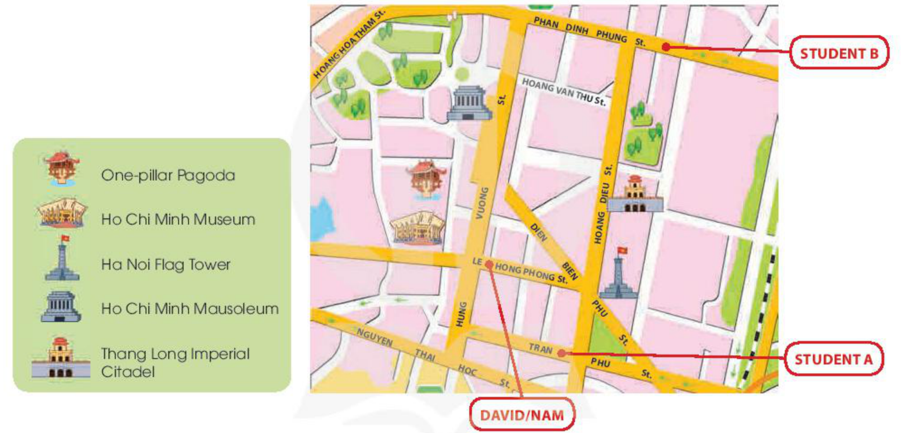

<!-- pdf:67 -->

# UNIT 6: PRESERVING OUR HERITAGE

> **This unit includes:**
> - **LANGUAGE**
>   - **Pronunciation:** Intonation in statements, commands, and lists
>   - **Vocabulary:** Words and phrases related to preserving heritage
>   - **Grammar:** *To*-infinitive clauses
> - **SKILLS**
>   - **Reading:** Reading for main ideas and specific information in an article about an ideas competition
>   - **Speaking:**
>     - Discussing ways to preserve cultural heritage
>     - Keeping a conversation going by showing interest and encouragement
>   - **Listening:** Listening for main ideas and specific information in a tour guide's talk about Trang An Scenic Landscape Complex
>   - **Writing:** Writing a leaflet to inform people about ways to preserve Trang An Scenic Landscape Complex
> - **COMMUNICATION AND CULTURE / CLIL**
>   - **Everyday English:** Asking for and giving directions
>   - **Culture:** Initiatives to preserve heritage around the world
> - **PROJECT**
>   - Propose ways to preserve a type of heritage

## I. GETTING STARTED

**Heritage sites in Viet Nam**

**1. Listen and read.**

**Ms Hoa:** Good morning, everyone. As part of our school cultural programme, we need to plan a field trip to a **heritage** site in Viet Nam. So, where would you like to go?
<!-- term: field trip -->

**Peter:** Do you have any suggestions for us, Ms Hoa?

**Ms Hoa:** I'd recommend Trang An Scenic Landscape **Complex**. It's the only place in Southeast Asia to be recognised as a mixed heritage site by UNESCO.
<!-- term: mixed heritage site -->

**Peter:** What's a mixed heritage site?
<!-- term: mixed heritage site -->

**Ms Hoa:** It's a site that has both natural and cultural importance. For example, you can go on a boat trip there to enjoy the beautiful **landscape**. Or you can visit the old **temples** and **monuments** to learn about Vietnamese history.

**Anna:** That sounds interesting, but if we want to learn about cultural values of the past, where should we go?

**Ms Hoa:** You can go to Hoi An Ancient Town in central Viet Nam. You'll learn about urban lifestyles and traditions from the 15th to the 19th century and will see examples of **ancient** architecture. All buildings are kept in their original **state**. It's a great place to explore.

**Anna:** Wow! That's exciting. What about southern Viet Nam?

<!-- pdf:68 -->

**Ms Hoa:** You can go to the Mekong River Delta to enjoy *don ca tai tu* – a form of traditional **folk** singing. Local artists perform *don ca tai tu* everywhere – at parties, in fruit gardens, even on the floating market boats.
<!-- term: folk singing -->

**Peter:** It's a great way to promote this kind of cultural heritage of southern Viet Nam.
<!-- term: cultural heritage -->

**Ms Hoa:** Indeed. Now, please discuss in your group and let me know your field trip ideas.
<!-- term: field trip -->

**2. Where can we do the following? Write T for Trang An, H for Hoi An, and M for Mekong River Delta.**

| Activity | Place |
| --- | --- |
| 1. Going on a tour by boat | |
| 2. Seeing areas of natural beauty | |
| 3. Seeing ancient houses kept in their original style of architecture | |
| 4. Listening to *don ca tai tu* at floating markets | |

**3. Match the words to make phrases used in 1.**

| | |
| --- | --- |
| 1. folk | a. architecture |
| 2. cultural | b. landscape |
| 3. beautiful | c. singing |
| 4. ancient | d. heritage |
<!-- ocr-ok: đã đối chiếu ảnh trang gốc, OCR lỗi nhận diện các thẻ ghép từ 1-4 và a-d -->

**4. Complete the sentences using phrases from 1.**

1. Trang An is the only place in Southeast Asia \_\_\_\_\_\_\_.
2. You can go on a boat trip \_\_\_\_\_\_\_.
3. You can visit the old temples and monuments \_\_\_\_\_\_\_.
4. Performing folk songs at floating markets is a great way \_\_\_\_\_\_\_.

## II. LANGUAGE

### Pronunciation

**Intonation in statements, commands, and lists**

**Remember!**

- Intonation describes how a speaker's voice rises and falls in speech, and is very important in communication.
- We usually use falling intonation at the end of statements and commands to show certainty.
- When listing things, we slightly raise our voice on each item (level-rising intonation) and lower our voice on the last item to show that the list is complete.

**1. Listen and repeat. Pay attention to the falling intonation (↘) and level-rising intonation (→↗) in the following sentences.**

1. Our class is going on a field trip next week. ↘
2. Put your rubbish in the bin! ↘
3. You can see beautiful caves →↗, green **valleys** →↗, and high mountains. ↘

<!-- pdf:69 -->

**2. Listen and mark the intonation in these sentences, using ↘ (falling intonation) or →↗ (level-rising intonation). Then practise saying them in pairs.**

1. Hoi An Ancient Town became a World Heritage Site in 1999.
2. Turn on the light. It's dark in here.
3. Cultural heritage may include temples, pagodas, and monuments.
4. Tourists can visit the pedestrian streets in Ha Noi.

### Vocabulary

**Our heritage**

**1. Match the words with their meanings.**

| Words | Meanings |
| --- | --- |
| 1. **restore** (v) | a. connected with things from the past |
| 2. **historical** (adj) | b. traditional to a particular group or country, and usually passed down from generation to generation |
| 3. **preserve** (v) | c. important in history |
| 4. **folk** (adj) | d. to return something to an earlier good condition or position |
| 5. **historic** (adj) | e. to keep something in its original state or in good condition and prevent it from being damaged |

**2. Complete the sentences using the words in 1.**

1. Mary enjoys reading \_\_\_\_\_\_\_ novels set in World War Two.
2. This meeting of world leaders was a truly \_\_\_\_\_\_\_ event that is likely to be remembered in the future.
3. The local authority plans to \_\_\_\_\_\_\_ the old **monument** which was damaged by the storm.
4. We should increase efforts to \_\_\_\_\_\_\_ *ca tru* because nowadays there are very few *ca tru* musicians left.
5. Many \_\_\_\_\_\_\_ songs tell stories about lives of ordinary people in the past.

### Grammar

***To*-infinitive clauses**

**Remember!**

A *to*-infinitive clause can be used:
- to express purpose.
  *Example: He studied hard to pass the exam.*
  *I bought some souvenirs to give to my parents.*
- to modify a noun or noun phrase that contains ordinal numbers (*the first, the second,* etc.), superlatives (*the best, the most beautiful,* etc.) and *next, last,* and *only*.
  *Example: Ethan is usually the last person to understand the joke.*
<!-- term: To-infinitive clauses -->

**1. Combine the sentences using *to*-infinitive clauses.**

1. Lan went to Hue. She wanted to see the monuments there.
   → Lan \_\_\_\_\_\_\_.
2. Minh created a website. He wanted to give more information about local historical sites to visitors.
   → Minh \_\_\_\_\_\_\_.
3. Peter took a boat trip around the floating market. He wanted to listen to *don ca tai tu* there.
   → Peter \_\_\_\_\_\_\_.
4. My sister has opened a small shop behind the museum. She wanted to sell postcards and souvenirs to tourists.
   → My sister \_\_\_\_\_\_\_.

**2. Work in pairs. Ask and answer questions about heritage sites or traditions, using *to*-infinitive clauses.**

*Example:*

**A:** *What do many tourists go to Ha Long Bay for?*

**B:** *They go there to enjoy the beautiful scenery. / To enjoy the beautiful scenery.*

<!-- pdf:70 -->

## III. READING

**Teenagers' ideas for preserving heritage**

**1. Work in pairs. Ask and answer the question.**

*Why is it important to protect our heritage?*

**2. Read the article and circle the correct meanings of the highlighted words and phrase.**

**PRESERVING OUR HERITAGE: IDEAS FROM TEENAGERS**

*To encourage young people to learn about and **appreciate** our **cultural heritage**, we organised an ideas competition. We invited students from across the country to send us their ideas for protecting and promoting our heritage. We have received many interesting entries. Below are the winners.*

**A.** \_\_\_\_\_\_\_

The idea of promoting heritage sites through social media came from a group of 11th grade students. They suggested using social media activities, such as photo competitions, to encourage young people to learn about our heritage sites and local traditions on important festivals. They also suggested creating **trending** topics or challenges on social media. For example, a postcard challenge will invite people to create and share unusual and exciting postcards about the heritage sites that they have visited.

**B.** \_\_\_\_\_\_\_

Two 10th grade students suggested forming **historical** societies or local groups who have a keen interest in their history and heritage. These groups will provide information about local heritage sites, organise special events to celebrate local festivals, and invite young people to discuss issues related to preserving the heritage. This way, they will be able to **give voice to** suggestions and solutions to problems they care about. They will feel that their voices are heard, and they can contribute to society.

**C.** \_\_\_\_\_\_\_

To **preserve** heritage, such as traditional music and stories, a group of secondary school students **proposed** setting up folk clubs. The clubs will hold events for young people to experience and learn about traditional **performing arts**. The artists will not only perform, but also introduce their arts and talk about how students can help promote folk culture. The clubs will organise training for students who want to learn folk songs, a traditional musical instrument, or folk dancing.

1. **appreciate**
   - A. to recognise the good qualities of something
   - B. to realise that something is dangerous
   - C. to discuss a new idea
2. **trending**
   - A. being discussed a lot on social media
   - B. being forgotten by the public
   - C. creating and sharing information
3. **give voice to**
   - A. to take action about something
   - B. to listen to someone's advice
   - C. to express opinions about something
4. **proposed**
   - A. asked someone for information
   - B. suggested something as a plan or course of action
   - C. invited guests for an event

<!-- pdf:71 -->

**3. Read the article again. Match the following headings (1–4) with the appropriate paragraphs (A–C). There is ONE extra heading.**

1. Organising photo competitions of performing artists
2. Promoting and developing the folk arts
3. Making use of social media to promote heritage
4. Opportunities to learn about heritage and be involved in problem-solving

**4. Read the article again and decide which paragraph includes the following information.**

| | Paragraph |
| --- | --- |
| 1. Creating popular topics on the Internet such as sharing postcards | A |
| 2. Raising awareness of preserving our heritage through discussions | |
| 3. Organising photo competitions on social media | |
| 4. Setting up local historical societies to organise festivals and other events | |
| 5. Inviting artists to perform and teach folk singing, dancing, and music | |

**5. Work in pairs. Discuss the following questions.**

*Which of the ideas in the text do you like most? How will it help preserve heritage?*

## IV. SPEAKING

**Preserving cultural heritage**

**1. Work in pairs. Match the ways to preserve our heritage with the reasons for doing so.**

| Ways | Reasons |
| --- | --- |
| 1. Learning about cultural heritage at school | a. Spreading information to more people quickly |
| 2. Promoting cultural heritage on social media | b. Helping students understand the value of cultural heritage |
| 3. Organising competitions to find good ideas for preserving our heritage | c. Making cultural heritage more widely known to people around the world |
| 4. Introducing cultural heritage to foreign visitors through tourism activities | d. Encouraging people to get more involved |

**2. Complete the conversation with the words and phrase in the box. Then practise it in pairs.**

| A. Well | B. Right | C. Really | D. Let me think |
| --- | --- | --- | --- |

**Nam:** What do you think is the best way to preserve cultural heritage?

**Anna:** (1) \_\_\_\_\_\_\_. The best way to preserve it is to raise people's awareness of its importance.
<!-- term: raise awareness -->

**Nam:** (2) \_\_\_\_\_\_\_. We can set up school jobs for students to learn about forms of cultural heritage, such as folk music, singing, or dancing.

**Anna:** (3) \_\_\_\_\_\_\_, our classmates will show no interest in such clubs.

**Nam:** (4) \_\_\_\_\_\_\_? Why do you think so?

**Anna:** Traditional arts are not fashionable. There are so many other exciting things for us to do.

**Nam:** That's why it's important to make such clubs more interesting for teenagers.

<!-- pdf:72 -->

> **Tips**
> - To keep a conversation going, you should show that you are interested in it and encourage the speaker to continue speaking using words and phrases such as *Yeah, Uh huh, OK, Right, I see, Interesting, Really*.
> - We often need to think before speaking. To show that you have understood and are going to speak, use words and phrases such as *Well, Let me think, I'm not sure, Hold on a minute, That's a good question*.

**3. Work in pairs. Make a similar conversation about ways to preserve cultural heritage. Use the ideas in 1, the model in 2, and the tips above to help you.**

**4. Work in groups. Think of a form of cultural heritage (such as a tradition, a festival, or a form of music), and discuss ways to preserve it. Report your group's ideas to the whole class.**

## V. LISTENING

**A trip to Trang An Scenic Landscape Complex**

**1. Work in pairs. Ask and answer the questions.**

*What do you know about Trang An? Have you been there? If yes, what did you see or do there?*

**2. Listen to a talk. What is the talk mainly about?**

- A. The tour guide is explaining why Trang An is a mixed World Heritage Site.
- B. The tour guide is talking about the ecosystem of Trang An and efforts to preserve it.
- C. The tour guide is introducing the site's natural beauty.

**3. Listen to the talk again and complete each gap in the notes with no more than THREE words and/or a number.**

> **TRANG AN SCENIC LANDSCAPE COMPLEX**
>
> **Quick facts**
> - Recognised as the first mixed World Heritage Site in (1) \_\_\_\_\_\_\_
> - Famous for its beautiful landscape and long cultural history
> - Consists of (2) \_\_\_\_\_\_\_
>
> **Natural beauty and biodiversity**
> - Beautiful **limestone** mountains, **valleys**, and rivers
> - More than (3) \_\_\_\_\_\_\_ of plants and 200 types of animals
>
> **Cultural heritage**
> - Caves showing how (4) \_\_\_\_\_\_\_ lived over a period of 30,000 years
> - Hundreds of temples and **historic** pagodas
>
> **Current condition**
> - The landscape is not changed or damaged by human activities.
> - Most of the site is still kept in its (5) \_\_\_\_\_\_\_, e.g. the original style of architecture.

**4. Work in pairs. Make some predictions about what the tour guide will say next.**

<!-- pdf:73 -->

## VI. WRITING

**A leaflet about ways to preserve Trang An Scenic Landscape Complex**

**1. Work in pairs. Put the problems that Trang An Scenic Landscape Complex may face and the possible solutions in the correct blanks.**

- A. educating young people about the importance of heritage
- B. damaging the ecosystem
- C. loss of cultural values
- D. organising eco-tours to natural heritage sites
<!-- term: natural heritage -->

| NATURAL HERITAGE | CULTURAL HERITAGE |
| --- | --- |
| **Problems: Negative effects of mass tourism** - polluting the rivers and valleys - (1) \_\_\_\_\_\_\_ **Solutions:** - (2) \_\_\_\_\_\_\_ - creating a sustainable habitat suitable for local wildlife | **Problems: Young people's lack of knowledge about the cultural heritage** - not able to appreciate traditions - (3) \_\_\_\_\_\_\_ **Solutions:** - (4) \_\_\_\_\_\_\_ - promoting heritage values on social media |
<!-- term: mass tourism -->
<!-- term: natural heritage -->
<!-- term: cultural heritage -->
<!-- ocr-ok: đã đối chiếu ảnh trang gốc, OCR đọc ghép ngang hai cột khung NATURAL HERITAGE và CULTURAL HERITAGE -->

**2. Write a leaflet about the problems that Trang An may face and the possible solutions to them. Use the ideas in 1 and the outline below to help you.**

> **Preserve our heritage – Preserve Trang An Scenic Landscape Complex**
>
> Trang An (Ninh Binh Province) was the first site in Viet Nam to be recognised by UNESCO as a mixed World Heritage Site in 2014. It is famous for \_\_\_\_\_\_\_.
>
> **Preserving nature**
> - Trang An may be affected by mass tourism. This kind of tourism can cause / lead to / result in \_\_\_\_\_\_\_.
> - To preserve Trang An, it is necessary to \_\_\_\_\_\_\_ / it is recommended that \_\_\_\_\_\_\_ / we should \_\_\_\_\_\_\_.
>
> **Preserving culture**
> - Another problem might be young people's lack of knowledge about our cultural heritage. As a result, / As a consequence, \_\_\_\_\_\_\_.
> - This problem can be solved if \_\_\_\_\_\_\_ / To deal with this problem, we should \_\_\_\_\_\_\_.
>
> **LET'S PRESERVE AND BE PROUD OF OUR HERITAGE!**
<!-- ocr-ok: đã đối chiếu ảnh trang gốc, OCR đọc lệch chữ trên tờ gấp ba cột -->

<!-- pdf:74 -->

## VII. COMMUNICATION AND CULTURE / CLIL

### Everyday English

*Asking for and giving directions*

**1. Listen and complete the conversation with the expressions in the box. Then practise it in pairs.**

| A. could you tell me the way to | B. turn left |
| --- | --- |
| C. on your right | D. Go straight ahead |

**David:** Excuse me, (1) \_\_\_\_\_\_\_ Thang Long **Imperial** Citadel? I'm lost.

**Nam:** Sure. The **citadel** is not far from here. (2) \_\_\_\_\_\_\_ until you get to Hoang Dieu Street, then (3) \_\_\_\_\_\_\_. Walk past Ha Noi Flag Tower and you'll see it (4) \_\_\_\_\_\_\_.

**David:** Thank you.
<!-- term: Asking for and giving directions -->

**2. Work in pairs. Use the model in 1 to make similar conversations for these situations. One of you is Student A, the other is Student B. Use the expressions below to help you.**

1. Student A is asking for directions to Ho Chi Minh Mausoleum. Student B uses the map to give directions.
2. Student B is asking for directions to Ha Noi Flag Tower. Student A uses the map to give directions.

| **Useful expressions** | |
| --- | --- |
| **Asking for directions** | **Giving directions** |
| Can you tell me the way to ...? Excuse me, is ... near here? How do/can I get to ...? Which is the best/easiest way to ...? | **Movement:** Go straight ahead/on. Walk along ... street/road. Walk past the (post office/bank). Turn left/right at the traffic lights/into Star Street. Take the first/second road/turning on the left. **Location:** It's on your left/right. It's next to/opposite/between/at the end of/behind/in front of ... It's (just) around the corner. |
<!-- term: Asking for and giving directions -->

<!-- pdf:75 -->

### Culture

**1. Read the text and answer the questions.**

**PRESERVING HERITAGE AROUND THE WORLD**

*Crowdfunding for heritage!*

Preserving their heritage can present a challenge to many nations, especially if they have a large number of heritage sites, like Italy does. However, the country has found a new method of raising money for heritage projects from a large number of individuals and businesses – **crowdfunding**. For example, *loveitaly*, a non-profit organisation, uses its website to reach all the people around the world who love Italy, and collects donations from everyone who wants to help. One of their first success stories was raising enough money to **restore** an ancient site in Pompeii.

*Strict heritage laws*

In Australia, individuals and companies have to pay a **fine** of AU\$1,000 to AU\$5,000 for any damage to heritage sites or objects, regardless of whether they can be repaired. In some cases, the fines are heavier, and people could even face time in prison. The authorities hope the harsher punishments can stop people from destroying or damaging cultural sites and items, and prevent heritage crime.

*Tourism works!*

Spain is one of the countries that has successfully promoted its cultural heritage through tourism. For many years, festivals such as La Tomatina (in which people throw tomatoes at each other) or Las Fallas (a five-day festival of fireworks and light shows) in Valencia have attracted millions of local and foreign tourists. The unique architecture in Barcelona, home to nine UNESCO World Heritage Sites, and Santiago de Compostela's Old Town, which is also on the world heritage list, are famous all over the world.

*Which country ...*

1. raises money from the public for restoring its heritage?
2. organises successful festivals that attract visitors from around the world?
3. fines people heavily if they damage its heritage?

**2. Work in groups. Discuss the following questions.**

*Are the methods of preserving heritage in the text used in Viet Nam? Which one do you think works best in Viet Nam?*

## VIII. LOOKING BACK

### Pronunciation

**Listen and mark the intonation in the following sentences, using ↘ (falling intonation) or →↗ (level-rising intonation). Then practise saying them in pairs.**

1. The trip to Hoi An Ancient Town was amazing.
2. Turn off the air conditioner. It wastes too much electricity.
3. A boat tour is the best way to experience wildlife habitats.
4. In Ha Long Bay you can go swimming, diving, and fishing.

<!-- pdf:76 -->

### Vocabulary

**Choose the correct word to complete each sentence.**

1. Many ancient houses in the city are not *well preserved* / *well promoted* because of changes over time and bad weather.
2. His *historical* / *historic* novels are based on events that happened in the early 19th century.
3. Older generations worry that *folk* / *festival* music and dances will die out because young people only listen to pop music.
4. The heritage site is *promoted* / *protected* as a tourist destination on social media.

### Grammar

**Rewrite the sentences using *to*-infinitive clauses.**

1. Mai went to Soc Son because she wanted to attend the Giong Festival.
   → \_\_\_\_\_\_\_
2. The first place that you can visit on the trip is Hue Imperial Citadel.
   → \_\_\_\_\_\_\_
3. Our music teacher gave lessons in *xoan* singing because she wanted to help us appreciate our cultural heritage.
   → \_\_\_\_\_\_\_
4. The most famous site that you can see is the old bridge across the river.
   → \_\_\_\_\_\_\_

## PROJECT

**How can we preserve our heritage?**
<!-- ocr-ok: đã đối chiếu ảnh trang gốc, chữ nghệ thuật tiêu đề dự án làm OCR đọc nhầm preserve thành phesewe và bỏ sót our heritage -->

**Work in groups. Choose a type of heritage that you are interested in and propose ways to preserve it. Present your ideas to the class in the form of an oral presentation, a leaflet, or a poster. Use these questions as cues.**

1. What is the heritage? Where is it? Is it cultural or natural heritage?
2. What is it famous for?
3. How important is it?
4. What can we do to preserve it?

### Now I can ...

- use rising and falling intonation in statements, commands, and lists.
- understand and use words and phrases related to preserving heritage.
- use *to*-infinitive clauses correctly.
- read for main ideas and specific information in an article about an ideas competition.
- discuss ways to preserve cultural heritage and keep a conversation going by showing interest and encouragement.
- listen for main ideas and specific information in a tour guide's talk about Trang An Scenic Landscape Complex.
- write a leaflet to inform people about ways to preserve Trang An Scenic Landscape Complex.
- ask for and give directions.
- learn about initiatives to preserve heritage around the world.
- propose ways to preserve a type of heritage, and give a group presentation.

## 📷 Danh mục hình minh hoạ

| Mã hình | Trang PDF | Trang sách | Chú thích / Mô tả |
| --- | --- | --- | --- |
| H11-tieng_anh-u06-01 | 74 | 73 | Bản đồ chỉ đường khu vực Ba Đình (Hà Nội) kèm chú giải các địa danh: One-pillar Pagoda, Ho Chi Minh Museum, Ha Noi Flag Tower, Ho Chi Minh Mausoleum, Thang Long Imperial Citadel và vị trí của David/Nam, Student A, Student B |
