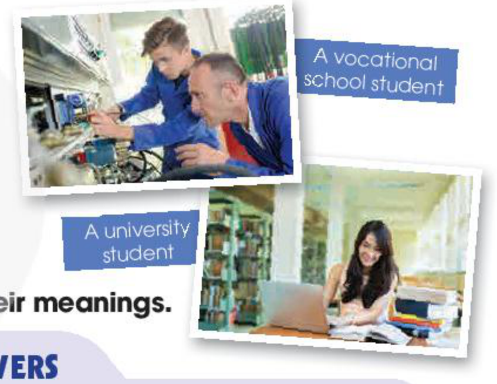
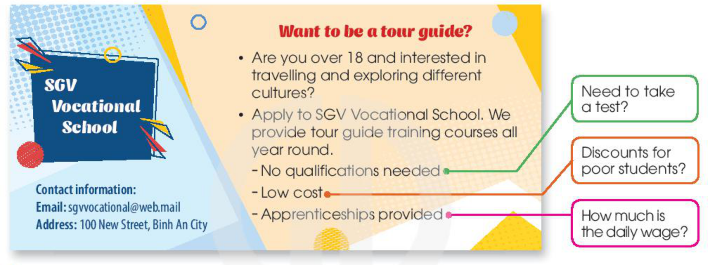

<!-- pdf:77 -->

# UNIT 7: EDUCATION OPTIONS FOR SCHOOL-LEAVERS

> **This unit includes:**
> - **LANGUAGE**
>   - **Pronunciation:** Intonation in *Wh*- and *Yes/No* questions
>   - **Vocabulary:** Words and phrases related to education after leaving school
>   - **Grammar:** Perfect gerunds and perfect participle clauses
> - **SKILLS**
>   - **Reading:** Reading for main ideas and specific information in an article about different study options after leaving school
>   - **Speaking:**
>     - Discussing the benefits of vocational training and academic study
>     - Ending a conversation or discussion
>   - **Listening:** Listening for main ideas and specific information in a conversation about courses provided at a vocational school
>   - **Writing:** Writing a request letter to ask for information about vocational school courses
> - **COMMUNICATION AND CULTURE / CLIL**
>   - **Everyday English:** Making an appointment
>   - **Culture:** UK education after secondary school
> - **PROJECT**
>   - Doing research on an educational institution

## I. GETTING STARTED

**Planning our education**

**1. Listen and read.**

**Ms Hoa:** Good morning, class. There was an education fair last weekend. Did anyone go?
<!-- term: education fair -->

**Nam:** Yes, Mai and I did. The fair was great, and we got a lot of useful information.

**Ms Hoa:** I'm glad to hear that. Would you like to share some of it with the class?

**Mai:** Sure. After finishing school, we mainly have two education options. For example, we can get into university if we earn high grades or pass the university **entrance exam**.

**Nam:** That's true, but **academic** education isn't everything. The other option is going to a **vocational school** where we can learn skills for particular jobs.

**Ms Hoa:** That sounds interesting. So what are your plans for the future?

**Mai:** I'm hoping to go to university. Having won several biology competitions, I want to study biology and become a scientist.

**Ms Hoa:** Great! It's really important to follow your dream, Mai.

**Mai:** My mum still regrets not having gone to university. So I want to make her proud of me. How about you, Nam?

**Nam:** Well, I don't think university is for me. I want to go to a vocational school because I want to become a car **mechanic**. My father owns a car repair shop. Having watched him work very hard for many years helped me make my decision.

**Ms Hoa:** That's very sensible, Nam! I hope you can help him grow his business.

<!-- pdf:78 -->

**2. Read the conversation again. Decide whether the following statements are true (T) or false (F).**

| | T | F |
| --- | --- | --- |
| 1. School-leavers only have the option of academic education. | | |
| 2. Good grades at school can help students get into university. | | |
| 3. Vocational schools are for those who want to develop job skills. | | |
| 4. Nam wants to work at his father's car repair shop after leaving school. | | |

**3. Find phrases in the conversation that mean the following.**

| | |
| --- | --- |
| 1. an event at which students can talk to representatives of universities or vocational schools about their study options | e\_\_\_\_\_\_\_ f\_\_\_\_\_\_\_ |
| 2. an exam that someone takes to be accepted into a school or university | e\_\_\_\_\_\_\_ e\_\_\_\_\_\_\_ |
| 3. studying at school or university to gain knowledge and develop thinking skills | a\_\_\_\_\_\_\_ e\_\_\_\_\_\_\_ |
| 4. a place that teaches skills needed for particular jobs | v\_\_\_\_\_\_\_ s\_\_\_\_\_\_\_ |
<!-- term: education fair -->

**4. Complete the sentences using phrases from 1.**

1. \_\_\_\_\_\_\_ several biology competitions, Mai wants to study biology and become a scientist.
2. Mai's mum still regrets not \_\_\_\_\_\_\_ to university.
3. \_\_\_\_\_\_\_ his father work very hard for many years helped Nam make his decision.

## II. LANGUAGE

### Pronunciation

**Intonation in *Wh*- and *Yes/No* questions**

**Remember!**

- In *Yes/No* questions, we usually use rising intonation, which means the voice goes up at the end of the sentence.
  *Example: Do you like it?* ↗
- In *Wh*-questions, we usually use falling intonation, which means the voice goes down at the end of the sentence.
  *Example: Where do you buy it?* ↘

**1. Listen and repeat. Pay attention to the falling (↘) or rising (↗) intonation in each of the following questions.**

1. Did anyone go? ↗
2. Is academic education important nowadays? ↗
3. What are your plans for the future? ↘
4. When does the course start? ↘

**2. Listen and mark the intonation in these questions, using ↗ (rising intonation) or ↘ (falling intonation). Then practise saying them in pairs.**

1. Do you want to go to university?
2. Have you talked with your parents about your plans?
3. How much does it cost to study at university?
4. What's your favourite subject at school?

<!-- pdf:79 -->

### Vocabulary

**Completing your education**

**1. Match the words and phrase with their meanings.**

| Words / Phrases | Meanings |
| --- | --- |
| 1. **school-leaver** (n) | a. education at a college or university |
| 2. **vocational education** (np) | b. the act of completing a university degree or a course of study |
| 3. **higher education** (n) | c. a person who has just left school |
| 4. **qualification** (n) | d. education that prepares students for work in a specific trade |
| 5. **graduation** (n) | e. an official record showing that you have finished a training course or have the necessary skills, etc. |

**2. Complete the sentences using the correct form of the words and phrase in 1.**

1. Many parents nowadays want their children to pursue \_\_\_\_\_\_\_ at universities after leaving school.
2. He didn't get the job he wanted because he didn't have the right \_\_\_\_\_\_\_.
3. Many \_\_\_\_\_\_\_ choose to go to university to study academic subjects.
4. More and more young people prefer \_\_\_\_\_\_\_ because they like to learn practical skills.
5. Many young people find it hard to get a job immediately after \_\_\_\_\_\_\_.

### Grammar

*Perfect gerunds*

**Remember!**

The perfect gerund (*having done*) always refers to a time before that of the verb in the main clause. It is used to emphasise that the action was completed in the past.
<!-- term: Perfect gerunds -->

It can be used as:
- the subject of a sentence.
  *Example: Having studied science subjects made it easy for me to choose a university degree.*
- an object after some verbs, e.g. *admit, deny, forget, mention, regret,* and *remember* or after prepositions.
  *Example: My friend didn't remember having lent me his English textbook.*
  *My cousin often talked about having studied for five years at a top university.*
<!-- term: Perfect gerunds -->

**1. Find and correct the mistakes in the following sentences.**

1. I forgot have discussed this topic with you.
2. Had won many maths competitions helped me win a place at university.
3. Nam regretted not having choose a more interesting course at university.
4. He was proud of had won the first place at the biology competition.

*Perfect participle clauses*

**Remember!**

The perfect participle has the same form as the perfect gerund, e.g. *having asked, having studied*.

We can use perfect participle clauses to:
- describe an action that happened before the action in the main clause.
  *Example: Having finished their course, they started looking for jobs.*
- talk about the reason for the action in the main clause.
  *Example: Not having read the book, he can't give us his opinion.*
<!-- term: Perfect participle clauses -->

<!-- pdf:80 -->

**2. Rewrite these sentences using perfect participle clauses.**

1. After we listened to an introduction to the course, we asked some questions.
   → \_\_\_\_\_\_\_, we asked some questions.
2. He failed the university entrance exams, then he decided to train to become a car mechanic.
   → \_\_\_\_\_\_\_, he decided to train to become a car mechanic.
3. His brother had not studied hard enough, so he failed the exams.
   → \_\_\_\_\_\_\_, his brother failed the exams.
4. After I answered the job interview questions, I was asked to prepare a short presentation.
   → \_\_\_\_\_\_\_, I was asked to prepare a short presentation.

**3. Work in pairs. Make sentences, using perfect gerunds and perfect participle clauses.**

*Example:*
- *Having completed the project gave us a feeling of satisfaction.*
- *Having finished school, I can apply to university.*

## III. READING

**Options for school-leavers**

**1. Work in pairs. Which of the two options for school-leavers is more common in your town? Can you think of other options?**

**2. Read the article. Match the highlighted words with their meanings.**

**THE EDUCATIONAL JOURNEY FOR SCHOOL-LEAVERS**

*This month, Teen Talk magazine has received many letters from secondary school students asking about the different options for **school-leavers**. We've talked to educational experts, and they think that young people should either continue their studies at a college or university or go to a vocational school.*

**A.** \_\_\_\_\_\_\_

**Higher education** is really for people who want **formal** learning in order to get an academic degree. If you are good at certain subjects and need a degree related to those subjects, then university is the right choice for you. Besides studying, university students also have the opportunity to live independently, make new friends, and join different clubs. Many students still **manage** to work part-time during their university years. In addition, college or university students usually have an advantage over students from vocational schools when it comes to further studies after a degree. They will also have broader career options and an advantage in the job market.

**B.** \_\_\_\_\_\_\_

If you are not interested in traditional academic subjects and want to work in a specific **trade**, then **vocational education** is the right choice for you. You will gain the practical skills and knowledge necessary for a specific job. In addition, a vocational school may also offer you an **apprenticeship**. This type of training not only provides students with **hands-on experience**, but also gives them wages to cover their living costs. Most importantly, vocational training is usually much shorter than a college or university course. After getting their vocational **qualifications**, graduates can immediately start work and earn a salary.

There are a lot of educational opportunities for school-leavers today. You can choose from hundreds of vocational schools or higher education **institutions** to continue your educational journey.

<!-- pdf:81 -->

| Highlighted words | Meanings |
| --- | --- |
| 1. **formal** | a. a job that requires special training and skills |
| 2. **manage** | b. a period of time working for and learning from a skilled person |
| 3. **trade** | c. to succeed in doing something difficult |
| 4. **apprenticeship** | d. important organisations that have a particular purpose |
| 5. **institutions** | e. received in a school, college, or university, with lessons, exams, etc. |

**3. Read the article again. Match the headings (1–3) with the paragraphs (A–B). There is ONE extra heading.**

1. Getting vocational training
2. Earning a salary while studying
3. Going to college or university

**4. Read the article again and complete each gap with ONE word.**

| College or university | Vocational school |
| --- | --- |
| - For students who want (1) \_\_\_\_\_\_\_ learning - Get a (2) \_\_\_\_\_\_\_ related to an academic subject - Join different clubs | - For students who want to work in a specific (3) \_\_\_\_\_\_\_ - Can offer an (4) \_\_\_\_\_\_\_ - Finish their (5) \_\_\_\_\_\_\_ quickly and start earning a salary. |
<!-- ocr-ok: đã đối chiếu ảnh trang gốc, OCR đọc ghép ngang hai cột bảng so sánh -->

**5. Work in pairs. Discuss the following questions.**

*Which of the two options will be appropriate for you after leaving school? Why?*

## IV. SPEAKING

**Vocational training vs. academic study**

**1. Work in pairs. Complete the table below. Use the suggested ideas and/or your own ideas.**

> **Suggested ideas:**
> - develop critical thinking skills
> - develop research skills
> - provide shorter duration of study
> - develop practical skills

| Benefits of vocational training | Benefits of academic study |
| --- | --- |
| - cost less - \_\_\_\_\_\_\_ - \_\_\_\_\_\_\_ | - can earn more - \_\_\_\_\_\_\_ - \_\_\_\_\_\_\_ |
<!-- ocr-ok: đã đối chiếu ảnh trang gốc, bảng hai cột chứa các dòng kẻ trống điền khuyết -->

**2. Complete the conversation with the sentences in the box. Then practise it in pairs.**

- A. It's the cost. Vocational training is much cheaper than university education.
- B. I couldn't agree more. So, we've decided on the three main benefits: more practical, shorter, and cheaper.
- C. Great! We're now ready to report to the class.
- D. Now, let's think about one more benefit.

**Nam:** Let's decide on the three main benefits of vocational training. First, I think it will help students develop practical skills.

**Lan:** I agree. Vocational courses are more practical than university courses.

**Nam:** What do you think is the second benefit?

**Lan:** I think it's the short duration of study. Degree programmes at university usually go on for at least three years while vocational courses can last less than two years.

**Nam:** (1) \_\_\_\_\_\_\_

**Lan:** (2) \_\_\_\_\_\_\_

**Nam:** (3) \_\_\_\_\_\_\_

**Lan:** (4) \_\_\_\_\_\_\_

<!-- pdf:82 -->

> **Tips**
>
> We can end a conversation or discussion by:
> - summarising it, e.g. *We've decided ... / We've agreed to ... / We've covered everything/all points.*
> - concluding it, e.g. *Bye. / Great, we're now ready for ... / That's all we have today. / It was a very useful discussion/meeting.*

**3. Work in pairs. Talk about the benefits of academic study. Use the ideas in 1, the model in 2, and the tips above to help you.**

**4. Work in groups. Discuss what kind of students/learners each option will be more suitable for. Give reasons for your decision. Report to the whole class.**

## V. LISTENING

**Vocational courses**

**1. Work in pairs. Look at the picture and discuss the following questions.**

1. What kind of vocational course are they taking?
2. Do you think students need any special qualifications to apply for this course?
3. What do you think students expect to learn from this course?

**2. Choose the correct meanings of the underlined words and phrase.**

1. I want to become a restaurant cook, so I'm looking for a **professional** cooking course.
   - A. connected with real situations and time
   - B. connected with a job that needs special training and skills
2. Once you join a course, you'll have the opportunity to work as an **apprentice** in a restaurant.
   - A. a person working for an employer to learn a skill or a job
   - B. a skilled chef in a famous restaurant
3. We can learn a lot about a particular school from its school **brochure**.
   - A. a map of the school
   - B. a small book giving information about something

**3. Listen to a conversation between Mai and the receptionist at ABC Vocational School. What are they talking about?**

- A. Vocational schools in the area.
- B. Cooking courses at the vocational school.
- C. Qualifications needed to study at ABC Vocational School.

**4. Listen to the conversation again and complete the notes below. Use no more than TWO words for each gap.**

| **ABC Vocational School** | |
| --- | --- |
| **Courses** | Tour guide training, hotel and restaurant management, cooking, etc. |
| **Types of cooking courses** | Short courses: - for all ages and abilities - duration: two to three (1) \_\_\_\_\_\_\_ (2) \_\_\_\_\_\_\_ courses: - for people training to be (3) \_\_\_\_\_\_\_ - duration: two years |
| **Hands-on experience** | Work as a(n) (4) \_\_\_\_\_\_\_ in a real restaurant |
| **Information about the school** | Parents and students can study the (5) \_\_\_\_\_\_\_. |
<!-- term: hands-on experience -->

<!-- pdf:83 -->

**5. Work in pairs. Discuss the following questions.**

*Would you be interested in a cooking course? Why/Why not? If yes, what kind?*

## VI. WRITING

**A request letter about a course**

**1. Look at the advertisement about a vocational school and its tour guide training courses. You want to ask for more information. Complete the enquiries.**

> **SGV Vocational School — Want to be a tour guide?**
> - Are you over 18 and interested in travelling and exploring different cultures?
> - Apply to SGV Vocational School. We provide tour guide training courses all year round.
>   - No qualifications needed → *Need to take a test?*
>   - Low cost → *Discounts for poor students?*
>   - Apprenticeships provided → *How much is the daily wage?*
> - **Contact information:**
>   - Email: sgvvocational@web.mail
>   - Address: 100 New Street, Binh An City
<!-- ocr-ok: đã đối chiếu ảnh trang gốc, OCR đọc xáo trộn các nhãn nối mũi tên trên tờ quảng cáo -->

1. Could you please tell me \_\_\_\_\_\_\_?
2. I would like to know \_\_\_\_\_\_\_.
3. I would appreciate it if you could tell me \_\_\_\_\_\_\_.

**2. Write a letter (140–170 words) to request information about the courses in 1. Use the information in 1, your ideas, and the outline with the tips below to help you.**

> **Tips**
>
> Formal emails or letters asking for information usually have the following structure:
> 1. Greeting. *Example: Dear Sir/Madam,* (or name if known)
> 2. Reason(s) for writing. *Example: I would like to have more information about ... / I am writing to enquire about ...*
> 3. Enquiries (one paragraph for each of the things you want to ask about, using linking words or phrases). *Example: First, I would like to know ... / In addition, I wonder if ... / I would appreciate it if you could tell me ... / It would be great if you ...*
> 4. Closing line. *Example: I look forward to hearing from you / receiving your reply.*
> 5. Signature. *Example: Yours sincerely,* (if you know the name of the person you are writing to) / *Yours faithfully,* (if you don't know the name)

> Dear Sir or Madam,
>
> I am writing to ask for more information about \_\_\_\_\_\_\_.
>
> First, I would appreciate it if you could tell me \_\_\_\_\_\_\_.
>
> Next, I would like to know \_\_\_\_\_\_\_.
>
> Finally, it would be great if you \_\_\_\_\_\_\_.
>
> I look forward to hearing from you.
>
> Yours faithfully,
> \_\_\_\_\_\_\_
<!-- ocr-ok: đã đối chiếu ảnh trang gốc, OCR đọc ghép hai cột hộp Tips và dàn ý bức thư bên phải -->

<!-- pdf:84 -->

## VII. COMMUNICATION AND CULTURE / CLIL

### Everyday English

*Making an appointment*

**1. Listen and complete the conversation with the expressions in the box. Then practise it in pairs.**

| A. suit you | B. shall I come |
| --- | --- |
| C. I have another appointment | D. could I meet you |
<!-- ocr-ok: đã đối chiếu ảnh trang gốc, OCR đọc nhầm shall I thành shdll l và I thành | -->

**Lan:** Ms Ha, (1) \_\_\_\_\_\_\_ on Thursday afternoon? I would like your advice on how to prepare for my university entrance exam next year.

**Ms Ha:** Sorry, (2) \_\_\_\_\_\_\_ at that time. But I'm free on Saturday morning.

**Lan:** That would be good for me. What time (3) \_\_\_\_\_\_\_ to see you?

**Ms Ha:** Would 9 o'clock (4) \_\_\_\_\_\_\_?

**Lan:** Yes, sounds good. Thank you, Ms Ha.

**Ms Ha:** OK, then. See you on Saturday in the staffroom.
<!-- term: Making an appointment -->

**2. Work in pairs. Use the model in 1 to make similar conversations for these situations. One of you is Student A, the other is Student B. Use the expressions below to help you.**

1. Student A, a secondary school student, makes an appointment to see Student B, a university representative, to ask for advice on his/her education plans after leaving school. Student B can't make the suggested day/time and proposes another day/time.
2. Student B, a secondary school student, makes an appointment to see Student A, a career advisor, to ask for advice on vocational courses. Student A can't make the suggested day/time and proposes another day/time.

| **Useful expressions** | |
| --- | --- |
| **Making an appointment** | **Giving a positive response** |
| - Will you be available on/at ...? - I'd like to make/arrange an appointment with you on/at ... - Would ... suit you/be OK for you? - When's convenient for you? | - All right, I'll see you then. - OK, I'll see you (next week) (at around 3 p.m.).  **Giving a negative response and proposing another time/date** - Sorry, I've got another appointment at that time. How about ...? - I'm afraid I can't make it at that time. Are you free on/at ...? |
<!-- term: Making an appointment -->

<!-- pdf:85 -->

### Culture

**1. Read the text and complete the table below with information from the text. Use no more than TWO words or a number in each gap.**

**UK EDUCATION AFTER SECONDARY SCHOOL**

In the UK, students can choose to end their formal education at 16, but in England they must stay in full-time education or do a training course until the age of 18.

Many 16-year-old students go on to study at different vocational colleges. Vocational education usually lasts up to three years. During this time, students learn job-specific skills. That is why vocational education is often referred to as career education or technical education. Many students still go on to higher education after receiving their vocational qualifications.

Alternatively, students can go to a **sixth-form college** or stay at their secondary school if it offers a sixth form for two more years. Students usually focus on three or four subjects that they are interested in or related to the degree they want to study at university. Exams are taken at the end of the two-year course, and the grades are used to apply for university courses. Not all students leaving sixth form go to university. Some prefer to get into a vocational course or find a job.

At university, students study for at least three years in order to get a **bachelor's degree**. After the first degree, they can study for one to two years to get a **master's degree**, and three to five years to get a **doctorate**.

| **UK education after secondary school** | |
| --- | --- |
| **Age at end of formal education** | - 16 in the UK - stay until the age of (1) \_\_\_\_\_\_\_ in full-time education or do training in England |
| **Vocational education** | - lasts up to three years - also called career education or (2) \_\_\_\_\_\_\_ - some students still go on to (3) \_\_\_\_\_\_\_ |
| **Sixth form** | - lasts two years - Students study subjects they are interested in or subjects related to higher education. - Grades are used to apply for (4) \_\_\_\_\_\_\_. |
| **University education** | Students study to get a (5) \_\_\_\_\_\_\_, a master's degree, or a doctorate. |

**2. Work in groups. Discuss the similarities and differences between education after leaving school in Viet Nam and in the UK.**

## VIII. LOOKING BACK

### Pronunciation

**Listen and mark the intonation in these questions, using ↗ (rising intonation) or ↘ (falling intonation). Then practise saying them in pairs.**

1. Are you interested in studying at university?
2. How much is the fee for this cooking course?
3. Did you attend the education fair?
4. Who would like to train to become a tour guide?
<!-- ocr-ok: đã đối chiếu ảnh trang gốc, bốn câu 1-4 của phần Pronunciation đều nằm trọn trên trang in 84 (PDF 85) -->

### Vocabulary

**Complete the text. Use the correct form of the words and phrase in the box.**

| school-leaver | apprenticeship | higher education | graduation | institution |
| --- | --- | --- | --- | --- |

Nowadays, there are educational opportunities available to all (1) \_\_\_\_\_\_\_. If they want to earn an academic degree, they can continue their studies at (2) \_\_\_\_\_\_\_ institutions. But if they want to gain practical and job-specific skills, then vocational education is the perfect choice for them. At vocational schools, they can also do (3) \_\_\_\_\_\_\_ and learn from skilled people on the job. Having qualifications from good educational (4) \_\_\_\_\_\_\_ helps young people find jobs immediately after (5) \_\_\_\_\_\_\_.

<!-- pdf:86 -->

### Grammar

**Rewrite these sentences using perfect participle clauses or perfect gerunds.**

1. After he finished school, my brother took a year off and travelled around the world.
   → \_\_\_\_\_\_\_ took a year off and travelled around the world.
2. He did not remember that he had discussed his study options with his parents.
   → \_\_\_\_\_\_\_ his study options with his parents.
3. My cousin didn't ask anyone for advice, so she made the wrong decision about her education.
   → \_\_\_\_\_\_\_ made the wrong decision about her education.
4. Lan won the first prize in the competition. This is something she's very proud of.
   → \_\_\_\_\_\_\_ is something Lan is very proud of.

## PROJECT

**Choosing the perfect educational institution**

**Work in groups. Do some research on educational institutions for school-leavers (e.g. colleges, universities, vocational schools) in Viet Nam. Choose one that you think has the best programme for a particular subject, trade, or job, and present your findings to the class.**

**Use these questions as cues for your presentation.**

1. What type of educational **institution** is it? Where is it? How big is it?
2. What programme or training for that particular subject, trade, or job does it offer? How much is the fee?
3. What facilities does it have? Are there any student activities or clubs?
4. What job opportunities are there for its students after **graduation**?

### Now I can ...

- use rising and falling intonation in *Wh*- and *Yes/No* questions.
- understand and use words and phrases related to education after leaving school.
- use perfect gerunds and perfect participle clauses correctly.
- read for main ideas and specific information in an article about different study options after leaving school.
- discuss the benefits of vocational training and academic study, and end a conversation or discussion.
- listen for main ideas and specific information in a conversation about courses provided at a vocational school.
- write a request letter to ask for information about vocational school courses.
- make an appointment.
- understand the UK education after secondary school.
- do research on an educational institution and present the information to the class.

## 📷 Danh mục hình minh hoạ

| Mã hình | Trang PDF | Trang sách | Chú thích / Mô tả |
| --- | --- | --- | --- |
| H11-tieng_anh-u07-01 | 80 | 79 | Hai ảnh minh hoạ lựa chọn học tập sau trung học: học sinh trường nghề (*A vocational school student*) và sinh viên đại học (*A university student*) |
| H11-tieng_anh-u07-02 | 82 | 81 | Ảnh học viên tham gia khoá học nấu ăn thực hành tại trường dạy nghề |
| H11-tieng_anh-u07-03 | 83 | 82 | Tờ quảng cáo khoá đào tạo hướng dẫn viên du lịch của trường dạy nghề SGV Vocational School kèm ba câu hỏi gợi ý tra cứu thông tin |
