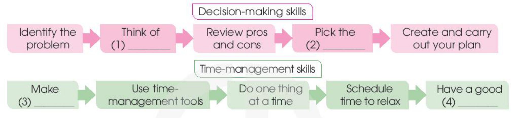
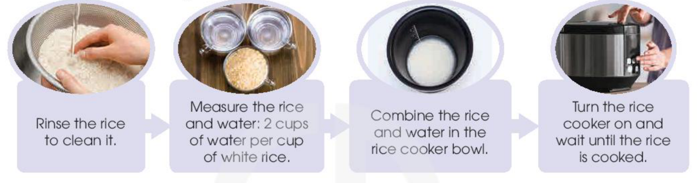
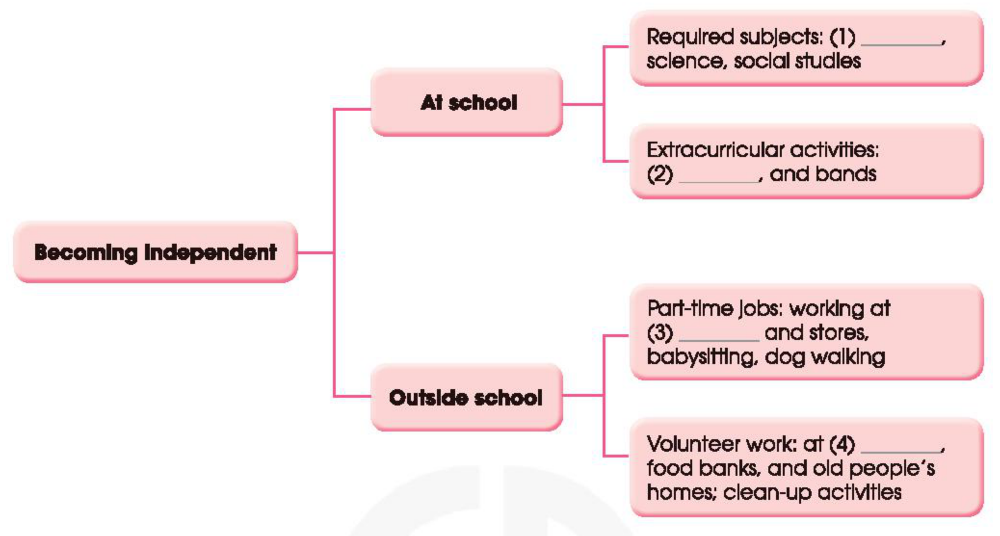

<!-- pdf:87 -->

# UNIT 8: BECOMING INDEPENDENT

> **This unit includes:**
> - **LANGUAGE**
>   - **Pronunciation:** Intonation in invitations, suggestions, and polite requests
>   - **Vocabulary:** Words and phrases related to teen independence
>   - **Grammar:** Cleft sentences with *It is/was ... that/who ...*
> - **SKILLS**
>   - **Reading:** Reading for main ideas and specific information in an article about how teens can become independent
>   - **Speaking:**
>     - Giving detailed instructions on learning basic life skills
>     - Using sequencing words and phrases when giving instructions
>   - **Listening:** Listening for main ideas and specific information in a conversation about becoming independent learners
>   - **Writing:** Writing an article about the pros and cons of self-study
> - **COMMUNICATION AND CULTURE / CLIL**
>   - **Everyday English:** Expressing best wishes and responding
>   - **Culture:** Teen independence in the US
> - **PROJECT**
>   - Creating a detailed plan to develop a life skill

## I. GETTING STARTED

**Earning your parents' trust**

**1. Listen and read.**

**Nam:** Mai, why don't you answer your phone? It keeps ringing.

**Mai:** It's my mum who's calling me again. She wants me to contact her from time to time while I'm out.

**Nam:** My parents used to be like that. They thought I didn't have the **confidence** to **deal with** difficult situations.

**Mark:** I had the same experience. It was earning my parents' **trust** that took a long time. But I managed to convince them that I'm **responsible** when I'm out and about.
<!-- term: out and about -->

**Mai:** It's my parents who still think I don't have the skills to be **independent**. I'm not good at managing my time or money, but I'm independent at home – I can cook, clean the house, and do my laundry!

**Nam:** That's a good start! I use a time-management app to plan my weekly schedule including all my activities and **responsibilities**. Would you like me to help you install it?

**Mai:** That'd be great. Thanks, Nam.

**Mark:** I use a **money-management** app. It's the app that taught me how to be responsible with money.

**Mai:** Mark, can you show it to me?

**Mark:** No problem. My parents also encourage me to take part-time jobs and pay me for doing certain chores around the house.

**Mai:** Lucky you!

<!-- pdf:88 -->

**2. Read the conversation again and decide who has these skills. Put a tick (✓) in the correct column.**

| | Mai | Nam | Mark |
| --- | --- | --- | --- |
| 1. Managing money | | | |
| 2. Cooking, cleaning, and doing laundry | | | |
| 3. Managing time | | | |

**3. Find words and a phrase in 1 that have the following meanings.**

| | |
| --- | --- |
| 1. a belief in your own ability to do things well | \_\_\_\_\_\_\_ |
| 2. **confident** and free to do things without help from other people | \_\_\_\_\_\_\_ |
| 3. things that you must do as part of your duty or job | \_\_\_\_\_\_\_ |
| 4. the activity of planning how to spend and save money | \_\_\_\_\_\_\_ |

**4. Match the two halves to make sentences used in 1.**

| | |
| --- | --- |
| 1. It's my mum | a. that took a long time. |
| 2. It was earning my parents' trust | b. who still think I don't have the skills to be independent. |
| 3. It's my parents | c. that taught me how to be responsible with money. |
| 4. It's the app | d. who's calling me again. |

## II. LANGUAGE

### Pronunciation

**Intonation in invitations, suggestions, and polite requests**

**Remember!**

We usually use fall-rise intonation in invitations, suggestions, and requests. This intonation pattern makes the questions sound friendlier and more polite.

**1. Listen and repeat. Pay attention to the fall-rise intonation (↘↗) in the following sentences.**

1. Would you like a cup of tea? ↘↗
2. Why don't you answer your phone? ↘↗
3. Would you like me to help you install the software? ↘↗
4. Can you show me the money-management app you told me about? ↘↗

**2. Listen and pay attention to the fall-rise intonation (↘↗) in the following sentences. Then practise saying them in pairs.**

1. Shall we now talk about other learning methods?
2. Could you please pay attention when I'm talking to you?
3. Why don't we use public transport to go to school?
4. Would you like to join our cooking course?

<!-- pdf:89 -->

### Vocabulary

**Teens and independence**

**1. Match the words with their meanings.**

| Words | Meanings |
| --- | --- |
| 1. **self-motivated** (adj) | a. a skill that is necessary or extremely useful to manage well in daily life |
| 2. **self-study** (n) | b. to succeed in dealing with something, especially something difficult |
| 3. **manage** (v) | c. a belief that someone is good, honest and reliable, and will not harm you |
| 4. **trust** (n) | d. the activity of learning something by yourself without teachers' help |
| 5. **life skill** (n) | e. able to do or achieve something without pressure from others |

**2. Complete the sentences using the correct form of the words in 1.**

1. We have great \_\_\_\_\_\_\_ in our parents and teachers.
2. Teenagers should learn basic \_\_\_\_\_\_\_, such as cooking a meal and using a washing machine.
3. My brother signed up for a \_\_\_\_\_\_\_ computer course.
4. It is important for us to learn how to \_\_\_\_\_\_\_ our time and money.
5. His parents don't have to force him to study hard as he is highly \_\_\_\_\_\_\_.

### Grammar

**Cleft sentences with *It is/was ... that/who ...***

**Remember!**

- A cleft sentence is used to focus on a particular part of the sentence and to emphasise what we want to say.
- We use preparatory *It* to introduce the thing that we want to focus on while the rest is put in a relative clause introduced with a relative pronoun, e.g. *that* or *who*.
  *Example:*
  *Nam taught Mai how to use the app in the library last weekend. (no particular focus)*
  - *It was Nam that/who taught Mai how to use the app in the library last weekend. (focus on Nam)*
  - *It was the app that Nam taught Mai how to use in the library last weekend. (focus on the app)*
  - *It was in the library that Nam taught Mai how to use the app last weekend. (focus on the library)*
  - *It was last weekend that Nam taught Mai how to use the app in the library. (focus on last weekend)*
<!-- term: Cleft sentences -->

**1. Rewrite the sentences using cleft sentences focusing on the underlined parts.**

1. <u>John</u> is saving his pocket money to buy a new phone.
   → It \_\_\_\_\_\_\_ to buy a new phone.
2. He gets <u>20 dollars</u> every week by doing chores around the house.
   → It \_\_\_\_\_\_\_ by doing chores around the house.
3. John earned more pocket money by helping his grandpa <u>last weekend</u>.
   → It \_\_\_\_\_\_\_ more pocket money by helping his grandpa.
4. He bought <u>gifts for his friends and family members</u> with his pocket money.
   → It \_\_\_\_\_\_\_ he bought with his pocket money.
5. Teenagers can earn pocket money <u>by doing part-time jobs</u>.
   → It \_\_\_\_\_\_\_ can earn pocket money.
<!-- term: pocket money -->

<!-- pdf:90 -->

**2. Work in pairs. Ask and answer questions about the chores you and your family members do at home. Use cleft sentences.**

*Example:*

**A:** *Is it you who does the cooking at home?*

**B:** *Yes, it is me who does the cooking. / No, it is my mum who does the cooking.*

## III. READING

**How to become independent**

**1. Tick (✓) the appropriate box to see how independent you are. Add up your points. If your total score is nine or above, you are independent. Compare with a partner.**

| How often do you ...? | Always (3 points) | Sometimes (2 points) | Never (1 point) |
| --- | --- | --- | --- |
| 1. go to school by yourself | | | |
| 2. cook meals for your family | | | |
| 3. communicate well with people | | | |
| 4. think carefully before making decisions | | | |
| 5. plan how to save and spend your pocket money | | | |
<!-- term: pocket money -->

**2. Read the text. Match the paragraphs (A–C) with the headings (1–5). There are TWO extra headings.**

1. Manage your money
2. Relax and sleep well
3. Develop **time-management skills**
4. Improve your **decision-making skill**
5. Learn basic, but important **life skills**

Becoming independent is important for teenagers. Below are the necessary skills you should learn to **achieve** **independence** for the future.

**A.** \_\_\_\_\_\_\_

First, make sure you can safely **get around** by yourself using public transport, walking, or cycling. Second, learn to communicate well and develop good relationships with people. Do some part-time jobs and get to know how to **manage** your money. You should also learn to cook healthy meals for your family. Finally, help your parents with household chores like cleaning and doing laundry.

**B.** \_\_\_\_\_\_\_

To begin with, identify the problem and **come up with** as many solutions as possible. Write down the options, so you can review the advantages and disadvantages of each one. This will help you see which option could be the best for you. Don't base your decision on emotion only. Once you have made your choice, create a plan of specific steps to move forward. Then **carry out** your plan, and think about whether you have achieved the result you wanted.

**C.** \_\_\_\_\_\_\_

First of all, **get into the habit of** making a to-do-list every day or week. **Make use of** time-management tools, such as apps or diaries, to know what you need to do next. In addition, decide how much time you need for each task and always do one thing at a time to make sure you complete it. Schedule time to relax as well, and make sure you sleep at least nine hours each night. A good night's sleep is necessary for teenage brain development and good health.

Becoming independent is not easy, but it is not as challenging as you may think. It's about learning useful skills, making decisions by yourself, and knowing how to spend your time.

<!-- pdf:91 -->

**3. Read the text again and match the highlighted phrases in the text with their meanings.**

| Highlighted phrases | Meanings |
| --- | --- |
| 1. **get around** | a. to start doing something regularly so that it becomes a habit |
| 2. **come up with** | b. to perform and complete something |
| 3. **carry out** | c. to go or travel to different places |
| 4. **get into the habit of** | d. to use something to achieve a particular result or benefit |
| 5. **make use of** | e. to produce or find an answer or a solution |

**4. Read the text again. Complete the diagrams with information from the text. Use no more than TWO words for each gap.**

- **Decision-making skills:** Identify the problem → Think of (1) \_\_\_\_\_\_\_ → Review pros and cons → Pick the (2) \_\_\_\_\_\_\_ → Create and carry out your plan
- **Time-management skills:** Make (3) \_\_\_\_\_\_\_ → Use time-management tools → Do one thing at a time → Schedule time to relax → Have a good (4) \_\_\_\_\_\_\_
<!-- ocr-ok: đã đối chiếu ảnh trang gốc, OCR lỗi nhận diện chữ trong các ô mũi tên của sơ đồ -->

**5. Work in pairs. Discuss the following questions.**

*Which of the skills mentioned in the text do you have? What other skills do you think teenagers need to become independent?*

## IV. SPEAKING

**Learning basic life skills**

**1. Work in pairs. Discuss these questions.**

a. Have you ever done your laundry? If yes, how did you do it?

b. Below are some steps to do laundry. Put them in the correct order.

1. \_\_\_\_\_\_\_ → 2. D → 3. \_\_\_\_\_\_\_ → 4. \_\_\_\_\_\_\_ → 5. \_\_\_\_\_\_\_

- A. Hang or fold, and store your own clothes
- B. Sort the clothes by colour
- C. **Remove** the wet clothes from the washing machine and dry them
- D. Add the washing powder or liquid
- E. Load the washing machine and turn it on

**2. Read the following instructions on how to do laundry. Circle the correct answers.**

There are several simple steps in doing laundry. First of all, (1) *sort* / *don't sort* your clothes by colour. You should separate them into whites and colours, and wash them separately. (2) *Secondly* / *Finally*, add the washing powder or liquid. Read the instructions on the packet to make sure you use the right amount. Then, (3) *load* / *you load* the washing machine and turn it on. Make sure you place the items one at a time. Don't put too many items as they need room to move about in the water. When the washing machine stops, (4) *remove* / *you will remove* the wet clothes. You can hang the items to dry, or put them in the dryer. Remember that air-drying clothes saves energy and money. (5) *Finally* / *Afterwards*, don't forget to hang or fold each item. You could also iron your clothes before storing them in the wardrobe or drawer.

<!-- pdf:92 -->

> **Tips**
>
> To give instructions, you should use:
> - the imperative form of the verb.
>   *Example: Don't ... / Avoid ... / Make sure ...*
> - modal verbs.
>   *Example: You could ... / You should ... / You mustn't ...*
> - linking words or phrases.
>   *Example: First, / To begin with, / First of all, ...*
>   *Second, / Secondly, ...*
>   *Then, / After that, / In addition, ...*
>   *Last but not least, / Finally, ...*
<!-- term: Giving instructions -->

**3. Work in pairs. Read the steps in cooking rice in a rice cooker. Use the model in 2 and the tips above to give instructions.**

1. Rinse the rice to clean it.
2. **Measure** the rice and water: 2 cups of water per cup of white rice.
3. **Combine** the rice and water in the **rice cooker** bowl.
4. Turn the rice cooker on and wait until the rice is cooked.

**4. Work in groups. Add more steps or tips, and report to the whole class. Vote for the best recipe for cooking rice in a rice cooker.**

## V. LISTENING

**Becoming independent learners**

**1. Tick (✓) the columns to complete the following table about you. Compare your answers in pairs.**

| | Yes | No |
| --- | --- | --- |
| 1. Are you interested in learning new things? | | |
| 2. Do you set your **learning goals** and make plans to achieve them? | | |
| 3. Do you try to understand a problem on your own before asking for help? | | |
| 4. Do you want to know more about the world? | | |

**2. Listen to a conversation between Mai and Mike, and choose the correct answers A, B, or C.**

1. What is the conversation mainly about?
   - A. What motivates independent learners.
   - B. Independent learners' sense of **responsibility**.
   - C. What makes a successful independent **learner**.
2. What makes independent learners study hard?
   - A. Their motivation for learning.
   - B. Their learning goals.
   - C. The responsibility for their own learning.
3. What do independent learners do if the task they are working on is too difficult?
   - A. They give up and move on to something harder.
   - B. They make every effort to finish it.
   - C. They ask questions about it.
4. Which of the following descriptions of independent learners is NOT mentioned?
   - A. They're **self-motivated** and responsible.
   - B. They're confident and highly organised.
   - C. They're curious about the world and they don't give up.

<!-- pdf:93 -->

**3. Listen to the conversation again and answer each of the following questions using no more than THREE words or a number.**

1. How many characteristics of independent learners does Mike find on the website?
2. What do independent learners take responsibility for?
3. What do they use to help them achieve their learning goals?
4. What are they not afraid of doing?

**4. Work in groups. Discuss the following questions.**

*Which of the characteristics of independent learners do you think you have? Which one do you want to develop in the future?*

## VI. WRITING

**An article about pros and cons of self-study**

**1. Work in pairs. Read the following ideas and decide if they are pros or cons of self-study. Think of other pros and cons to add.**

| | Pros | Cons |
| --- | --- | --- |
| 1. **Self-study** gives learners more freedom (e.g. they decide what to study and how). | | |
| 2. Learners need more time to learn things (e.g. they work on their own, with no one to push them or help them). | | |
| 3. Learners become responsible (e.g. they set their learning goals and make plans to achieve them). | | |
| 4. Learners may not develop certain life skills (e.g. good communication and relationship skills). | | |
| 5. Self-study makes learners confident (e.g. they realise they can complete tasks by themselves). | | |
| 6. Learners may not learn practical skills (e.g. they may focus too much on learning, and may not apply the academic skills to real life). | | |

**2. Write an article (150–180 words) about the pros and cons of self-study. Use the ideas in 1 and the outline with useful expressions below to help you.**

> 1. **Title:** *Pros and cons of **self-study***
> 2. **Introduction:**
>    - *Independent learning often involves self-study – learning at home without a teacher.*
>    - *Let's look at ...*
> 3. **Body paragraphs:**
>    - *First (of all), self-study gives/makes learners ... Secondly, ... Finally, ...*
>    - *On the other hand, learners may ... In addition, ... For example, ... Finally, ...*
> 4. **Conclusion:**
>    - *In conclusion, self-study has both ...*
>    - *Learners should understand both ...*
>    - *... education is changing all the time ... / get used to the challenges of ...*

<!-- pdf:94 -->

## VII. COMMUNICATION AND CULTURE / CLIL

### Everyday English

*Expressing best wishes and responding*

**1. Listen and complete the conversations with the expressions in the box. Then practise them in pairs.**

| A. Same to you | B. Have a great time | C. Happy New Year | D. Thanks so much |
| --- | --- | --- | --- |

1. **Nam:** Hey, I heard that you're going on a trip to Singapore tomorrow. (1) \_\_\_\_\_\_\_!
   **Mike:** Yep. (2) \_\_\_\_\_\_\_.
2. **Kevin:** Hi, Mai. (3) \_\_\_\_\_\_\_! Wishing you a great year ahead!
   **Mai:** Thanks, Kevin. (4) \_\_\_\_\_\_\_! Hope all your dreams come true!
<!-- term: Expressing best wishes and responding -->

**2. Work in pairs. Use the models in 1 to make similar conversations for these situations. One of you is Student A, the other is Student B. Use the expressions below to help you.**

1. Student A is going to take an exam. Student B is expressing his/her wishes for Student A's success.
2. Student B is not feeling well. Student A is expressing his/her wishes for Student B's recovery.

| **Useful expressions** | |
| --- | --- |
| **Expressing wishes** | **Responding to wishes** |
| - Have a good/great ...! - Best wishes! / Good luck! - I wish you a happy and healthy new year. / Happy New Year! / Happy holidays! - I wish you best of luck / every success in your new ... - Get well soon! / Hope you feel better soon / make a speedy recovery. | - Thanks so much. - Thank you (all) for your wishes. - Thanks. Happy New Year to you too! - (The) same to you! Thanks. |
<!-- term: Expressing best wishes and responding -->

### Culture

**Teen independence in the US**

**1. Read the text below and complete the diagram. Use no more than THREE words for each gap.**

American parents usually encourage independence in their teenage children, and it is normal for teens to want more responsibility and freedom for their choices.

American teenagers often start high school with a basic plan of classes they need to take to get a high school diploma. Some subjects like English, maths, science, or social studies are required, others can be selected. Schools also provide extracurricular activities, such as sports, clubs, and bands. American teenagers who plan to go to college study hard to get good grades. They are highly motivated and very confident, and take responsibility for their learning.

Many American teenagers have part-time jobs as they want to gain work experience and learn how to manage their money. Many teens work at fast-food restaurants and stores, or do babysitting, and dog walking for neighbours. They also volunteer at local hospitals, food banks, and old people's homes, or take part in clean-up activities to improve their neighbourhood. This community service counts towards the volunteer hours that some schools require for university admission.

The teenage years form an important period of their development that influences adult life. The main goal of this period for most American teenagers is becoming independent, and they work hard both at school and outside school to achieve this goal.

<!-- pdf:95 -->

- **Becoming independent**
  - **At school**
    - Required subjects: (1) \_\_\_\_\_\_\_, science, social studies
    - Extracurricular activities: (2) \_\_\_\_\_\_\_, and bands
  - **Outside school**
    - Part-time jobs: working at (3) \_\_\_\_\_\_\_ and stores, babysitting, dog walking
    - Volunteer work: at (4) \_\_\_\_\_\_\_, food banks, and old people's homes; clean-up activities
<!-- ocr-ok: đã đối chiếu ảnh trang gốc, OCR đọc nhầm chữ trong các khung sơ đồ phân nhánh -->

**2. Work in groups. Discuss the following questions.**

*Do American teenagers learn to become independent in the same way as Vietnamese teenagers? What are the similarities and differences?*

## VIII. LOOKING BACK

### Pronunciation

**Read the sentences using fall-rise intonation (↘↗). Then listen and compare. Practise saying them in pairs.**

1. Shall we look for a part-time job to earn some pocket money?
2. Do you feel like doing a vegetarian cooking course?
3. Would you please give me some advice on how to set my goals?
4. Could you help me improve my communication skills?

### Vocabulary

**Choose the correct answers A, B, or C to complete the sentences.**

1. Many teenagers are not interested in learning how to \_\_\_\_\_\_\_ their time and money.
   - A. manage
   - B. come up with
   - C. get around
2. Successful people are highly organised and \_\_\_\_\_\_\_ in everything they do.
   - A. self-motivated
   - B. trust
   - C. responsibility
3. Some of my classmates find learning basic \_\_\_\_\_\_\_ like cleaning and cooking difficult.
   - A. confidence
   - B. responsibilities
   - C. life skills
4. To develop \_\_\_\_\_\_\_ skills, please keep a diary for tasks and appointments.
   - A. decision-making
   - B. time-management
   - C. independent

<!-- pdf:96 -->

### Grammar

**Complete the answers to these questions using cleft sentences focusing on the words or phrases in brackets.**

1. Would you like to apply for the babysitting job? *(dog walking)*
   No. It \_\_\_\_\_\_\_ I'd like to apply for.
2. Did your dad buy you a new bicycle last week? *(a new motorbike)*
   No. It \_\_\_\_\_\_\_ he bought me last week.
3. Is Lan the best decision-maker in your class? *(Tuan)*
   No. It \_\_\_\_\_\_\_ is the best decision-maker in my class.
4. Does the presentation skills training start tomorrow? *(the day after tomorrow)*
   No. It \_\_\_\_\_\_\_ the presentation skills training starts.

## PROJECT

**A life skills workshop**

**Work in groups. Choose a life skill teenagers need to develop in order to become independent. Discuss what they need to do and make a list of all the steps and activities.**

**Present your group's plan to the whole class. Use these questions as cues for your presentation.**

1. What is the **life skill**?
2. How important is it for teens to become independent?
3. What are the main steps of the skill development?
4. What other activities will be helpful for its development?

### Now I can ...

- use fall-rise intonation in invitations, suggestions, and polite requests.
- understand and use words and phrases related to teen independence.
- use cleft sentences with *It is/was ... that/who ...* correctly.
- read for main ideas and specific information in an article about how teens can become independent.
- give detailed instructions on learning basic life skills and use sequencing words and phrases when giving instructions.
- listen for main ideas and specific information in a conversation about becoming independent learners.
- write an article about the pros and cons of self-study.
- express best wishes and respond.
- understand how American teenagers become independent.
- create a detailed plan to develop a life skill, and present it to the class.

## 📷 Danh mục hình minh hoạ

| Mã hình | Trang PDF | Trang sách | Chú thích / Mô tả |
| --- | --- | --- | --- |
| H11-tieng_anh-u08-01 | 91 | 90 | Hai sơ đồ quy trình rèn luyện kĩ năng ra quyết định (*Decision-making skills*) và kĩ năng quản lí thời gian (*Time-management skills*) |
| H11-tieng_anh-u08-02 | 92 | 91 | Sơ đồ minh hoạ 4 bước nấu cơm bằng nồi cơm điện: vo gạo, đong gạo và nước, cho vào lòng nồi, bật nút nấu |
| H11-tieng_anh-u08-03 | 95 | 94 | Sơ đồ phân nhánh các hoạt động rèn luyện tính tự lập của thanh thiếu niên Mỹ ở trường (*At school*) và ngoài trường học (*Outside school*) |
