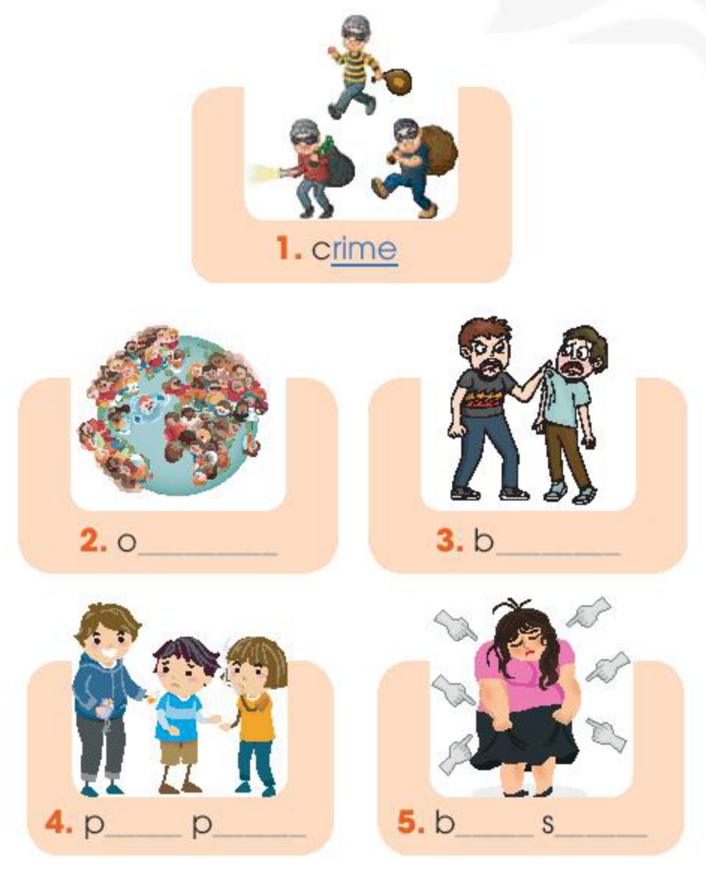
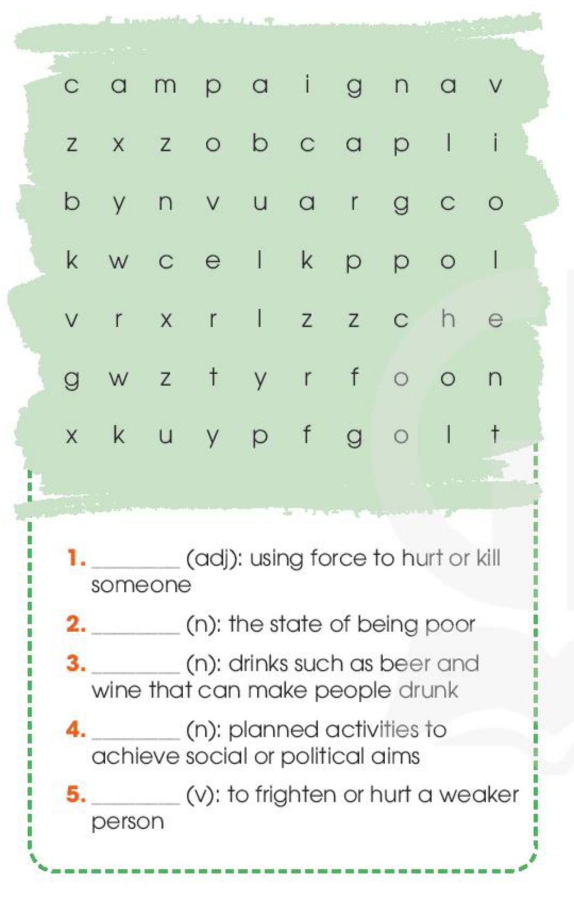
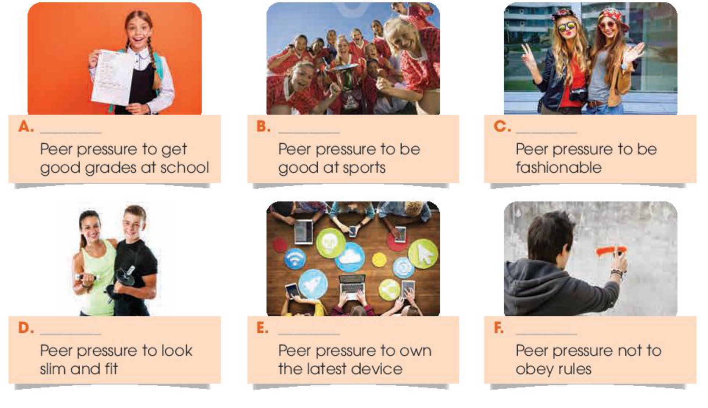
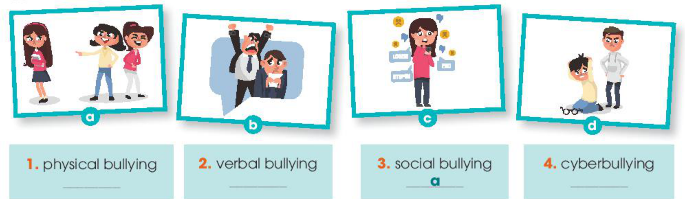
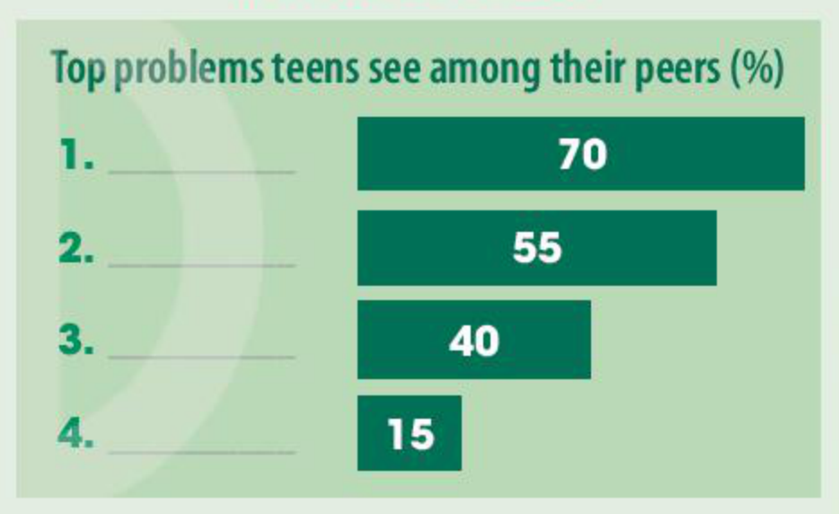
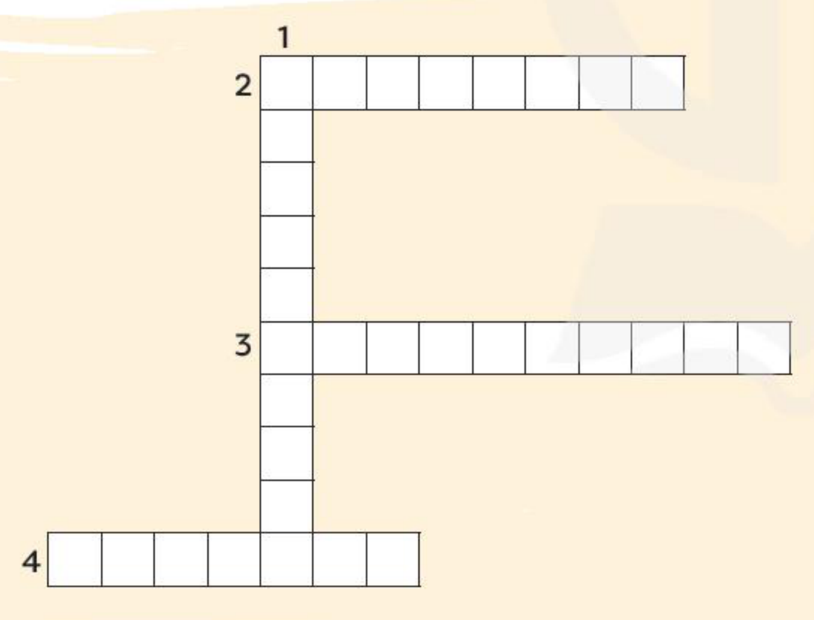

<!-- pdf:101 -->

# UNIT 9: SOCIAL ISSUES

> **This unit includes:**
> - **LANGUAGE**
>   - **Pronunciation:** Intonation in choice questions
>   - **Vocabulary:** Words and phrases related to social issues
>   - **Grammar:** Linking words and phrases
> - **SKILLS**
>   - **Reading:** Reading for main ideas and specific information in an article about peer pressure
>   - **Speaking:** Talking about experiences of peer pressure and responding to peer pressure situations
>   - **Listening:** Listening for specific information in a conversation about types of bullying
>   - **Writing:** Writing a proposal for a school campaign against cyberbullying
> - **COMMUNICATION AND CULTURE / CLIL**
>   - **Everyday English:** Expressing disappointment and sympathy
>   - **CLIL:** Social problems facing teens in the US today
> - **PROJECT**
>   - Planning an awareness campaign about a social issue

## I. GETTING STARTED

**A social awareness club meeting**

**1. Listen and read.**

**Mark:** Hi, everyone. Last time our club met, we decided to start an **awareness** **campaign** to draw attention to a pressing social issue. So have you thought about any issues that we could focus on?
<!-- term: draw attention to -->
<!-- term: social issue -->

**Mai:** Yes, I think we should promote issues that affect a lot of people in our city, such as **crime** and **overpopulation**.

**Nam:** I like your ideas, Mai, but I think we should plan our campaign around social issues that directly affect teenagers like us.

**Mark:** Can you give us some examples?

**Nam:** Well, **bullying**, **peer pressure**, and **body shaming**, for instance, are major problems among teenagers today although many people don't feel comfortable talking about them.

**Mai:** I agree with you. Hmm... so Mark, what do you think? Should we focus our campaign on a general social issue or one affecting mainly teens?
<!-- term: social issue -->

**Mark:** Hmm. I think this time we should focus on a problem teens **struggle** with every day because this won't be a big campaign. However, we'll try to use your ideas for another project, Mai.

**Mai:** Sounds good! Now let's decide on a social issue. Is the top problem facing teens today peer pressure, body shaming, or bullying?

**Nam:** I think it's bullying because it's very common today, and ...

<!-- pdf:102 -->

**2. Who suggests the following ideas? Tick (✓) the correct box.**

| | Mark | Mai | Nam |
| --- | --- | --- | --- |
| 1. Issues that have an effect on many people in the city | | | |
| 2. Problems that have a direct impact on teens | | | |
| 3. An issue that teens face in their everyday life | | | |

**3. Find five social issues in 1. Use the pictures and hints below to help you.**

1. <u>crime</u>
2. o\_\_\_\_\_\_\_
3. b\_\_\_\_\_\_\_
4. p\_\_\_\_\_\_\_ p\_\_\_\_\_\_\_
5. b\_\_\_\_\_\_\_ s\_\_\_\_\_\_\_
<!-- ocr-ok: đã đối chiếu ảnh trang gốc, các từ khuyết chữ đi kèm hình gợi ý 1-5 trong H11-tieng_anh-u09-01 -->

**4. Complete the summary with words from 1.**

Nam believes that there are major teen problems today (1) \_\_\_\_\_\_\_ many people don't feel comfortable talking about them. Mai agrees with him. Mark thinks they should focus on a problem teens struggle with every day. (2) \_\_\_\_\_\_\_, they'll try to use Mai's ideas for another project. Finally, Nam suggests focusing their campaign on bullying (3) \_\_\_\_\_\_\_ this issue is very common among teenagers these days.

## II. LANGUAGE

### Pronunciation

**Intonation in choice questions**

**Remember!**

Choice questions are questions that include a list of choices. Each choice mentioned before the word 'or' has rising intonation at the end, while the last one has falling intonation at the end.

**1. Listen and repeat. Pay attention to the intonation. Practise saying the questions in pairs.**

1. Should we focus our campaign on a general social issue ↗ or one affecting mainly teens ↘?
2. Is the top problem facing teens today peer pressure ↗, body shaming ↗, or bullying ↘?

**2. Mark the intonation in these questions. Then listen and check. Practise saying them in pairs.**

1. Is peer pressure good or bad?
2. Is this a social or environmental issue?
3. Should our campaign focus on crime, overpopulation, or climate change?
4. Do you talk to your parents, share problems with your friends, or ask your teachers for advice?

<!-- pdf:103 -->

### Vocabulary

**Social issues**

**1. Find five words in the word search and write them next to the correct definition. Use the glossary (page 130) to help you.**

| c | a | m | p | a | i | g | n | a | v |
| --- | --- | --- | --- | --- | --- | --- | --- | --- | --- |
| z | x | z | o | b | c | a | p | l | i |
| b | y | n | v | u | a | r | g | c | o |
| k | w | c | e | l | k | p | p | o | l |
| v | r | x | r | l | z | z | c | h | e |
| g | w | z | t | y | r | f | o | o | n |
| x | k | u | y | p | f | g | o | l | t |
<!-- ocr-ok: đã đối chiếu ảnh trang gốc, bảng ô chữ 7x10 của bài tập 1 -->

1. \_\_\_\_\_\_\_ (adj): using force to hurt or kill someone
2. \_\_\_\_\_\_\_ (n): the state of being poor
3. \_\_\_\_\_\_\_ (n): drinks such as beer and wine that can make people drunk
4. \_\_\_\_\_\_\_ (n): planned activities to achieve social or political aims
5. \_\_\_\_\_\_\_ (v): to frighten or hurt a weaker person

**2. Complete the sentences using the correct forms of the words in 1.**

1. People mustn't drive after drinking \_\_\_\_\_\_\_. It's dangerous!
2. The boy does not want to go to school because he is afraid of being \_\_\_\_\_\_\_.
3. Many children live in \_\_\_\_\_\_\_. They often stop going to school so that they can work.
4. Many parents complain about the number of \_\_\_\_\_\_\_ TV programmes for children.
5. We are going to start a \_\_\_\_\_\_\_ to raise awareness of animal rights.

### Grammar

*Linking words and phrases*

**Remember!**

We use linking words and phrases to connect ideas, clauses, or sentences.
<!-- term: Linking words and phrases -->

Below are some common linking words and phrases:

| | |
| --- | --- |
| **To add ideas and information** | Besides (this/that), ... Moreover, ... In addition (to + noun or gerund), ... |
| **To contrast ideas** | However, ... Although ..., ... In spite of / Despite (noun or gerund), ... By contrast, ... |
| **To give reasons** | Because ..., ... Because of (noun or gerund), ... As / Since ..., ... |
| **To show results** | As a result, ... As a consequence, ... Therefore, ... |
<!-- term: Linking words and phrases -->
<!-- ocr-ok: đã đối chiếu ảnh trang gốc, OCR đọc nhầm to + noun thành đo + noun trong bảng từ nối -->

**1. Connect these sentences, using linking words or phrases.**

1. Some people cannot control their anger when drinking **alcohol**. \_\_\_\_\_\_\_, they become **violent**.
2. Body shaming is a very common issue. \_\_\_\_\_\_\_, many people are not aware of it.
3. Alcohol can affect people's mind and behaviour. \_\_\_\_\_\_\_, they can cause other health problems.
4. The government has promised to solve our environmental issues. \_\_\_\_\_\_\_, little has been achieved so far.

**2. Work in pairs. Add more sentences to each item. Use different linking words and/or phrases.**

1. Some children play too many violent computer games. \_\_\_\_\_\_\_
2. Many people live in **poverty**. \_\_\_\_\_\_\_
3. Awareness campaigns help to draw people's attention to social issues. \_\_\_\_\_\_\_
<!-- term: draw attention to -->

*Example: Some children play too many violent computer games. As a result, they can also become violent. Besides, it's unhealthy for them to play video games for hours ...*

<!-- pdf:104 -->

## III. READING

**Peer pressure**

**1. Work in pairs. Discuss the question.**

*Have your friends ever made you do something you do not like? If yes, give an example.*

**2. Read the article. Match the highlighted words and phrase with their meanings.**

**TEEN'S LIFE — I DON'T WANT TO BE THE ODD ONE OUT!**

*'My parents don't want me to **hang out** with my friends from school. They think those friends have a bad influence on me. They aren't happy that instead of going home after school, we go to games centres to play video games. But I think it's fun, and I don't want to lose my friends,'* Thanh, 17.

*'One day I coloured my hair and painted my finger nails. My parents got so angry with me. I know that this is not allowed at school, but all the girls in my group of friends did the same. I don't want to be **the odd one out**!'* Van, 16.
<!-- ocr-ok: đã đối chiếu ảnh trang gốc, bài báo trình bày theo bố cục 3 cột nên OCR đọc trộn các cột -->

**[A]** The emails we have received from teenagers this week point to the effects of peer **pressure**, which is when you do things because you want to be accepted or valued by your friends. If teens fail to do what their group of friends want them to do, they may not be accepted or may even be **bullied**.

**[B]** In many cases, peer pressure can lead to **depression**, low **self-confidence**, distance from family and poor school performance. It can also lead to bigger social issues. It was reported that 70% of teenage smokers surveyed in the US said that they started smoking because they had friends who were smoking.

**[C]** It is not always easy to **stand up to** peer pressure, but sooner or later you need to decide what is best for you. Choose the right friends, learn to say no when you don't feel comfortable and don't hesitate to talk to an adult when the situation looks dangerous. And remember it's sometimes OK to be 'the odd one out'.
<!-- ocr-ok: đã đối chiếu ảnh trang gốc, các đoạn [A], [B], [C] nằm ở cột 2 và cột 3 của trang báo -->

| Highlighted words / phrase | Meanings |
| --- | --- |
| 1. **hang out** | a. a belief in your own ability to do things well |
| 2. **pressure** | b. the state of feeling very sad and without hope for the future |
| 3. **depression** | c. the act of trying to force someone to do something by arguing, persuading, etc. |
| 4. **self-confidence** | d. to spend a lot of time in a place |

**3. Read the article again. Which paragraph contains the following information? Write A, B, or C.**

1. The definition of 'peer pressure' \_\_\_\_\_\_\_
2. How peer pressure can cause social issues \_\_\_\_\_\_\_
3. Dealing with peer pressure \_\_\_\_\_\_\_
4. The possible problems facing teens if they do not follow their peers \_\_\_\_\_\_\_

<!-- pdf:105 -->

**4. Read the article again and choose the correct answers A, B, or C.**

1. What is the similarity between Thanh and Van?
   - A. They both changed their appearance.
   - B. They both want to be different from their friends.
   - C. Their parents do not approve of their behaviour.
2. Which is NOT mentioned in the article as a consequence of peer pressure?
   - A. Encouraging someone to fight.
   - B. Lack of a close relationship with family members.
   - C. Lack of confidence about what you can do.
3. What was reported about the effects of peer pressure on teenagers in the US?
   - A. Fifty-five per cent of them started to smoke because of peer influence.
   - B. Seventy per cent of them were drinking alcohol with their friends.
   - C. More than two-thirds of teen smokers started the habit under the influence of their friends.
4. According to the article, what is one way of dealing with peer pressure?
   - A. Going to see the right doctor.
   - B. Not always saying yes to your friends.
   - C. Choosing friends who say no when they feel uncomfortable.

**5. Work in pairs. Discuss the following question.**

*Have you, or has someone you know, experienced any of the problems mentioned in this article?*

## IV. SPEAKING

**Experiencing peer pressure**

**1. Order the examples of peer pressure below from 1 (most powerful) to 6 (least powerful).**

- **A.** \_\_\_\_\_\_\_ Peer pressure to get good grades at school
- **B.** \_\_\_\_\_\_\_ Peer pressure to be good at sports
- **C.** \_\_\_\_\_\_\_ Peer pressure to be fashionable
- **D.** \_\_\_\_\_\_\_ Peer pressure to look slim and fit
- **E.** \_\_\_\_\_\_\_ Peer pressure to own the latest device
- **F.** \_\_\_\_\_\_\_ Peer pressure not to **obey** rules

<!-- pdf:106 -->

**2. Work in pairs. Talk about your experiences of peer pressure. Use the following guiding questions.**

- Which example of peer pressure (A–F) in 1 affects you most? Why?
- Which one affects you the least? Why?
- Which are examples of positive peer pressure?

**3. Work in groups. Read the situations below and think of some possible responses. Provide reasons for each answer.**

1. Your friend wants to **skip** a test, so he/she asks you to pretend that you are his/her parent(s) and write a letter to his/her teacher asking permission to be absent from school.
   *Example: 'No way! I'm not lying. You should try to revise and take the test. **Lies** can have serious consequences and people will always find out the truth.'*
2. Your friend has just got the latest smartphone. He/She **makes fun of** your old smartphone and says that you should buy a new one.
3. Your friend is getting good grades in English. He/She wants you to join his/her study group so that you can also improve your English.
4. Your friend is skipping classes frequently. He/She says that every teen does it sometimes, and you should do it as well.

**4. Report your answers to the whole class. Vote for the most interesting responses.**

## V. LISTENING

**Types of bullying**

**1. Choose the word or phrase with the closest meaning to the underlined one.**

1. I find your comments very <u>**offensive**</u>, so you should apologise to me.
   - A. nice
   - B. rude
2. I don't believe his <u>**lies**</u>!
   - A. things that are true
   - B. things that are not true
3. Don't feel <u>**ashamed**</u> to **admit** that you do not know something.
   - A. proud
   - B. embarrassed

**2. Listen to a conversation between two students and match the pictures with the type of bullying.**

1. **physical** bullying \_\_\_\_\_\_\_
2. **verbal** bullying \_\_\_\_\_\_\_
3. social bullying <u>a</u>
4. **cyberbullying** \_\_\_\_\_\_\_
<!-- term: social bullying -->

<!-- pdf:107 -->

**3. Listen again. Circle the correct answers.**

1. Technology has made bullying *more* / *less* common.
2. Mai's friend *was bullying others* / *was bullied by others* on social media.
3. One of the most common forms of *physical bullying* / *cyberbullying* is body shaming.
4. In their next meeting, they are most likely to talk about *when* / *how* bullying can be stopped.

**4. Work in groups. Discuss the following question.**

*What types of bullying have you experienced or seen happening to people around you?*

## VI. WRITING

**A proposal against cyberbullying**

**1. You are planning a school campaign against cyberbullying. Work in groups to discuss these questions.**

1. When and where should the campaign take place? How long should it last?
2. Who should participate in it? (You can choose more than one and add your ideas.)
   - A. Everyone who is interested.
   - B. **Victims** of cyberbullying.
   - C. Parents.
   - D. Teachers.
   - E. Your idea: \_\_\_\_\_\_\_
3. What activities should the campaign include? (You can choose more than one and add your ideas.)
   - A. Giving talks about cyberbullying.
   - B. Providing students with resources where they can find information on cyberbullying and how to deal with it.
   - C. Inviting students to share experiences of cyberbullying.
   - D. Informing students of the school anti-bullying policies.
   - E. Showing cyberbullying videos to promote discussion about the issue.
   - F. Your idea: \_\_\_\_\_\_\_
4. What should be the main goals of the campaign?

**2. Write a proposal for the campaign (150–180 words) to your head teacher. Use the ideas in 1 and the outline with useful expressions below to help you.**

> **Title: A SCHOOL CAMPAIGN AGAINST CYBERBULLYING**
> - **To:** \_\_\_\_\_\_\_
> - **Date:** \_\_\_\_\_\_\_
> - **Prepared by:** \_\_\_\_\_\_\_
>
> **Introduction:**
> - *... has become a common/serious issue nowadays because ...*
> - *We would like to propose ...*
>
> **Details about the campaign:**
> - *The campaign events/activities will take place in/at ... The campaign will last for ...*
> - *... will participate in ...*
> - *The campaign will target ...*
> - *The main events/activities will include ...*
>
> **Goals and benefits of the campaign:**
> - *(The campaign) aims at ... / doing ...*
> - *(The campaign) will allow (students, teenagers) to do ...*
>
> **Conclusion:**
> - *We hope that you will consider our proposal ...*

<!-- pdf:108 -->

## VII. COMMUNICATION AND CULTURE / CLIL

### Everyday English

*Expressing disappointment and sympathy*

**1. Listen and complete the conversation with the expressions in the box. Then practise it in pairs.**

- A. I can sympathise
- B. I'm sorry to hear that
- C. What a pity

**Mary:** I'm afraid I can't go to the cinema with you, Andy.

**Andy:** (1) \_\_\_\_\_\_\_! I really wanted you to watch the film.

**Mary:** Maybe another time. My brother is going to see a doctor tomorrow and I promised to go with him.

**Andy:** (2) \_\_\_\_\_\_\_. What's wrong with him?

**Mary:** He's been bullied at school. We think he's suffering from depression and needs help.

**Andy:** (3) \_\_\_\_\_\_\_. I was also the **victim** of bullying and had a very painful experience. I hope he'll be fine.

**Mary:** Thank you for your sympathy, Andy.
<!-- term: Expressing disappointment and sympathy -->

**2. Work in pairs. Use the model in 1 to make similar conversations for these situations. One of you is Student A, the other is Student B. Use the expressions to help you.**

1. Student A can't go on a school trip because his/her little brother/sister is ill and he/she has to take care of him/her. Student B expresses disappointment and sympathy.
2. Student B can't finish a community project on time because he/she is too stressed preparing for his/her exams. Student A expresses disappointment and sympathy.

| **Useful expressions** | |
| --- | --- |
| **Expressing disappointment** | **Expressing sympathy** |
| - What a pity/shame! - It's a pity/shame that ... - That's (so) / How disappointing. - That's too bad. | - I'm (so) sorry (to hear that) ... - I (can) sympathise (with you/him/her). - That's so sad (that ...). - I know how it feels. |
<!-- term: Expressing disappointment and sympathy -->
<!-- ocr-ok: đã đối chiếu ảnh trang gốc, OCR đọc ghép ngang hai cột bảng Useful expressions -->

### CLIL

**1. Read the text and match each percentage in the chart with ONE social problem mentioned in the text.**

**SOCIAL PROBLEMS FACING TEENS IN THE US TODAY**

- **Top problems teens see among their peers (%)**
  1. \_\_\_\_\_\_\_: 70
  2. \_\_\_\_\_\_\_: 55
  3. \_\_\_\_\_\_\_: 40
  4. \_\_\_\_\_\_\_: 15
<!-- ocr-ok: đã đối chiếu ảnh trang gốc, số liệu trên biểu đồ cột ngang H11-tieng_anh-u09-05 -->

In many countries around the world, it is not easy growing up because teens are dealing with many social issues. A study carried out by a famous research centre in the US found out that the following were among the most serious ones.

**Anxiety and depression:** Seven in ten teenagers considered them a serious problem among their peers. The main source of teenagers' **anxiety** and depression was social pressure, such as the pressure to look good, to fit in social groups, and to be good at sport.

**Bullying:** 55% said that bullying was a major problem for teenagers, and around 15% admitted that they had experienced some form of cyberbullying. Girls or younger students were more likely to be victims of bullying.

**Poverty:** Four out of 10 teens said that poverty was also a major problem for them. In fact, about 20% of the teens in the survey struggled to live below **the poverty line** every day.

The survey results suggest that more support should be provided to help teenagers avoid serious social issues and enjoy a happier life.

<!-- pdf:109 -->

**2. Work in pairs. Discuss the following questions.**

*Are the problems mentioned in the text similar to those facing Vietnamese teens? Are there any other problems among teenagers in Viet Nam?*

## VIII. LOOKING BACK

### Pronunciation

**Mark the intonation in these questions, using ↗ (rising intonation) or ↘ (falling intonation). Listen and check. Then practise saying them.**

1. Should we report bullying to teachers or speak to our parents first?
2. Is this social awareness campaign about poverty or crime?
3. Have you ever experienced any physical, verbal, or social bullying?
4. Do you worry about peer pressure, body shaming, or bullying?
<!-- term: social bullying -->

### Vocabulary

**Solve the crossword. Use the words you have learnt in this unit.**

**ACROSS**
- 2. The local police are running an awareness \_\_\_\_\_\_\_ to reduce crime in the area.
- 3. Teens who are regularly bullied suffer from \_\_\_\_\_\_\_.
- 4. \_\_\_\_\_\_\_ video games can lead to feelings of anger and hate.

**DOWN**
- 1. Building self-\_\_\_\_\_\_\_ is important for preventing and dealing with bullying.

### Grammar

**Choose the correct answer to complete each sentence below.**

1. We started a campaign against bullying in our school. *However* / *In addition*, we organised classes for teens to try new things and become more confident.
2. Sharing someone's personal information online is illegal. *Therefore* / *Moreover*, you should be very careful about what you post online.
3. *Because* / *Because of* our health campaign was successful, more teenagers now eat healthy food and exercise regularly.
4. *Although* / *In spite of* all our efforts, we were not able to solve the problem.

<!-- pdf:110 -->

## PROJECT

**A social awareness campaign**

**Work in groups. Your class is starting a campaign to raise people's awareness about different social issues in your community. Each group is responsible for planning activities for one social issue.**

**Give a group presentation. Use these questions as cues.**

- What is the social issue? How does it affect the community?
- Who will participate in your campaign? Who can help to fix this issue?
- What activities do you plan to include in your campaign? What are their goals?

### Now I can ...

- use rising and falling intonation in choice questions.
- understand and use words and phrases related to social issues.
- use linking words and phrases to connect ideas, clauses, or sentences.
- read for main ideas and specific information in an article about peer pressure.
- talk about experiences of peer pressure and respond to peer pressure situations.
- listen for specific information in a conversation about types of bullying.
- write a proposal for a school campaign against cyberbullying.
- express disappointment and sympathy.
- understand some of the social problems facing teens in the US today.
- plan activities for a campaign to raise people's awareness about a social issue and give a group presentation about it.

## 📷 Danh mục hình minh hoạ

| Mã hình | Trang PDF | Trang sách | Chú thích / Mô tả |
| --- | --- | --- | --- |
| H11-tieng_anh-u09-01 | 102 | 101 | Năm tranh gợi ý các vấn đề xã hội: (1) crime, (2) overpopulation, (3) bullying, (4) peer pressure, (5) body shaming |
| H11-tieng_anh-u09-02 | 103 | 102 | Bảng ô chữ tìm từ (*word search*) và 5 định nghĩa từ vựng chủ đề các vấn đề xã hội |
| H11-tieng_anh-u09-03 | 105 | 104 | Sáu bức ảnh minh hoạ các biểu hiện áp lực đồng trang lứa (A–F): đạt điểm cao, giỏi thể thao, ăn mặc hợp thời trang, giữ dáng thon gọn, sở hữu thiết bị mới nhất và phá vỡ nội quy |
| H11-tieng_anh-u09-04 | 106 | 105 | Bốn bức tranh (a–d) minh hoạ các hình thức bắt nạt học đường: bắt nạt thể chất, bắt nạt bằng lời nói, bắt nạt xã hội và bắt nạt trên mạng |
| H11-tieng_anh-u09-05 | 108 | 107 | Biểu đồ cột ngang tỉ lệ phần trăm các vấn đề nghiêm trọng nhất mà thanh thiếu niên Mỹ nhận thấy ở bạn bè đồng trang lứa (70%, 55%, 40%, 15%) |
| H11-tieng_anh-u09-06 | 109 | 108 | Lưới ô chữ (*crossword*) ôn tập từ vựng Unit 9 gồm 1 hàng dọc và 3 hàng ngang |
