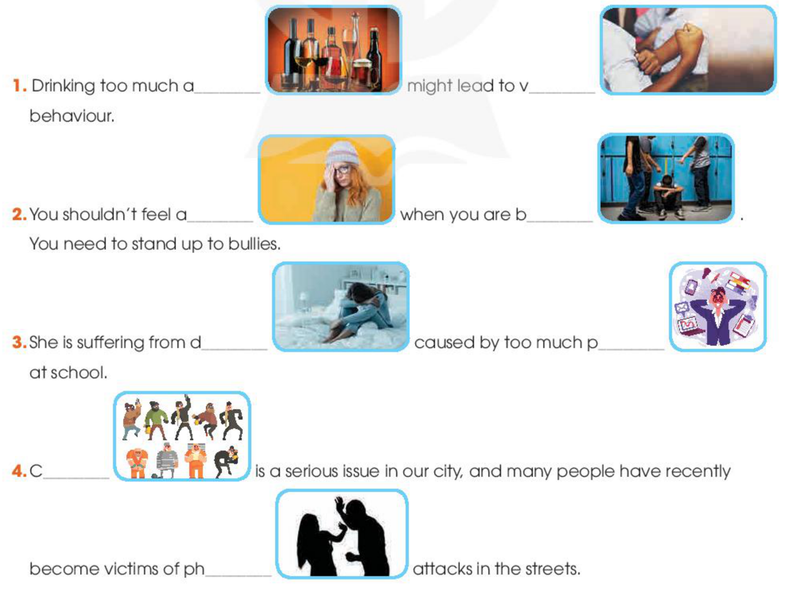
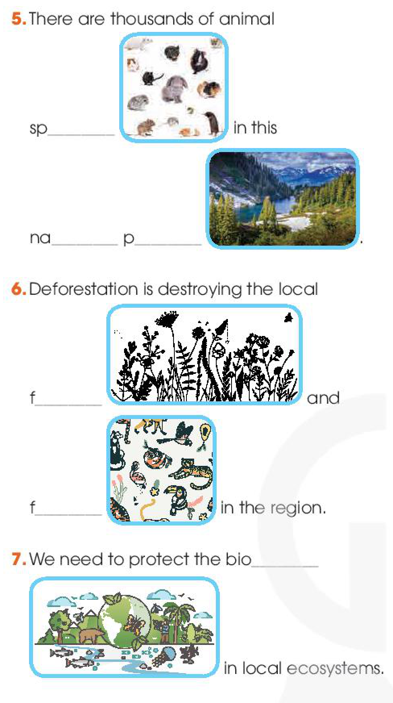

<!-- pdf:121 -->

# REVIEW 4

## I. LANGUAGE

### Pronunciation

**Mark the intonation, using ↘ (falling intonation) or ↗ (rising intonation). Then listen and check. Practise saying the sentences in pairs.**

1. Is this an example of negative peer pressure or bad decision-making?
2. Have you ever experienced physical or verbal bullying?
3. Is the most serious issue cutting down trees, hunting wild animals, or littering?
4. Is your awareness campaign going to focus on social issues, environmental problems, or educational themes?
5. Cutting down forests is destroying the earth's ecosystems, isn't it? Governments should stop deforestation.
6. You have been to Cuc Phuong National Park, haven't you? – No, I haven't.
7. Buying products made from wild animals is not good, isn't it? We shouldn't do it.
8. People don't want to harm the environment, do they? But they do so little to protect it, don't they?

### Vocabulary

**What are the missing letters? Complete the sentences using the pictures to help you.**

1. Drinking too much a\_\_\_\_\_\_\_ might lead to v\_\_\_\_\_\_\_ behaviour.
2. You shouldn't feel a\_\_\_\_\_\_\_ when you are b\_\_\_\_\_\_\_. You need to stand up to bullies.
3. She is suffering from d\_\_\_\_\_\_\_ caused by too much p\_\_\_\_\_\_\_ at school.
4. C\_\_\_\_\_\_\_ is a serious issue in our city, and many people have recently become victims of ph\_\_\_\_\_\_\_ attacks in the streets.
<!-- ocr-ok: đã đối chiếu ảnh trang gốc, các chỗ khuyết chữ đi kèm tranh gợi ý trong H11-tieng_anh-r04-01 -->

<!-- pdf:122 -->

5. There are thousands of animal sp\_\_\_\_\_\_\_ in this na\_\_\_\_\_\_\_ p\_\_\_\_\_\_\_.
6. Deforestation is destroying the local f\_\_\_\_\_\_\_ and f\_\_\_\_\_\_\_ in the region.
7. We need to protect the bio\_\_\_\_\_\_\_ in local ecosystems.
<!-- ocr-ok: đã đối chiếu ảnh trang gốc, các chỗ khuyết chữ đi kèm tranh gợi ý trong H11-tieng_anh-r04-02 -->

### Grammar

**1. Write one sentence using the linking words and phrases in brackets. Do not change the meaning of the original sentences.**

1. Many teenagers are victims of cyberbullying. As a result, they become depressed. *(because of)*
   \_\_\_\_\_\_\_\_\_\_\_\_\_\_\_\_\_\_\_\_\_\_\_\_\_\_\_\_\_\_\_\_\_\_\_\_\_\_\_
2. People pollute the environment. As a result, ecosystems are damaged. *(as)*
   \_\_\_\_\_\_\_\_\_\_\_\_\_\_\_\_\_\_\_\_\_\_\_\_\_\_\_\_\_\_\_\_\_\_\_\_\_\_\_
3. Our awareness campaign was a success. However, we still need to do more to stop cyberbullying. *(although)*
   \_\_\_\_\_\_\_\_\_\_\_\_\_\_\_\_\_\_\_\_\_\_\_\_\_\_\_\_\_\_\_\_\_\_\_\_\_\_\_
4. The forest has become a nature reserve. Therefore, people are not allowed to camp or hunt there. *(since)*
   \_\_\_\_\_\_\_\_\_\_\_\_\_\_\_\_\_\_\_\_\_\_\_\_\_\_\_\_\_\_\_\_\_\_\_\_\_\_\_
5. There have been many campaigns to end deforestation. But trees are still being cut down. *(in spite of)*
   \_\_\_\_\_\_\_\_\_\_\_\_\_\_\_\_\_\_\_\_\_\_\_\_\_\_\_\_\_\_\_\_\_\_\_\_\_\_\_
6. There was peer pressure from my friends. However, I didn't skip lessons. *(despite)*
   \_\_\_\_\_\_\_\_\_\_\_\_\_\_\_\_\_\_\_\_\_\_\_\_\_\_\_\_\_\_\_\_\_\_\_\_\_\_\_
7. Mandy is doing environmental projects. She is also helping teenagers find part-time jobs. *(in addition to)*
   \_\_\_\_\_\_\_\_\_\_\_\_\_\_\_\_\_\_\_\_\_\_\_\_\_\_\_\_\_\_\_\_\_\_\_\_\_\_\_
8. We made an effort to save our local park. But it was sold to a property developer. *(despite)*
   \_\_\_\_\_\_\_\_\_\_\_\_\_\_\_\_\_\_\_\_\_\_\_\_\_\_\_\_\_\_\_\_\_\_\_\_\_\_\_

**2. Circle the correct answers.**

1. The *nation* / *national* park is protected by the government.
2. *Cyberbully* / *Cyberbullying* is a common problem among teenagers today.
3. The area, which is home to many rare species of plants, became a *nature* / *nature's* reserve two years ago.
4. Many students go to *academic* / *vocational* schools after finishing secondary school.
5. Medical advances have helped to increase *life* / *living* expectancy.
6. There is often a *generation* / *generational* gap in extended families.
7. These policies are designed to reduce the impact of *climate* / *climate's* change.
8. We can post photos of environmentally-friendly activities on *society* / *social* media.

## II. SKILLS

### Listening

**Body shaming**

**1. Listen to a talk show. Put the main points in the order they are mentioned. There is ONE extra choice.**

- A. Definition of body shaming \_\_\_\_\_\_\_
- B. The effects of body shaming \_\_\_\_\_\_\_
- C. The solutions to body shaming \_\_\_\_\_\_\_
- D. The reasons why body shaming has become more common today \_\_\_\_\_\_\_

<!-- pdf:123 -->

**2. Listen to the talk show again. Choose the correct answers A, B, or C.**

1. Who was a victim of body shaming?
   - A. The TV host.
   - B. Dr Harrison.
   - C. A classmate of the TV host.
2. Which of the following is NOT mentioned as an effect of body shaming?
   - A. Depression.
   - B. Loss of confidence.
   - C. Unhealthy eating.
3. What can be inferred about body shaming?
   - A. It is not a new thing.
   - B. The Internet has made it less popular.
   - C. Fewer people are posting body shaming comments.
4. What do you think Dr Harrison will talk about next?
   - A. Things we can do to fight body shaming.
   - B. Ways for teenagers to deal with body shaming.
   - C. Reasons why body shaming is so hard to deal with.

### Speaking

**Dealing with body shaming**

**1. Work in pairs. Which of the ways below do you think is the best way to deal with body shaming? Give your reasons.**

1. Ignoring negative comments
2. Learning to be confident
3. Focusing on staying healthy instead
4. Understanding that beauty comes from other things rather than just appearance

**2. Work in groups. Read the situations below and think of some possible responses. Provide reasons for each answer. Report to the class and vote for the best response.**

1. A group of friends are making fun of your classmate for being short. They ask you to join them in making jokes about his height.
2. You are watching a talent show with a friend when a girl comes to the stage to perform a song. Your friend laughs at the girl and says that she is 'too ugly' to win the show.
3. A friend has posted photos of 'fat' people on social media. She invites you to share these photos with other friends and make jokes about their weight.

### Reading

**Cuc Phuong National Park**

**1. Read the article. Choose the best heading for each section. There are TWO extra headings.**

1. A popular tourist destination
2. A rich ecosystem
3. Environmental problems
4. Illegal hunting and logging
5. Solutions to the problems
<!-- ocr-ok: đã đối chiếu ảnh trang gốc, OCR bỏ sót số thứ tự 1-5 và đọc nhầm Illegal thành llegal -->

**CUC PHUONG NATIONAL PARK**

**A.** \_\_\_\_\_\_\_

As the oldest national park in Viet Nam, Cuc Phuong is a natural habitat of many rare animals and plants in Asia. It is estimated that over 2,000 plant species and thousands of species of animals live in the 22,000-hectare ecosystem. The park also has the largest variety of birds in northern Viet Nam with more than 3,000 bird species.

**B.** \_\_\_\_\_\_\_

The rich ecosystem of Cuc Phuong attracts many nature lovers from all over the world. The park is very popular from April to May, when visitors have a chance to see more than 400 species of colourful butterflies in the forest. That's why it has won the award of Asia's Leading National Park several times.

**C.** \_\_\_\_\_\_\_

Despite the government's effort to protect Cuc Phuong, several problems have been reported. Small parts of the park have been destroyed as people have cut down old trees without permission. In addition, rare animals were hunted illegally, some of which were fortunately rescued and returned to the forest. There are still irresponsible tourists who drop litter on the trails, which pollutes the water and soil. These actions can damage the ecosystem of the park. Therefore, tougher measures should be taken to protect the biodiversity of the area.

<!-- pdf:124 -->

**2. Read the article again. Which paragraph contains the following information? Write A, B, or C.**

1. The popularity of Cuc Phuong among tourists \_\_\_\_\_\_\_
2. The diversity of the ecosystem \_\_\_\_\_\_\_
3. The impact of tourism on the area \_\_\_\_\_\_\_
4. Winning an award \_\_\_\_\_\_\_
5. More work to be done to preserve the park \_\_\_\_\_\_\_

### Writing

**Protecting our national park**

**1. Work in pairs. Discuss the advert and the questions below. Add more details.**

> **Cuc Phuong National Park: Calling for ideas**
>
> Viet Nam Wildlife Conservation Committee is organising an ideas competition to raise young people's awareness of Cuc Phuong National Park. Please send us a short proposal with practical and interesting ideas for preserving the ecosystem of Cuc Phuong. The best one will win a five-day trip to Cuc Phuong for four people!

| | **AN ONLINE PHOTO ALBUM** |
| --- | --- |
| 1. What is the proposal about? | - Creating an online photo album of the area on the park website |
| 2. What will the album include? | - Photos of eco-friendly activities in Cuc Phuong, e.g. *picking up litter, going on ecotours, planting trees* - Photos of activities that can harm the ecosystem in Cuc Phuong, e.g. *cutting down trees, littering in the forest* |
| 3. Who can take photos? | - ... |
| 4. How long will this initiative last? | - ... |
| 5. What are the goals and benefits? | - Raising public awareness of what is good and not good for the ecosystem of Cuc Phuong - ... - ... |
<!-- ocr-ok: đã đối chiếu ảnh trang gốc, OCR đọc xáo trộn hai cột tờ quảng cáo và bảng AN ONLINE PHOTO ALBUM -->

**2. Write your proposal (150–180 words). Use the idea in 1 and the outline below to help you.**

> **Title: PRESERVING CUC PHUONG ECOSYSTEM**
> - **To:** Viet Nam Wildlife Conservation Committee
> - **Date:** \_\_\_\_\_\_\_
> - **Prepared by:** \_\_\_\_\_\_\_
> - **Introduction:** \_\_\_\_\_\_\_
> - **Details:** \_\_\_\_\_\_\_
> - **Goals and benefits:** \_\_\_\_\_\_\_
> - **Conclusion:** \_\_\_\_\_\_\_

## 📷 Danh mục hình minh hoạ

| Mã hình | Trang PDF | Trang sách | Chú thích / Mô tả |
| --- | --- | --- | --- |
| H11-tieng_anh-r04-01 | 121 | 120 | Các tranh gợi ý từ vựng câu 1–4 phần Vocabulary (đồ uống có cồn, bạo lực, xấu hổ, bắt nạt, trầm cảm, áp lực bạn bè, tội phạm, tấn công thể chất) |
| H11-tieng_anh-r04-02 | 122 | 121 | Các tranh gợi ý từ vựng câu 5–7 phần Vocabulary (các loài động vật, vườn quốc gia, hệ thực vật, hệ động vật, đa dạng sinh học) |
