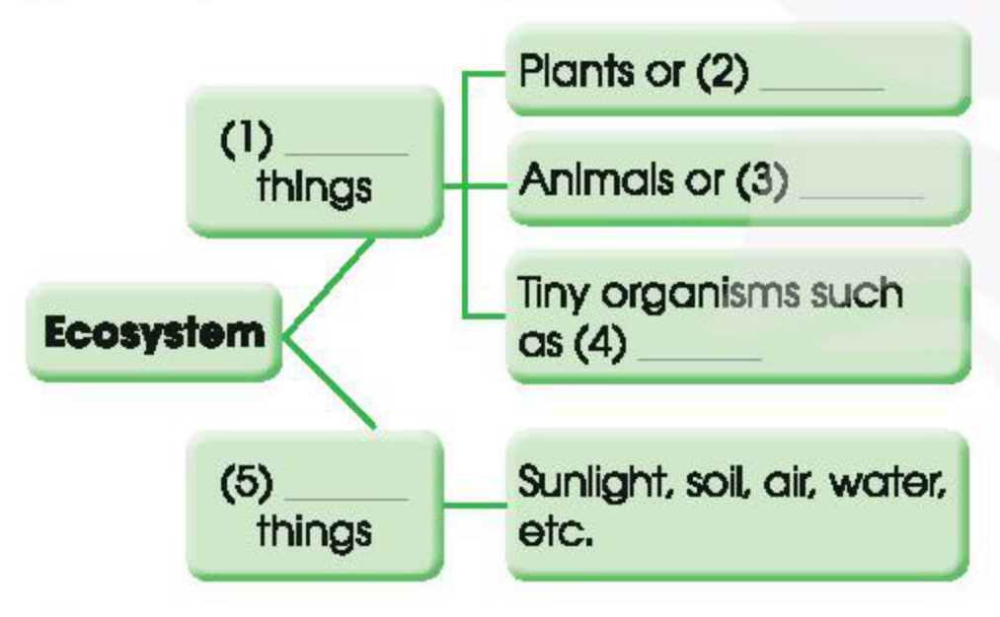
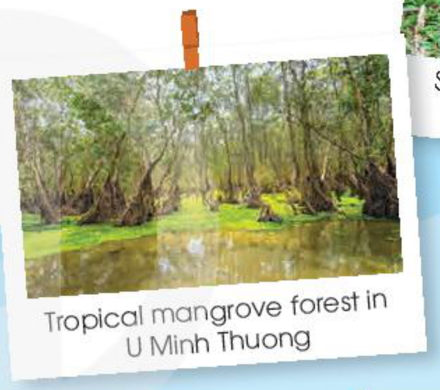
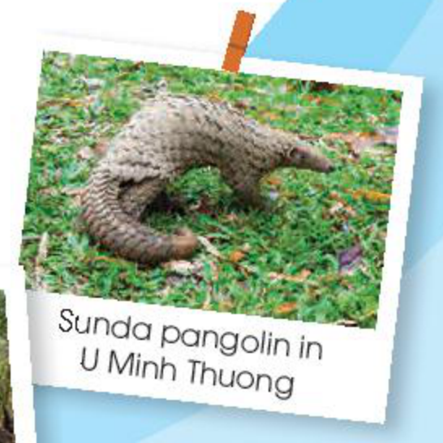
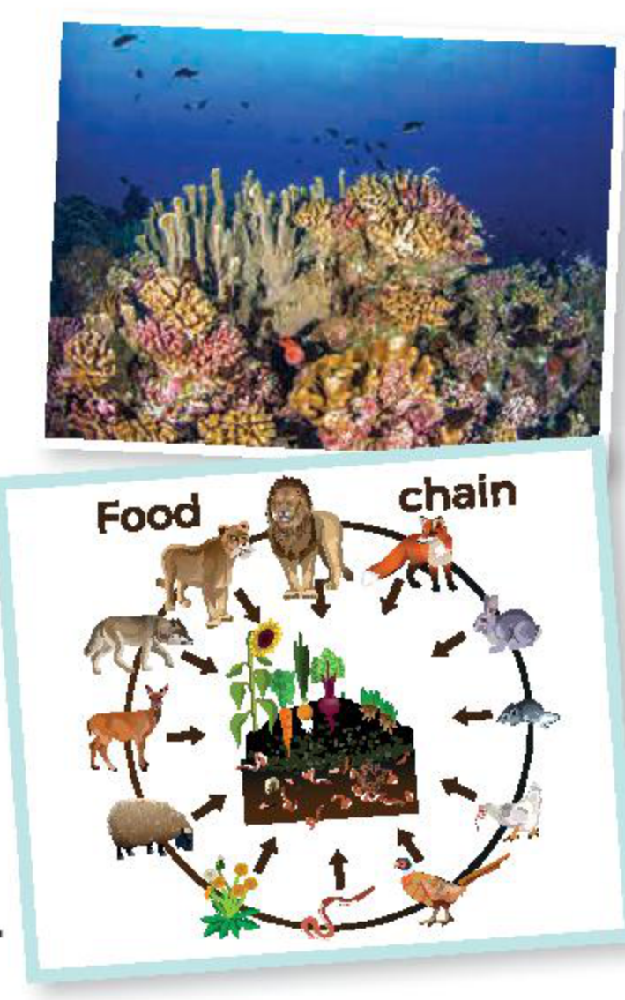
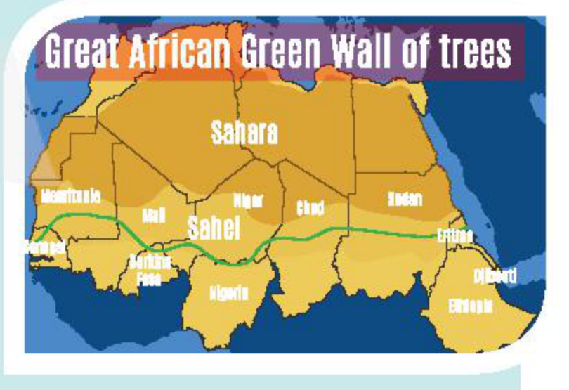

<!-- pdf:111 -->

# UNIT 10: THE ECOSYSTEM

> **This unit includes:**
> - **LANGUAGE**
>   - **Pronunciation:** Intonation in question tags
>   - **Vocabulary:** Words and phrases related to ecosystems
>   - **Grammar:** Compound nouns
> - **SKILLS**
>   - **Reading:** Reading for main ideas and specific information in an article about a national park
>   - **Speaking:** Talking about ways to protect local biodiversity and responding to situations that may harm the environment
>   - **Listening:** Listening for specific information in a talk about the human impact on ecosystems, and making predictions
>   - **Writing:** Writing an opinion essay about spending money on restoring local ecosystems
> - **COMMUNICATION AND CULTURE / CLIL**
>   - **Everyday English:** Expressing likes and dislikes
>   - **CLIL:** Protecting the ecosystem – ideas from around the world
> - **PROJECT**
>   - Making a poster about a local ecosystem and how to restore/protect it
<!-- ocr-ok: đã đối chiếu ảnh trang gốc, OCR bỏ sót dòng tiêu đề Listening trong cột tóm tắt đầu bài -->

## I. GETTING STARTED

**Ecosystems and humans**

**1. Listen and read.**

**Ms Hoa:** Nam, you went to Cuc Phuong **National Park** last weekend, didn't you?

**Nam:** Yes, that's right. It was an amazing trip. This old forest is home to thousands of different kinds of plants, insects, and animals. I really liked the colourful butterflies and the thousand-year-old tree.

**Ms Hoa:** Yes, Cuc Phuong National Park has a very rich **ecosystem**.

**Mai:** What's an ecosystem, Ms Hoa?

**Ms Hoa:** It's a community that has **living things**, like **flora** and **fauna**. Flora refers to plants and fauna refers to animals, including tiny organisms, like bacteria. Ecosystems also include non-living things, like sunlight, air, soil, and water.
<!-- term: non-living things -->

**Nam:** How important are ecosystems to life on our planet, Ms Hoa?

**Ms Hoa:** Healthy ecosystems are essential for human health and survival because they provide us with goods such as food, energy, raw materials, clean water, and air.
<!-- term: raw materials -->

**Mai:** So we should protect our ecosystems, shouldn't we?

**Ms Hoa:** That's right. Unfortunately, many ecosystems around the world are being lost, damaged, or **destroyed** because of climate change, pollution, and overuse of **natural resources**. It's very important to protect and restore them for future generations. We don't want our planet to lose even more **biodiversity**, do we?
<!-- term: climate change -->

...

<!-- pdf:112 -->

**2. Read the conversation again and decide whether these statements are true (T) or false (F).**

| | T | F |
| --- | --- | --- |
| 1. Nam went to Cuc Phuong National Park two weeks ago. | | |
| 2. In an ecosystem, plants, animals, and other living and non-living things form a community. | | |
| 3. We are losing a large number of ecosystems around the world. | | |

**3. Complete the diagram with words in 1.**

- **Ecosystem**
  - (1) \_\_\_\_\_\_\_ things
    - Plants or (2) \_\_\_\_\_\_\_
    - Animals or (3) \_\_\_\_\_\_\_
    - Tiny organisms such as (4) \_\_\_\_\_\_\_
  - (5) \_\_\_\_\_\_\_ things
    - Sunlight, soil, air, water, etc.
<!-- ocr-ok: đã đối chiếu ảnh trang gốc, OCR đọc xáo trộn các ô trong sơ đồ H11-tieng_anh-u10-01 -->

**4. Use the words in the box to form compound nouns mentioned in 1. Match them with the meanings below.**

| raw | climate | change | **resources** |
| --- | --- | --- | --- |
| park | natural | national | materials |

1. a change in the earth's weather conditions \_\_\_\_\_\_\_
2. things that exist in nature and can be used by people \_\_\_\_\_\_\_
3. land protected by the government because of its natural beauty or special history \_\_\_\_\_\_\_
4. basic materials used to make products \_\_\_\_\_\_\_
<!-- term: climate change -->
<!-- term: raw materials -->

## II. LANGUAGE

### Pronunciation

**Intonation in question tags**

**Remember!**

- We use falling intonation on the question tag when we are almost sure of the answer and we think that the listener will confirm that our statement is correct, or we want to gently persuade the listener.
  *Example:*
  **A:** *The tiger is an **endangered** animal, isn't it?* ↘
  **B:** *Yes, it is. / That's right.*
- We can also use falling intonation on the tag to make a point.
  *Example: It's a beautiful view, isn't it?* ↘
- We use rising intonation on the question tag when we are not so sure of the answer.
  *Example:*
  **A:** *You didn't do your homework, did you?* ↗
  **B:** *Yes, I did.*

**1. Listen to these conversations. Pay attention to the intonation of the question tags. Then practise saying them in pairs.**

1. **A:** So we need to protect local ecosystems, *don't we*? ↘
   **B:** Yes, we do.
2. **A:** You'll take the books back to the library, *won't you*? ↗
   **B:** OK, I'll do that tomorrow.
3. **A:** We don't want our planet to lose biodiversity, *do we*? ↘
   **B:** No, we don't.
4. **A:** An ecosystem is a community of living things, *isn't it*? ↗
   **B:** No, it isn't. It's a community of both living and non-living things.
5. **A:** You went to Cuc Phuong National Park last weekend, *didn't you*? ↘
   **B:** Yes, I did.

<!-- pdf:113 -->

**2. Mark the intonation in the question tags, using ↗ (rising intonation) or ↘ (falling intonation). Then listen and check. Practise saying the conversations in pairs.**

1. **A:** Sorry, I didn't hear my alarm this morning.
   **B:** So you were late again, *weren't you*?
2. **A:** I couldn't watch the match last night. We won, *didn't we*?
   **B:** Yes, we did.
3. **A:** There are several ecosystems that can be found in Viet Nam.
   **B:** Yes. Viet Nam is biologically diverse, *isn't it*?
4. **A:** We are running out of fossil fuels, *aren't we*?
   **B:** Yes, we are. We should find more alternative sources of energy.
5. **A:** People should stop damaging the environment, *shouldn't they*?
   **B:** Yes, I agree with you.
<!-- term: run out -->

### Vocabulary

**Plants and animals**

**1. Match the words and phrase with their meanings.**

| Words / Phrase | Meanings |
| --- | --- |
| 1. **native** (adj) | a. a group of animals or plants that have similar characteristics |
| 2. **tropical forest** (np) | b. the protection of the natural environment |
| 3. **species** (n) | c. any animal that gives birth to live young, not eggs, and feeds its young on milk |
| 4. **conservation** (n) | d. thick forest that grows in the hot parts of the world |
| 5. **mammal** (n) | e. existing naturally in a place |

**2. Complete the sentences using the correct form of the words and phrase in 1.**

1. \_\_\_\_\_\_\_ usually have a great variety of flora and fauna.
2. Many young people are really interested in **wildlife** \_\_\_\_\_\_\_ nowadays.
3. Koalas and kangaroos are \_\_\_\_\_\_\_ to Australia only.
4. Cat Ba National Park has many plant \_\_\_\_\_\_\_ that can be used as medicine.
5. Some groups of \_\_\_\_\_\_\_, including lions and tigers, eat mainly meat.

### Grammar

*Compound nouns*

**Remember!**

A compound noun is a noun that is made with two or more words, e.g. *air-traffic controller*.
A compound noun is usually formed by:
- noun + noun: *bus stop*
- adjective + noun: *wildlife*
- *-ing* form + noun: *washing machine*
- noun + *-ing* form: *film-making*
- verb + preposition: *break-out*
<!-- term: Compound nouns -->

Some compound nouns are usually written as one word, e.g. *bedroom*, some as separate words, e.g. *tennis shoes*, and others with a hyphen, e.g. *film-maker*.

Even if the first noun has a plural meaning, it usually has a singular form, e.g. *car park*.

To make a compound noun plural, we usually make the second noun plural, e.g. *car parks*. There are some exceptions, e.g. *clothes shop, passers-by*.
<!-- term: Compound nouns -->

**1. Use the words in the box to make five compound nouns.**

| endangered | nature | life | rain | vocational |
| --- | --- | --- | --- | --- |
| species | reserve | expectancy | forest | school |
<!-- ocr-ok: đã đối chiếu ảnh trang gốc, OCR đọc theo cột dọc danh sách 10 từ đơn -->

1. \_\_\_\_\_\_\_
2. \_\_\_\_\_\_\_
3. \_\_\_\_\_\_\_
4. \_\_\_\_\_\_\_
5. \_\_\_\_\_\_\_
<!-- ocr-ok: đã đối chiếu ảnh trang gốc, 5 dòng kẻ trống đánh số 1-5 -->

<!-- pdf:114 -->

**2. Work in pairs. Use the words in the box to make compound nouns. Then make sentences with them.**

| wild | swim | life | level | ~~warm~~ |
| --- | --- | --- | --- | --- |
| mobile | sea | ~~globe~~ | pool | phone |
<!-- ocr-ok: đã đối chiếu ảnh trang gốc, hai từ warm và globe bị gạch ngang vì đã làm mẫu trong câu Example -->

*Example: There are many factors that contribute to global warming.*

## III. READING

**U Minh Thuong – A unique national park**

**1. Work in pairs. Look at the photos and discuss the questions.**

- *Have you ever been to U Minh Thuong National Park? Where is it?*
- *What can/did you see in the park?*

**2. Read the article and match the headings (1–4) to the paragraphs (A–D).**

1. Flora and fauna
2. Best time to visit
3. Location
4. Geography

**A.** \_\_\_\_\_\_\_

U Minh Thuong National Park is located in An Bien, An Minh, and Vinh Thuan districts of Kien Giang Province, about 60 km south of Rach Gia city centre. This place is considered one of the most important sites for ecosystem **conservation** in the Mekong River **Delta**. It attracts tourists not only with its wild and beautiful scenery, but also with its rare and rich **biodiversity**.

**B.** \_\_\_\_\_\_\_

U Minh Thuong National Park covers a large area of freshwater wetlands, including mangrove forests. Its central part is surrounded by waterways with a series of gates, which are used to manage the water level.

**C.** \_\_\_\_\_\_\_

Home to 226 **species** of plants, U Minh Thuong National Park is the region with the richest biodiversity in the Mekong River Delta. It used to be one of the largest **habitats** for water birds in the area, but their home was badly damaged by forest fires in 2002. Now there are about two hundred types of birds in the park, including some unique birds like the great spotted eagle. Thirty-two types of **mammals** have been found here. Ten of them, including the fishing cat and Sunda **pangolin**, are on the list of rare and **endangered** species, **native** to Viet Nam.

**D.** \_\_\_\_\_\_\_

The ideal time to explore U Minh Thuong National Park is from August to November, known as the floating water season of the region. Tourists can take a boat to experience nature and **wildlife**. Visitors can go to Trang Doi, a place where thousands of bats gather, hanging on the trees like huge fruits. Another popular place to visit is Trang Chim, a large area with thousands of colourful birds. So if you love nature, you should definitely go to explore this amazing natural park.

<!-- pdf:115 -->

**3. Read the article again and complete each sentence with no more than THREE words.**

1. U Minh Thuong National Park is famous for its rare and rich \_\_\_\_\_\_\_.
2. Waterways surround the \_\_\_\_\_\_\_ of the national park.
3. It has more than two hundred \_\_\_\_\_\_\_.
4. You can find nearly 200 types of birds and 32 \_\_\_\_\_\_\_ there.
5. The best time to visit U Minh Thuong National Park is from \_\_\_\_\_\_\_.

**4. Work in groups. Discuss the following questions.**

*Why do we need national parks? What should we do to protect them?*

## IV. SPEAKING

**Ways to protect local biodiversity**

**1. Look at the table below. Which of the following are ways to protect local biodiversity? Tick (✓) the correct boxes. Add two more if you can.**

| | |
| --- | --- |
| 1. banning the hunting of wild animals | |
| 2. planting local trees, flowers, and other plants | |
| 3. promoting mass tourism | |
| 4. educating people about the importance of biodiversity | |
| 5. increasing your carbon footprint | |

**2. Work in pairs. Choose a way to protect local biodiversity from the list in 1, and tell your partner about it. Use the following questions.**

Why is it important? How will it help protect local biodiversity? What can you do to help?

*Example: Plants play an important role in ecosystems. They provide food and shelter for many animal species. Each plant supports the ecosystem and biodiversity of the local area. We can help by researching the local flora, and planting more native plants.*

**3. Work in groups. Your class is on a field trip to a national park. Read the situations below and think of some possible responses. Provide reasons for each answer.**

1. Some of your classmates want to collect some rare insects/flowers for their collection.
   *Example: 'You shouldn't do that for several reasons. First, rare plant and animal species are endangered. Second, if people start killing or collecting them, they will soon disappear. Finally, this will harm local biodiversity and have a serious effect on the balance of the local ecosystem.'*
2. Some classmates have brought some snacks and want to feed the wild animals in the park.
3. You see some classmates throwing rubbish, such as plastic bottles, paper, and cans, on the grass and in the water.
4. Some classmates want to collect wood to build a fire in the park.

**4. Report your answers to the whole class. Vote for the best response.**

<!-- pdf:116 -->

## V. LISTENING

**Human impact on ecosystems**

**1. Choose the correct meanings of the word and phrases.**

1. **coral reef**
   - A. a plant that grows in the sea
   - B. a line of hard rock formed by coral found in warm sea water
2. **food chain**
   - A. the order in which living things depend on each other for food
   - B. the order in which food is provided
3. run out
   - A. to use all of something
   - B. to experience something unexpectedly
4. break down
   - A. to make smaller
   - B. to stop working
<!-- term: run out -->

**2. Listen to a talk and choose the correct answers A, B, or C.**

1. Why is Dr Logan invited to give a talk?
   - A. Because he knows Nam.
   - B. Because he's an expert in biodiversity conservation.
   - C. Because he's a member of the environment club.
2. Which of the benefits provided by a healthy ecosystem is NOT mentioned?
   - A. Cleaning our air and water.
   - B. Controlling climate changes.
   - C. Recycling waste naturally.
3. How much of the **coral reefs** has disappeared?
   - A. 25%.
   - B. 50%.
   - C. 90%.
4. What may happen as a result of damaging the ecosystem balance?
   - A. More space for farming and houses.
   - B. Lack of food, water, and fresh air.
   - C. Fewer natural disasters.
5. What do you think Dr Logan will talk about next?
   - A. Ways to repair damaged ecosystems.
   - B. Ways to restore the food chain.
   - C. The future of human life.

**3. Listen again and decide whether the statements are true (T) or false (F).**

| | T | F |
| --- | --- | --- |
| 1. The threat to the earth's biodiversity comes from human activities. | | |
| 2. Nearly half of the world's forests have been cut down. | | |
| 3. The disappearance of some species may cause problems to the food chain. | | |
| 4. The health of human beings does not depend on a healthy ecosystem. | | |

**4. Work in groups. Discuss the following question.**

*What can humans do to protect and restore the earth's ecosystems?*

<!-- pdf:117 -->

## VI. WRITING

**An opinion essay about spending more money on restoring local ecosystems**

**1. Work in groups. Discuss and decide whether the following ideas are for or against restoring local ecosystems.**

| IDEAS | For | Against |
| --- | --- | --- |
| 1. It is more important to invest in healthcare and education. | | |
| 2. Air and water pollution are affecting our health. | | |
| 3. There are more serious problems such as unemployment and poverty. | | |
| 4. Many plant and animal species are disappearing. | | |
| 5. Cutting down forests is causing floods and other natural disasters. | | |
| 6. Ecosystems can restore themselves naturally. | | |

**2. Write an opinion essay (150–180 words) presenting your point of view on whether we should spend more money on restoring local ecosystems. Use the ideas in 1 and the outline with useful expressions below to help you.**

> **Introduction**
> - *Today, many people argue that ...*
> - *From my point of view / In my opinion, this is / people should ...*
>
> **Body**
> - *Firstly, the most important reason why we should / should not ... is that ...*
> - *Secondly, we should / should not ... because / as / since ... (this) has caused ... That is why ...*
> - *Finally, ... this has led / affected ...*
>
> **Conclusion**
> - *In conclusion, I firmly believe that ... it is essential to ...*

## VII. COMMUNICATION AND CULTURE / CLIL

### Everyday English

*Expressing likes and dislikes*

**1. Listen and complete the conversation with the expressions in the box. Then practise it in pairs.**

| A. I can't stand | B. I really love | C. I'm not a fan |
| --- | --- | --- |
<!-- ocr-ok: đã đối chiếu ảnh trang gốc, OCR đọc nhầm I really thành Iredlly -->

**Alice:** There're so many activities for visitors in this park. Do you fancy going on an elephant ride, Mai?

**Mai:** No, thanks. (1) \_\_\_\_\_\_\_ of elephant rides.

**Alice:** Don't you like elephants? They are very gentle creatures.

**Mai:** That's why we shouldn't ride on them. (2) \_\_\_\_\_\_\_ animal cruelty.
<!-- term: Expressing likes and dislikes -->

**Alice:** Yes, you're right. Perhaps we should learn more about the birds in the park.

**Mai:** Good idea! (3) \_\_\_\_\_\_\_ bird-watching.
<!-- term: Expressing likes and dislikes -->
<!-- ocr-ok: đã đối chiếu ảnh trang gốc, OCR đọc nhầm Good idea! thành Good ideal! -->

<!-- pdf:118 -->

**2. Work in pairs. Use the model in 1 to make similar conversations for these situations. One of you is Student A, the other is Student B. Use the expressions below to help you.**

1. Student A is talking about the activities he/she does on field trips to national parks. Student B expresses likes/dislikes about these activities.
2. Student A and Student B are planning an eco-friendly class party. They talk about the things and activities they like or dislike at a party.

| **Useful expressions** | |
| --- | --- |
| **Expressing likes** | **Expressing dislikes** |
| - I love/adore ... - I'm really into ... - I'm a (big) fan of ... - I'm keen on ... - I'm into ... | - I hate/don't like ... - I can't bear/stand ... - I'm not really into ... - ... is not my favourite. |
<!-- term: Expressing likes and dislikes -->
<!-- ocr-ok: đã đối chiếu ảnh trang gốc, OCR đọc nhầm I hate/don't thành Ihơfe/donf và I'm really thành I'm redlly -->

### CLIL

**1. Read the text and tick (✓) the correct project in the table.**

**PROTECTING ECOSYSTEMS – IDEAS FROM AROUND THE WORLD**

The healthier our ecosystems are, the healthier our planet and its people become. Ecosystem restoration can help end poverty, fight climate change, and prevent loss of flora and fauna on every continent and in every ocean. Below are two examples of successful ecological projects.

**The Great Green Wall**

The goal of this project is to create the largest living structure on the planet. The plan is to restore 100 million hectares of damaged land, limit the amount of carbon dioxide and create 10 million **green** jobs in Africa. This will provide rich land, food security, and improve the region's ability to deal with climate change. Since its launch in 2007, Ethiopia and Nigeria have restored millions of hectares of land, and Senegal has planted more than 10 million trees.

**Belize Barrier Reef**

The Belize Barrier Reef was once described as the most amazing reef in the West Indies. It is home to a large diversity of plants and animals. It is Belize's top tourist destination, popular for scuba diving and snorkelling, and a UNESCO Natural World Heritage Site. Between 2009 and 2018, it was declared endangered because of pollution and the destruction of its ecosystems. However, because of conservation efforts, a large part of the reef is now protected. There are seven marine reserves. Belize has also stopped oil drilling near the Barrier Reef, banned plastic products, and created 'no-take zones', where removing plants and animals is not allowed.
<!-- term: no-take zones -->

<!-- pdf:119 -->

| | The Great Green Wall | Belize Barrier Reef |
| --- | --- | --- |
| 1. It is a marine ecosystem of rich biodiversity. | | |
| 2. Its aim is to build the world's biggest living structure. | | |
| 3. Millions of trees have been planted in several African countries. | | |
| 4. The government has taken measures to restore and protect the ecosystem. | | |

**2. Work in groups. Discuss the following questions.**

*Are there similar projects in Viet Nam? Do you think the ideas in 1 can be applied in Viet Nam?*

## VIII. LOOKING BACK

### Pronunciation

**Mark the intonation in the question tags. Then listen and check. Practise saying the sentences in pairs.**

1. I can't find my key. You will help me find it, *won't you*?
2. People have **destroyed** so many forests, *haven't they*?
3. I haven't been to Yellowstone. I think it's a famous natural park in the USA, *isn't it*?
4. I don't know much about Sam. He didn't graduate from university, *did he*?

### Vocabulary

**Choose the correct word or phrase to complete each sentence.**

1. Cuc Phuong National Park has a large number of flora and fauna *species* / *regions*.
2. Many species are saved from disappearing by *biodiversity* / *conservation* efforts.
3. Reducing the use of fresh water can help to protect marine *ecosystems* / *national parks*.
4. The overuse of *natural resources* / *climate change* may lead to loss of biodiversity.

### Grammar

**Find and correct the mistakes in the following sentences.**

1. You can get off at the next busstop.
2. Watching the sunsetting at the beach is really amazing.
3. Did you have a chance to do any sightsee in Paris?
4. Viet Nam has a large variety of fascinating wildlives.

<!-- pdf:120 -->

## PROJECT

**Restore and protect a local ecosystem**

**Work in groups. Make a poster to illustrate an ecosystem in your local area and suggest ideas to restore and/or protect it.**

**Give a group presentation. Use these questions as cues.**

- What does the ecosystem include?
- What is its current condition? Is it damaged?
- What can we do to restore and/or protect it?

### Now I can ...

- use rising and falling intonation in question tags.
- understand and use words and phrases related to ecosystems.
- understand and use compound nouns.
- read for main ideas and specific information in an article about a national park.
- talk about ways to protect local biodiversity and respond to situations that may harm the environment.
- listen for specific information in a talk about the human impact on ecosystems, and make predictions.
- write an opinion essay about spending money on restoring local ecosystems.
- express likes and dislikes.
- understand how ecosystems around the world are protected and restored.
- make a poster about a local ecosystem and how to restore/protect it, and present it to the class.

## 📷 Danh mục hình minh hoạ

| Mã hình | Trang PDF | Trang sách | Chú thích / Mô tả |
| --- | --- | --- | --- |
| H11-tieng_anh-u10-01 | 112 | 111 | Sơ đồ cấu trúc hệ sinh thái (*Ecosystem*) gồm hai nhánh thành phần hữu sinh và thành phần vô sinh |
| H11-tieng_anh-u10-02 | 114 | 113 | Ảnh rừng ngập mặn nhiệt đới tại Vườn quốc gia U Minh Thượng (*Tropical mangrove forest in U Minh Thuong*) |
| H11-tieng_anh-u10-03 | 114 | 113 | Ảnh tê tê Sunda tại Vườn quốc gia U Minh Thượng (*Sunda pangolin in U Minh Thuong*) |
| H11-tieng_anh-u10-04 | 116 | 115 | Ảnh rạn san hô dưới đáy biển và sơ đồ vòng tròn chuỗi thức ăn (*Food chain*) trong tự nhiên |
| H11-tieng_anh-u10-05 | 118 | 117 | Bản đồ dự án Bức tường Xanh Vĩ đại ở châu Phi (*Great African Green Wall of trees*) chạy ngang vùng Sahel phía nam sa mạc Sahara |
