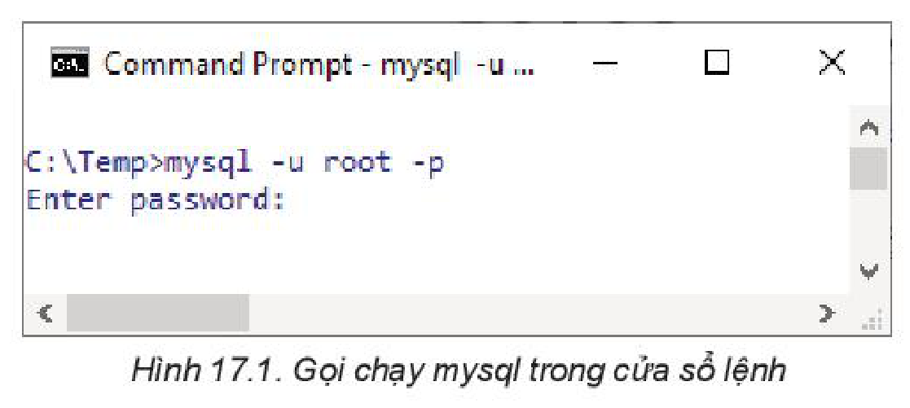
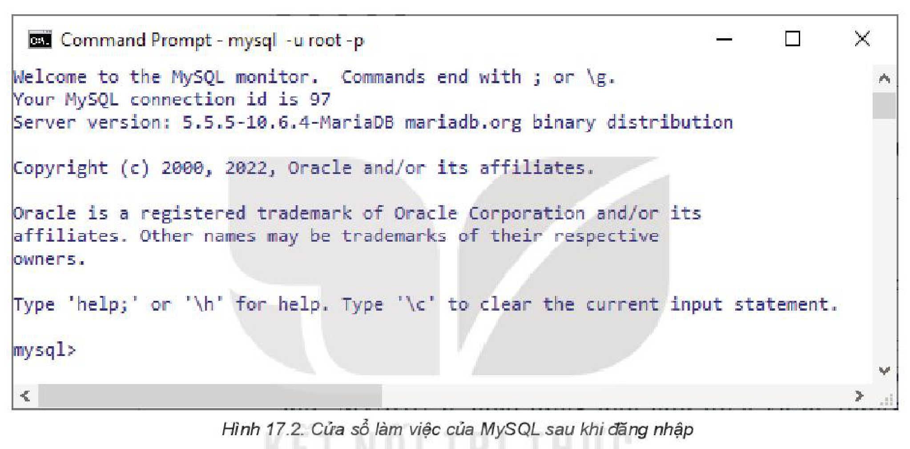
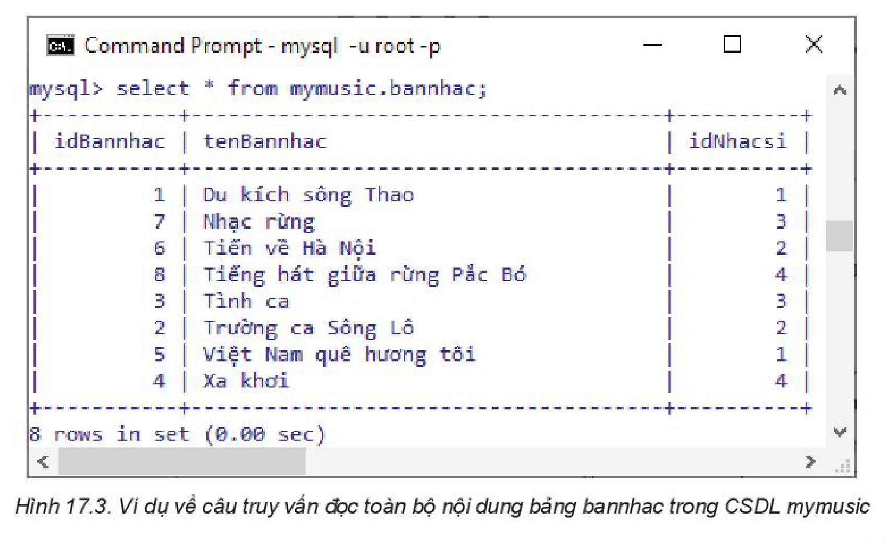
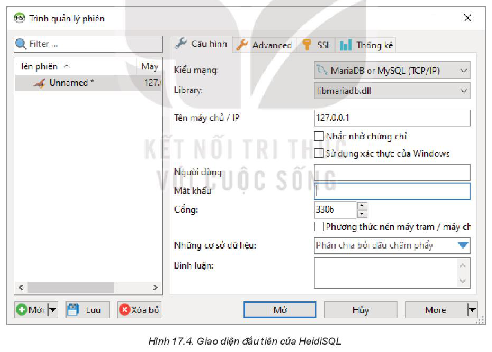
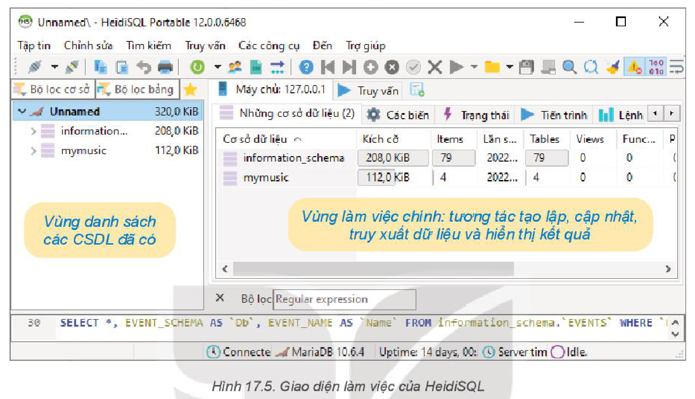

<!-- pdf:83 -->

# BÀI 17: QUẢN TRỊ CƠ SỞ DỮ LIỆU TRÊN MÁY TÍNH

## 🎯 Sau bài học này em sẽ:

- Biết được lợi ích của việc quản trị CSDL trên máy tính.
- Làm quen với MySQL và HeidiSQL – bộ công cụ hỗ trợ việc quản trị CSDL trên máy tính.

## 🔴 Khởi động

> Trở lại với các bài toán quản lí điểm, quản lí các bản thu âm (Bài 10 đến Bài 15), em có nhận xét, so sánh gì về việc cập nhật, chỉnh sửa dữ liệu giữa quản lí thủ công và quản lí CSDL trên máy tính?

## 1. LỢI ÍCH CỦA VIỆC QUẢN TRỊ CƠ SỞ DỮ LIỆU TRÊN MÁY TÍNH

> **Hoạt động 1: Tìm hiểu lợi ích của quản trị CSDL trên máy tính**
>
> Các bài toán quản lí cùng với việc lưu trữ dữ liệu, khai thác thông tin đã xuất hiện từ rất lâu trong các hoạt động kinh tế – xã hội với những nghiệp vụ được vận hành nề nếp, ổn định từ rất nhiều năm,... Hãy cùng tìm hiểu tại sao lại phải thay đổi thói quen quản lí thủ công, chuyển sang sử dụng máy tính với hệ QTCSDL.

Trước khi có máy tính và giải pháp quản trị CSDL trên máy tính, việc **quản lí dữ liệu thủ công** là công việc rất vất vả, khó kiểm soát, đòi hỏi nhiều công sức, đặc biệt với những dữ liệu không được phép sai sót dù rất nhỏ, chẳng hạn như với ngành ngân hàng.

Hằng ngày, nhân viên ngân hàng phải tiếp số lượng lớn khách hàng đến thực hiện các giao dịch gửi, rút tiền,... Mỗi giao dịch đều phải tiếp nhận thông tin khách hàng, đối chiếu với thông tin lưu trong sổ sách, ghi chép chính xác lượng tiền gửi vào hay rút ra, lập các chứng từ cần thiết,... Vì vậy, cần nhiều thời gian cho mỗi giao dịch.

Cuối ngày, nhân viên ngân hàng lại phải thực hiện rà soát số liệu, so sánh, đối chiếu để phát hiện, xử lí nếu có sai sót, làm sổ tổng hợp dữ liệu tài khoản, số dư trong ngày, làm các chứng từ giao dịch liên ngân hàng,... Vì vậy, tiền tệ luân chuyển chậm, mất nhiều thời gian, ảnh hưởng lớn đến tất cả các hoạt động sản xuất kinh doanh trong xã hội.

Những chức năng được thiết kế để hạn chế tối đa dư thừa dữ liệu, đảm bảo tính nhất quán của dữ liệu, đảm bảo an ninh và an toàn dữ liệu,... đã giúp hoạt động của ngân hàng ngày nay có nhiều chuyển biến tiến bộ.

<!-- pdf:84 -->

Việc tìm kiếm, xác định một khách hàng cùng danh sách các giao dịch đã thực hiện cũng như số dư tài khoản trong CSDL có thể thực hiện một cách nhanh chóng và chính xác. Tài khoản đích trong mỗi giao dịch cũng có thể được kiểm tra xác nhận ngay trước khi thực hiện giao dịch, không những rút ngắn thời gian giao dịch mà còn hạn chế tối đa những giao dịch nhầm lẫn. Nhiều hệ QTCSDL cho phép cài đặt bổ sung các dịch vụ (phần mềm) hỗ trợ **giao dịch trực tuyến** trên máy tính, điện thoại di động,... mà không cần yêu cầu khách hàng phải trực tiếp tới các chi nhánh ngân hàng.

Không chỉ riêng lĩnh vực ngân hàng, việc ứng dụng mô hình tổ chức và quản trị CSDL một cách khoa học trên máy tính trong quản lí của các lĩnh vực khác nhau đều đem lại nhiều lợi ích to lớn. Chính vì vậy, ngày nay, việc ứng dụng quản trị CSDL trên máy tính đã được thực hiện một cách phổ biến ở hầu khắp các hoạt động quản lí kinh tế – xã hội.

<!-- term: Lợi ích của việc ứng dụng CSDL trong quản lí -->
> Việc ứng dụng CSDL trong quản lí đem lại nhiều lợi ích to lớn: tiện lợi, kịp thời, nhanh chóng, hạn chế sai sót,...

> ❓ **Câu hỏi**
>
> Hãy nêu vài ví dụ thực tế minh hoạ về việc ứng dụng quản trị CSDL trên máy tính và những lợi ích mà nó mang lại.

## 2. HỆ QUẢN TRỊ CƠ SỞ DỮ LIỆU MYSQL VÀ PHẦN MỀM HEIDISQL

> **Hoạt động 2: Tìm hiểu và lựa chọn hệ QTCSDL**
>
> Hãy sử dụng từ khoá “hệ quản trị CSDL phổ biến” để tìm kiếm thông tin trên Internet và trả lời câu hỏi "Nếu được lựa chọn, em sẽ chọn hệ QTCSDL nào để đáp ứng được các tiêu chí nhiều người dùng và là hệ QTCSDL miễn phí"?

Để có thể làm việc được với CSDL (khởi tạo CSDL, tạo bảng, cập nhật dữ liệu và khai thác thông tin) cần phải có một hệ QTCSDL và một phần mềm giúp giao tiếp với hệ QTCSDL đó. Các hệ QTCSDL được dùng phổ biến nhất hiện nay có thể kể tới là ORACLE, **MySQL**, Microsoft SQL Server,... Trong số đó chỉ có MySQL là sản phẩm mã nguồn mở miễn phí. MySQL cũng được đánh giá là gọn nhẹ, tốc độ xử lí nhanh, hỗ trợ quản lí chặt chẽ sự nhất quán dữ liệu, đảm bảo an ninh và an toàn dữ liệu, thích hợp cho cả các bài toán quản trị CSDL lớn cũng như các bài toán quản trị CSDL trên Internet.

Vì những đặc điểm trên, MySQL được sử dụng phổ biến trong các ứng dụng quản lí hiện nay. Trong sách này, em sẽ làm quen với MySQL để thực hành quản trị CSDL.

### a) Cài đặt và làm việc với MySQL
<!-- ocr-ok: đã đối chiếu ảnh trang 84, tiêu đề mục 2.a bị OCR đọc sai thành "Cải đặt vả làm việc với MuSQL" -->

Truy cập trang dev.mysql.com/downloads/mysql/ để tải về một trong các bản:

- Bản cài đặt tự động: Windows (x86, 32&64-bit) MySQL Installer MSI.
- Bản Windows (x86, 64-bit) ZIP archive (gọn nhẹ).
- Bản đầy đủ Windows (x86, 64-bit) ZIP archive (với Debug Binaries & Test Suite).

Với bản cài đặt tự động, trong quá trình cài đặt sẽ có yêu cầu nhập mật khẩu cho người dùng **root** (tương tự administrator của hệ điều hành Windows). Cần ghi nhớ mật khẩu này để truy xuất MySQL. Sau khi cài đặt, MySQL sẽ hoạt động như một **dịch vụ hệ thống** (**Service**).

<!-- pdf:85 -->

MySQL có sẵn phần mềm khách giúp người dùng có thể kết nối, làm việc với MySQL, dùng giao diện dòng lệnh, có tên là **mysql.exe** trong thư mục bin của thư mục MySQL.

Hãy mở cửa sổ dòng lệnh (chẳng hạn chạy `cmd.exe`). Nhập `mysql -u root -p` và nhấn phím `Enter` (`u` là viết tắt của từ user, `p` là viết tắt của từ password). Nhập mật khẩu của người dùng root, nhấn phím `Enter` để mở cửa sổ làm việc của MySQL.

*Hình 17.1. Gọi chạy mysql trong cửa sổ lệnh*

*Hình 17.2. Cửa sổ làm việc của MySQL sau khi đăng nhập*

Trong cửa sổ làm việc này, có thể nhập các câu truy vấn SQL và nhận được thông báo về kết quả và thời gian thực hiện câu truy vấn đó, tính đến phần trăm giây.

*Hình 17.3. Ví dụ về câu truy vấn đọc toàn bộ nội dung bảng bannhac trong CSDL mymusic*

<!-- pdf:86 -->

### b) Phần mềm HeidiSQL

Phần mềm mysql.exe giúp kết nối, làm việc với hệ QTCSDL MySQL tuy rất gọn nhẹ nhưng dùng giao diện dòng lệnh nên không thật thuận tiện với người dùng mới. Sẽ thuận lợi hơn nếu có một phần mềm tương tự, dùng giao diện đồ hoạ. **HeidiSQL** là phần mềm như vậy. Đây là một phần mềm mã nguồn mở, miễn phí, giúp kết nối, làm việc với nhiều hệ QTCSDL như MySQL, MariaDB, Microsoft SQL Server, PostgreSQL,... Hơn nữa, HeidiSQL còn là hệ QTCSDL có hỗ trợ tiếng Việt nên được lựa chọn giới thiệu trong sách này.

**Cài đặt HeidiSQL**

Truy cập trang www.heidisql.com/download.php để tải về một trong hai bản sau:

- Bản cài đặt tự động Installer, 32/64 bit combined.
- Bản Portable version (zipped): 32 bit, 64 bit.

**Bản Portable** là bản nén dạng zip, chỉ cần giải nén vào một thư mục và chạy tệp `heidisql.exe`. Bản cài đặt tự động sẽ thêm biểu tượng HeidiSQL trên màn hình nền.

**Làm việc với HeidiSQL**

Nháy đúp chuột vào biểu tượng HeidiSQL trên màn hình nền để khởi động hoặc nháy đúp trực tiếp tệp `heidisql.exe`. Giao diện ban đầu như Hình 17.4.

*Hình 17.4. Giao diện đầu tiên của HeidiSQL*

<!-- term: Đăng nhập phiên làm việc trong HeidiSQL -->
- Các ô `Kiểu mạng`, `Library` được đặt các giá trị mặc định để kết nối với các hệ QTCSDL MySQL hay MariaDB.
- Ô `Tên máy chủ / IP` và các ô kiểm đi kèm được đặt giá trị mặc định vì MySQL và HeidiSQL được cài đặt trên cùng một máy.
- Ô `Người dùng` (tên người dùng CSDL): hãy nhập `root`.

<!-- pdf:87 -->

<!-- term: Đăng nhập phiên làm việc trong HeidiSQL -->
- Ô `Mật khẩu`: nhập mật khẩu của người dùng `root`.
- Ô `Cổng` dùng giá trị mặc định là cổng giao tiếp dành cho các hệ QTCSDL.
- Sau khi nhập tên người dùng và mật khẩu, hãy chọn `Mở` để vào cửa sổ làm việc. Giao diện sau khi đăng nhập thành công của HeidiSQL như Hình 17.5.

*Hình 17.5. Giao diện làm việc của HeidiSQL*

*Chú ý:* Khi cài đặt HeidiSQL, nếu máy tính kết nối Internet, HeidiSQL sẽ tự động nhận biết mã vùng quốc gia và thiết lập giao diện với ngôn ngữ tương ứng. Người dùng có thể thiết lập ngôn ngữ bằng công cụ `Tools/Preferences/General`.

Trong các bài học tiếp theo, em sẽ được hướng dẫn chi tiết các thao tác với HeidiSQL để tạo lập CSDL, tạo bảng dữ liệu cũng như cập nhật và truy xuất dữ liệu.

> MySQL và HeidiSQL là các phần mềm mã nguồn mở, được nhiều người dùng để quản trị các CSDL.

> ❓ **Câu hỏi**
>
> Cần gõ câu truy vấn nào trong cửa sổ lệnh của MySQL để đọc được toàn bộ thông tin bảng nhacsi trong CSDL mymusic?

## ✏️ Luyện tập

Thực hành cài đặt MySQL và cài đặt HeidiSSQL.
<!-- ocr-ok: đã đối chiếu ảnh trang 87, câu Luyện tập bị OCR đọc sai thành "cải đặt MySCOL và cài đặt HeidiSSCL" -->

## 🚀 Vận dụng

Truy cập Internet với các cụm từ khoá thích hợp để tìm hiểu thêm thông tin về MySQL và HeidiSQL.

## 📷 Danh sách hình trong bài

| Mã hình | Trang PDF | Vị trí trong bài | Chú thích gốc |
| --- | --- | --- | --- |
| H11-tin_hoc_thud-b17-01 | 85 | Mục 2.a | Hình 17.1. Gọi chạy mysql trong cửa sổ lệnh |
| H11-tin_hoc_thud-b17-02 | 85 | Mục 2.a | Hình 17.2. Cửa sổ làm việc của MySQL sau khi đăng nhập |
| H11-tin_hoc_thud-b17-03 | 85 | Mục 2.a | Hình 17.3. Ví dụ về câu truy vấn đọc toàn bộ nội dung bảng bannhac trong CSDL mymusic |
| H11-tin_hoc_thud-b17-04 | 86 | Mục 2.b | Hình 17.4. Giao diện đầu tiên của HeidiSQL |
| H11-tin_hoc_thud-b17-05 | 87 | Mục 2.b | Hình 17.5. Giao diện làm việc của HeidiSQL |
