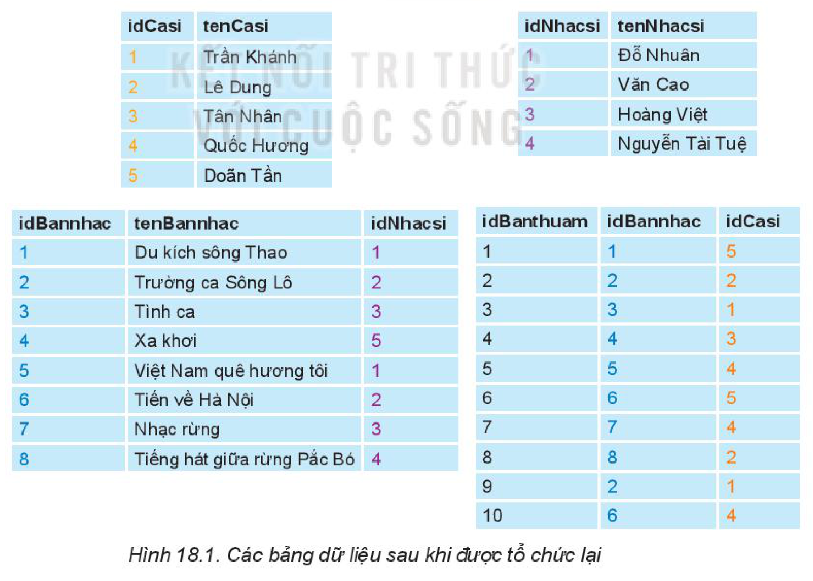
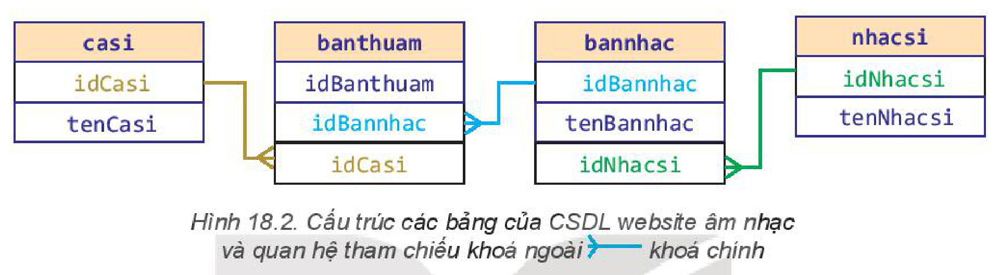

<!-- pdf:88 -->

# BÀI 18: THỰC HÀNH XÁC ĐỊNH CẤU TRÚC BẢNG VÀ CÁC TRƯỜNG KHOÁ

## 🎯 Sau bài học này em sẽ:

- Có được hình dung về công việc xác định các bảng dữ liệu, cấu trúc của chúng và các trường khoá trước khi bước vào tạo lập CSDL.

## 🔴 Khởi động

> Ở Bài 13, các em đã phần nào thấy được lợi ích khi tổ chức CSDL của website âm nhạc với nhiều bảng mà không phải là một bảng với đầy đủ tất cả các thông tin về mỗi bản thu âm (tên bản nhạc, tên nhạc sĩ, tên ca sĩ).
>
> Tuy nhiên, làm thế nào để từ yêu cầu ban đầu (quản lí danh sách các bản thu âm với đầy đủ thông tin tên bản nhạc, tên nhạc sĩ, tên ca sĩ) người ta lại đi đến được CSDL với các bảng như đã trình bày ở Bài 13?

**Nhiệm vụ. Xác định các bảng dữ liệu, cấu trúc của chúng và các trường khoá cho CSDL của một website âm nhạc**

*Hướng dẫn:*

## 1. XEM XÉT BÀI TOÁN

Cùng xem xét lại bài toán quản lí các bản thu âm nhạc. Ta sẽ quy ước nói đến nhạc sĩ sáng tác bản nhạc là nói đến tên một nhạc sĩ hay tên một nhóm nhạc sĩ sáng tác bản nhạc đó. Tương tự như vậy, ta cũng quy ước khi nói đến tên ca sĩ là nói đến một ca sĩ hay một nhóm ca sĩ biểu diễn tác phẩm. Dưới đây là một ví dụ về một bản ghi chép lại thông tin các bản thu âm.

**Bảng 18.1.** *Ví dụ về một bản ghi chép các bản thu âm nhạc*

| STT | Tên bản nhạc | Tên nhạc sĩ | Tên ca sĩ |
| :---: | :--- | :--- | :--- |
| 1 | Du kích sông Thao | Đỗ Nhuận | Doãn Tần |
| 2 | Trường ca Sông Lô | Văn Cao | Lê Dung |
| 3 | Tình ca | Hoàng Việt | Trần Khánh |
| 4 | Xa khơi | Nguyễn Tài Tuệ | Tân Nhân |
| 5 | Việt Nam quê hương tôi | Đỗ Nhuận | Quốc Hương |
| 6 | Tiến về Hà Nội | Văn Cao | Doãn Tần |
| 7 | Nhạc rừng | Hoàng Việt | Quốc Hương |
| 8 | Tiếng hát giữa rừng Pắc Bó | Nguyễn Tài Tuệ | Lê Dung |
| 9 | Trường ca Sông Lô | Văn Cao | Trần Khánh |
| 10 | Tiến về Hà Nội | Văn Cao | Quốc Hương |

<!-- pdf:89 -->

## 2. TẠO LẬP BẢNG

<!-- term: Mô tả cấu trúc bảng và trường khoá chính -->
Tổng kết tất cả các thông tin cần quản lí, viết ra thành dãy: Số hiệu bản thu âm (STT), tên bản nhạc, tên nhạc sĩ sáng tác, tên ca sĩ thể hiện. Từ đó em có thể hình dung về một bảng dữ liệu tên là `banthuam`, với các trường `idBanthuam` (để lưu số hiệu bản thu âm), `tenBannhac` (để lưu tên bản nhạc), `tenNhacsi` (để lưu tên nhạc sĩ), `tenCasi` (để lưu tên ca sĩ) và viết mô tả ngắn gọn ở dạng:

`banthuam(idBanthuam, tenBannhac, tenNhacsi, tenCasi)`

Trong bảng này, trường `idBanthuam` xác định duy nhất một bản thu âm nên sẽ được lấy làm khoá chính của bảng. Nhóm cả ba trường `tenBannhac`, `tenNhacsi`, `tenCasi` cũng xác định duy nhất một bản thu âm, nên nhóm các trường này cũng có thể dùng làm khoá chính của bảng, nhưng rõ ràng dùng `idBanthuam` là ngắn gọn và thuận lợi hơn. Có thể viết lại mô tả bảng trên với tên trường khoá chính có gạch chân như sau:

`banthuam(idBanthuam, tenBannhac, tenNhacsi, tenCasi)`

## 3. TỔ CHỨC LẠI BẢNG DỮ LIỆU

Phân tích và sắp xếp lại để hạn chế lượng dữ liệu lặp lại.

Một ca sĩ có thể là người thể hiện nhiều bản nhạc khác nhau nên trường `tenCasi` có giá trị lặp lại, tên ca sĩ lại dài, làm lớn dung lượng lưu trữ và khó khăn khi cần sửa chữa. Ví dụ, trong Bảng 18.1 ca sĩ Trần Khánh thể hiện hai bản nhạc (ở dòng số 3 và 9), khi cần sửa chữa tên của ca sĩ, sẽ phải tìm sửa ở tất cả những dòng có tên ca sĩ này.

<!-- term: Tổ chức lại bảng dữ liệu để hạn chế lặp lại -->
Để khắc phục hạn chế này, cách làm tốt hơn là lập bảng `casi(idCasi, tenCasi)` với trường khoá là `idCasi` và thay `tenCasi` trong bảng `banthuam` bởi `idCasi`. Như vậy, `idCasi` trong bảng `banthuam` sẽ là khoá ngoài tham chiếu đến khoá chính `idCasi` trong bảng `casi`.

`banthuam(idBanthuam, tenBannhac, tenNhacsi, idCasi)`

`casi(idCasi, tenCasi)`

**Bảng 18.2.** *Bảng casi với hai trường khoá idCasi và trường tenCasi*

| idCasi | tenCasi |
| :---: | :--- |
| 1 | Trần Khánh |
| 2 | Lê Dung |
| 3 | Tân Nhân |
| 4 | Quốc Hương |
| 5 | Doãn Tần |

**Bảng 18.3.** *Bảng banthuam sau khi thay tenCasi bởi idCasi*

| idBanthuam | tenBannhac | tenNhacsi | idCasi |
| :---: | :--- | :--- | :---: |
| 1 | Du kích sông Thao | Đỗ Nhuân | 5 |
| 2 | Trường ca Sông Lô | Văn Cao | 2 |
| 3 | Tình ca | Hoàng Việt | 1 |
| 4 | Xa khơi | Nguyễn Tài Tuệ | 3 |
| 5 | Việt Nam quê hương tôi | Đỗ Nhuận | 4 |

<!-- pdf:90 -->

| idBanthuam | tenBannhac | tenNhacsi | idCasi |
| :---: | :--- | :--- | :---: |
| 6 | Tiến về Hà Nội | Văn Cao | 5 |
| 7 | Nhạc rừng | Hoàng Việt | 4 |
| 8 | Tiếng hát giữa rừng Pắc Bó | Nguyễn Tài Tuệ | 2 |
| 9 | Trường ca Sông Lô | Văn Cao | 1 |
| 10 | Tiến về Hà Nội | Văn Cao | 4 |

Tương tự, một bản nhạc có thể có nhiều bản thu âm khác nhau do những ca sĩ khác nhau thể hiện. Ví dụ, trong Bảng 18.1, bản nhạc Trường ca sông Lô xuất hiện ở dòng số 2 và số 9. Do đó, cách tốt hơn là tạo bảng `bannhac(idBannhac, tenBannhac, tenNhacsi)` với trường khoá là `idBannhac` và thay cặp `(tenBannhac, tenNhacsi)` trong bảng `banthuam` bởi `idBannhac`.

`banthuam(idBanthuam, idBannhac, idCasi)`

`casi(idCasi, tenCasi)`

`bannhac(idBannhac, tenBannhac, tenNhacsi)`

**Bảng 18.4.** *Bảng bannhac với trường khoá idBannhac*

| idBannhac | tenBannhac | tenNhacsi |
| :---: | :--- | :--- |
| 1 | Du kích sông Thao | Đỗ Nhuân |
| 2 | Trường ca Sông Lô | Văn Cao |
| 3 | Tình ca | Hoàng Việt |
| 4 | Xa khơi | Nguyễn Tài Tuệ |
| 5 | Việt Nam quê hương tôi | Đỗ Nhuận |
| 6 | Tiến về Hà Nội | Văn Cao |
| 7 | Nhạc rừng | Hoàng Việt |
| 8 | Tiếng hát giữa rừng Pắc Bó | Nguyễn Tài Tuệ |

**Bảng 18.5.** *Bảng banthuam sau khi sử dụng trường idBannhac*

| idBanthuam | idBannhac | idCasi |
| :---: | :---: | :---: |
| 1 | 1 | 5 |
| 2 | 2 | 2 |
| 3 | 3 | 1 |
| 4 | 4 | 3 |
| 5 | 5 | 4 |
| 6 | 6 | 5 |
| 7 | 7 | 4 |
| 8 | 8 | 2 |
| 9 | 2 | 1 |
| 10 | 6 | 4 |

Tên nhạc sĩ trong bảng `bannhac` bị lặp lại do một nhạc sĩ có thể sáng tác nhiều bản nhạc; Ví dụ, trong Bảng 18.1, nhạc sĩ Văn Cao xuất hiện trong hai dòng số 2 và số 6; vì vậy lại lập bảng `nhacsi(idNhacsi, tenNhacsi)` và thay thế trường `tenNhacsi` trong bảng `bannhac` bởi `idNhacsi`.

<!-- pdf:91 -->

**Bảng 18.6.** *Bảng nhacsi với trường idNhacsi*

| idNhacsi | tenNhacsi |
| :---: | :--- |
| 1 | Đỗ Nhuân |
| 2 | Văn Cao |
| 3 | Hoàng Việt |
| 4 | Nguyễn Tài Tuệ |

**Bảng 18.7.** *Bảng bannhac sau khi dùng trường idNhacsi*

| idBannhac | tenBannhac | idNhacsi |
| :---: | :--- | :---: |
| 1 | Du kích sông Thao | 1 |
| 2 | Trường ca Sông Lô | 2 |
| 3 | Tình ca | 3 |
| 4 | Xa khơi | 4 |
| 5 | Việt Nam quê hương tôi | 1 |
| 6 | Tiến về Hà Nội | 2 |
| 7 | Nhạc rừng | 3 |
| 8 | Tiếng hát giữa rừng Pắc Bó | 4 |

Các bảng dữ liệu thu được bây giờ sẽ là:

`casi(idCasi, tenCasi)`

`nhacsi(idNhacsi, tenNhacsi)`

`bannhac(idBannhac, tenBannhac, idNhacsi)`

`banthuam(idBanthuam, idBannhac, idCasi)`

*Hình 18.1. Các bảng dữ liệu sau khi được tổ chức lại*

<!-- pdf:92 -->

## 4. CÁC LOẠI KHOÁ

- Mỗi bảng đã có một khoá chính (tên trường được gạch chân).
- Khoá ngoài của các bảng:
  - `bannhac`: `. idNhacsi` tham chiếu đến `idNhacsi` trong bảng `nhacsi`,
  - `banthuam`: `. idBannhac` tham chiếu đến `idBannhac` trong bảng `bannhac`,
  - `. idCasi` tham chiếu đến `idCasi` trong bảng `casi`.

Có thể tóm tắt lại về cấu trúc các bảng và quan hệ của các bảng theo tham chiếu từ khoá ngoài đến khoá chính ở dạng sơ đồ như Hình 18.2.

*Hình 18.2. Cấu trúc các bảng của CSDL website âm nhạc và quan hệ tham chiếu khoá ngoài >— khoá chính*

- **Khoá cấm trùng lặp giá trị** (**Unique**): Cặp `(tenBannhac, idNhacsi)` trong bảng `bannhac` không được trùng lặp giá trị. Cặp `(idBannhac, idCasi)` cũng không được trùng lặp giá trị. Để ghi nhớ điều này người ta cũng nói rằng các trường này phải đặt **khoá cấm trùng lặp**.

## 5. VỀ CÁC KIỂU DỮ LIỆU CỦA CÁC TRƯỜNG

- Để đơn giản, các trường khoá chính thường có kiểu `INT` và tự động tăng giá trị (**AUTO_INCREMENT**).
- Các trường `tenNhacsi`, `tenCasi`, `tenBannhac` có thể chọn là xâu kí tự có độ dài tối đa 255 kí tự (**VARCHAR (255)**).

> ❓ **Câu hỏi**
>
> Em hãy chỉ ra những lợi ích có được khi tổ chức CSDL âm nhạc với các bảng như đã trình bày trong bài học.

## ✏️ Luyện tập

1. Có thể có những nhạc sĩ, ca sĩ trùng tên nên người ta muốn quản lí thêm thông tin ngày sinh của các nhạc sĩ, ca sĩ. Để làm được việc đó, CSDL cần thay đổi như thế nào?
2. Nếu muốn quản lí thêm thông tin nơi sinh của nhạc sĩ, ca sĩ (tên tỉnh/thành phố), CSDL cần thay đổi như thế nào?

## 🚀 Vận dụng

Thực hiện các bước phân tích để thiết lập mô hình dữ liệu cho một bài toán quản lí thực tế, ví dụ quản lí danh sách tên quận/huyện của các tỉnh thành phố.

## 📷 Danh sách hình trong bài

| Mã hình | Trang PDF | Vị trí trong bài | Chú thích gốc |
| --- | --- | --- | --- |
| H11-tin_hoc_thud-b18-01 | 91 | Mục 3 | Hình 18.1. Các bảng dữ liệu sau khi được tổ chức lại |
| H11-tin_hoc_thud-b18-02 | 92 | Mục 4 | Hình 18.2. Cấu trúc các bảng của CSDL website âm nhạc và quan hệ tham chiếu khoá ngoài >— khoá chính |
