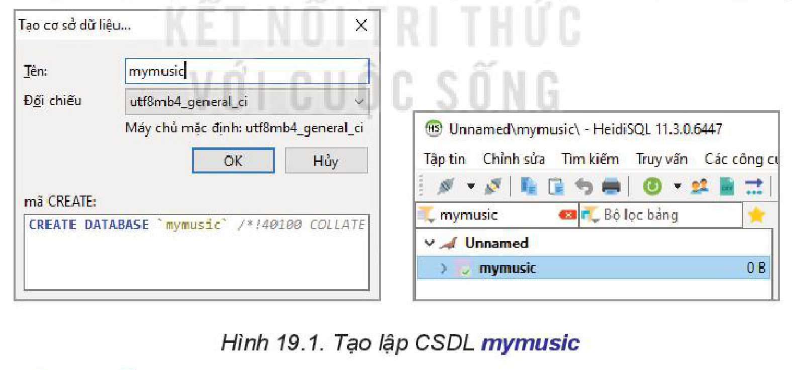
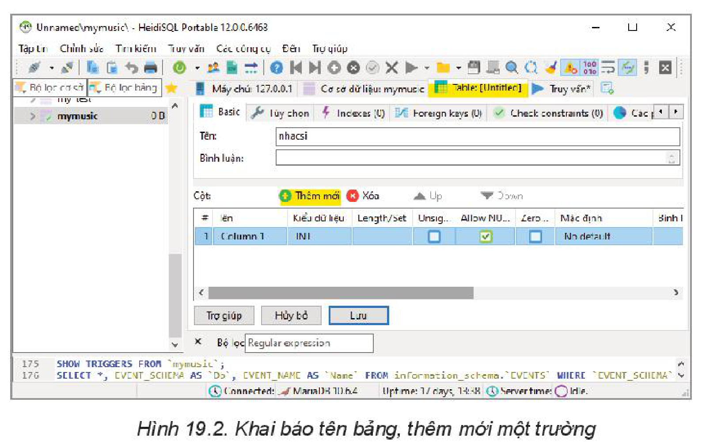
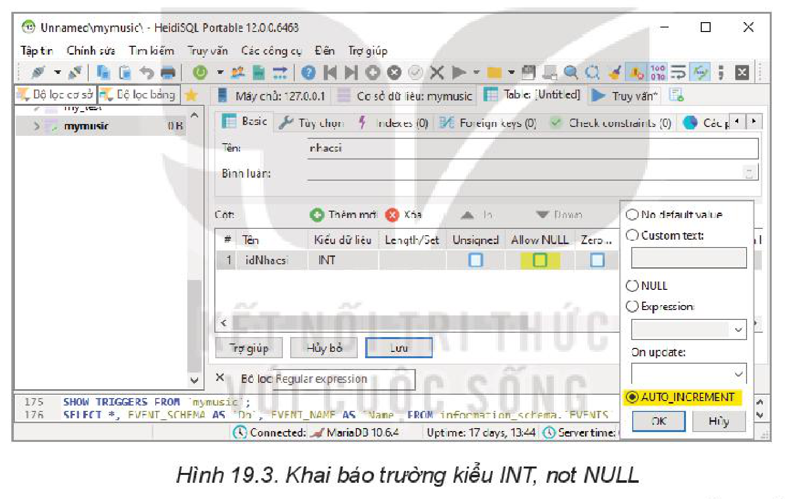
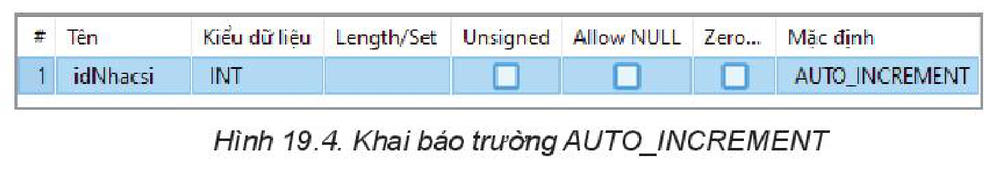
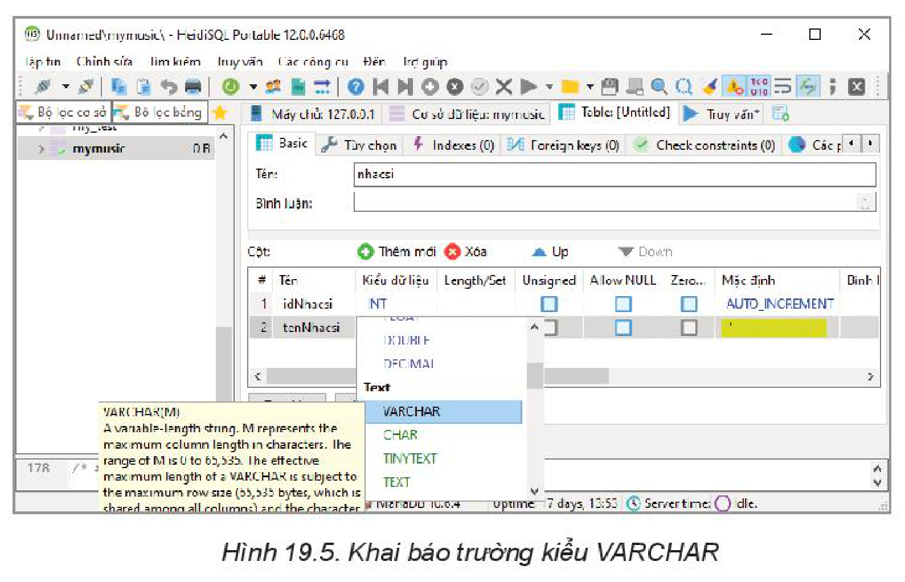
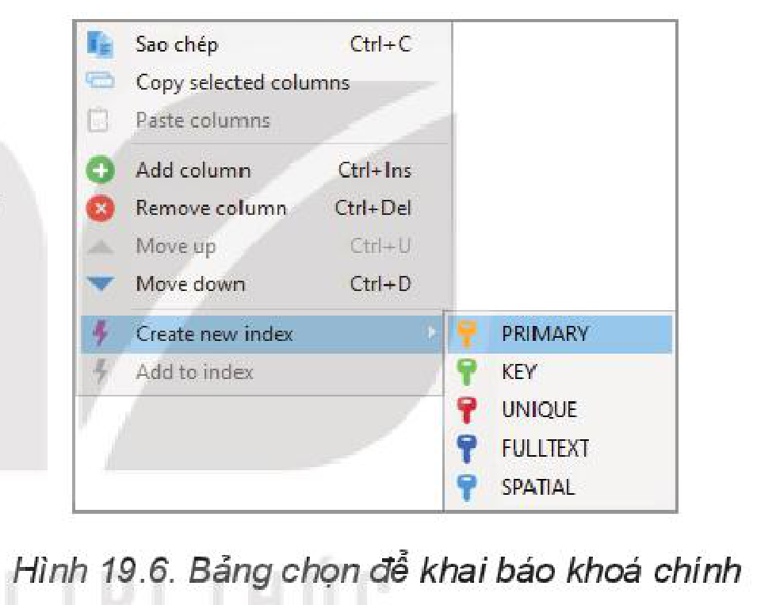
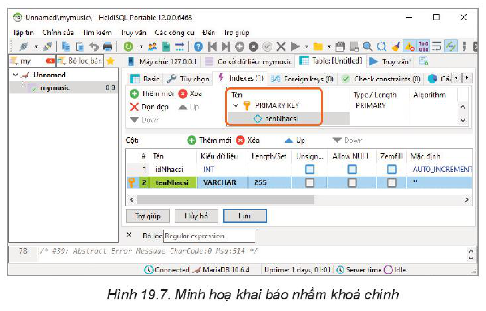
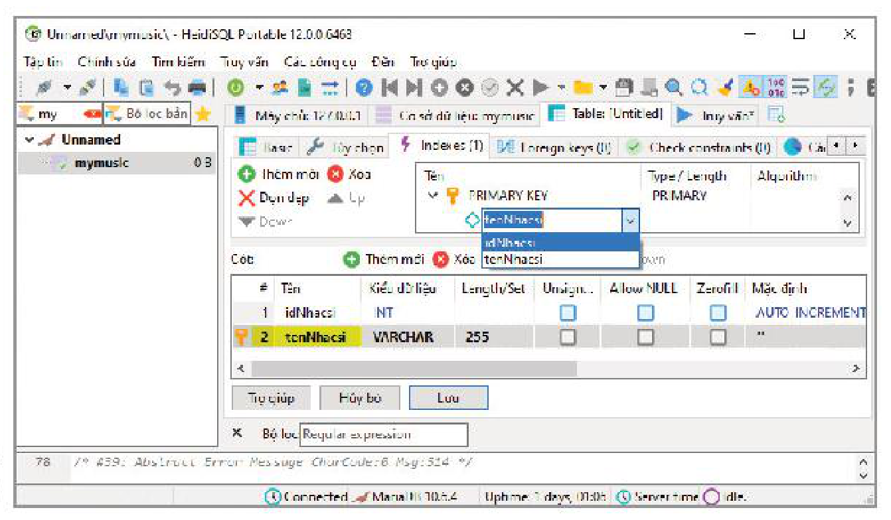
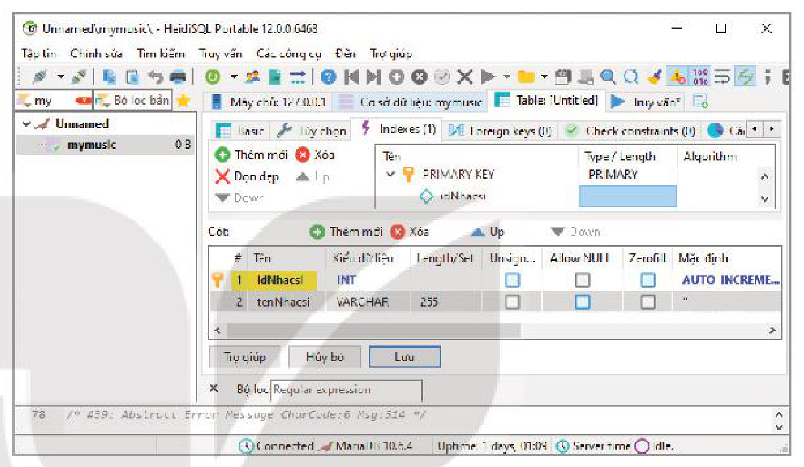
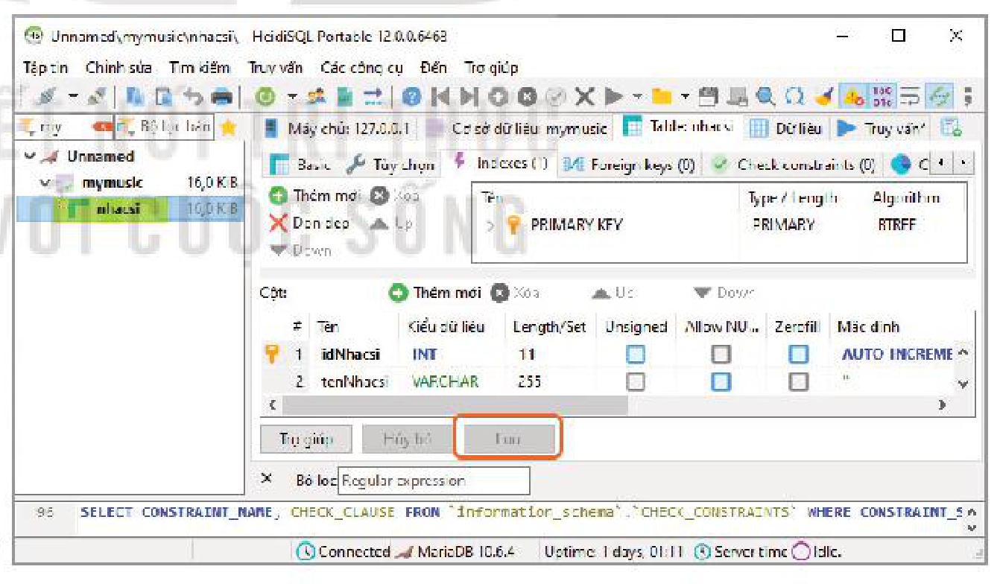

<!-- pdf:93 -->

# BÀI 19: THỰC HÀNH TẠO LẬP CƠ SỞ DỮ LIỆU VÀ CÁC BẢNG

## 🎯 Sau bài học này em sẽ:

- Biết tạo mới một CSDL, thực hiện thông qua giao diện của phần mềm khách quản trị CSDL HeidiSQL.
- Tạo được các bảng không có khoá ngoài, chỉ định được khoá chính cho mỗi bảng, khoá cấm trùng lặp cho những trường không được có giá trị trùng lặp.

## 🔴 Khởi động

> Việc đầu tiên để làm việc với một CSDL là tạo lập. Với HeidiSQL, việc tạo lập CSDL và các bảng đơn giản được thực hiện như thế nào?

**Nhiệm vụ. Tạo lập CSDL mới tên là mymusic, khởi tạo bảng nhacsi, khai báo các khoá cho các bảng này như thiết kế ở Bài 18**

*Hướng dẫn:*

## 1. TẠO LẬP CSDL MYMUSIC

<!-- term: Tạo lập CSDL mới trong HeidiSQL -->
Nháy nút phải chuột ở vùng danh sách các CSDL đã có, chọn thẻ `Tạo mới`, chọn `Cơ sở dữ liệu`. Nhập `mymusic`, chọn `OK`.

Bộ mã kí tự mặc định là Unicode 4 byte: **utf8mb4**, đối chiếu so sánh xâu theo **utf8mb4_general_ci**.

Ở vùng mã lệnh phía dưới sẽ thấy xuất hiện câu truy vấn SQL tương ứng:

*Hình 19.1. Tạo lập CSDL mymusic*

## 2. TẠO LẬP BẢNG

### a) Khai báo tạo lập bảng, các trường và kiểu dữ liệu

Tạo lập bảng `nhacsi (idNhacsi, tenNhacsi)`, `idNhacsi` kiểu `INT` `tenNhacsi` kiểu `VARCHAR (255)`.

<!-- term: Khai báo tạo lập bảng và các trường dữ liệu -->
Nháy nút phải chuột ở vùng danh sách các CSDL đã có, chọn thẻ `Tạo mới`, chọn `Bảng`. Nhập tên: `nhacsi`, chọn `Thêm mới` để thêm trường. Một trường với tên mặc định `Column1` sẽ xuất hiện phía dưới.

<!-- pdf:94 -->

*Hình 19.2. Khai báo tên bảng, thêm mới một trường*

Nhập Tên: `idNhacsi`, chọn kiểu dữ liệu `INT`, bỏ đánh dấu ô **Allow NULL**.

*Hình 19.3. Khai báo trường kiểu INT, not NULL*

Chọn `AUTO_INCREMENT`, dưới nhãn `Mặc định` và chọn `OK`, để có kết quả như Hình 19.4.

*Hình 19.4. Khai báo trường AUTO_INCREMENT*

Để thêm khai báo trường tiếp theo, nhấn `Ctrl+Insert` hoặc nháy nút phải chuột vào phần dưới dòng `idNhacsi` và chọn `Add column`.

Nhập: `tenNhacsi`, chọn kiểu `VARCHAR`, độ dài `255`, giá trị mặc định là kí tự rỗng `''`.

<!-- pdf:95 -->

*Hình 19.5. Khai báo trường kiểu VARCHAR*

### b) Khai báo khoá chính

Ấn định `idNhacsi` là khoá chính:

<!-- term: Khai báo khoá chính trong HeidiSQL -->
Nháy nút phải chuột vào dòng khai báo `idNhacsi` và chọn `Create new index → PRIMARY`.

*Hình 19.6. Bảng chọn để khai báo khoá chính*

Cần phải làm gì trong trường hợp chọn nhầm trường làm khoá chính, chẳng hạn chọn nhầm trường `tenNhacsi` như Hình 19.7?

*Hình 19.7. Minh hoạ khai báo nhầm khoá chính*

<!-- pdf:96 -->

<!-- term: Chỉnh sửa khoá chính đã khai báo nhầm -->
Để sửa khoá chính đã khai báo nhầm này, hãy nháy đúp chuột vào ô `tenNhacsi` ở dưới ô `PRIMARY KEY` ở phần trên và chọn lại `idNhacsi` (Hình 19.8):
<!-- ocr-ok: đã đối chiếu ảnh trang 96, cột chữ bên trái Hình 19.8 bị OCR ghép lẫn chữ trong ảnh chụp màn hình -->

*Hình 19.8. Thao tác sửa khoá chính*

Sau đó nháy chuột vào ô bên cạnh dưới ô `PRIMARY` (Hình 19.9).

*Hình 19.9. Kết quả chỉnh sửa khoá chính*

### c) Lưu kết quả

Cuối cùng chọn `Lưu` để lưu lại khai báo bảng `nhacsi`. Ở vùng hiển thị phía trái sẽ xuất hiện tên bảng `nhacsi` dưới dòng tên CSDL `mymusic` (Hình 19.10).
<!-- ocr-ok: đã đối chiếu ảnh trang 96, cột chữ bên trái Hình 19.10 bị OCR ghép lẫn chữ trong ảnh chụp màn hình -->

*Hình 19.10. Kết quả tạo lập bảng*
<!-- ocr-ok: đã đối chiếu ảnh trang 96, chú thích Hình 19.10 bị OCR đọc nhầm thành "Hình 18. 10. Kêt quả" và tách dòng -->

## ✏️ Luyện tập

Khai báo tạo lập bảng `casi` như thiết kế ở Bài 18.

## 🚀 Vận dụng

Hãy lập CSDL quản lí tên các Quận/Huyện, Tỉnh/Thành phố của Việt Nam. Tạo bảng Tỉnh/Thành phố.

## 📷 Danh sách hình trong bài

| Mã hình | Trang PDF | Vị trí trong bài | Chú thích gốc |
| --- | --- | --- | --- |
| H11-tin_hoc_thud-b19-01 | 93 | Mục 1 | Hình 19.1. Tạo lập CSDL mymusic |
| H11-tin_hoc_thud-b19-02 | 94 | Mục 2.a | Hình 19.2. Khai báo tên bảng, thêm mới một trường |
| H11-tin_hoc_thud-b19-03 | 94 | Mục 2.a | Hình 19.3. Khai báo trường kiểu INT, not NULL |
| H11-tin_hoc_thud-b19-04 | 94 | Mục 2.a | Hình 19.4. Khai báo trường AUTO_INCREMENT |
| H11-tin_hoc_thud-b19-05 | 95 | Mục 2.a | Hình 19.5. Khai báo trường kiểu VARCHAR |
| H11-tin_hoc_thud-b19-06 | 95 | Mục 2.b | Hình 19.6. Bảng chọn để khai báo khoá chính |
| H11-tin_hoc_thud-b19-07 | 95 | Mục 2.b | Hình 19.7. Minh hoạ khai báo nhầm khoá chính |
| H11-tin_hoc_thud-b19-08 | 96 | Mục 2.b | Hình 19.8. Thao tác sửa khoá chính |
| H11-tin_hoc_thud-b19-09 | 96 | Mục 2.b | Hình 19.9. Kết quả chỉnh sửa khoá chính |
| H11-tin_hoc_thud-b19-10 | 96 | Mục 2.c | Hình 19.10. Kết quả tạo lập bảng |
