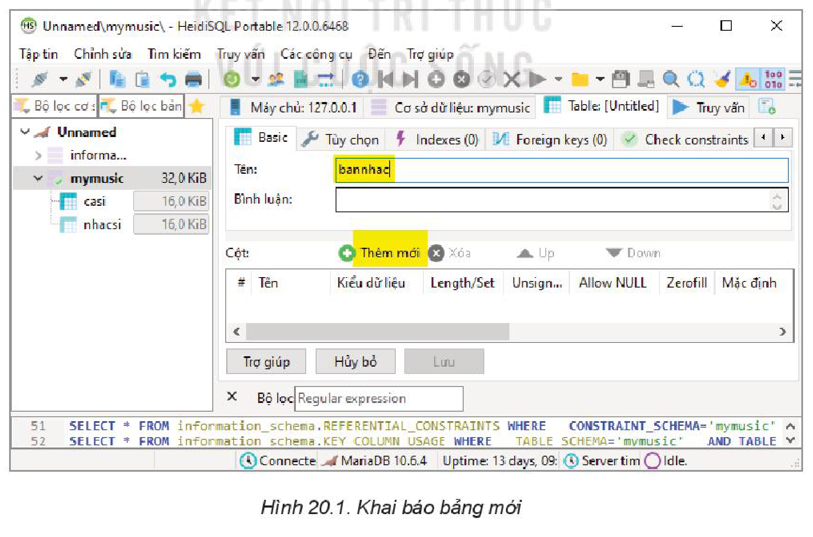
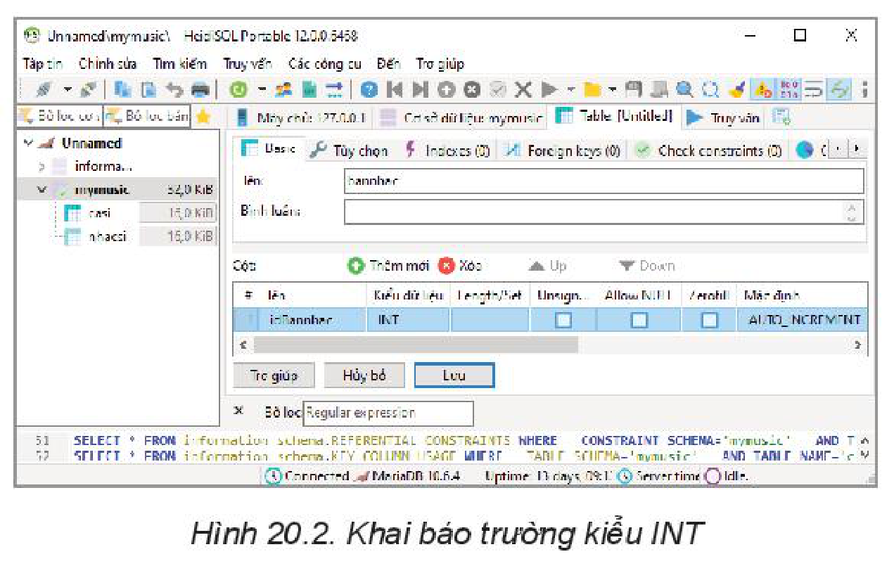
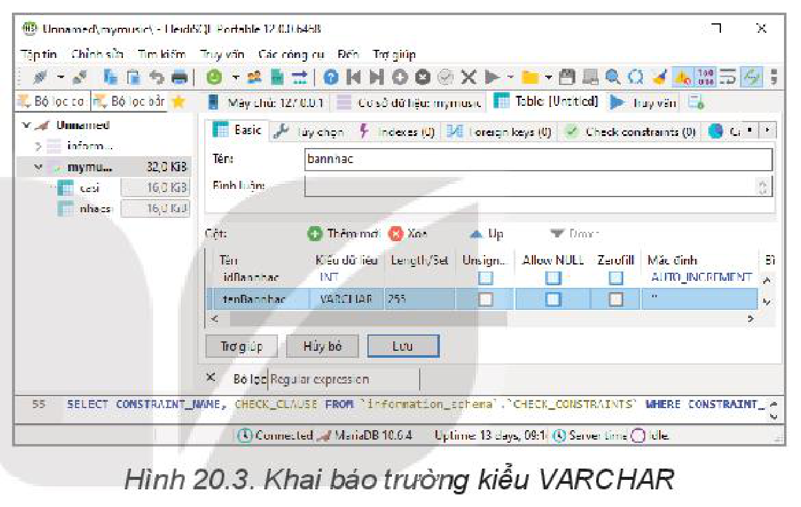
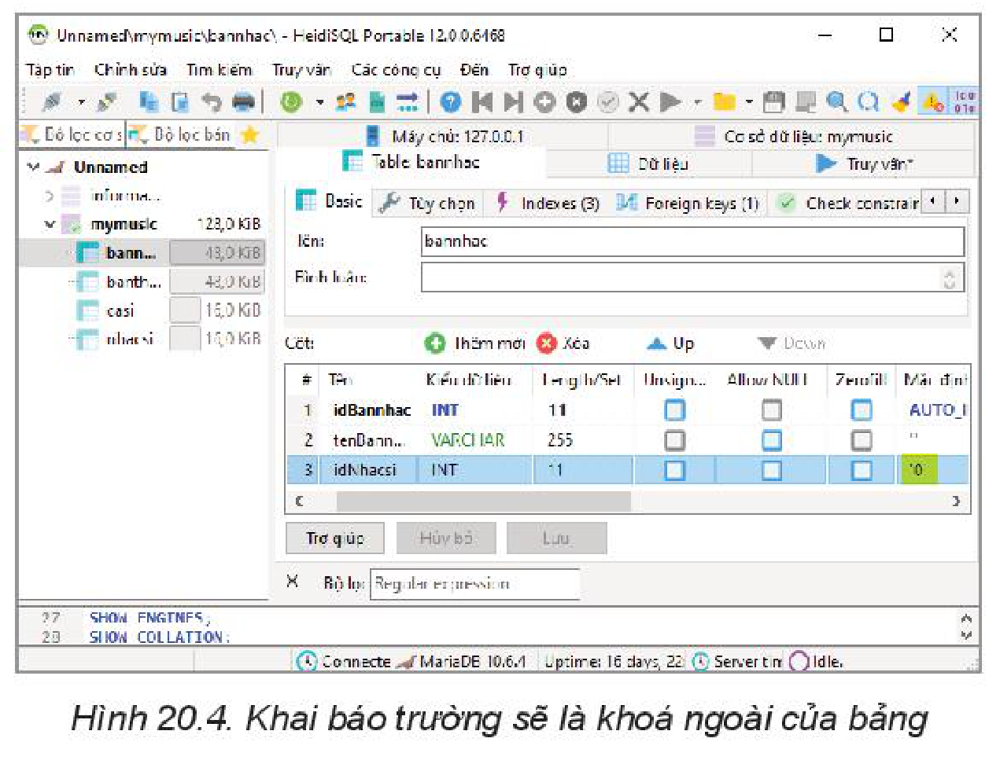
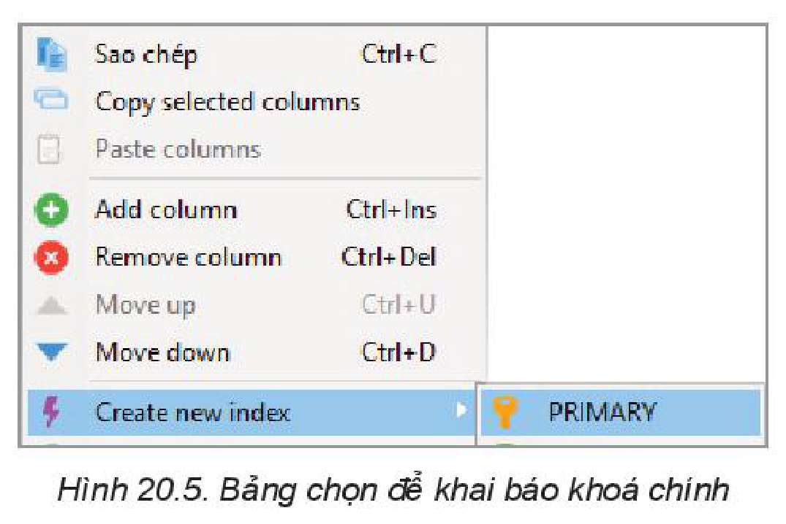
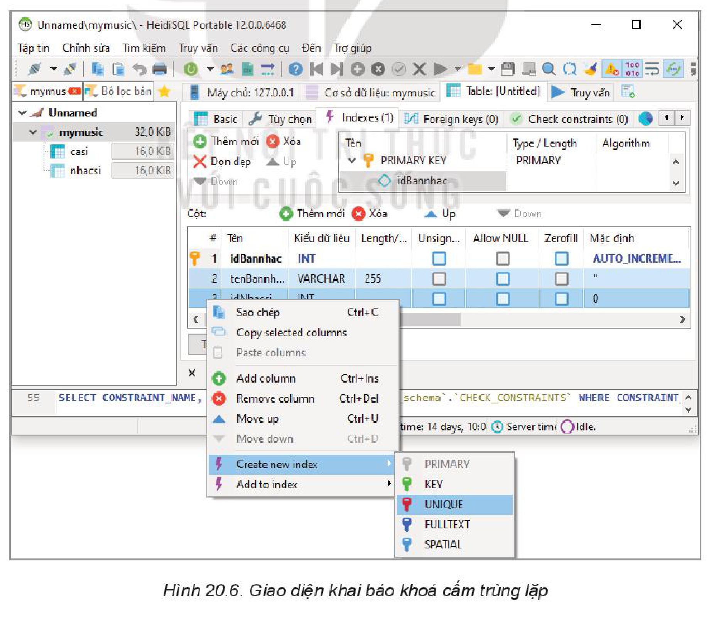
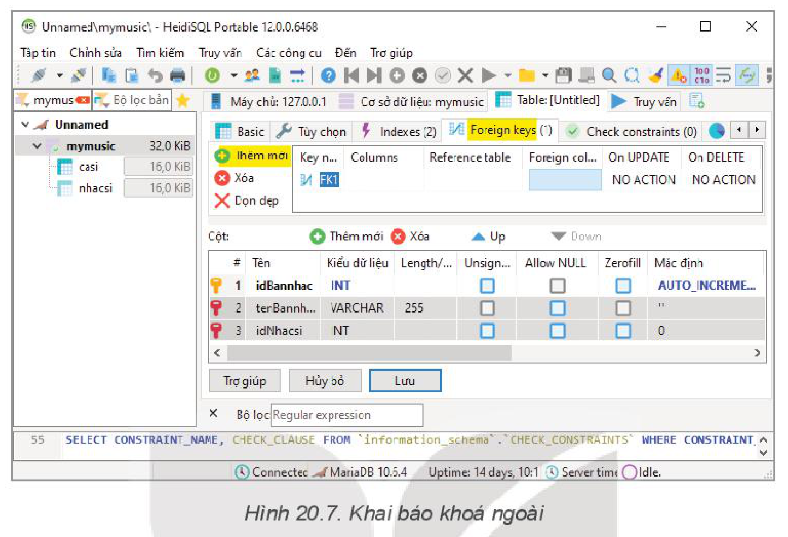
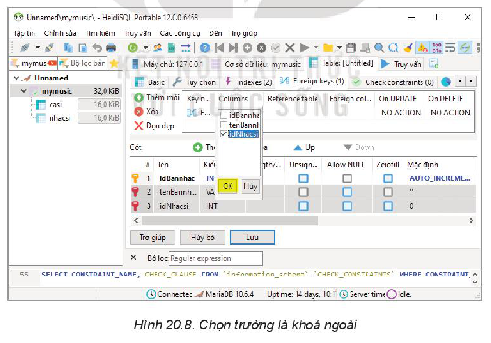
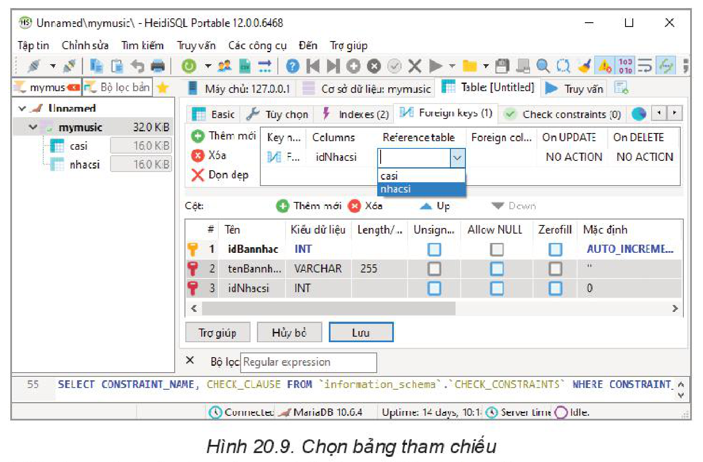
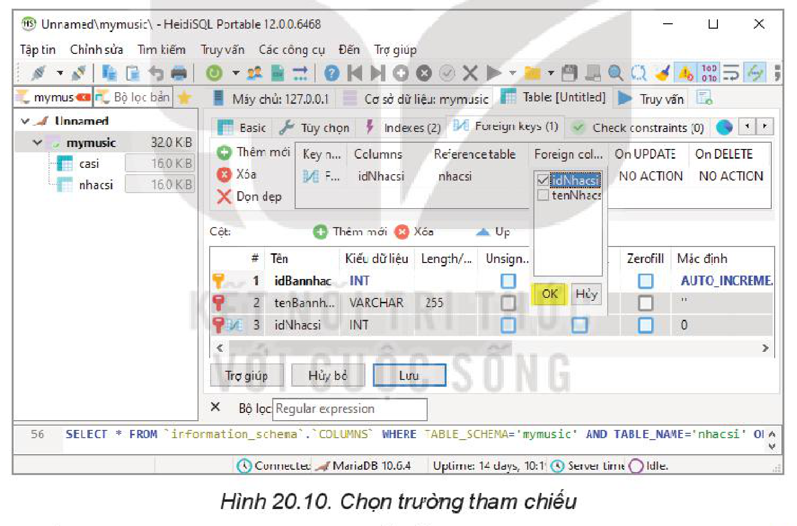

<!-- pdf:97 -->

# BÀI 20: THỰC HÀNH TẠO LẬP CÁC BẢNG CÓ KHOÁ NGOÀI

## 🎯 Sau bài học này em sẽ:

- Biết cách tạo mới các bảng có khoá ngoài.

## 🔴 Khởi động

> Các em đã biết, khoá ngoài có tác dụng liên kết dữ liệu giữa các bảng. Khi tạo bảng có khoá ngoài, việc thiết lập khoá ngoài được thực hiện như thế nào?

**Nhiệm vụ. Tạo lập bảng bannhac với cấu trúc:**

`bannhac (idBannhac, tenBannhac, idNhacsi),`

Các trường `idBannhac`, `idNhacsi` kiểu `INT`,

Trường `tenBannhac` kiểu `VARCHAR (255)`.

*Hướng dẫn:*

## 1. KHAI BÁO BẢNG BANNHAC VỚI CÁC TRƯỜNG IDBANNHAC, TENBANNHAC

Chọn thẻ `Tạo mới`, chọn `Bảng`. Nhập tên: `bannhac`, chọn `Thêm mới` để thêm trường dữ liệu, một trường với tên mặc định `Column1` sẽ xuất hiện phía dưới.

*Hình 20.1. Khai báo bảng mới*

<!-- pdf:98 -->

Nhập tên: `idBannhac`, chọn kiểu dữ liệu `INT`, bỏ đánh dấu ô `Allow NULL`, nháy chuột vào ô `No default` để chọn giá trị mặc định là `AUTO_INCREMENT`.

*Hình 20.2. Khai báo trường kiểu INT*

Để khai báo thêm trường tiếp theo, nhấn `Ctrl+Insert` hoặc nháy nút phải chuột vào phần dưới dòng `idBannhac` và chọn `Add column`.

Nhập: `tenBannhac`, chọn kiểu `VARCHAR`, độ dài `255`, giá trị mặc định là kí tự rỗng `''`.

*Hình 20.3. Khai báo trường kiểu VARCHAR*

## 2. KHAI BÁO CÁC TRƯỜNG LÀ KHOÁ NGOÀI

<!-- term: Giá trị mặc định của trường khoá ngoài -->
Các trường là khoá ngoài của bảng là các trường tham chiếu đến một trường khoá chính (k) của một bảng khác vì vậy cần được khai báo giá trị mặc định phù hợp với giá trị tương ứng của k.

Ví dụ, bảng `bannhac`, trường `idNhacsi` tham chiếu đến trường `idNhacsi` (kiểu `INT`) của bảng `nhacsi` nên giá trị của trường này cũng là `INT` và giá trị mặc định là một số nguyên, chẳng hạn là `0`.

*Hình 20.4. Khai báo trường sẽ là khoá ngoài của bảng*

<!-- pdf:99 -->

## 3. KHAI BÁO CÁC TRƯỜNG KHOÁ

### a) Khai báo khoá chính: idBannhac

Nháy nút phải chuột vào ô `idBannhac`, chọn `Creat new index`, chọn `PRIMARY`.

*Hình 20.5. Bảng chọn để khai báo khoá chính*

### b) Khai báo khoá chống trùng lặp

<!-- term: Khai báo khoá cấm trùng lặp trong HeidiSQL -->
Cặp `(tenBannhac, idNhacsi)` không được trùng lặp giá trị nên phải khai báo khoá cấm trùng lặp. Đánh dấu hai trường này, nháy nút phải chuột vào vùng đánh dấu và chọn `Create new index`, chọn **UNIQUE**.

*Hình 20.6. Giao diện khai báo khoá cấm trùng lặp*

<!-- pdf:100 -->

### c) Khai báo các khoá ngoài

Để khai báo khoá ngoài `idNhacsi`, chọn thẻ **Foreign Key**.

*Hình 20.7. Khai báo khoá ngoài*

<!-- term: Khai báo tham chiếu khoá ngoài trong HeidiSQL -->
Nháy chuột vào ô dưới dòng `Columns` và chọn trường khoá ngoài là `idNhacsi` rồi chọn `OK`.

*Hình 20.8. Chọn trường là khoá ngoài*

<!-- term: Khai báo tham chiếu khoá ngoài trong HeidiSQL -->
Nháy chuột vào ô phía dưới **Reference table** để chọn bảng tham chiếu là `nhacsi` và chọn `OK`.

<!-- pdf:101 -->

*Hình 20.9. Chọn bảng tham chiếu*

Tiếp theo chọn trường tham chiếu trong bảng `nhacsi`.

*Hình 20.10. Chọn trường tham chiếu*

Cuối cùng nháy chuột chọn `Lưu` để kết thúc khai báo và khởi tạo bảng `bannhac`.

## ✏️ Luyện tập

Hãy tạo lập bảng `banthuam`.

## 🚀 Vận dụng

Hãy tạo lập bảng Quận/Huyện trong CSDL quản lí tên Quận/Huyện, Tỉnh/Thành phố.

## 📷 Danh sách hình trong bài

| Mã hình | Trang PDF | Vị trí trong bài | Chú thích gốc |
| --- | --- | --- | --- |
| H11-tin_hoc_thud-b20-01 | 97 | Mục 1 | Hình 20.1. Khai báo bảng mới |
| H11-tin_hoc_thud-b20-02 | 98 | Mục 1 | Hình 20.2. Khai báo trường kiểu INT |
| H11-tin_hoc_thud-b20-03 | 98 | Mục 1 | Hình 20.3. Khai báo trường kiểu VARCHAR |
| H11-tin_hoc_thud-b20-04 | 98 | Mục 2 | Hình 20.4. Khai báo trường sẽ là khoá ngoài của bảng |
| H11-tin_hoc_thud-b20-05 | 99 | Mục 3.a | Hình 20.5. Bảng chọn để khai báo khoá chính |
| H11-tin_hoc_thud-b20-06 | 99 | Mục 3.b | Hình 20.6. Giao diện khai báo khoá cấm trùng lặp |
| H11-tin_hoc_thud-b20-07 | 100 | Mục 3.c | Hình 20.7. Khai báo khoá ngoài |
| H11-tin_hoc_thud-b20-08 | 100 | Mục 3.c | Hình 20.8. Chọn trường là khoá ngoài |
| H11-tin_hoc_thud-b20-09 | 101 | Mục 3.c | Hình 20.9. Chọn bảng tham chiếu |
| H11-tin_hoc_thud-b20-10 | 101 | Mục 3.c | Hình 20.10. Chọn trường tham chiếu |
