<!-- pdf:102 -->

# BÀI 21: THỰC HÀNH CẬP NHẬT VÀ TRUY XUẤT DỮ LIỆU CÁC BẢNG

## 🎯 Sau bài học này em sẽ:

- Biết cách cập nhật và truy xuất CSDL.

## 🔴 Khởi động

> Cập nhật và truy xuất dữ liệu là hai công việc chính khi làm việc với một CSDL. HeidiSQL hỗ trợ việc thực hiện các công việc đó như thế nào với những bảng đơn giản, không có khoá ngoài?

**Nhiệm vụ. Cập nhật bảng nhacsi**

*Hướng dẫn:*

## 1. THÊM MỚI DỮ LIỆU VÀO BẢNG NHACSI

Chọn bảng `nhacsi`, chọn thẻ `Dữ liệu`, em sẽ thấy bảng dữ liệu có hai trường `idNhacsi` và `tenNhacsi` nhưng chưa có dữ liệu.

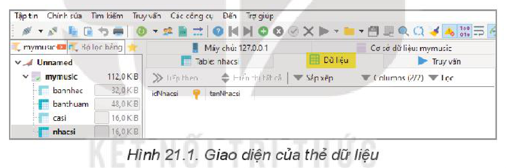

*Hình 21.1. Giao diện của thẻ dữ liệu*
<!-- ocr-ok: đã đối chiếu ảnh trang 102, chú thích Hình 21.1 nguyên văn khớp ảnh trang -->

<!-- term: Thêm mới hàng dữ liệu trong HeidiSQL -->
Để thêm vào một hàng dữ liệu mới có thể nhấn phím `Insert` hoặc chọn biểu tượng `+` hay nháy nút phải chuột lên vùng dữ liệu của bảng và chọn **Chèn hàng**. Một hàng dữ liệu rỗng sẽ xuất hiện. Tiếp theo nháy đúp chuột vào từng ô trên hàng đó để nhập dữ liệu tương ứng cho từng trường.
<!-- ocr-ok: đã đối chiếu ảnh trang 102, đoạn hướng dẫn thêm hàng dữ liệu mới nguyên văn khớp ảnh trang -->

Trường `idNhacsi` là có kiểu `INT`, `AUTO_INCREMENT` (tự động điền giá trị) nên không cần nhập dữ liệu cho trường này. Nháy đúp chuột vào ô ở cột `tenNhacsi` để nhập tên Nhạc sĩ, nhấn phím `Enter`, sau đó nhấn phím `Insert` để nhập hàng mới.
<!-- ocr-ok: đã đối chiếu ảnh trang 102, đoạn hướng dẫn nhập cột tenNhacsi nguyên văn khớp ảnh trang -->

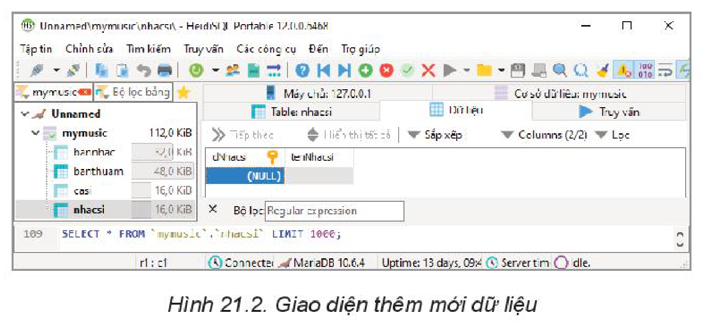

*Hình 21.2. Giao diện thêm mới dữ liệu*

<!-- pdf:103 -->

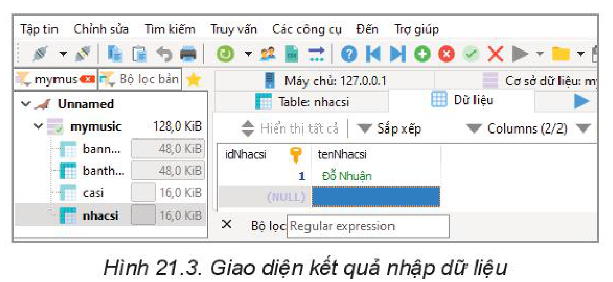

*Hình 21.3. Giao diện kết quả nhập dữ liệu*

Tiếp tục thực hành nhập thêm dữ liệu để nắm vững những thao tác nhập dữ liệu.

## 2. CHỈNH SỬA DỮ LIỆU TRONG BẢNG NHACSI

Giả sử dữ liệu nhập có sai sót, cần sửa lại, chẳng hạn tên nhạc sĩ Hoàng Việt thiếu dấu tiếng Việt như Hình 21.4.
<!-- ocr-ok: đã đối chiếu ảnh trang 103, cột chữ bên trái Hình 21.4 bị OCR ghép lẫn chữ trong ảnh chụp màn hình -->

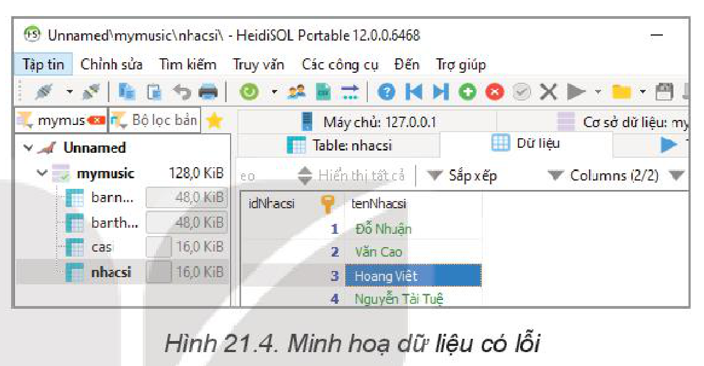

*Hình 21.4. Minh hoạ dữ liệu có lỗi*

<!-- term: Chỉnh sửa dữ liệu bảng trong HeidiSQL -->
Em có thể nháy đúp chuột vào ô dữ liệu cần sửa và nhập lại.

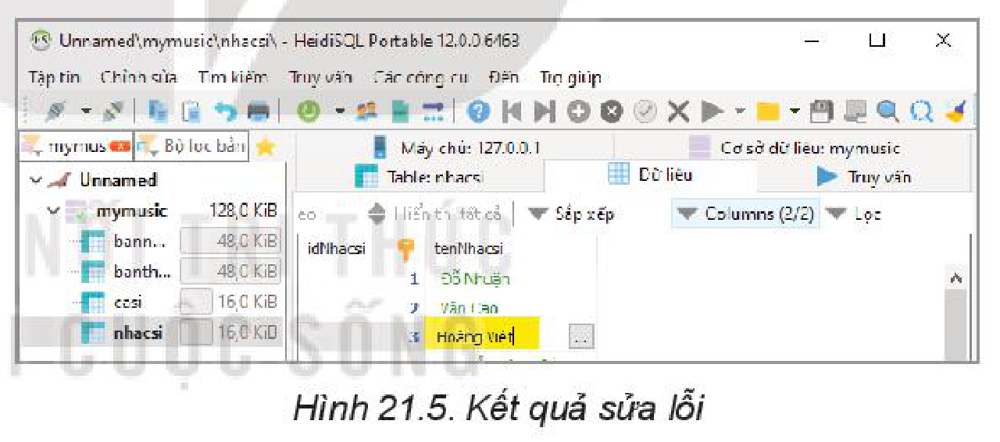

*Hình 21.5. Kết quả sửa lỗi*

## 3. XOÁ DÒNG DỮ LIỆU TRONG BẢNG NHACSI

<!-- term: Xoá dòng dữ liệu trong HeidiSQL -->
Để xoá các dòng dữ liệu trong bảng `nhacsi`, hãy đánh dấu những dòng muốn chọn: giữ phím `Shift` và nháy chuột để chọn những dòng liền nhau hoặc nhấn giữ phím `Ctrl` và nháy chuột để chọn những dòng tách rời nhau.

<!-- term: Xoá dòng dữ liệu trong HeidiSQL -->
Nhấn tổ hợp phím `Ctrl+Delete` trên bàn phím hoặc chọn biểu tượng `x` để xoá. Phần mềm sẽ có lời nhắc yêu cầu khẳng định muốn xoá.

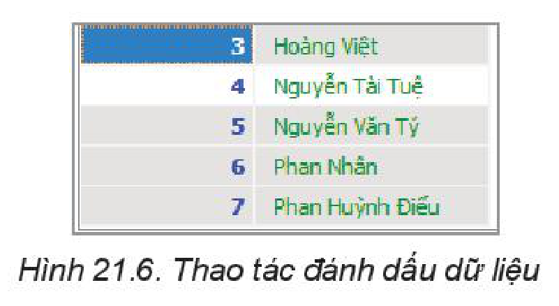

*Hình 21.6. Thao tác đánh dấu dữ liệu*

Nếu chắc chắn muốn xoá, nháy chuột chọn `OK`.

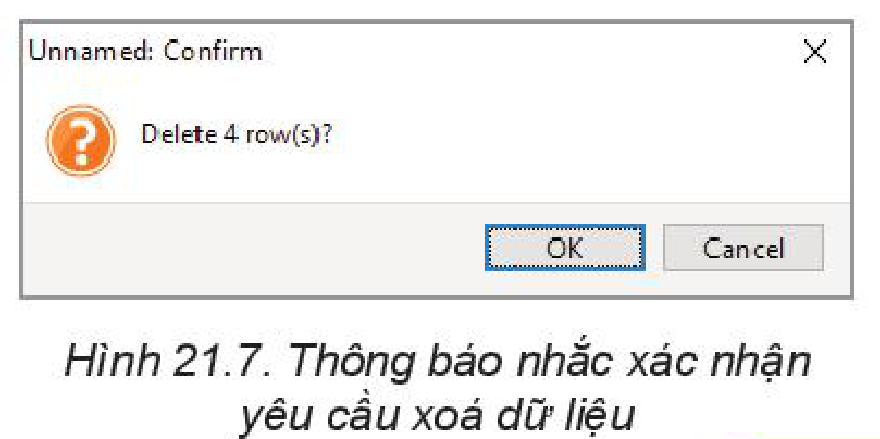

*Hình 21.7. Thông báo nhắc xác nhận yêu cầu xoá dữ liệu*

<!-- pdf:104 -->

## 4. TRUY XUẤT DỮ LIỆU TỪ BẢNG NHACSI

### a) Truy xuất đơn giản

Để xem toàn bộ dữ liệu trong bảng `nhacsi`, chỉ cần chọn bảng `nhacsi` và thẻ `Dữ liệu`.

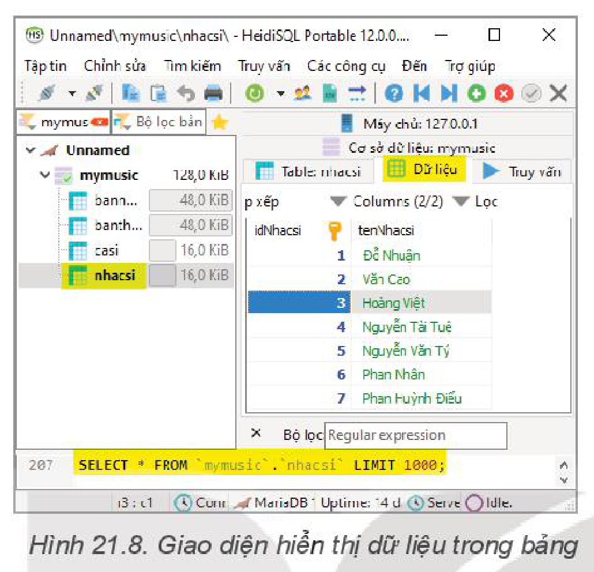

*Hình 21.8. Giao diện hiển thị dữ liệu trong bảng*

### b) Truy xuất và sắp xếp kết quả theo thứ tự

<!-- term: Sắp xếp kết quả truy xuất trong HeidiSQL -->
Nhìn trong danh sách dữ liệu kết xuất, có thể thấy bình thường dữ liệu được kết xuất theo thứ tự tăng dần của trường khoá chính `idNhacsi`. Nếu muốn kết xuất theo thứ tự giảm dần của `idNhacsi`, hãy nháy chuột vào ô `idNhacsi`. Hình tam giác màu đen sẽ xuất hiện và dữ liệu được kết xuất theo thứ tự giảm dần của `idNhacsi`.

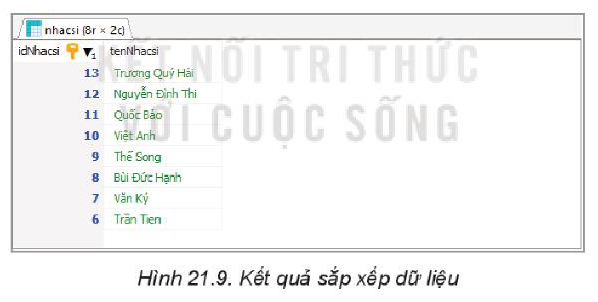

*Hình 21.9. Kết quả sắp xếp dữ liệu*

### c) Tìm kiếm

– Để lấy ra danh sách dữ liệu thoả mãn một yêu cầu nào đó có thể thực hiện các thao tác tạo bộ lọc: Nháy nút phải chuột vào vùng dữ liệu `tenNhacsi`, chọn **Quick Filter**, rồi chẳng hạn chọn `LIKE “%...”`. Nhập vào kí tự `P`.

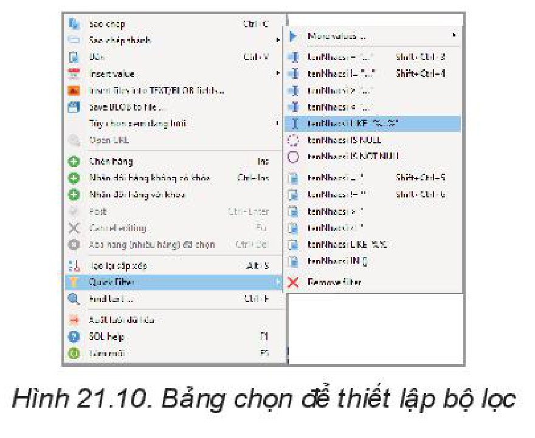

*Hình 21.10. Bảng chọn để thiết lập bộ lọc*

<!-- pdf:105 -->

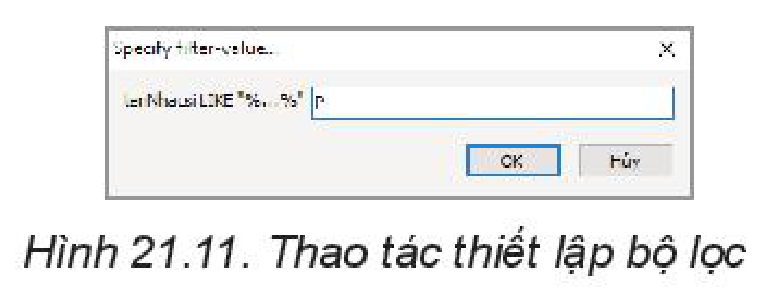

*Hình 21.11. Thao tác thiết lập bộ lọc*

Kết quả thu được như Hình 21.12 là danh sách hai nhạc sĩ và có chữ P trong tên.

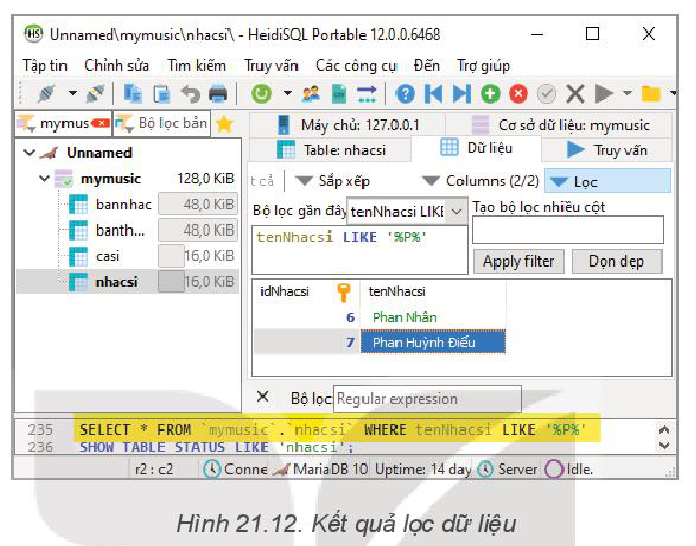

*Hình 21.12. Kết quả lọc dữ liệu*

– Để xoá bộ lọc chọn `Dọn dẹp` và `Lọc`.

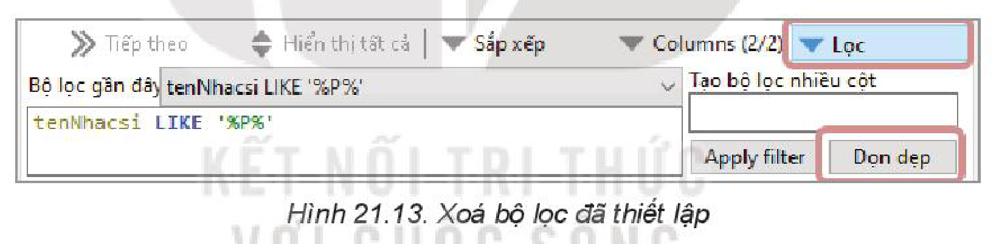

*Hình 21.13. Xoá bộ lọc đã thiết lập*

## 5. TRUY XUẤT DỮ LIỆU VỚI CÂU TRUY VẤN SQL
<!-- ocr-ok: đã đối chiếu ảnh trang 105, tiêu đề mục 5 bị OCR đọc sai thành "S. TRUY XUẤT DƯ LIÊU VỚI CAU TRUY VĂN SOQL" -->

<!-- term: Cấu trúc câu truy vấn SELECT một bảng -->
Ngoài việc sử dụng các thao tác qua giao diện trực quan như đã hướng dẫn ở trên, cũng có thể nhập câu truy vấn SQL để truy xuất dữ liệu một cách linh hoạt hơn. Cấu trúc cơ bản câu truy vấn vào một bảng dữ liệu như sau:

```sql
SELECT    danh_sách_các_trường
FROM tên_bảng
[WHERE    biểu_thức_điều_kiện]
[ORDER BY tên_trường_1 [ASC|DESC], [tên_trường_2 [ASC|DESC],...] ]
;
```

Trong đó:

– `danh_sách_các_trường`: liệt kê các tên trường ngăn cách nhau bởi dấu phẩy. Nếu muốn lấy tất cả các trường dùng kí tự `*`.

– `tên_bảng`: khi làm việc với nhiều CSDL đồng thời, tên trường phải bao gồm cả tên CSDL, ví dụ: `mymusic.bannhac`.

<!-- pdf:106 -->

– `biểu_thức_điều_kiện`: là biểu thức lôgic xác lập các điều kiện với các giá trị của các trường dữ liệu.

Ví dụ: `tenNhacsi LIKE 'P%' AND (idNhacsi=2 OR idNhacsi=6)`

Cặp dấu `[ ]` biểu thị nội dung bên trong nó là một lựa chọn có thể dùng hoặc không dùng.

`ASC|DESC`: nghĩa là **ASC** hoặc **DESC**. ASC là viết tắt của Ascending – tăng dần, DESC là viết tắt của Descending – giảm dần.

<!-- term: Cấu trúc câu truy vấn SELECT một bảng -->
Ý nghĩa của câu truy vấn trên, với đủ các lựa chọn là: Lấy ra tất cả các dòng dữ liệu, mỗi dòng là giá trị của các trường trong `danh_sách_các_trường` từ bảng `tên_bảng` ở đó các giá trị thoả mãn `biểu_thức_điều_kiện`, kết quả truy vấn được sắp xếp theo thứ tự `tên_trường_1 [ASC|DESC], tên_trường_2 [ASC|DESC]`.

Ví dụ:

```sql
SELECT idNhacsi, tenNhacsi
FROM   nhacsi
WHERE  tenNhacsi LIKE 'P%'
ORDER BY tenNhacsi
;
```

Mở CSDL `mymusic`, chọn thẻ `Truy vấn`, nhập câu truy vấn trên và chọn `▶`. Kết quả nhận được như Hình 21.14.

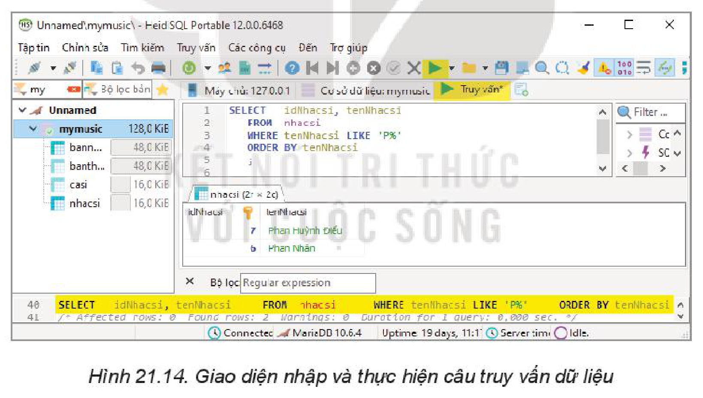

*Hình 21.14. Giao diện nhập và thực hiện câu truy vấn dữ liệu*

## ✏️ Luyện tập

1. Cập nhật dữ liệu vào bảng `casi`.
2. Truy xuất dữ liệu bảng `casi` theo các tiêu chí khác nhau.

## 🚀 Vận dụng

Thực hành cập nhật và truy xuất dữ liệu bảng Tỉnh/Thành phố trong CSDL quản lí danh sách tên Quận/Huyện, Tỉnh/Thành phố.

## 📷 Danh sách hình trong bài

| Mã hình | Trang PDF | Vị trí trong bài | Chú thích gốc |
| --- | --- | --- | --- |
| H11-tin_hoc_thud-b21-01 | 102 | Mục 1 | Hình 21.1. Giao diện của thẻ dữ liệu |
| H11-tin_hoc_thud-b21-02 | 102 | Mục 1 | Hình 21.2. Giao diện thêm mới dữ liệu |
| H11-tin_hoc_thud-b21-03 | 103 | Mục 1 | Hình 21.3. Giao diện kết quả nhập dữ liệu |
| H11-tin_hoc_thud-b21-04 | 103 | Mục 2 | Hình 21.4. Minh hoạ dữ liệu có lỗi |
| H11-tin_hoc_thud-b21-05 | 103 | Mục 2 | Hình 21.5. Kết quả sửa lỗi |
| H11-tin_hoc_thud-b21-06 | 103 | Mục 3 | Hình 21.6. Thao tác đánh dấu dữ liệu |
| H11-tin_hoc_thud-b21-07 | 103 | Mục 3 | Hình 21.7. Thông báo nhắc xác nhận yêu cầu xoá dữ liệu |
| H11-tin_hoc_thud-b21-08 | 104 | Mục 4.a | Hình 21.8. Giao diện hiển thị dữ liệu trong bảng |
| H11-tin_hoc_thud-b21-09 | 104 | Mục 4.b | Hình 21.9. Kết quả sắp xếp dữ liệu |
| H11-tin_hoc_thud-b21-10 | 104 | Mục 4.c | Hình 21.10. Bảng chọn để thiết lập bộ lọc |
| H11-tin_hoc_thud-b21-11 | 105 | Mục 4.c | Hình 21.11. Thao tác thiết lập bộ lọc |
| H11-tin_hoc_thud-b21-12 | 105 | Mục 4.c | Hình 21.12. Kết quả lọc dữ liệu |
| H11-tin_hoc_thud-b21-13 | 105 | Mục 4.c | Hình 21.13. Xoá bộ lọc đã thiết lập |
| H11-tin_hoc_thud-b21-14 | 106 | Mục 5 | Hình 21.14. Giao diện nhập và thực hiện câu truy vấn dữ liệu |
