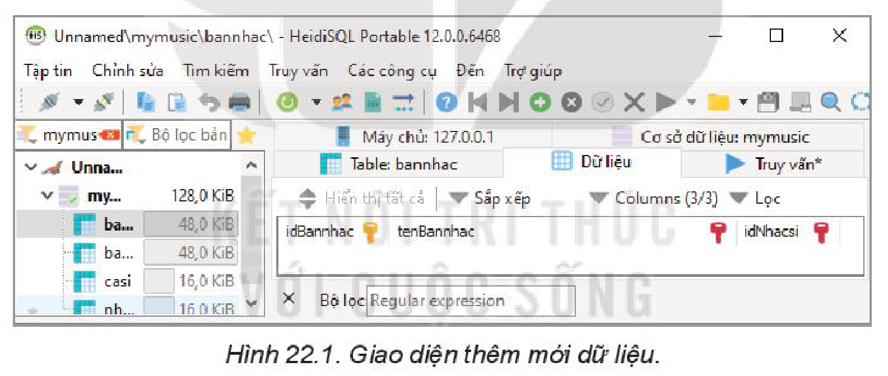
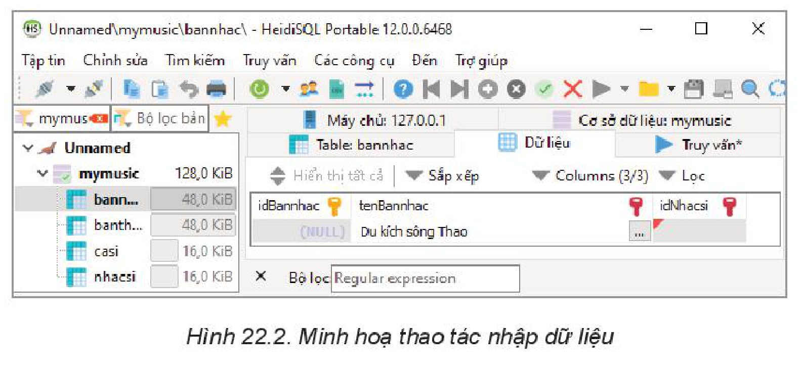
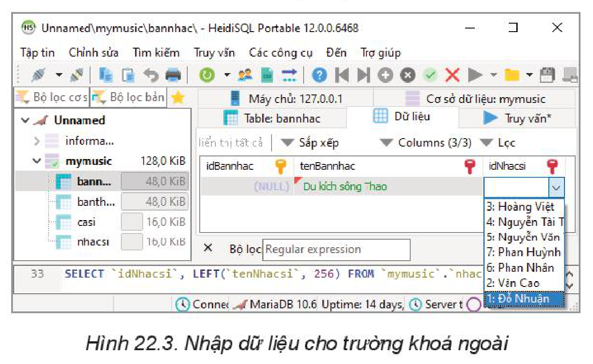
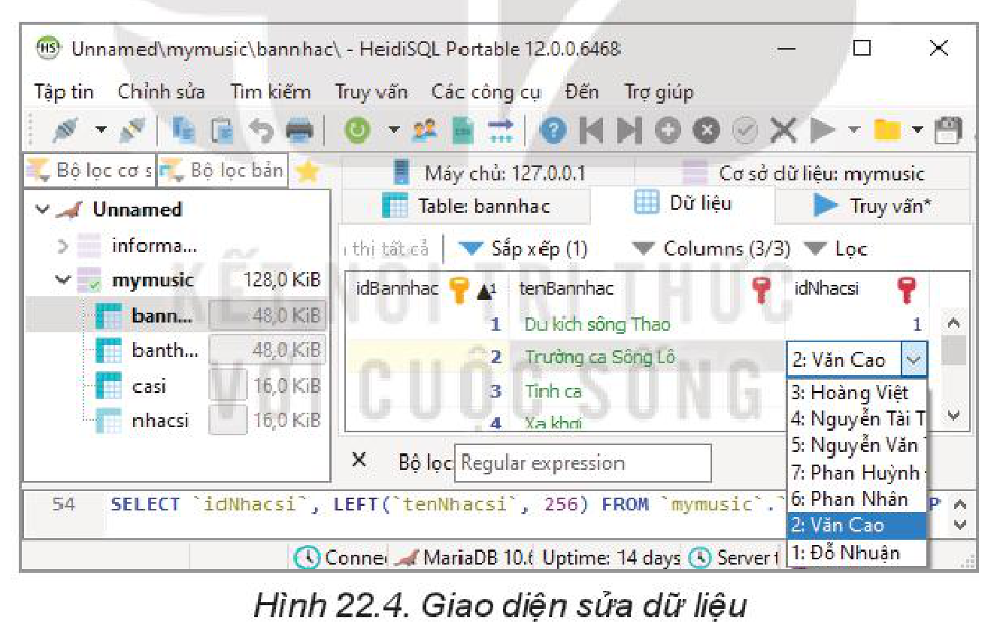
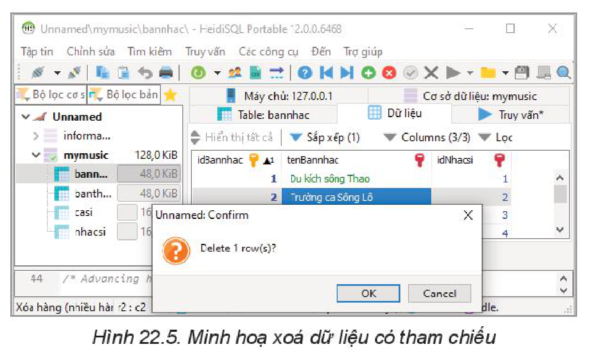
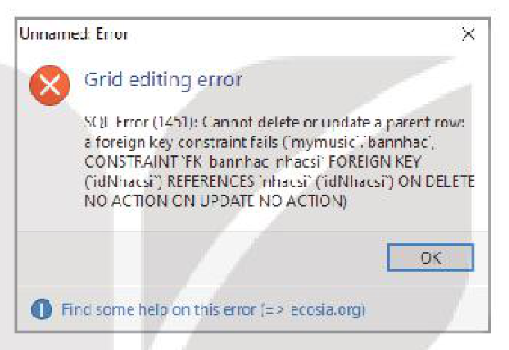
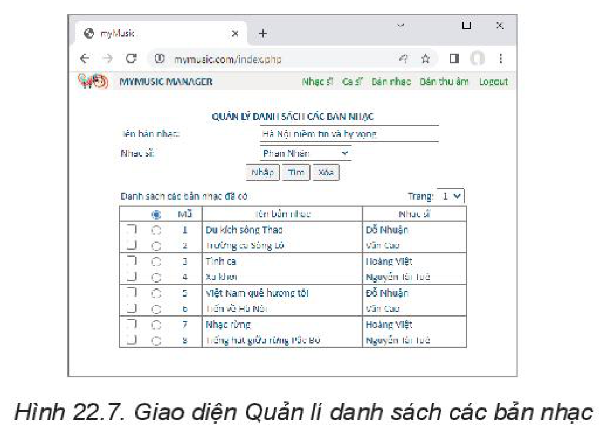

<!-- pdf:107 -->

# BÀI 22: THỰC HÀNH CẬP NHẬT BẢNG DỮ LIỆU CÓ THAM CHIẾU

## 🎯 Sau bài học này em sẽ:

- Hiểu được cách thức nhập dữ liệu đối với các bảng có trường khoá ngoài – trường tham chiếu đến một khoá chính của bảng khác.

## 🔴 Khởi động

> Khi cập nhật một bảng có khoá ngoài, dữ liệu của trường khoá ngoài phải là dữ liệu tham chiếu được đến một trường khoá chính của một bảng tham chiếu. HeidiSQL hỗ trợ kiểm soát điều này như thế nào?

## Nhiệm vụ 1. Cập nhật bảng bannhac

*Hướng dẫn:*

### a) Thêm mới dữ liệu vào bảng bannhac

Chọn bảng `bannhac`, nháy chuột chọn thẻ `Dữ liệu`, em sẽ thấy bảng dữ liệu có các trường `idBannhac`, `tenBannhac`, `idNhacsi` nhưng chưa có dữ liệu.

*Hình 22.1. Giao diện thêm mới dữ liệu.*

Thực hiện nhập dữ liệu.

Trường `idNhacsi` có kiểu `INT`, `AUTO_INCREMENT` nên không cần nhập dữ liệu cho trường này. Nháy đúp chuột vào ô ở trường `tenBannhac` để nhập tên bản nhạc.

*Hình 22.2. Minh hoạ thao tác nhập dữ liệu*

<!-- pdf:108 -->

<!-- term: Nhập dữ liệu cho trường khoá ngoài -->
Trường `idNhacsi` là trường khoá ngoài, đã được khai báo tham chiếu đến trường `idNhacsi` của bảng `nhacsi`, vì vậy để đảm bảo tính nhất quán, giá trị hợp lệ chỉ có thể lấy từ các giá trị của `idNhacsi` có trong bảng `nhacsi`. Nháy đúp chuột vào ô nhập trường `idNhacsi` và chọn tên nhạc sĩ trong hộp danh sách.

*Hình 22.3. Nhập dữ liệu cho trường khoá ngoài*

### b) Sửa chữa, cập nhật dữ liệu trong bảng bannhac

Thao tác sửa chữa dữ liệu trong bảng `bannhac` nếu phát hiện có sai sót, tương tự như đã được giới thiệu ở Bài 21, chỉ cần nháy đúp chuột vào ô dữ liệu muốn sửa.

Sửa dữ liệu trường `idNhacsi` ở dòng số 2.

*Hình 22.4. Giao diện sửa dữ liệu*

### c) Xoá dữ liệu trong bảng bannhac

Thực hiện tương tự các bước ở Bài 21 để xoá các dòng dữ liệu trong bảng `bannhac`.

### d) Xoá dữ liệu trong bảng nhacsi

<!-- term: Kiểm soát toàn vẹn tham chiếu khi xoá dữ liệu -->
Chú ý rằng bây giờ bảng `bannhac` đã có dữ liệu với trường `idNhacsi` tham chiếu đến trường `idNhacsi` của bảng `nhacsi`. Do vậy, ta sẽ không thể tuỳ tiện xoá các dòng của bảng `nhacsi`. MySQL sẽ kiểm tra và ngăn chặn việc xoá các dòng trong bảng `nhacsi` mà giá trị trường `idNhacsi` đã có trong trường `idNhacsi` của bảng `bannhac`.

<!-- pdf:109 -->

Ví dụ: `idNhacsi` của nhạc sĩ Văn Cao là 2 đã có trong các bản nhạc *Trường ca sông Lô*, *Tiến về Hà Nội* ở bảng `bannhac`. MySQL sẽ ngăn chặn xoá dòng tương ứng với nhạc sĩ Văn Cao ở bảng `nhacsi`.

*Hình 22.5. Minh hoạ xoá dữ liệu có tham chiếu*

Nếu chọn `OK`, thông báo lỗi sẽ xuất hiện như Hình 22.6

*Hình 22.6. Thông báo lỗi xoá dữ liệu làm mất tính toàn vẹn dữ liệu*

<!-- term: Giới hạn kiểm soát lỗi theo lôgic của hệ QTCSDL -->
*Lưu ý:* Hệ QTCSDL chỉ có thể ngăn chặn được các lỗi theo lôgic đã được khai báo (ví dụ lôgic tham chiếu khoá ngoài). Nó không thể ngăn chặn được các lỗi không liên quan đến lôgic nào. Ví dụ: Chọn tên nhạc sĩ sáng tác bản nhạc *Hà Nội niềm tin và hi vọng* là Phan Nhân hay Đỗ Nhuận thì không sai về lôgic; nếu các em nhập sai tên bản nhạc, tên người (tên nhạc sĩ, ca sĩ) thì lỗi này sẽ xuất hiện ở tất cả các danh sách kết xuất liên quan như bản nhạc, bản thu âm. Vì vậy người làm việc với CSDL luôn phải có sự cẩn thận, mẫn cán trong công việc của mình.

### e) Truy xuất dữ liệu trong bảng bannhac

Việc truy xuất dữ liệu trong bảng `bannhac` là hoàn toàn tương tự như truy xuất dữ liệu trong bảng `nhacsi` ở Bài 21.

– Hãy thực hành các truy xuất dữ liệu theo thứ tự giảm dần của trường `idBannhac`, theo thứ tự tên các bản nhạc.

– Hãy thực hành lấy ra danh sách tên các bản nhạc của nhạc sĩ Văn Cao có trong bảng `bannhac`.

**Nhiệm vụ 2**

Hãy tìm hiểu một chức năng của phần mềm ứng dụng *Quản lí dữ liệu âm nhạc* qua giao diện ở Hình 22.7, so sánh với những kiến thức vừa được học trong bài thực hành và cho nhận xét so sánh.

<!-- pdf:110 -->

*Hình 22.7. Giao diện Quản lí danh sách các bản nhạc*

Cách tương tác với giao diện này như sau:

– Để nhập dữ liệu bản nhạc mới, người dùng phải nhập tên bản nhạc, chọn nhạc sĩ từ hộp danh sách phía dưới sau đó chọn `Nhập`. Ví dụ nhập “Hà Nội niềm tin và hi vọng”, chọn nhạc sĩ Phan Nhân và nháy chuột chọn `Nhập`.

– Để tìm một bản nhạc có thể nhập vài từ của tên bản nhạc, cũng có thể chọn nhạc sĩ nếu biết, sau đó nháy chuột chọn `Tìm`.

– Danh sách các bản nhạc đã có trong CSDL được thể hiện ở bảng phía dưới thành nhiều trang, mỗi trang 10 dòng. Có thể nháy chuột vào hộp danh sách trang để chọn trang.

– Muốn sửa một bản nhạc nào đó, nháy chuột vào **phím radio** (`◯`) trên dòng đó, thông tin của bản nhạc sẽ được hiển thị ở phần phía trên của giao diện để người dùng sửa chữa, thay đổi,... Nháy chuột chọn `Nhập` để lưu lại kết quả thay đổi.

– Muốn xoá một hay nhiều bản nhạc nào đó trong danh sách đã có: nháy chuột vào các **checkbox** (`☐`) ở đầu các dòng tương ứng và chọn `Xoá`.

*Hướng dẫn:*

<!-- term: Giao diện ứng dụng quản lí dữ liệu chuyên biệt -->
Ứng dụng *Quản lí dữ liệu âm nhạc* nói trên là một ứng dụng được thiết kế chuyên biệt cho bài toán quản lí dữ liệu âm nhạc, giao diện được thiết kế hướng vào những nghiệp vụ mà người quản lí thường phải làm hằng ngày (không phải là giao diện hướng vào từng bảng dữ liệu). Tất cả các chức năng nhập mới, sửa chữa, xoá, tìm kiếm được tích hợp vào một giao diện. Theo các em:

– Người sử dụng có cần biết, nhớ cấu trúc của bảng `bannhac`, bảng `nhacsi` không?

– Giao diện trên có dễ hiểu, dễ sử dụng không?

## ✏️ Luyện tập

1. Cập nhật dữ liệu vào bảng `banthuam`.
2. Truy xuất dữ liệu bảng `banthuam` theo các tiêu chí khác nhau.

## 🚀 Vận dụng

Hãy thực hành cập nhật và truy xuất bảng Quận/Huyện trong CSDL quản lí danh sách tên các Quận/Huyện, Tỉnh/Thành phố.

## 📷 Danh sách hình trong bài

| Mã hình | Trang PDF | Vị trí trong bài | Chú thích gốc |
| --- | --- | --- | --- |
| H11-tin_hoc_thud-b22-01 | 107 | Nhiệm vụ 1.a | Hình 22.1. Giao diện thêm mới dữ liệu. |
| H11-tin_hoc_thud-b22-02 | 107 | Nhiệm vụ 1.a | Hình 22.2. Minh hoạ thao tác nhập dữ liệu |
| H11-tin_hoc_thud-b22-03 | 108 | Nhiệm vụ 1.a | Hình 22.3. Nhập dữ liệu cho trường khoá ngoài |
| H11-tin_hoc_thud-b22-04 | 108 | Nhiệm vụ 1.b | Hình 22.4. Giao diện sửa dữ liệu |
| H11-tin_hoc_thud-b22-05 | 109 | Nhiệm vụ 1.d | Hình 22.5. Minh hoạ xoá dữ liệu có tham chiếu |
| H11-tin_hoc_thud-b22-06 | 109 | Nhiệm vụ 1.d | Hình 22.6. Thông báo lỗi xoá dữ liệu làm mất tính toàn vẹn dữ liệu |
| H11-tin_hoc_thud-b22-07 | 110 | Nhiệm vụ 2 | Hình 22.7. Giao diện Quản lí danh sách các bản nhạc |
