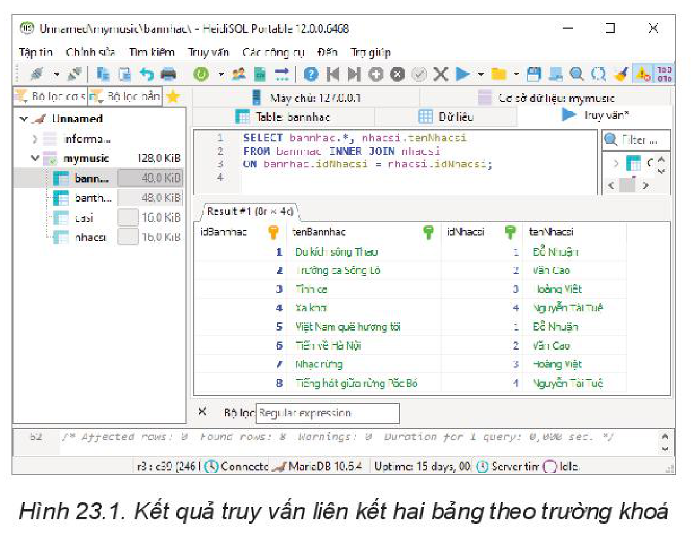
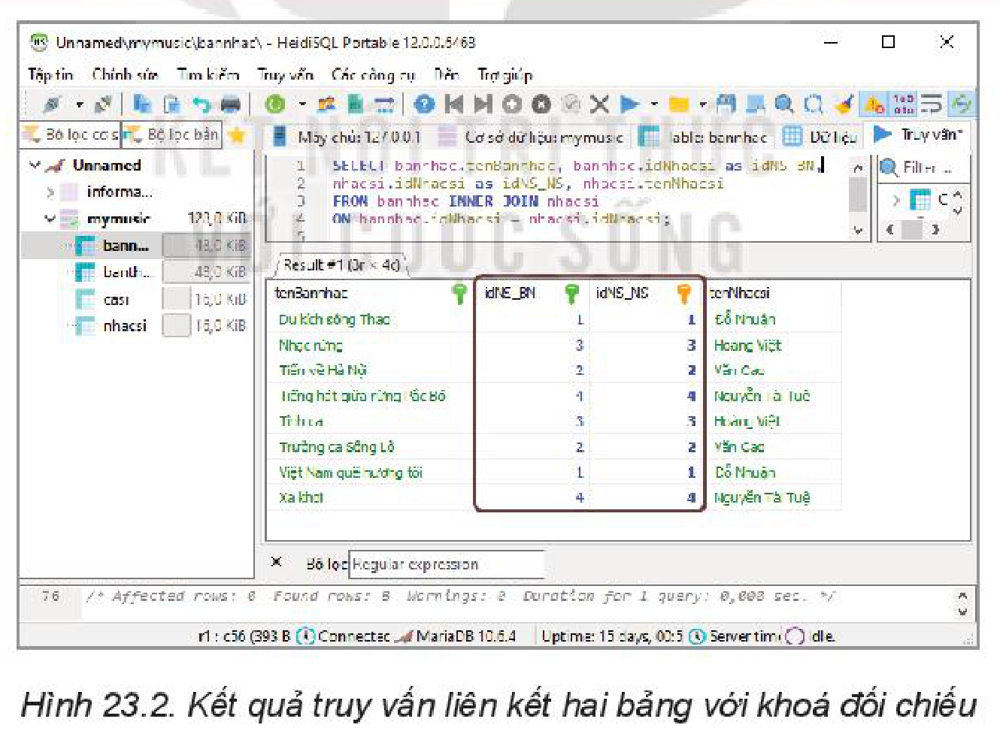
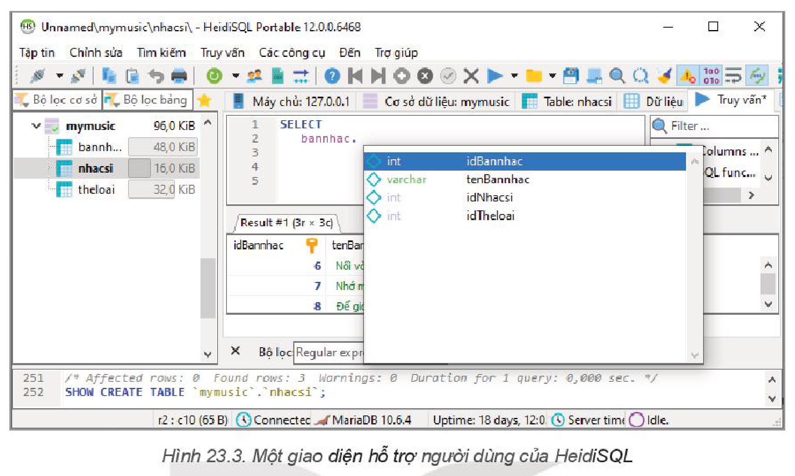
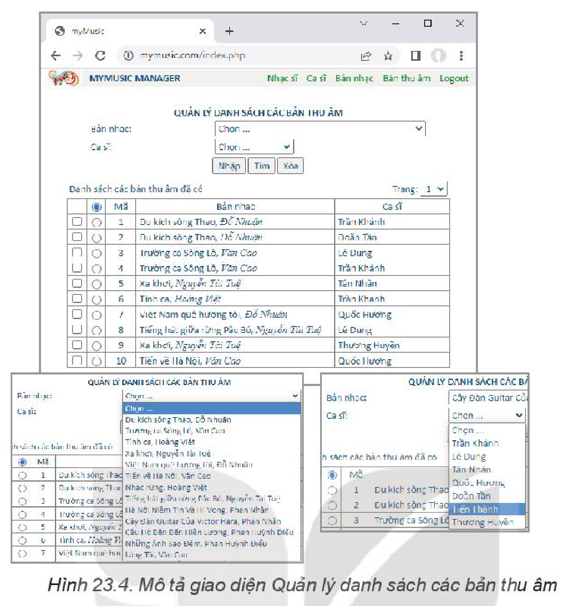

<!-- pdf:111 -->

# BÀI 23: THỰC HÀNH TRUY XUẤT DỮ LIỆU QUA LIÊN KẾT CÁC BẢNG

## 🎯 Sau bài học này em sẽ:

- Hiểu được cách thức truy xuất dữ liệu qua liên kết các bảng.

## 🔴 Khởi động

> Các bảng có thể có quan hệ với nhau, thể hiện qua khoá ngoài. Nhờ vậy có thể truy xuất dữ liệu từ các bảng khác theo mối quan hệ. Việc này sẽ được thực hiện cụ thể như thế nào trong giao diện của một hệ QTCSDL?

## Nhiệm vụ 1. Lập danh sách các bản nhạc với tên bản nhạc và tên tác giả

*Hướng dẫn:*

– Bảng `bannhac` có cấu trúc:
<!-- ocr-ok: đã đối chiếu ảnh trang 111, OCR đọc sai "cấu trúc" thành "cầu trúc" -->

`bannhac (idBannhac, tenBannhac, idNhacsi, idTheloai)`
<!-- ocr-ok: đã đối chiếu ảnh trang 111, OCR đọc sai "idBannhac" thành "1dBannhac" -->

Trong số các trường này không có trường `tenNhacsi`. Làm thế nào lập được danh sách các bản nhạc cùng với tên nhạc sĩ sáng tác bản nhạc ấy?

Tên nhạc sĩ nằm trong bảng `nhacsi`, lưu trữ ở trường `tenNhacsi`

`nhacsi (idNhacsi, tenNhacsi)`

Bảng `bannhac` có khoá ngoài là `idNhacsi` tham chiếu đến trường khoá chính `idNhacsi` của bảng `nhacsi`.

<!-- term: Truy vấn hai bảng qua liên kết INNER JOIN -->
Để truy vấn hai bảng qua liên kết khoá, câu truy vấn SQL với **mệnh đề JOIN** có cấu trúc như sau:

```sql
SELECT danh_sách_tên_trường_của_2_bảng
FROM tên_bảng_a INNER JOIN tên_bảng_b
     ON tên_bảng_a.tên_trường_a = tên_bảng_b.tên_trường_b
     [WHERE … ]
     [ORDER BY  … ] ;
```

Ví dụ: Để lấy ra danh sách các bản nhạc gồm `tenBannhac`, `tenNhacsi`, dùng câu truy vấn:

```sql
SELECT bannhac.tenBannhac, nhacsi.tenNhacsi
FROM bannhac INNER JOIN nhacsi
ON bannhac.idNhacsi = nhacsi.idNhacsi;
```

– Vào HeidiSQL, chọn CSDL `mymusic`, chọn thẻ `Truy vấn` và nhập vào câu truy vấn trên. Nhấn `F9` trên bàn phím hoặc nháy chuột vào biểu tượng `▶` hoặc nháy nút phải chuột, chọn `Chạy`.

<!-- pdf:112 -->



*Hình 23.1. Kết quả truy vấn liên kết hai bảng theo trường khoá*

<!-- term: Đổi tên trường trùng tên khi truy vấn liên kết -->
– Nếu muốn ở dữ liệu kết xuất có cả trường `idNhacsi` của bảng `nhacsi` nhằm có thể đối chiếu một cách tường minh cũng không khó, chỉ cần đổi tên hai trường (cùng tên) ở hai bảng để phân biệt.

```sql
SELECT
  bannhac.tenBannhac, bannhac.idNhacsi as idNS_BN,
  nhacsi.idNhacsi as idNS_NS, nhacsi.tenNhacsi
FROM bannhac INNER JOIN nhacsi
ON bannhac.idNhacsi = nhacsi.idNhacsi;
```



*Hình 23.2. Kết quả truy vấn liên kết hai bảng với khoá đối chiếu*

*Lưu ý:* HeidiSQL có hỗ trợ người dùng khi nhập các câu truy vấn theo các phương thức:

– Dùng màu sắc để trợ giúp quan sát cú pháp của câu truy vấn (**syntax coloring**).

– Mỗi khi người dùng nhập một tên bảng và dấu chấm (`.`), HeidiSQL sẽ hiển thị ngay danh sách các tên trường của bảng để người dùng lựa chọn.

<!-- pdf:113 -->



*Hình 23.3. Một giao diện hỗ trợ người dùng của HeidiSQL*

Hãy thực hành

– Lập danh sách bao gồm `idBannhac`, `tenBannhac`, `tenNhacsi` từ tất cả các bản nhạc có trong bảng `bannhac`.

– Lập danh sách bao gồm `idBannhac`, `tenBannhac` từ tất cả các bản nhạc của nhạc sĩ Đỗ Nhuận có trong bảng `bannhac`.

## Nhiệm vụ 2. Lập danh sách các bản thu âm với đủ các thông tin idBanthuam, tenBannhac, tenCasi

*Hướng dẫn:*

<!-- term: Truy vấn nhiều hơn hai bảng qua liên kết khoá ngoài -->
Để truy vấn được nhiều hơn hai bảng theo liên kết khoá ngoài, hãy lặp lại mệnh đề `JOIN` trong câu truy vấn SQL theo cấu trúc như sau:

```sql
SELECT danh_sách_tên_trường_của_3_bảng
FROM tên_bảng_a
  INNER JOIN tên_bảng_b
      ON tên_bảng_a.tên_trường_a = tên_bảng_b.tên_trường_b
  INNER JOIN tên_bảng_c
      ON tên_bảng_x.tên_trường_x = tên_bảng_c.tên_trường_c
    [WHERE … ]
    [ORDER BY  … ] ;
```

Trong đó `tên_bảng_x.tên_trường_x` là tên trường của bảng a hay bảng b.

## Nhiệm vụ 3. Tìm hiểu một chức năng của ứng dụng Quản lý dữ liệu âm nhạc

Qua giao diện trong Hình 23.4, em hãy tìm hiểu một chức năng của ứng dụng *Quản lý dữ liệu âm nhạc*, so sánh với những kiến thức vừa được học và cho nhận xét so sánh.

<!-- pdf:114 -->



*Hình 23.4. Mô tả giao diện Quản lý danh sách các bản thu âm*

Cách tương tác với giao diện này tương tự như với giao diện *Quản lý Bản nhạc* ở Bài 22 (Hình 22.7), chỉ khác ở chỗ khi nhập bản thu âm, chỉ có thể chọn tên bản nhạc, tên ca sĩ từ hộp danh sách với những tên đã có trong CSDL. Danh sách các bản thu âm có đầy đủ các thông tin tường minh tên bản nhạc, tên nhạc sĩ và tên ca sĩ thể hiện.

Theo các em:

– Người sử dụng có cần biết, nhớ cấu trúc của bảng trong CSDL không?

– Giao diện trên có dễ hiểu, dễ sử dụng không?

– Hình thức nhập dữ liệu như vậy có hỗ trợ tính nhất quán dữ liệu không?

## ✏️ Luyện tập

1. Lấy danh sách các bản thu âm với đầy đủ các thông tin, `idBanthuam`, `tenBannhac`, `tenTheloai`, `tenNhacsi`, `tenCasi`.
2. Lấy danh sách các bản thu âm với các thông tin `idBanthuam`, `tenBannhac`, `tenTheloai`, `tenCasi` các bản nhạc của nhạc sĩ Văn Cao.
3. Lấy danh sách các bản thu âm với các thông tin `idBanthuam`, `tenBannhac`, `tenTacgia`, `tenTheloai` các bản nhạc do ca sĩ Lê Dung thể hiện.
4. Lấy danh sách các bản thu âm với các thông tin `idBanthuam`, `tenBannhac`, `tenTacgia`, `tenCasi` các bản nhạc do ca sĩ Lê Dung thể hiện thuộc thể loại Nhạc trữ tình.

## 🚀 Vận dụng

Thực hành truy xuất bảng Quận/Huyện qua liên kết với bảng Tỉnh/Thành phố.

## 📷 Danh sách hình trong bài

| Mã hình | Trang PDF | Vị trí trong bài | Chú thích gốc |
| --- | --- | --- | --- |
| H11-tin_hoc_thud-b23-01 | 112 | Nhiệm vụ 1 | Hình 23.1. Kết quả truy vấn liên kết hai bảng theo trường khoá |
| H11-tin_hoc_thud-b23-02 | 112 | Nhiệm vụ 1 | Hình 23.2. Kết quả truy vấn liên kết hai bảng với khoá đối chiếu |
| H11-tin_hoc_thud-b23-03 | 113 | Nhiệm vụ 1 | Hình 23.3. Một giao diện hỗ trợ người dùng của HeidiSQL |
| H11-tin_hoc_thud-b23-04 | 114 | Nhiệm vụ 3 | Hình 23.4. Mô tả giao diện Quản lý danh sách các bản thu âm |
