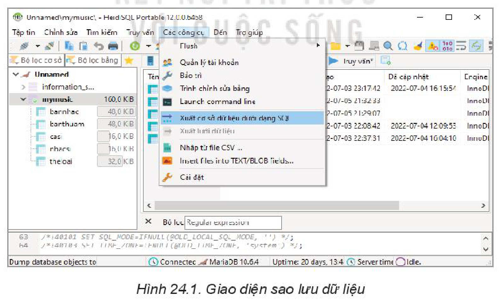
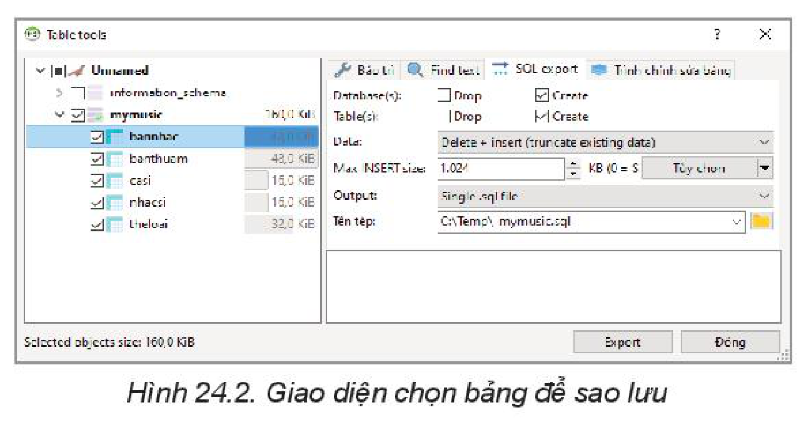
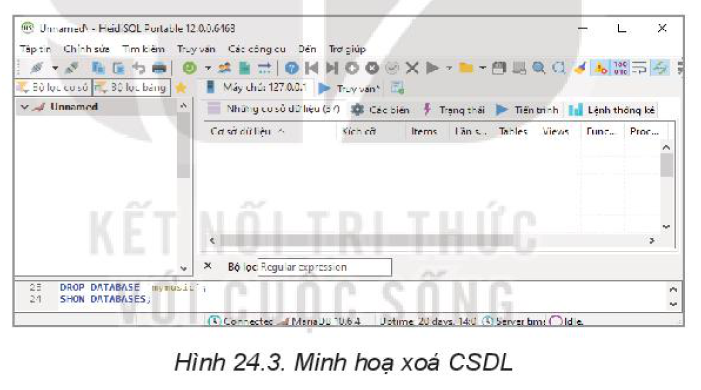
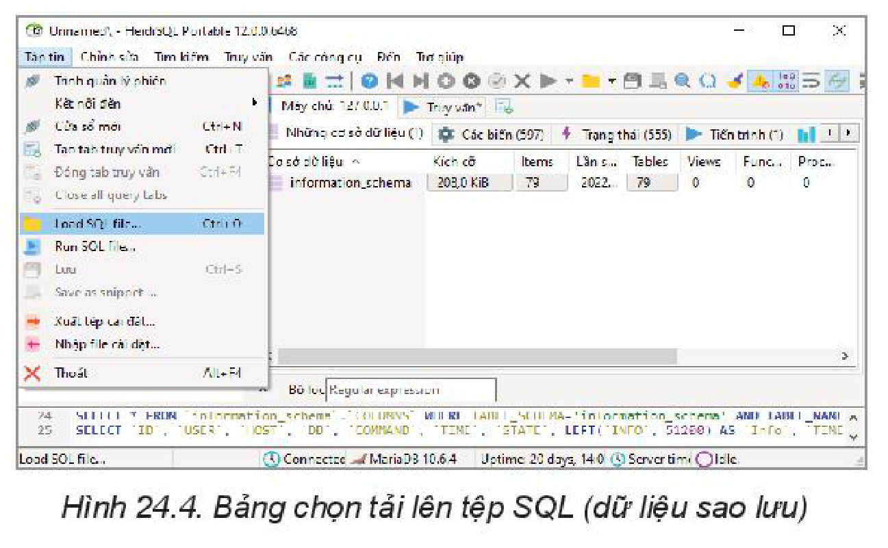
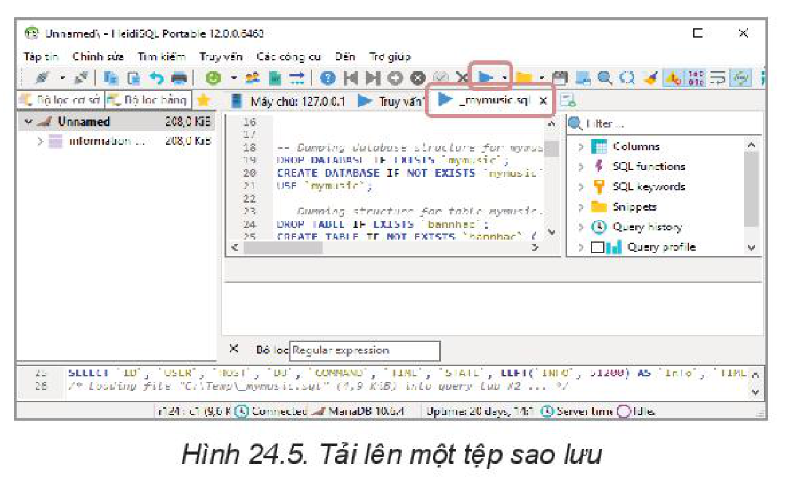
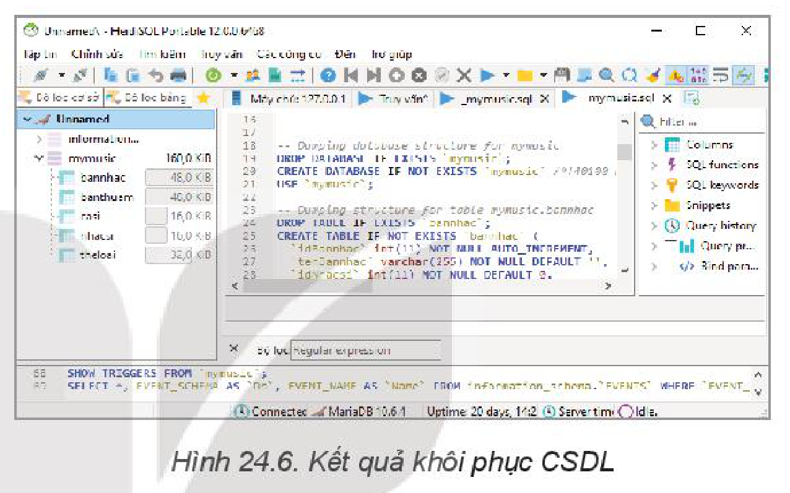
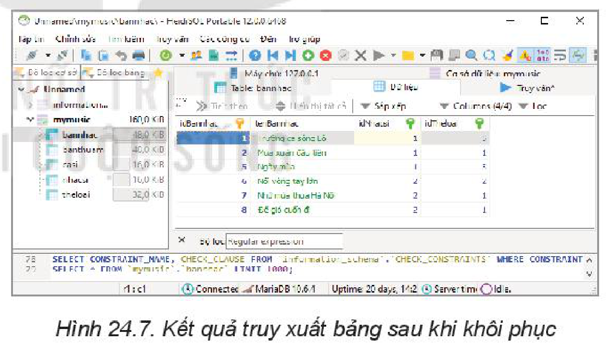

<!-- pdf:115 -->

# BÀI 24: THỰC HÀNH SAO LƯU DỮ LIỆU

## 🎯 Sau bài học này em sẽ:

- Nắm được các thao tác sao lưu và phục hồi dữ liệu.

## 🔴 Khởi động

> Như đã biết, để tổ chức đảm bảo an toàn CSDL phục vụ công tác quản lí của một tổ chức, cần xây dựng chính sách an toàn dữ liệu với những kế hoạch về tất cả các phương án sự cố có thể xảy ra và giải pháp hạn chế, khắc phục. Chính sách an toàn dữ liệu cũng phải bao gồm những quy định về ý thức, trách nhiệm đối với những người vận hành hệ thống. Về giải pháp phần mềm, các hệ QTCSDL đều có chức năng hỗ trợ sao lưu dữ liệu dự phòng một cách thường xuyên theo quy định và phục hồi dữ liệu khi có sự cố. Có thể khai thác sử dụng nhóm chức năng này như thế nào?

## Nhiệm vụ 1. Thực hành sao lưu CSDL

*Hướng dẫn:*

Nháy chuột chọn thẻ `Các công cụ`, chọn **Xuất cơ sở dữ liệu dưới dạng SQL**.

– Nháy chuột để đánh dấu vào CSDL `mymusic` ở phía trái và đánh dấu vào các ô **Drop**, có nghĩa là khi phục hồi CSDL thì xoá đối tượng cũ (nếu có) trước khi tạo đối tượng mới (`Create`).

– Ở dòng `Data` chọn **Delete + insert** để khi phục hồi thì xoá dữ liệu cũ đi (nếu có) trước khi chèn vào dữ liệu đã sao lưu.

*Hình 24.1. Giao diện sao lưu dữ liệu*

<!-- term: Xuất tệp sao lưu SQL trong HeidiSQL -->
Tiếp theo, chọn kiểu `output` là 1 tệp các câu truy vấn SQL: **Single.sql file**. Nhập vào tên tệp sao lưu, ví dụ là `C:\Temp\_mymusic.sql`.

Chọn `Export` để thực hiện việc sao lưu.

<!-- pdf:116 -->

– Cuối cùng là sao chép và lưu lại tệp `_mymusic.sql`.

<!-- term: Sao lưu một phần CSDL -->
*Lưu ý:* Cũng có thể thực hiện sao lưu một phần CSDL (một số bảng), bằng cách chỉ chọn những bảng muốn sao lưu.

*Hình 24.2. Giao diện chọn bảng để sao lưu*

## Nhiệm vụ 2. Thực hành phục hồi (restore) CSDL

*Hướng dẫn:*

<!-- term: Khôi phục CSDL từ tệp sao lưu SQL -->
Sau đây là một ví dụ **phục hồi** `mymusic` trên một máy mới, chưa có CSDL `mymusic`. Cũng có thể xoá CSDL `mymusic` đang có đi để thực hành khôi phục CSDL `mymusic` từ tệp sao lưu `_mymusic.sql`.

*Hình 24.3. Minh hoạ xoá CSDL*

– Nháy chuột chọn thẻ `Tập tin`, chọn **Load SQL file...** (hoặc nhấn `Ctrl+O`).

*Hình 24.4. Bảng chọn tải lên tệp SQL (dữ liệu sao lưu)*

<!-- pdf:117 -->

– Chọn tệp đã sao lưu là `_mymusic.sql`. Nháy chuột chọn `Open`. Nội dung tệp `mymusic_data` sẽ được tải vào cửa sổ truy vấn.

*Hình 24.5. Tải lên một tệp sao lưu*

<!-- term: Thực thi truy vấn phục hồi và làm tươi danh sách CSDL -->
– Nháy chuột chọn `▶` để thực hiện truy vấn. Sau đó nhấn `F5` để làm tươi lại danh sách CSDL. Khi đó CSDL `mymusic` đã được khởi tạo với đầy đủ các bảng như Hình 24.6, Hình 24.7.
<!-- ocr-ok: đã đối chiếu ảnh trang 117, cột chữ bên trái Hình 24.6 bị OCR ghép lẫn chữ trong ảnh chụp màn hình -->

*Hình 24.6. Kết quả khôi phục CSDL*

*Hình 24.7. Kết quả truy xuất bảng sau khi khôi phục*

## ✏️ Luyện tập

Thực hành sao lưu và phục hồi bảng `banthuam` của CSDL `mymusic`.

## 🚀 Vận dụng

Giả sử cần di chuyển một CSDL từ máy tính này sang máy tính khác, em sẽ làm thế nào?

## 📷 Danh sách hình trong bài

| Mã hình | Trang PDF | Vị trí trong bài | Chú thích gốc |
| --- | --- | --- | --- |
| H11-tin_hoc_thud-b24-01 | 115 | Nhiệm vụ 1 | Hình 24.1. Giao diện sao lưu dữ liệu |
| H11-tin_hoc_thud-b24-02 | 116 | Nhiệm vụ 1 | Hình 24.2. Giao diện chọn bảng để sao lưu |
| H11-tin_hoc_thud-b24-03 | 116 | Nhiệm vụ 2 | Hình 24.3. Minh hoạ xoá CSDL |
| H11-tin_hoc_thud-b24-04 | 116 | Nhiệm vụ 2 | Hình 24.4. Bảng chọn tải lên tệp SQL (dữ liệu sao lưu) |
| H11-tin_hoc_thud-b24-05 | 117 | Nhiệm vụ 2 | Hình 24.5. Tải lên một tệp sao lưu |
| H11-tin_hoc_thud-b24-06 | 117 | Nhiệm vụ 2 | Hình 24.6. Kết quả khôi phục CSDL |
| H11-tin_hoc_thud-b24-07 | 117 | Nhiệm vụ 2 | Hình 24.7. Kết quả truy xuất bảng sau khi khôi phục |
