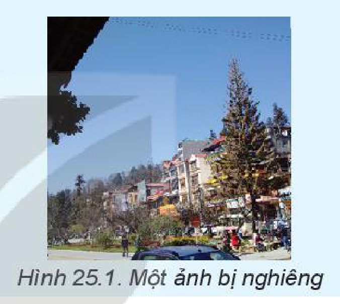
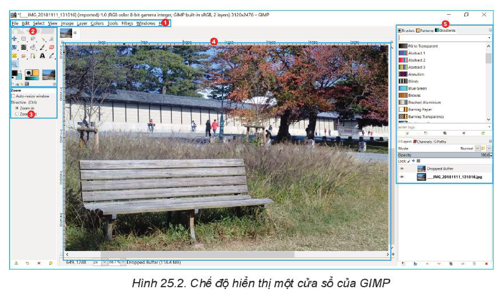
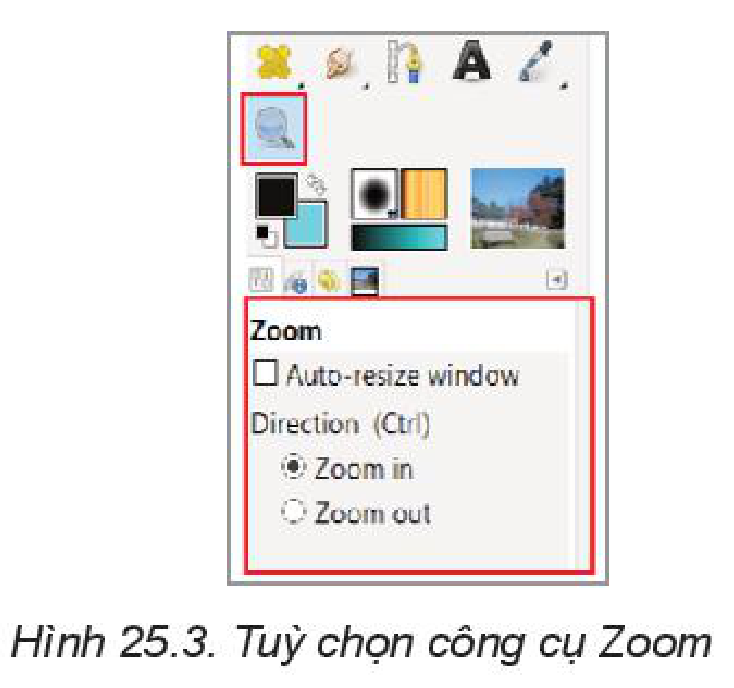
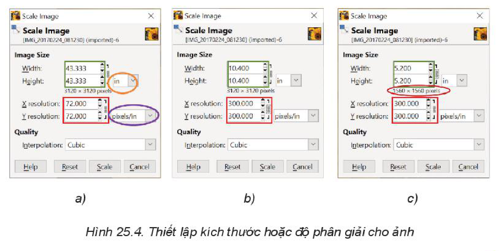
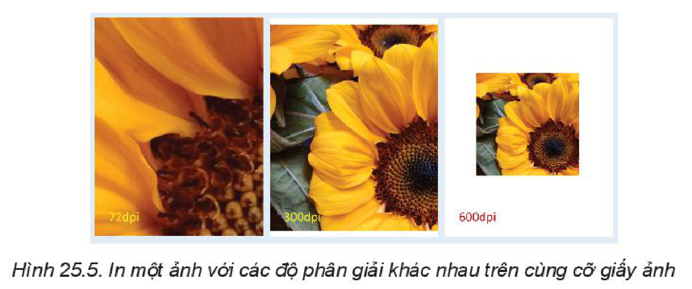
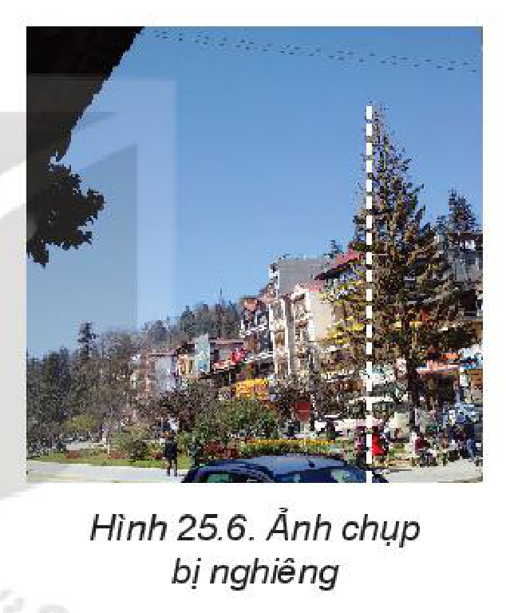
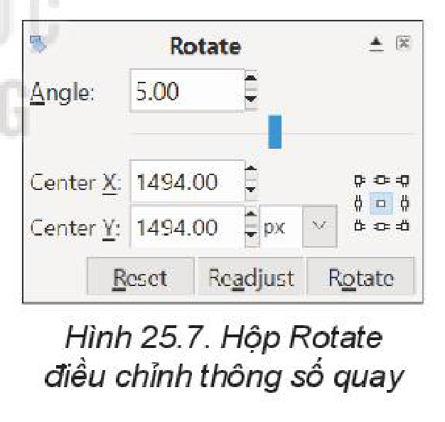
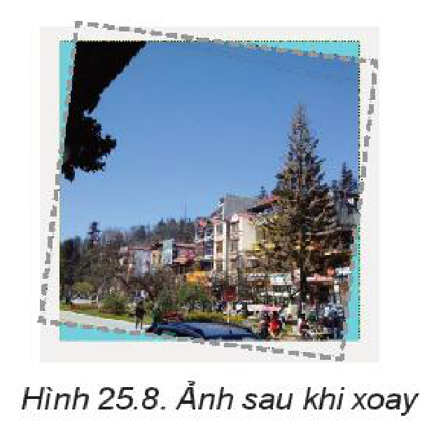
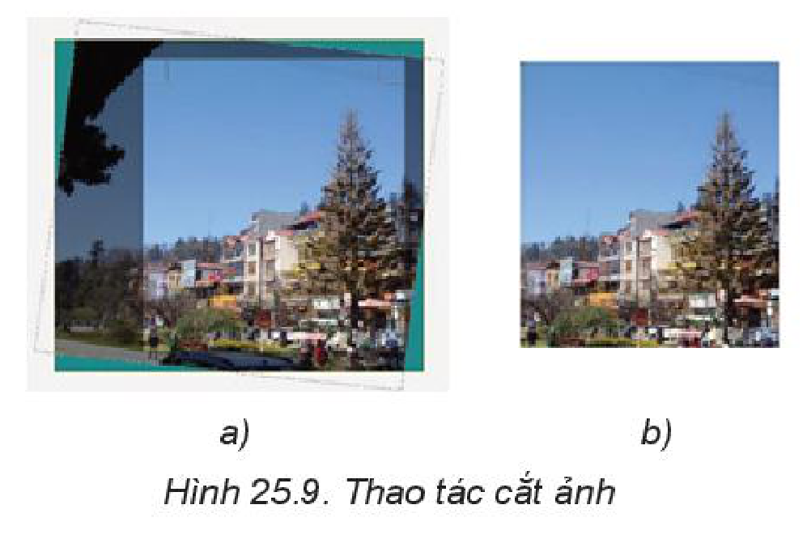
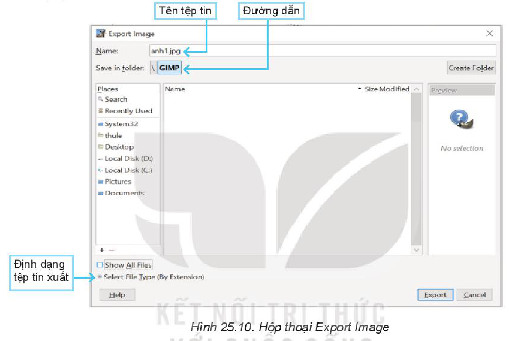

<!-- pdf:118 -->

# BÀI 25: PHẦN MỀM CHỈNH SỬA ẢNH

## 🎯 Sau bài học này em sẽ:

- Làm quen với phần mềm chỉnh sửa ảnh.
- Thực hiện được một số thao tác cơ bản với ảnh: phóng to, thu nhỏ, xoay, cắt ảnh.

## 🔴 Khởi động

> Nếu chỉ muốn lấy phần hình ảnh dãy nhà từ bức ảnh như Hình 25.1, em cần sử dụng phần mềm nào? Phần mềm đó có những chức năng gì?

*Hình 25.1. Một ảnh bị nghiêng*
<!-- ocr-ok: đã đối chiếu ảnh trang 118, chú thích trong hộp Khởi động màu xanh bị OCR bỏ sót -->

## 1. GIỚI THIỆU ẢNH SỐ

> **Hoạt động 1: Megapixel là gì?**
>
> Trong các quảng cáo về ưu điểm của điện thoại, em thường nghe nói đến camera nhiều megapixel. Em có biết megapixel là gì và có ý nghĩa thế nào với máy ảnh không?

**Ảnh số** (**digital image**) là biểu diễn số của hình ảnh. **Ảnh bitmap** là một trong các loại ảnh số phổ biến với nhiều định dạng khác nhau như bmp, jpeg, png, gif, psd,...

Ảnh bitmap thường được chụp từ camera hay máy quét,... là tập hợp các **điểm ảnh** (**pixel**). Mỗi điểm ảnh thường có dạng hình vuông nhỏ xác định bởi cặp (x, y) tương ứng với vị trí của điểm trên ảnh và được gán một bộ giá trị hữu hạn, rời rạc để biểu thị màu sắc, mật độ và cường độ tại điểm ảnh đó.

Độ rõ nét của hình ảnh phụ thuộc vào **độ phân giải**, thường được xác định bởi số điểm ảnh trên một inch (**dpi** – dots per inch hay **ppi** – pixels per inch), chẳng hạn ảnh dùng để in thường có độ phân giải ít nhất là 300 dpi. Hai bức ảnh có cùng kích thước, ảnh sắc nét hơn là ảnh có độ phân giải cao hơn, chứa nhiều thông tin và có dung lượng lớn hơn.

Ví dụ, ảnh cỡ 10 $\times$ 15 cm (xấp xỉ 4 $\times$ 6 inch) có độ phân giải 300 dpi có chiều rộng là 1200 pixel (bằng 4 $\times$ 300) và chiều dài là 1800 pixel (bằng 6 $\times$ 300). Nếu tệp ảnh 1200 $\times$ 1800 pixel này được in với độ phân giải 400 dpi thì ảnh nhận được có kích thước cỡ 3 $\times$ 4,5 inch.

<!-- pdf:119 -->

**Số lượng điểm ảnh**, là một cách khác để thể hiện độ phân giải của ảnh, là số điểm ảnh của bức ảnh. Ví dụ, camera chụp ảnh có kích thước 2560 $\times$ 1920 pixel có 4 915 200 điểm ảnh, xấp xỉ 5 triệu điểm ảnh được gọi là camera 5 **megapixel**.

> - **Ảnh số** được xác định bởi tập hợp các **điểm ảnh**, mỗi điểm ảnh có một bộ giá trị thể hiện màu sắc và cường độ.
> - **Độ phân giải** của ảnh thường được xác định bằng số điểm ảnh trên một inch, độ phân giải càng cao thì ảnh càng rõ nét.

> ❓ **Câu hỏi**
>
> Một ảnh có kích thước 600 $\times$ 600 pixel nếu in với độ phân giải 100 dpi có kích thước gấp mấy lần ảnh đó in với độ phân giải 200 dpi?

## 2. PHẦN MỀM CHỈNH SỬA ẢNH

> **Hoạt động 2: Phần mềm chỉnh sửa ảnh**
>
> Sau khi chụp ảnh kỉ yếu lớp, Minh tập hợp và chỉnh lại các ảnh trước khi in. Em có biết Minh có thể dùng phần mềm nào để thực hiện việc đó không?

**Phần mềm chỉnh sửa ảnh** cung cấp công cụ cho phép người sử dụng chỉnh sửa, thay đổi giúp cho ảnh đẹp, rõ nét hơn và có thể cắt bỏ những phần không cần thiết hay thêm vào các chi tiết khác. Các phần mềm chỉnh sửa ảnh đều có các chức năng cơ bản giống nhau và trong khuôn khổ sách này chúng ta sử dụng phần mềm nguồn mở **GIMP** (**GNU Image Manipulation Program**). Tệp tin chính của GIMP là **xcf**, loại tệp này có thể lưu trữ nhiều lớp, chứa thông tin về ảnh, độ trong suốt,... và nhiều thông tin khác cùng một dự án. Tuy nhiên, phần mềm làm việc được với nhiều loại tệp tin khác như bmp, jpeg, png,...

> *Hướng dẫn cài đặt*
>
> Truy cập trang web: http://www.gimp.org/downloads/ chọn bản phù hợp tải về và cài đặt theo hướng dẫn.
<!-- ocr-ok: đã đối chiếu ảnh trang 119, hộp Hướng dẫn cài đặt xếp cạnh đoạn văn bị OCR đọc lẫn dòng -->

### a) Giao diện của GIMP

Màn hình làm việc của GIMP có thể có dạng như Hình 25.2 (**chế độ một cửa sổ**). Chế độ mặc định là nhiều cửa sổ, mỗi cửa sổ hiển thị một chức năng của GIMP. Để chuyển sang chế độ một cửa sổ, chọn **Windows** → **Single-window Mode**.

Giao diện GIMP bao gồm:

1. **Thanh bảng chọn**: chứa các lệnh thường dùng liên quan đến tệp ảnh, các lệnh mở, lưu tệp ảnh.
2. **Bảng công cụ**: chứa các công cụ cơ bản của phần mềm như di chuyển, sao chép, cắt phần ảnh đang chọn, thêm chữ, tạo các hiệu ứng đặc biệt,...
3. **Hộp tuỳ chọn công cụ**: nằm dưới hộp công cụ, hiển thị các thuộc tính liên quan đến công cụ đang sử dụng.
4. **Vùng hiển thị ảnh**: hiển thị ảnh đang chỉnh sửa. Có thể quan sát và so sánh ảnh trước và sau mỗi bước chỉnh sửa bằng cách chọn chế độ xem trước (**Split view**) ở khung bên phải.
5. **Các hộp chức năng**: gồm phần trên chứa các hộp tuỳ chọn của cọ vẽ (Brushes), mẫu màu (Patterns), chuyển màu (Gradients), phía dưới là hộp quản lí lớp ảnh (Layer), hộp quản lí kênh màu (Channels),....

<!-- pdf:120 -->

*Hình 25.2. Chế độ hiển thị một cửa sổ của GIMP*

> - Thông tin ảnh bitmap được biểu thị bằng các điểm ảnh, mỗi điểm ảnh tương ứng với một vị trí trên ảnh với màu sắc xác định.
> - GIMP là phần mềm chỉnh sửa ảnh bitmap miễn phí.

> ❓ **Câu hỏi**
>
> 1. Để xử lí một bức ảnh thiếu sáng em sử dụng những phần mềm nào sau đây?
>
> A. GIMP. B. Inkscape. C. PowerPoint.
>
> 2. Để thay đổi giao diện hiển thị một cửa sổ của phần mềm GIMP, em thực hiện như thế nào?

### b) Một số thao tác cơ bản

Mở tệp ảnh trong GIMP bằng lệnh **File** → **Open** hoặc kéo thả tệp ảnh vào màn hình GIMP. Các chức năng cơ bản nhất trong chỉnh sửa ảnh gồm:

**Phóng to hay thu nhỏ ảnh**: Chọn nút lệnh **Zoom** trong bảng công cụ rồi nháy chuột vào vị trí muốn phóng to hay thu nhỏ. Em cũng có thể nhấn giữ phím **Ctrl** và lăn nút cuộn của chuột để phóng to hay thu nhỏ tại vị trí của con trỏ.

**Cắt ảnh**: Chọn nút lệnh **Crop**. Kéo thả chuột để chọn phần ảnh được giữ lại. Phần ảnh bị cắt sẽ được hiển thị mờ đi. Kéo thả chuột tại các điểm trên viền khung để thay đổi phần ảnh được chọn. Kéo thả các điểm bên trong khung để di chuyển ảnh gốc. Nhấn phím **Enter** để thực hiện cắt ảnh. Nhấn phím **Esc** để bỏ chọn ảnh.

**Xoay ảnh**: Chọn nút lệnh **Rotate** hoặc nhấn tổ hợp phím **Shift+R**. Có thể nhập góc xoay và tâm xoay hoặc kéo thả chuột trực tiếp trên ảnh.

## 3. THỰC HÀNH

*(Hình ảnh và hướng dẫn thực hành trong Bài 25, Bài 26, Bài 27, Bài 28 sử dụng phần mềm GIMP phiên bản 2.10.24 và sử dụng giao diện Icon Theme là Legacy để minh hoạ. Các tuỳ chỉnh giao diện như Theme, Icon Theme có thể thay đổi trong mục Edit → Preferences.)*

<!-- pdf:121 -->

### Nhiệm vụ 1. Mở tệp, quan sát, phóng to, thu nhỏ ảnh trên màn hình

Hướng dẫn:

*Bước 1.* Khởi động GIMP và mở tệp ảnh.

*Bước 2.* Chọn nút lệnh **Zoom** trong bảng công cụ. Trong phần tuỳ chọn công cụ, chọn **Zoom in** nếu muốn phóng to, chọn **Zoom out** nếu muốn thu nhỏ. (Hình 25.3)

*Bước 3.* Nháy chuột vào vị trí muốn phóng to, thu nhỏ. Có thể nhấn giữ phím **Ctrl** trong khi lăn nút cuộn của chuột.

*Hình 25.3. Tuỳ chọn công cụ Zoom*

### Nhiệm vụ 2. Thay đổi kích thước và độ phân giải của ảnh

<!-- term: Thay đổi kích thước và độ phân giải của ảnh -->
Vì chất lượng và kích thước của ảnh in ra phụ thuộc vào số điểm ảnh và độ phân giải của ảnh nên cần thay đổi kích thước ảnh hoặc độ phân giải.

Hướng dẫn:

*Bước 1.* Mở tệp ảnh cần thay đổi các thông số kích thước và độ phân giải.

<!-- term: Thay đổi kích thước và độ phân giải của ảnh -->
*Bước 2.* Chọn **Image** → **Scale Image**.

<!-- term: Thay đổi kích thước và độ phân giải của ảnh -->
*Bước 3.* Thay đổi các kích thước chiều ngang hoặc chiều cao trong các ô tương ứng **Width** hay **Height**. Thay đổi độ phân giải trong các ô **X resolution** hay **Y resolution** tuỳ theo mục đích. Rồi nháy nút **Scale**.

Đơn vị chiều dài có thể là inches (in), milimeters (mm), points(pt),... Đơn vị của độ phân giải là số điểm ảnh trên một inch (Hình 25.4a).

<!-- term: Thay đổi kích thước và độ phân giải của ảnh -->
*Lưu ý:* Khi thay đổi độ phân giải, số điểm ảnh vẫn giữ nguyên. Khi thay đổi kích thước ảnh, số điểm ảnh thay đổi. Ví dụ, ban đầu ảnh có 3120 $\times$ 3120 điểm ảnh với độ phân giải 72 dpi, ảnh in ra có kích thước là 43,3 $\times$ 43,3 inch (Hình 25.4a). Khi tăng độ phân giải lên 300 dpi thì ảnh sẽ có kích thước là 10,4 $\times$ 10,4 inch nhưng số điểm ảnh vẫn là 3120 $\times$ 3120 (Hình 25.4b). Nếu kích thước mỗi chiều giảm một nửa xuống còn 5,2 $\times$ 5,2 inch thì số điểm ảnh cũng giảm một nửa mỗi chiều là 1560 $\times$ 1560 (Hình 25.4c).

*Hình 25.4. Thiết lập kích thước hoặc độ phân giải cho ảnh*

<!-- pdf:122 -->

Hình 25.5 thể hiện kết quả khi in cùng một ảnh (3120 $\times$ 3120 điểm ảnh) với các độ phân giải khác nhau trên cùng một cỡ giấy ảnh.

*Hình 25.5. In một ảnh với các độ phân giải khác nhau trên cùng cỡ giấy ảnh*

### Nhiệm vụ 3. Thực hiện xoay ảnh, cắt ảnh, xuất ra tệp tin ảnh JPG

Hướng dẫn:

*Bước 1.* Mở tệp ảnh có hình bị nghiêng và có nhiều đối tượng không phù hợp (Hình 25.6). Cần xoay để cho hình thẳng lại và cắt bớt để bố cục ảnh đẹp hơn.

*Hình 25.6. Ảnh chụp bị nghiêng*
<!-- ocr-ok: đã đối chiếu ảnh trang 122, OCR đọc nhầm "Hình 25.6. Ảnh" thành "Hình 256. Änh" -->

*Bước 2.* Chọn nút lệnh **Rotate** hoặc nhấn tổ hợp phím **Shift+R**.

*Bước 3.* Kéo thả chuột để xoay ảnh đến khi ưng ý. Cách khác, thay đổi giá trị góc quay (Angle), tâm quay trên hộp **Rotate** (Hình 25.7) rồi nháy chuột vào nút **Rotate** để xoay hoặc nháy chuột vào nút **Reset** nếu muốn quay lại hình ảnh ban đầu.

*Hình 25.7. Hộp Rotate điều chỉnh thông số quay*

*Bước 4.* Để cắt ảnh, em chọn nút lệnh **Crop** hoặc nhấn tổ hợp phím **Shift+C**.

*Bước 5.* Kéo thả chuột chọn phần ảnh cần giữ lại.

*Bước 6.* Thay đổi kích thước và vị trí của khung hình bằng cách kéo thả các nút trên khung. Kéo thả ảnh để di chuyển phần ảnh được giữ lại (Hình 25.9a).

*Bước 7.* Nhấn phím **Enter** để hoàn thành việc cắt ảnh Hình 25.9b).

*Hình 25.8. Ảnh sau khi xoay*

*Hình 25.9. Thao tác cắt ảnh*

<!-- pdf:123 -->

<!-- term: Xuất tệp ảnh trong GIMP -->
*Bước 8.* Để xuất ảnh dạng jpg, em chọn **File** → **Export**. Hộp thoại **Export Image** như Hình 25.10 xuất hiện.

*Bước 9.* Nhập tên và đường dẫn cho tệp ảnh.

<!-- term: Xuất tệp ảnh trong GIMP -->
*Bước 10.* Nếu muốn thay đổi định dạng ảnh, nháy chuột vào ô **Select file type** và chọn loại định dạng.

*Bước 11.* Chọn **Export**, một cửa sổ mới xuất hiện ra cho phép điều chỉnh các thông số của ảnh xuất. Nháy chuột chọn nút **Export** để thực hiện.

<!-- term: Xuất tệp ảnh trong GIMP -->
*Lưu ý:* Lệnh **Save** trong GIMP chỉ sử dụng để lưu tệp tin đang làm việc ở định dạng xcf.

*Hình 25.10. Hộp thoại Export Image*

## ✏️ Luyện tập

1. Cho ảnh số có số điểm ảnh là 3000 $\times$ 2000 điểm ảnh. Tính kích thước ảnh với mỗi độ phân giải:
   a) 72 dpi. b) 150 dpi. c) 300 dpi. d) 600 dpi.
2. Nếu in một ảnh ở độ phân giải 300 dpi thì thu được ảnh in có kích thước 10 $\times$ 10 inch. Để ảnh in có kích thước 5 $\times$ 5 inch thì cần in ảnh ở độ phân giải cao hơn hay thấp hơn 300 dpi?

## 🚀 Vận dụng

1. Chọn một bức ảnh em đã chụp, thực hiện các thao tác xoay và cắt ảnh để thu được một bức ảnh đẹp.
2. Với ảnh thu được, em hãy tính xem cần đặt giá trị độ phân giải là bao nhiêu để khi in ảnh trên cỡ giấy 8,5 $\times$ 11 inch là đẹp nhất.

## 📷 Danh sách hình trong bài

| Mã hình | Trang PDF | Vị trí trong bài | Chú thích gốc |
| --- | --- | --- | --- |
| H11-tin_hoc_thud-b25-01 | 118 | Khởi động | Hình 25.1. Một ảnh bị nghiêng |
| H11-tin_hoc_thud-b25-02 | 120 | Mục 2.a | Hình 25.2. Chế độ hiển thị một cửa sổ của GIMP |
| H11-tin_hoc_thud-b25-03 | 121 | Mục 3, Nhiệm vụ 1 | Hình 25.3. Tuỳ chọn công cụ Zoom |
| H11-tin_hoc_thud-b25-04 | 121 | Mục 3, Nhiệm vụ 2 | Hình 25.4. Thiết lập kích thước hoặc độ phân giải cho ảnh |
| H11-tin_hoc_thud-b25-05 | 122 | Mục 3, Nhiệm vụ 2 | Hình 25.5. In một ảnh với các độ phân giải khác nhau trên cùng cỡ giấy ảnh |
| H11-tin_hoc_thud-b25-06 | 122 | Mục 3, Nhiệm vụ 3 | Hình 25.6. Ảnh chụp bị nghiêng |
| H11-tin_hoc_thud-b25-07 | 122 | Mục 3, Nhiệm vụ 3 | Hình 25.7. Hộp Rotate điều chỉnh thông số quay |
| H11-tin_hoc_thud-b25-08 | 122 | Mục 3, Nhiệm vụ 3 | Hình 25.8. Ảnh sau khi xoay |
| H11-tin_hoc_thud-b25-09 | 122 | Mục 3, Nhiệm vụ 3 | Hình 25.9. Thao tác cắt ảnh |
| H11-tin_hoc_thud-b25-10 | 123 | Mục 3, Nhiệm vụ 3 | Hình 25.10. Hộp thoại Export Image |
