<!-- pdf:124 -->

# BÀI 26: CÔNG CỤ TINH CHỈNH MÀU SẮC VÀ CÔNG CỤ CHỌN

## 🎯 Sau bài học này em sẽ:

- Biết các tham số biểu diễn màu của ảnh số.
- Biết một số công cụ chọn đơn giản.
- Thực hiện được một số lệnh chỉnh màu đơn giản.

## 🔴 Khởi động

> Khi em đi in ảnh, nhiều khi ảnh nhận được trông rất xỉn màu, khác xa tấm hình mà em đã chọn. Có bao giờ em thắc mắc và hỏi cửa hàng tại sao?

## 1. CÔNG CỤ TINH CHỈNH MÀU SẮC

> **Hoạt động 1: Màu sắc của ảnh**
>
> Nhóm của Hằng đi chụp vườn hoa Tết nhưng đến nơi đã muộn, ảnh chụp được như Hình 26.1. Theo em bức ảnh này gặp vấn đề gì? Cần làm gì để ảnh đẹp hơn?

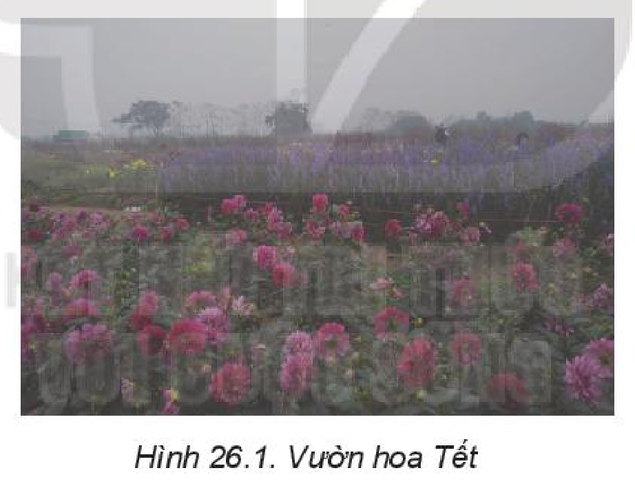

*Hình 26.1. Vườn hoa Tết*

GIMP cung cấp một số công cụ để tinh chỉnh màu sắc cho ảnh số. Em có thể chỉnh màu và ánh sáng cho toàn bộ ảnh hay từng phần. Để sử dụng các công cụ này, nháy chuột chọn **Color** rồi chọn tên lệnh tương ứng, một bảng điều khiển tương ứng hiện ra. Nháy chuột chọn **Preview** để xem trước kết quả và bỏ chọn để xem hình gốc. Chọn **Reset** nếu muốn bỏ qua các thay đổi đang thực hiện. Một số công cụ thường dùng là **Brightness-Contrast** (chỉnh độ sáng và độ tương phản) **Color Balance** (chỉnh cân bằng màu), **Hue**, **Levels**, **Curves**,...

### a) Công cụ chỉnh độ sáng và độ tương phản (Brightness-Contrast)

Công cụ này được sử dụng để điều chỉnh độ sáng và độ tương phản của lớp hoặc của vùng ảnh đang được chọn (Hình 26.2a). Em tăng, giảm độ sáng bằng cách tăng, giảm giá trị trên ô **Brightness**, giá trị càng lớn thì ảnh càng sáng. Tương tự với độ tương phản, em tăng giảm độ tương phản bằng cách thay đổi giá trị trong ô **Contrast**.

<!-- pdf:125 -->

Tuy dễ sử dụng, công cụ không thích hợp để sửa ảnh phức tạp. Công cụ **Levels** có thể giúp điều chỉnh một cách chi tiết hơn, do vậy nếu muốn điều chỉnh ảnh bằng công cụ **Levels**, em có thể nháy chuột vào nút **Edit this Settings as Levels** phía dưới ô **Contrast**.

### b) Công cụ cân bằng màu (Color Balance)

**Công cụ cân bằng màu** dùng để cân bằng màu của layer (lớp) hoặc một phần ảnh đang chọn (Hình 26.2b). Công cụ này thường dùng để hiệu chỉnh các màu nổi trội.

Trước hết cần chọn dải màu theo độ sáng mà em muốn thay đổi. Sau đó điều chỉnh giá trị của từng kênh màu. Có ba dải độ sáng: **Shadows** (chỉnh các điểm ảnh tối), **Midtones** (chỉnh các điểm ảnh trung bình) và **Highlights** (chỉnh các các điểm ảnh sáng).

### c) Công cụ chỉnh màu sắc (Hue-Saturation)

**Công cụ chỉnh màu sắc** được sử dụng để điều chỉnh tông màu, độ bão hoà và độ sáng cho từng mảng màu trên một layer hay một vùng ảnh đang được chọn (Hình 26.2c).

Để chỉnh màu sắc, chọn một màu trong số sáu màu để chỉnh. Sáu tuỳ chọn màu chỉnh gồm ba màu cơ bản red-đỏ, green-xanh lục, blue-xanh lam và ba màu in cơ bản là cyan-xanh lơ, magenta-hồng và yelow-vàng. Nếu chọn **Master** thì tất cả các màu đều được thay đổi.

Sau khi chọn màu tinh chỉnh, em thực hiện thay đổi giá trị **Hue** để đổi tông màu trên vòng tròn màu, **Lightness** để đổi độ sáng và **Saturation** để đổi độ bão hoà của màu đang chọn.

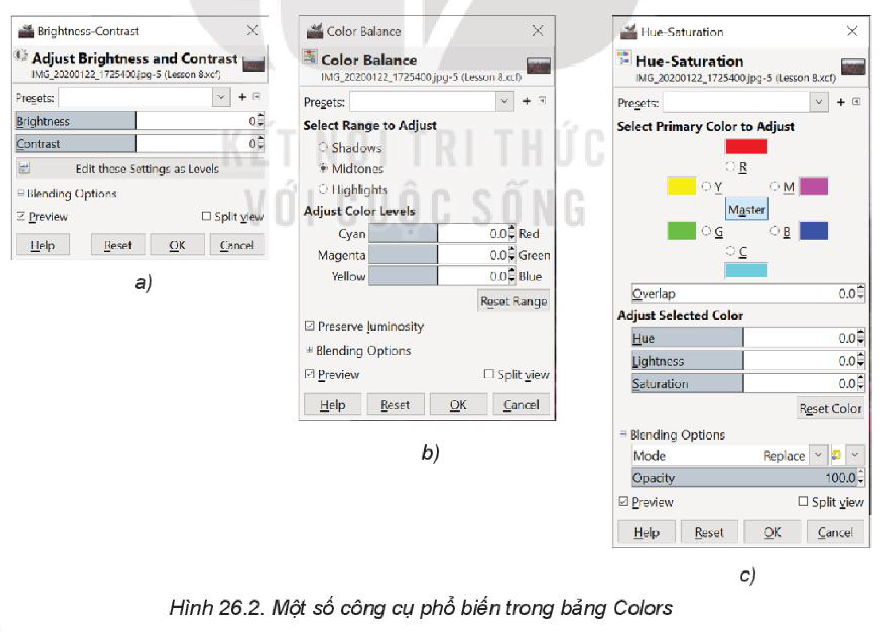

*Hình 26.2. Một số công cụ phổ biến trong bảng Colors*

> ❓ **Câu hỏi**
>
> Nếu em muốn làm màu của các bông hoa thược dược đỏ hơn thì dùng công cụ gì?

<!-- pdf:126 -->

## 2. VAI TRÒ, Ý NGHĨA VÀ CÁCH THIẾT LẬP VÙNG CHỌN

> **Hoạt động 2: Tìm hiểu vùng chọn**
>
> Với bức ảnh quả táo màu đỏ (Hình 26.3a), em có nghĩ ra cách chỉnh màu trên toàn bộ ảnh để thu được trái táo gồm hai nửa với màu sắc khác nhau (ví dụ như Hình 26.3b) hay không?

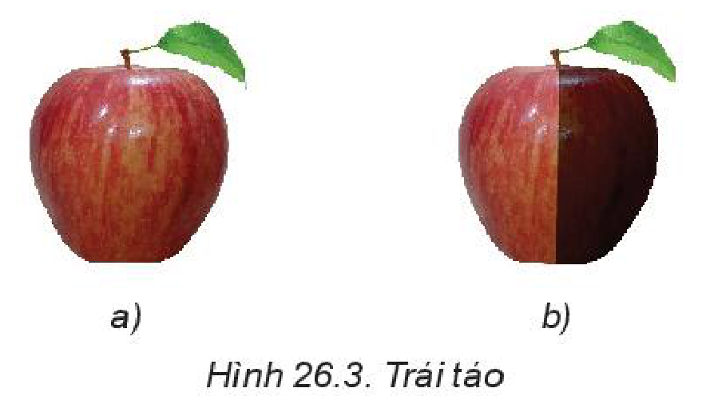

*Hình 26.3. Trái táo*

**Vùng chọn** có vai trò quan trọng trong việc chỉnh sửa ảnh. Vùng chọn cho phép em chia nhỏ hình ảnh để thực hiện các thao tác (lệnh xử lí) khác nhau trên từng phần riêng. Nếu không có vùng chọn thì các lệnh chỉnh sửa ảnh được thực hiện cho toàn bộ ảnh.

Ba công cụ thường được dùng để tạo vùng chọn như sau:

| Công cụ | Chức năng | Cách thực hiện |
| --- | --- | --- |
| **Rectangle Select Tool** | Tạo một vùng chọn hình chữ nhật. Phím tắt R. | *Bước 1.* Kéo thả chuột để tạo vùng chọn. *Bước 2.* Điều chỉnh kích thước của vùng chọn. |
| **Ellipse Select Tool** | Tạo một vùng chọn hình tròn hoặc hình elip. Phím tắt E. | *Bước 1.* Kéo thả chuột để tạo vùng chọn. *Bước 2.* Điều chỉnh kích thước của vùng chọn. |
| **Free Select Tool** | Tạo một vùng chọn có hình dạng tuỳ ý. | Kéo thả chuột bao quanh vùng cần chọn hoặc nháy chuột lên ảnh để tạo ra các điểm xác định đường bao kín cho vùng chọn. |

Nhấn giữ các phím **Alt+Ctrl** và kéo thả vùng chọn để cắt và di chuyển vùng chọn tới vị trí mới. Nhấn giữ các phím **Alt+Shift** và kéo thả vùng chọn để sao chép và di vùng chọn tới vị trí mới.

Với các công cụ chọn hình chữ nhật hoặc hình elip và đang có một vùng chọn: Nhấn giữ phím **Shift** để tạo vùng chọn mới thì vùng chọn mở rộng thêm vùng chọn mới; Nhấn giữ phím **Ctrl** để tạo vùng chọn thì vùng chọn được trừ bớt đi vùng chọn mới.

> Vùng chọn giúp em chỉnh sửa trong từng phần của ảnh.

> ❓ **Câu hỏi**
>
> Nếu ảnh có hình một chiếc đĩa hình tròn, em dùng công cụ nào để chọn chiếc đĩa đó? Phím tắt chọn công cụ đó là gì?

<!-- pdf:127 -->

## 3. THỰC HÀNH

### Nhiệm vụ 1. Chỉnh độ sáng, độ tương phản và màu sắc cho ảnh trong Hình 26.4

Hướng dẫn:

Ảnh gốc hơi mờ và tông màu hơi lạnh so với cảnh bình minh. Trước tiên ta sẽ tăng sáng và độ tương phản giúp ảnh rõ ràng hơn. Sau đó, ta sẽ chỉnh màu để ảnh ấm hơn phù hợp với khung cảnh bình minh. Với ảnh này, dải màu nên chỉnh là dải trung bình và cao.

Chi tiết các bước thực hiện như sau:

*Bước 1.* Chọn **Colors** → **Brightness-Contrast**.

*Bước 2.* Thay đổi giá trị trong hai ô **Brightness** và **Contrast** (Hình 26.6) cho đến khi thu được kết quả hợp lí. Với hình này các giá trị là 42 và 59.

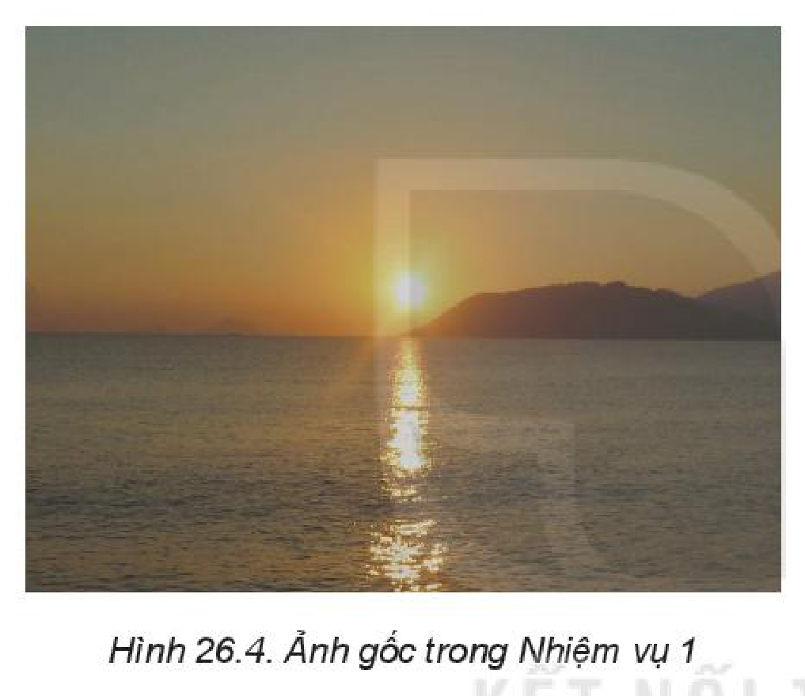

*Hình 26.4. Ảnh gốc trong Nhiệm vụ 1*

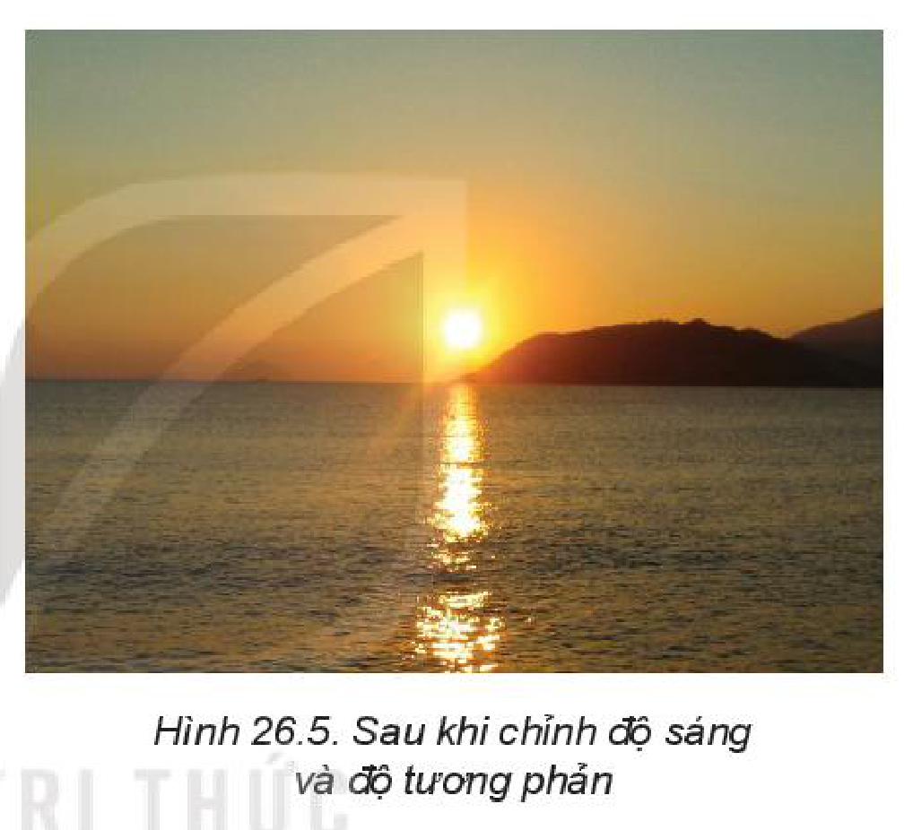

*Hình 26.5. Sau khi chỉnh độ sáng và độ tương phản*

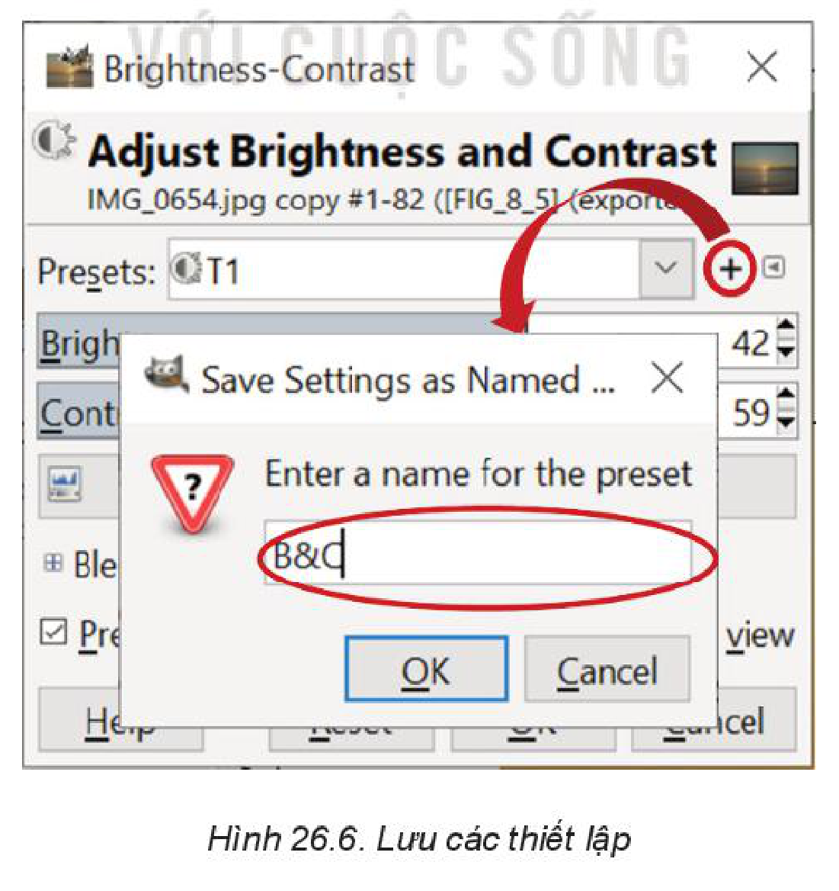

*Hình 26.6. Lưu các thiết lập*

<!-- pdf:128 -->

*Lưu ý:* Sau khi thiết đặt giá trị độ sáng và độ tương phản, em có thể lưu các thiết đặt này để sử dụng lần sau bằng cách nhấn vào nút **+** bên phải ô **Presets**. Hộp thoại xuất hiện để đặt tên cho cách thiết đặt này và nháy nút **OK** để lưu lại (Hình 26.6). Lần sau muốn sử dụng các tham số như thiết đặt này chỉ cần chọn tên đã nhập ở ô **Presets**.

*Bước 3.* Chọn **Colors** → **Color Balance**.

*Bước 4.* Trên hộp thoại **Color Balance**, lần lượt chọn từng dải màu và thay đổi giá trị trong các ô phía dưới cho đến khi ảnh có màu sắc ưng ý. Trong Hình 26.7 ảnh được sửa màu trong dải màu trung bình, giá trị các ô **Red**, **Green**, **Blue** lần lượt là 3, –11 và 10. Các thiết lập này cũng có thể lưu lại để sử dụng sau này như với công cụ **Brightness-Contrast**.

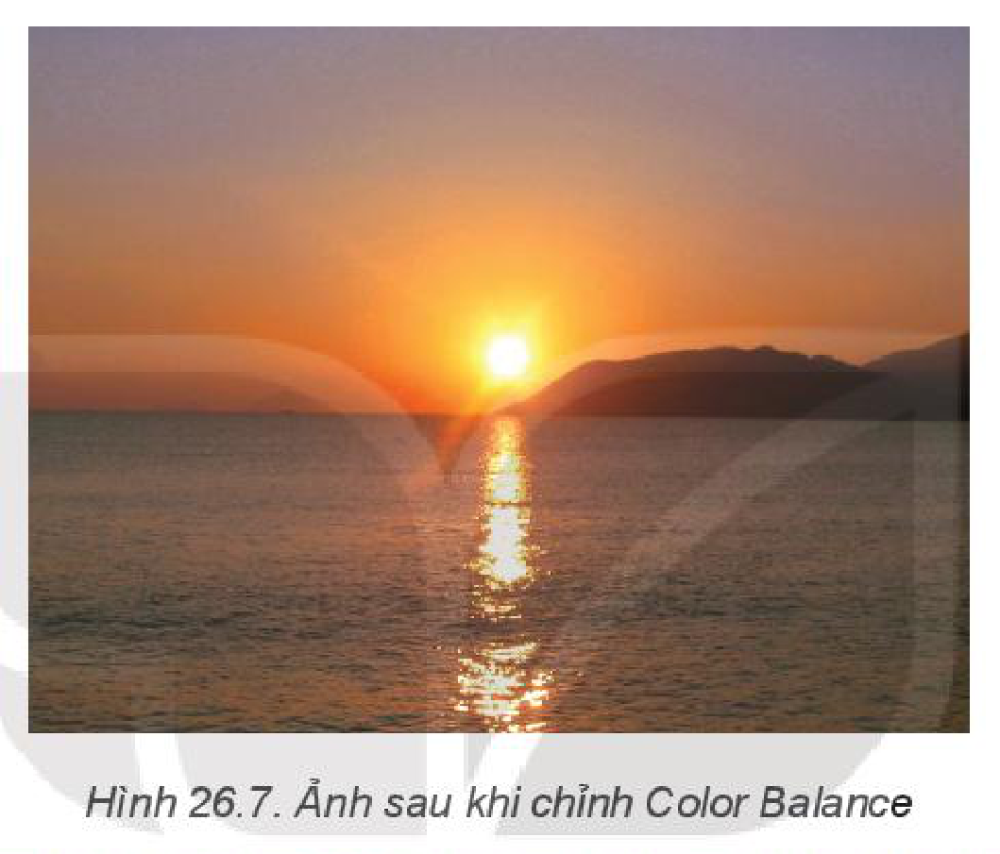

*Hình 26.7. Ảnh sau khi chỉnh Color Balance*

### Nhiệm vụ 2. Thực hành tạo vùng chọn và thực hiện các lệnh chỉnh độ sắc nét và cân bằng màu cho vùng đã chọn cho ảnh trong Hoạt động 1

Hướng dẫn:

Ảnh gốc được chụp khá tối, cần được chỉnh sáng cho toàn bộ ảnh. Ảnh có các vùng với màu sắc chủ đạo khác nhau rõ ràng, do vậy nên tạo các vùng chọn và chỉnh sửa màu sắc trên từng vùng thay vì chỉnh màu chung cho cả ảnh.

*Bước 1.* Chọn công cụ **Brightness-Contrast** để tăng độ sáng và độ tương phản (Hình 26.8).

*Bước 2.* Chọn công cụ **Rectangle Select Tool** (trên hộp công cụ hoặc nhấn phím **R**) rồi tạo vùng chọn chứa hoa thược dược.

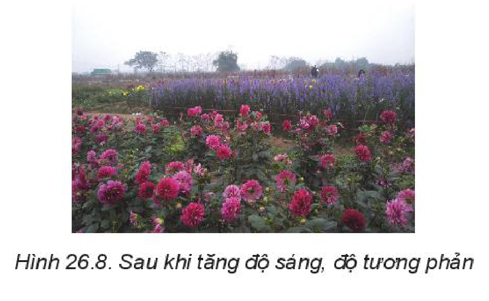

*Hình 26.8. Sau khi tăng độ sáng, độ tương phản*

<!-- pdf:129 -->

*Bước 3.* Chọn **Colors** → **Hue-Saturation**, chỉnh các thành phần màu cho đến khi phù hợp. Trong Hình 26.9, giá trị **Lightness** và **Saturation** của màu **Green** là 16.

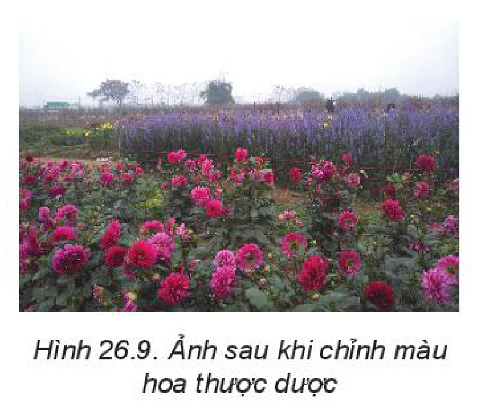

*Hình 26.9. Ảnh sau khi chỉnh màu hoa thược dược*

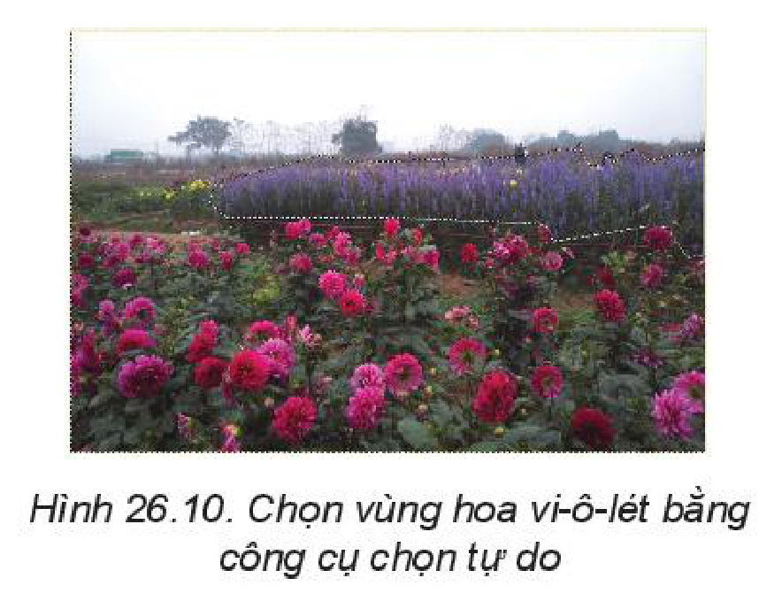

*Hình 26.10. Chọn vùng hoa vi-ô-lét bằng công cụ chọn tự do*

*Bước 4.* Chọn công cụ **Free Select Tools** trên hộp công cụ, sau đó nháy chuột để tạo vùng chọn chứa vùng hoa vi-ô-let (Hình 26.10).

*Bước 5.* Chọn **Colors** → **Color Balance**, điều chỉnh dải **Midtones** của màu **Blue** để phần hoa đậm hơn rồi nháy chuột vào nút **OK** để thay đổi màu sắc trên ảnh (Hình 26.11).

Ngoài cách sử dụng **Color Balance**, em có thể sử dụng công cụ **Hue-Saturation**, **Levels**,... để thay đổi màu sắc. Trong trường hợp này, ta muốn thành phần màu xanh lam của các điểm ảnh tăng lên nên khi sửa đều sửa trên kênh **Blue**.

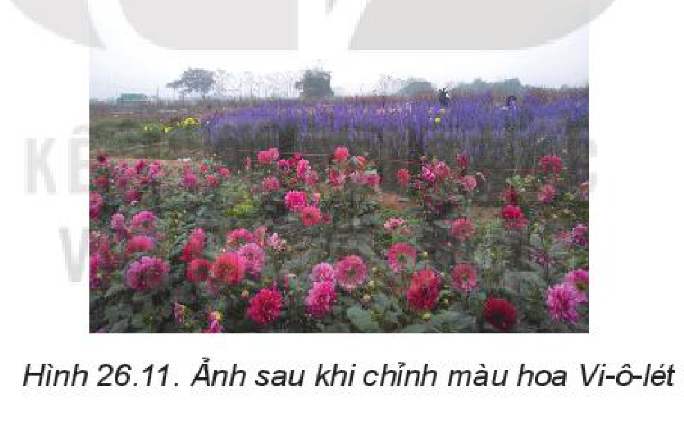

*Hình 26.11. Ảnh sau khi chỉnh màu hoa Vi-ô-lét*

## ✏️ Luyện tập

1. Em hãy thực hiện thay đổi các giá trị điều khiển của mỗi công cụ trong bài và ghi lại tác động của các tham số đó.
2. Thực hiện chỉnh ảnh chụp quả táo để có kết quả là trái táo như Hình 26.3b trong Hoạt động 3.

## 🚀 Vận dụng

Chọn một bức ảnh phong cảnh em đã chụp trong điều kiện ánh sáng kém. Thực hiện các chỉnh sửa cần thiết để bức ảnh đẹp và sống động hơn.

## 📷 Danh sách hình trong bài

| Mã hình | Trang PDF | Vị trí trong bài | Chú thích gốc |
| --- | --- | --- | --- |
| H11-tin_hoc_thud-b26-01 | 124 | Mục 1, Hoạt động 1 | Hình 26.1. Vườn hoa Tết |
| H11-tin_hoc_thud-b26-02 | 125 | Mục 1.c | Hình 26.2. Một số công cụ phổ biến trong bảng Colors |
| H11-tin_hoc_thud-b26-03 | 126 | Mục 2, Hoạt động 2 | Hình 26.3. Trái táo |
| H11-tin_hoc_thud-b26-04 | 127 | Mục 3, Nhiệm vụ 1 | Hình 26.4. Ảnh gốc trong Nhiệm vụ 1 |
| H11-tin_hoc_thud-b26-05 | 127 | Mục 3, Nhiệm vụ 1 | Hình 26.5. Sau khi chỉnh độ sáng và độ tương phản |
| H11-tin_hoc_thud-b26-06 | 127 | Mục 3, Nhiệm vụ 1 | Hình 26.6. Lưu các thiết lập |
| H11-tin_hoc_thud-b26-07 | 128 | Mục 3, Nhiệm vụ 1 | Hình 26.7. Ảnh sau khi chỉnh Color Balance |
| H11-tin_hoc_thud-b26-08 | 128 | Mục 3, Nhiệm vụ 2 | Hình 26.8. Sau khi tăng độ sáng, độ tương phản |
| H11-tin_hoc_thud-b26-09 | 129 | Mục 3, Nhiệm vụ 2 | Hình 26.9. Ảnh sau khi chỉnh màu hoa thược dược |
| H11-tin_hoc_thud-b26-10 | 129 | Mục 3, Nhiệm vụ 2 | Hình 26.10. Chọn vùng hoa vi-ô-lét bằng công cụ chọn tự do |
| H11-tin_hoc_thud-b26-11 | 129 | Mục 3, Nhiệm vụ 2 | Hình 26.11. Ảnh sau khi chỉnh màu hoa Vi-ô-lét |
