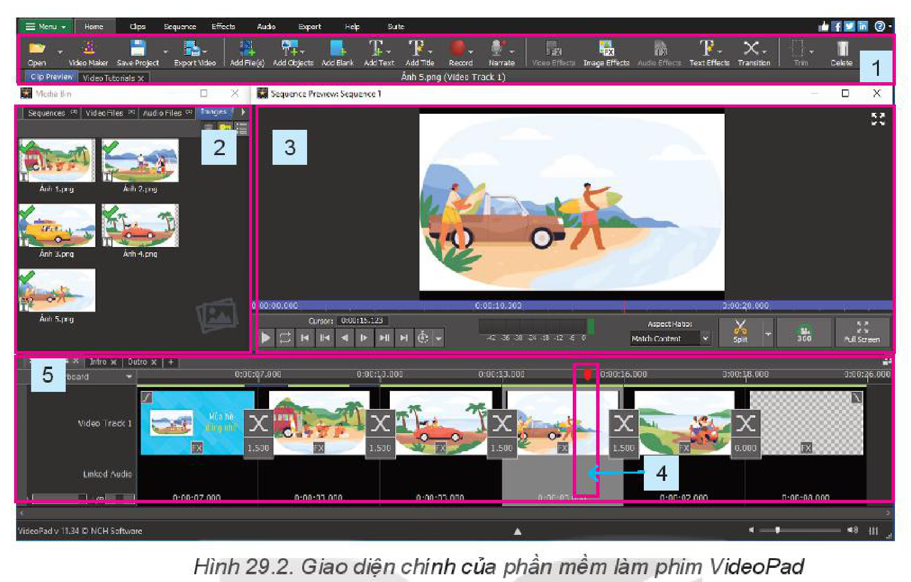
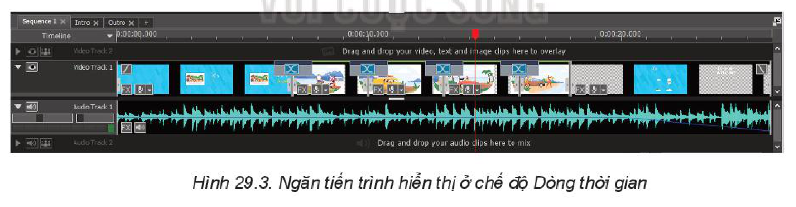
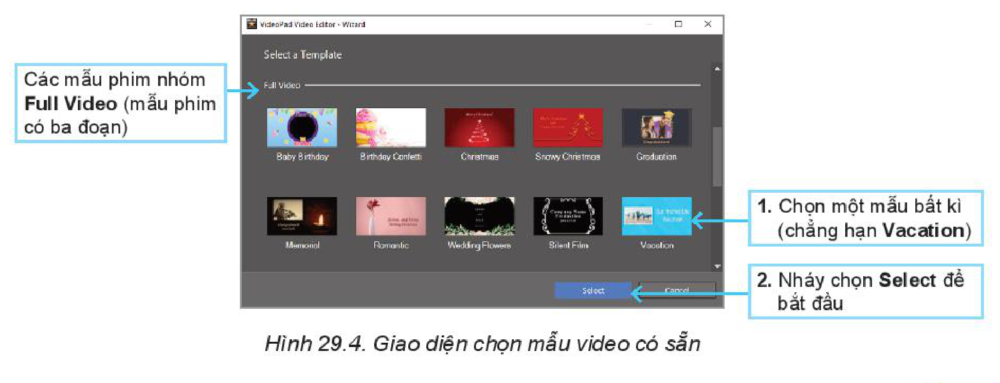
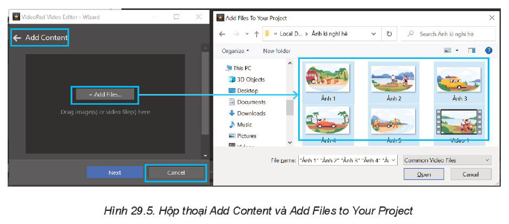
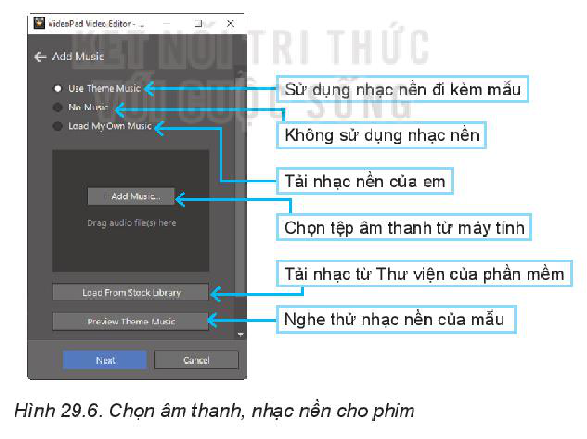
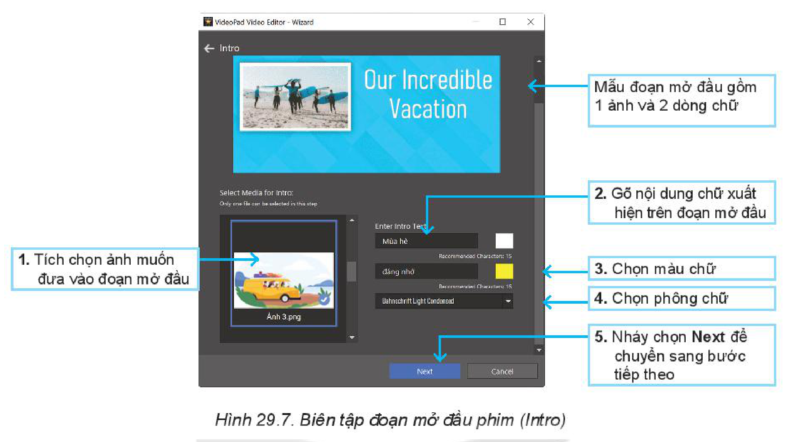
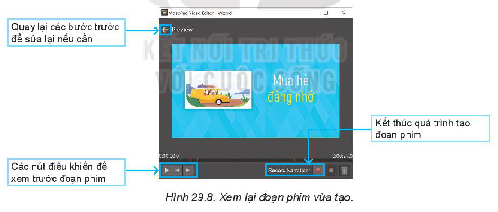
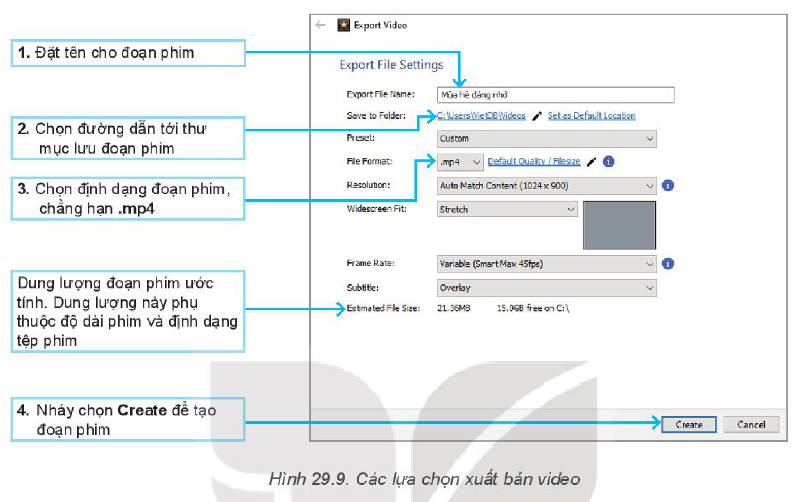

<!-- pdf:139 -->

# BÀI 29: KHÁM PHÁ PHẦN MỀM LÀM PHIM

## 🎯 Sau bài học này em sẽ:

- Tạo được các đoạn phim, nhập tư liệu từ ảnh và video có sẵn, biên tập được đoạn phim phục vụ học tập và giải trí.

## 🔴 Khởi động

> Bạn Nam làm một đoạn phim để kể lại những điều thú vị diễn ra trong kì nghỉ hè của mình. Tư liệu được sử dụng trong phim là các ảnh, video mà Nam đã chụp và quay trong kì nghỉ ấy. Em có mong muốn làm được một đoạn phim như vậy không?

*Hình 29.1. Hình ảnh một vài cảnh trong đoạn phim của Nam*

## 1. KHÁM PHÁ PHẦN MỀM LÀM PHIM

Ngày nay, việc tạo các đoạn phim cho các mục đích khác nhau không chỉ là nhu cầu của các tổ chức, doanh nghiệp, mà đang dần trở thành nhu cầu khá phổ biến của mỗi cá nhân. Nếu như trước đây, ta chỉ biết đến các sản phẩm do các nhà làm phim chuyên nghiệp làm ra, thì ngày nay, có thể dễ dàng tìm thấy rất nhiều các đoạn phim được tạo ra bởi các cá nhân, đăng tải trên mạng Internet với nhiều thể loại nội dung, mục đích phong phú, hình thức cũng rất hấp dẫn và chuyên nghiệp.

Để đáp ứng nhu cầu của người dùng, nhiều hãng phần mềm đã cho ra đời các ứng dụng làm phim với những tính năng hiện đại, hữu ích. Chỉ cần vào Internet, gõ từ khoá tìm kiếm, chẳng hạn “phần mềm làm phim”, ta có thể nhận về hàng ngàn gợi ý. Mỗi **phần mềm làm phim** đều có những ưu điểm riêng, tuy nhiên, hầu hết chúng đều cung cấp một số tính năng cơ bản như cho phép tạo ra các phân cảnh phim từ các tư liệu đầu vào như ảnh hay video clip, mỗi phân cảnh được thiết đặt thời lượng xuất hiện trên phim, thiết lập hiệu ứng chuyển cảnh, ghép âm thanh làm nhạc nền, lồng tiếng hay phụ đề,... để tạo thành một đoạn phim hoàn chỉnh.

Giao diện chung của một phần mềm làm phim thường có bố cục với các thành phần chính như Hình 29.2.

1) **Thanh công cụ**: chứa các nút lệnh để thiết lập các tính năng hay các thao tác chỉnh sửa phim.

2) **Ngăn tư liệu**: chứa các tệp ảnh, tệp video clip, tệp âm thanh,... là đầu tư liệu vào cho phim.

3) **Ngăn xem trước** đoạn phim và các lệnh chỉnh sửa, điều khiển đối tượng đang xem trước.

4) **Con trỏ thời điểm**.

<!-- pdf:140 -->

*Hình 29.2. Giao diện chính của phần mềm làm phim VideoPad*

5) **Ngăn tiến trình**: đây là khu vực giúp theo dõi, quản lí toàn bộ trình tự cũng như các thành phần của phim. Có hai chế độ hiển thị trong ngăn tiến trình:

– Hiển thị theo **Phân cảnh** (**Story board**) (Hình 29.2): Là chế độ hiển thị đơn giản, giúp quan sát trực quan chuỗi các phân cảnh trong phim. Mỗi phân cảnh có thể là một ảnh hoặc một video clip. Con số chỉ thời lượng dưới mỗi phân cảnh thể hiện thời gian xuất hiện trên phim của phân cảnh đó. Nút lệnh giữa các phân cảnh dùng để thiết lập hiệu ứng chuyển cảnh và thời gian diễn ra hiệu ứng.

– Hiển thị theo **Dòng thời gian** (**Timeline**) (Hình 29.3): Là chế độ hiển thị toàn bộ các thành phần của đoạn phim dưới dạng các lớp (**track**) theo đúng trình tự thời gian của phim.

*Hình 29.3. Ngăn tiến trình hiển thị ở chế độ Dòng thời gian*

Mỗi đoạn phim có thể có nhiều lớp khác nhau. Ví dụ đoạn phim trên Hình 29.3 có hai lớp:

– **Video track 1**: **lớp Băng hình** số 1, bao gồm các ảnh và các video clip.

– **Audio track 1**: **lớp Âm thanh** số 1, bao gồm đoạn âm thanh được sử dụng làm nhạc nền cho phim.

Tại mỗi thời điểm, đoạn phim sẽ thể hiện đồng thời các lớp đối tượng này. Chẳng hạn, tại thời điểm con trỏ đang đứng ở Hình 29.3, phim sẽ hiển thị phân cảnh tại Video track 1 và âm thanh nhạc nền ở Audio track 1.

<!-- pdf:141 -->

> - Có thể tạo ra các đoạn phim bằng cách sử dụng phần mềm làm phim.
> - Phần mềm làm phim có các tính năng giúp sắp xếp các tư liệu (ảnh, video clip, âm thanh) theo một trình tự, thời lượng nhất định tạo thành chuỗi các phân cảnh để làm thành một đoạn phim hoàn chỉnh.

> ❓ **Câu hỏi**
>
> Hình 29.2 là giao diện phần mềm làm phim mà Nam sử dụng để thực hiện đoạn phim “Kì nghỉ hè đáng nhớ”. Quan sát và chỉ ra:
>
> a) Các phân cảnh phim ứng với các ảnh trong ngăn Tư liệu.
>
> b) Thời lượng của mỗi phân cảnh.
>
> c) Thời lượng của cả đoạn phim.

## 2. THỰC HÀNH TẠO VÀ BIÊN TẬP MỘT ĐOẠN PHIM TỪ TƯ LIỆU ẢNH VÀ VIDEO CÓ SẴN

Hướng dẫn thực hành sau đây sử dụng phần mềm **VideoPad** của nhà sản xuất NCH Software, phiên bản không thương mại để minh hoạ. Các em có thể tải phần mềm này từ địa chỉ https://www.nchsoftware.com/videopad/index.html và thực hành cá nhân hoặc theo nhóm.

### Nhiệm vụ 1. Chuẩn bị tư liệu và kịch bản phim

Hướng dẫn:

– Chuẩn bị tư liệu đầu vào cho đoạn phim: khoảng 5 ảnh và 1 video clip. Nếu tải từ mạng Internet, cần lưu ý về bản quyền của chúng.

– Xây dựng ý tưởng, kịch bản phim, xác định thứ tự các phân đoạn. Nên đặt tên cho các tư liệu theo thứ tự phân đoạn dự kiến, chẳng hạn Ảnh 1, Ảnh 2,..., Video 1, Video 2,...

### Nhiệm vụ 2. Tạo đoạn phim từ tư liệu đã chuẩn bị

Hướng dẫn:

*Bước 1.* Khởi động phần mềm VideoPad.

*Bước 2.* Chọn lệnh **Video Wizard** tại màn hình khởi động của VideoPad. Đây là tính năng hỗ trợ tạo phim đơn giản và nhanh nhất theo các mẫu có sẵn của phần mềm. Khi hộp thoại **Video Wizard** hiện ra, làm theo hướng dẫn tại Hình 29.4.

*Hình 29.4. Giao diện chọn mẫu video có sẵn*

<!-- pdf:142 -->

*Bước 3.* Tạo video theo mẫu đã chọn.

\* *Bước 3.1. Chọn tư liệu đầu vào tại hộp thoại Add Content (Hình 29.5).*

*Hình 29.5. Hộp thoại Add Content và Add Files to Your Project*

1. Nháy chọn **Add Files**.

2. Hộp thoại **Add Files to Your Project** hiện ra, mở thư mục chứa các tư liệu, chọn các ảnh và video tư liệu rồi chọn **Open**. Các ảnh và video được chọn sẽ được đưa vào hộp thoại **Add Content**. Ở bước này, có thể bổ sung hoặc xoá các tư liệu nếu cần.

3. Tiếp tục chọn **Next** để sang bước tiếp theo.

\* *Bước 3.2. Chọn âm thanh, nhạc nền cho phim.*

Sau bước chọn ảnh và video clip đầu vào là bước chọn âm thanh hoặc nhạc nền cho phim với các lựa chọn như Hình 29.6.

*Hình 29.6. Chọn âm thanh, nhạc nền cho phim*

Ở bài thực hành này, hãy thử lựa chọn “Sử dụng nhạc nền đi kèm mẫu” (**Use theme music**) rồi chọn lệnh **Next** để chuyển sang bước tiếp theo.

\* *Bước 3.3. Biên tập **đoạn phim mở đầu** (**Intro**).*

<!-- pdf:143 -->

*Hình 29.7. Biên tập đoạn mở đầu phim (Intro)*

\* *Bước 3.4. Biên tập **đoạn phim kết thúc** (**Outro**).*

Thực hiện tương tự Bước 3.3.

\* *Bước 3.5. Xem trước đoạn phim vừa tạo.*

Sau khi thực hiện xong các bước trên, phần mềm cho phép ta xem lại đoạn phim vừa tạo (Hình 29.8).

*Hình 29.8. Xem lại đoạn phim vừa tạo.*

*Bước 4.* Nháy chọn **Create** để kết thúc quá trình tạo đoạn phim (Hình 29.8).

*Bước 5.* Lưu lại và xuất bản phim.

– Sau bốn bước trên, phần mềm sẽ hiện ra giao diện như Hình 29.2. Em có thể xem lại đoạn phim của mình ở ngăn xem trước.

<!-- term: Tệp dự án làm phim -->
– Lưu lại dự án làm phim của mình, đặt tên dự án theo cấu trúc `<Tên phim>.<Ngày tạo>.vpj`. Ta sẽ quay lại dự án này để làm cho đoạn phim thêm hấp dẫn ở các tiết học sau.

<!-- pdf:144 -->

– Nháy chọn lệnh **Export Video** trên thanh công cụ (Hình 29.2) để xuất bản phim vừa tạo với các lựa chọn gợi ý như Hình 29.9 dưới đây:

*Hình 29.9. Các lựa chọn xuất bản video*

Chúc mừng em đã hoàn thành đoạn phim đầu tiên của của mình.

## ✏️ Luyện tập

Mở tệp dự án phim em vừa tạo được bằng phần mềm **VideoPad**. Tại ngăn **Tư liệu**, lần lượt mở các trang **Sequences**, **Video Files**, **Audio Files**, **Images**, quan sát danh sách tư liệu tại mỗi trang đó, lập bảng nhận xét theo mẫu dưới đây:

| TT | Trang | Lưu trữ tư liệu gồm |
| --- | --- | --- |
| 1 | Sequences | 3 chuỗi phân cảnh chính: (1) Đoạn phim mở đầu; (2) Đoạn phim chính; (3) Đoạn phim kết thúc. |
| 2 | Video Files | ... |
| 3 | Audio Files | ... |
| 4 | Images | ... |

## 🚀 Vận dụng

Tạo mới một đoạn phim với tư liệu đầu vào là các ảnh và video khác, hoặc với tệp nhạc nền khác theo ý thích của em.

## 📷 Danh sách hình trong bài

| Mã hình | Trang PDF | Vị trí trong bài | Chú thích gốc |
| --- | --- | --- | --- |
| H11-tin_hoc_thud-b29-01 | 139 | Khởi động | Hình 29.1. Hình ảnh một vài cảnh trong đoạn phim của Nam |
| H11-tin_hoc_thud-b29-02 | 140 | Mục 1 | Hình 29.2. Giao diện chính của phần mềm làm phim VideoPad |
| H11-tin_hoc_thud-b29-03 | 140 | Mục 1 | Hình 29.3. Ngăn tiến trình hiển thị ở chế độ Dòng thời gian |
| H11-tin_hoc_thud-b29-04 | 141 | Mục 2, Nhiệm vụ 2 | Hình 29.4. Giao diện chọn mẫu video có sẵn |
| H11-tin_hoc_thud-b29-05 | 142 | Mục 2, Nhiệm vụ 2 | Hình 29.5. Hộp thoại Add Content và Add Files to Your Project |
| H11-tin_hoc_thud-b29-06 | 142 | Mục 2, Nhiệm vụ 2 | Hình 29.6. Chọn âm thanh, nhạc nền cho phim |
| H11-tin_hoc_thud-b29-07 | 143 | Mục 2, Nhiệm vụ 2 | Hình 29.7. Biên tập đoạn mở đầu phim (Intro) |
| H11-tin_hoc_thud-b29-08 | 143 | Mục 2, Nhiệm vụ 2 | Hình 29.8. Xem lại đoạn phim vừa tạo. |
| H11-tin_hoc_thud-b29-09 | 144 | Mục 2, Nhiệm vụ 2 | Hình 29.9. Các lựa chọn xuất bản video |
