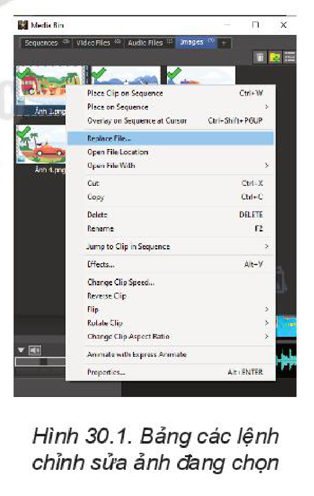
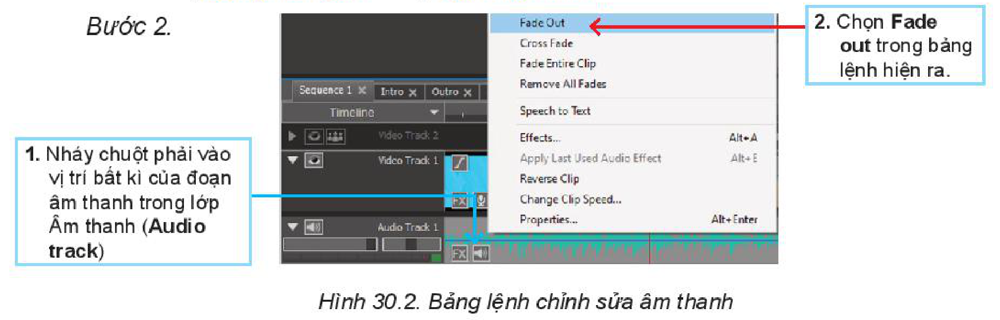
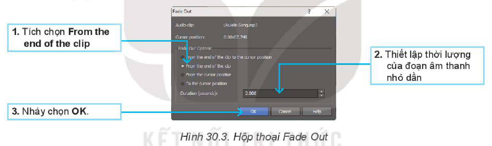
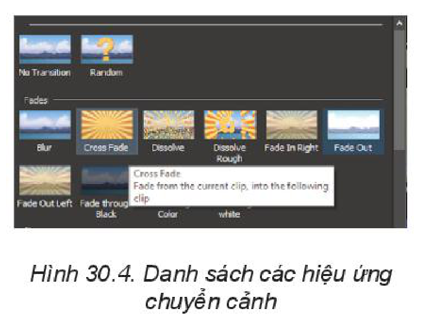
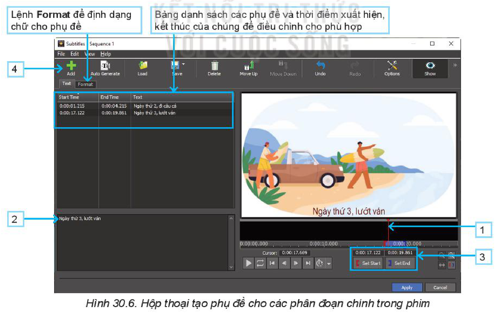
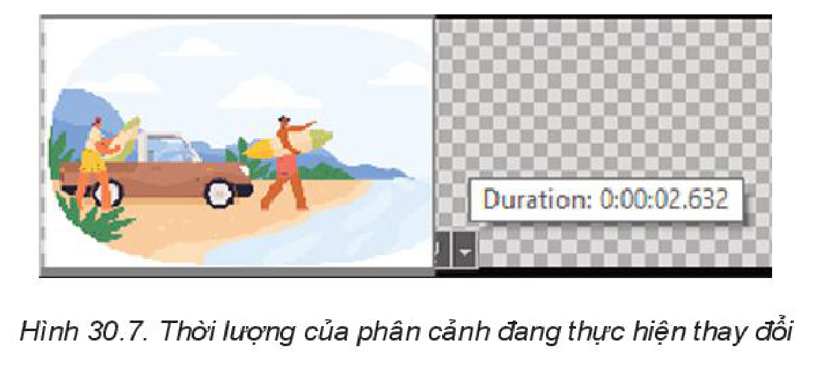

<!-- pdf:145 -->

# BÀI 30: BIÊN TẬP PHIM

## 🎯 Sau bài học này em sẽ:

- Sử dụng được một số công cụ cơ bản biên tập phim: chỉnh sửa hình ảnh, âm thanh, tạo phụ đề, tạo các hiệu ứng chuyển cảnh, căn chỉnh thời gian.

## 🔴 Khởi động

> Hãy cho biết cảm nghĩ của em sau tiết thực hành ở Bài 29? Em có hài lòng về đoạn phim mình tạo được không? Em có mong muốn tìm hiểu thêm các công cụ để chỉnh sửa cho đoạn phim đó trở nên hấp dẫn hơn không?

## 1. BIÊN TẬP PHIM

Để có được những đoạn phim chuyên nghiệp, người dùng có thể sử dụng các công cụ, tính năng biên tập của phần mềm làm phim như sau:

### a) Chỉnh sửa hình ảnh

<!-- term: Chỉnh sửa hình ảnh trong biên tập phim -->
Chỉnh sửa các hình ảnh hay video clip tại các phân đoạn của phim với các thao tác thường dùng bao gồm: bổ sung, thay thế hoặc xoá; căn chỉnh hướng, góc quay; tạo hiệu ứng cho ảnh hoặc video clip. Các thao tác chỉnh sửa này có thể thực hiện bởi các lệnh trong ngăn Tư liệu. Các lệnh này sẽ hiện ra khi ta nháy nút phải chuột vào một tư liệu bất kì như ảnh hoặc video (Hình 30.1).

### b) Chỉnh sửa âm thanh

<!-- term: Chỉnh sửa âm thanh trong biên tập phim -->
Bên cạnh các tư liệu ảnh hay video clip, âm thanh cũng là một trong những yếu tố góp phần làm nên thành công của đoạn phim. Phần mềm làm phim cho phép đưa các tệp âm thanh vào đoạn phim, ghép nối, thay đổi độ dài, âm lượng và các chỉnh sửa khác (Hình 30.2).

### c) Tạo các hiệu ứng chuyển cảnh

Với đoạn phim được tạo ra từ chuỗi các phân cảnh là các tư liệu ảnh hay video đầu vào, việc sử dụng **hiệu ứng chuyển cảnh** giúp cho đoạn phim mượt mà, hấp dẫn hơn. Vì vậy, tính năng này cũng được các phần mềm làm phim không ngừng sáng tạo và cải tiến (Hình 30.4).

### d) Căn chỉnh thời gian

<!-- term: Căn chỉnh thời gian trong biên tập phim -->
Một trong những yếu tố quan trọng của một đoạn phim là thời lượng của từng phân cảnh. Như ta đã biết, một đoạn phim có thể chứa nhiều lớp băng hình, lớp âm thanh, lớp chữ hay phụ đề khác nhau, việc căn chỉnh thời gian xuất hiện giữa phân cảnh trên các lớp này cần được thực hiện sao cho khớp với kịch bản mà ta mong muốn. Những thao tác này được hỗ trợ thực hiện tại ngăn tiến trình của phần mềm làm phim.

### e) Tạo phụ đề

<!-- term: Tạo phụ đề cho phim -->
Tạo phụ đề cho phim cũng là một trong những yếu tố giúp cho đoạn phim trở nên chuyên nghiệp, góp phần truyền tải thông tin tốt hơn. Do đó, tính năng tạo, chỉnh sửa, định dạng phụ đề cho phim cũng được một số phần mềm cung cấp và tương đối dễ sử dụng.

<!-- pdf:146 -->

> Để đoạn phim trở nên chuyên nghiệp và hấp dẫn, phần mềm làm phim cung cấp các công cụ chỉnh sửa cơ bản như chỉnh sửa hình ảnh, âm thanh, tạo các hiệu ứng chuyển cảnh, căn chỉnh thời gian và tạo phụ đề.

> ❓ **Câu hỏi**
>
> Chỉ ra các công cụ cần thiết để thực hiện được một phân cảnh phim với yêu cầu như sau: Tại giây thứ 10 của phim, video clip số 1 sẽ hiện ra, từ giây thứ 12 đến 18, dòng chữ “Video clip này được thực hiện tại Nha Trang, ngày 20/6/2021” hiện ra.
>
> (1) Công cụ chỉnh sửa âm thanh.
>
> (2) Công cụ tạo phụ đề.
>
> (3) Công cụ căn chỉnh thời gian.
>
> A. Cả ba công cụ trên. B. (1) và (2). C. (2) và (3). D. (1) và (3).

## 2. THỰC HÀNH

**Nhiệm vụ chung. Biên tập đoạn phim đã thực hiện ở phần thực hành Bài 30**

Hướng dẫn:

*Bước 1.* Khởi động phần mềm VideoPad.

*Bước 2.* Mở dự án phim đã thực hiện ở phần thực hành Bài 29.

*Bước 3.* Lưu dự án với tên mới `<Tên phim>.<Ngày tạo>.vpj`.

### Nhiệm vụ 1. Chỉnh sửa ảnh

Thay thế một ảnh trong phim bằng ảnh mới, chẳng hạn ảnh cần thay thế là ảnh số 5.

Hướng dẫn:

*Bước 1.* Nháy chuột phải vào ảnh 5 tại trang **Images** của ngăn Tư liệu. Khi bảng lệnh hiện ra (Hình 30.1), chọn lệnh **Replace file...**.

*Bước 2.* Chọn đường dẫn tới tệp ảnh mới sẽ dùng để thay thế cho ảnh 5.

Sau bước này, ảnh mới sẽ được đưa vào ngăn tư liệu, thay thế cho ảnh 5 cũ. Khi đó, phân cảnh sử dụng ảnh 5 cũ trong đoạn phim cũng sẽ thay đổi theo.

*Bước 3.* Chọn nút **Play** trong ngăn xem trước để kiểm tra kết quả thay thế ảnh vừa thực hiện.

*Lưu ý:* Cũng trong ngăn tiến trình này, em có thể thay đổi vị trí các phân cảnh bằng cách kéo thả. Hãy thử thực hành để khám phá tính năng này cũng như các tính năng chỉnh sửa ảnh khác trong bảng lệnh tại Hình 30.1.

*Hình 30.1. Bảng các lệnh chỉnh sửa ảnh đang chọn*

### Nhiệm vụ 2. Chỉnh sửa âm thanh

Tạo hiệu ứng nhỏ dần cho nhạc nền của đoạn phim. Hãy nghe lại nhạc nền trong đoạn phim của em, so sánh với đoạn phim của bạn Nam có nhạc nền nhỏ dần lại ở phía cuối phim trước khi kết thúc. Theo em, việc điều chỉnh âm lượng này có cần thiết không? Vì sao?

<!-- pdf:147 -->

Hướng dẫn:

Việc điều chỉnh âm lượng của âm thanh cần thực hiện tại ngăn tiến trình, ở chế độ hiển thị theo Dòng thời gian (Timeline).

*Bước 1.* Tại ngăn tiến trình, nháy chuột vào hộp chọn **Storyboard**, trong bảng chọn hiện ra, nháy chọn **Timeline** để mở chế độ Dòng thời gian trong ngăn tiến trình.

*Bước 2.*

1. Nháy chuột phải vào vị trí bất kì của đoạn âm thanh trong lớp Âm thanh (**Audio track**)

2. Chọn **Fade out** trong bảng lệnh hiện ra.

*Hình 30.2. Bảng lệnh chỉnh sửa âm thanh*

*Bước 3.* Hộp thoại **Fade Out** hiện ra, cho phép thiết lập các thông số để điều chỉnh âm lượng nhỏ dần về cuối phim.

*Hình 30.3. Hộp thoại Fade Out*

Quan sát hình ảnh minh hoạ đoạn âm thanh trên lớp **Audio track 1**, ta sẽ thấy, ở vị trí 2 giây cuối cùng, đường kẻ giữa màu xanh (biểu thị âm lượng) có chiều đi xuống (Hình 30.3). Điều đó có nghĩa là, trong vòng 2 giây cuối, âm lượng nhạc nền sẽ nhỏ dần cho đến hết đoạn phim.

### Nhiệm vụ 3. Tạo hiệu ứng chuyển cảnh

Hướng dẫn:

*Bước 1.* Mở chế độ hiển thị **Story Board** trên ngăn tiến trình.

*Bước 2.* Nháy chọn lệnh tại phân cảnh muốn thực hiện hiệu ứng chuyển cảnh.

*Bước 3.* Trong danh sách các hiệu ứng mở ra (Hình 30.4), chọn một hiệu ứng bất kì.

*Bước 4.* Xem đoạn phim ở ngăn xem trước để theo dõi hiệu ứng chuyển cảnh vừa thiết lập. Có thể thực hiện lại Bước 3 để đổi sang hiệu ứng khác nếu muốn.

*Hình 30.4. Danh sách các hiệu ứng chuyển cảnh*

<!-- pdf:148 -->

### Nhiệm vụ 4. Căn chỉnh thời gian các phân cảnh trong phim

Hướng dẫn:

Trong đoạn phim của em, phần mềm đã mặc định sẵn thời lượng của mỗi phân cảnh, con số này thể hiện trong ngăn tiến trình ở chế độ **Storyboad**. Để thay đổi thời lượng, em thực hiện như sau:

*Bước 1.* Bật chế độ hiển thị dạng **Story board** cho ngăn tiến trình.

*Bước 2.* Nháy chọn phân cảnh cần căn chỉnh thời gian, giả sử phân cảnh 2. Phân cảnh này sẽ được hiện ra ở ngăn xem trước.

*Bước 3.* Gõ vào thời lượng mong muốn tại ô **Duration** trong dãy lệnh ở ngăn xem trước (Hình 30.2) rồi nhấn phím **Enter**.

*Bước 4.* Xem lại đoạn phim để theo dõi sự thay đổi thời lượng phân cảnh vừa điều chỉnh. Có thể quay lại Bước 3 để chỉnh lại thời lượng nếu cần.

Thực hiện tương tự với các phân cảnh khác để đoạn phim có thời lượng như em mong muốn.

### Nhiệm vụ 5. Tạo phụ đề để chú thích cho các ảnh trong đoạn phim

Hướng dẫn:

*Bước 1.* Mở hộp thoại tạo phụ đề bằng cách: trên dải lệnh, chọn lệnh **Sequence**, tiếp theo chọn lệnh **Subtitles**.

*Hình 30.5. Thanh công cụ Sequence*

*Bước 2.* Khi hộp thoại **Subtitles** hiện ra, lần lượt thực hiện theo các chỉ dẫn trong Hình 30.6.

*Hình 30.6. Hộp thoại tạo phụ đề cho các phân đoạn chính trong phim*

<!-- pdf:149 -->

1. Đặt con trỏ vào vị trí chỉ thời điểm bắt đầu có phụ đề.
2. Gõ nội dung phụ đề.
3. Căn chỉnh lại thời gian cho từng phụ đề để khớp với phân cảnh.
4. Chọn **Add** để bổ sung phụ đề.

Sau khi đã tạo xong các phụ đề khớp với các phân cảnh, chọn **Apply** để đóng hộp thoại và lưu lại các phụ đề vừa tạo.

*Bước 3.* Xem lại toàn bộ đoạn phim để kiểm tra. Thực hiện lại các bước trên để điều chỉnh nếu cần.

## ✏️ Luyện tập

Hoàn thiện đoạn phim em đã thực hiện ở tiết thực hành với các yêu cầu sau:

a) Số lượng tư liệu đầu vào phù hợp với kịch bản của em.

b) Phim có hiệu ứng chuyển cảnh và thời lượng phù hợp với phụ đề để người xem dễ dàng theo dõi đủ cả kênh hình lẫn kênh chữ.

c) Âm thanh, nhạc nền hay, hấp dẫn, phù hợp với nội dung đoạn phim.

## 🚀 Vận dụng

Khám phá và thực hiện các thao tác sau để đoạn phim của em hấp dẫn hơn:

a) Bổ sung thêm ảnh hoặc video clip.

b) Thay thế nhạc nền bằng bài hát em yêu thích, lưu ý chỉnh sửa để có âm lượng phù hợp và thời lượng bài hát khớp với thời lượng phim.

c) Căn chỉnh thời lượng của mỗi phân cảnh trong chế độ ***Dòng thời gian***, thay vì ở chế độ ***băng hình*** như đã thực hiện ở nhiệm vụ 4, bằng cách thay đổi độ rộng của các phân cảnh như sau:

Đưa trỏ chuột vào vị trí cuối của một phân cảnh, cho tới khi con trỏ chuột có hình mũi tên hai chiều thì kéo thả chuột sang trái để giảm thời lượng hoặc sang phải để tăng thời lượng, cho tới khi đạt được thời lượng mong muốn thì thả tay.

Trong quá trình kéo, có thể quan sát sự thay đổi thời lượng của phân cảnh tại ô **Duration** xuất hiện ngay bên phải con trỏ chuột (Hình 30.7).

*Hình 30.7. Thời lượng của phân cảnh đang thực hiện thay đổi*

## 📷 Danh sách hình trong bài

| Mã hình | Trang PDF | Vị trí trong bài | Chú thích gốc |
| --- | --- | --- | --- |
| H11-tin_hoc_thud-b30-01 | 146 | Mục 2, Nhiệm vụ 1 | Hình 30.1. Bảng các lệnh chỉnh sửa ảnh đang chọn |
| H11-tin_hoc_thud-b30-02 | 147 | Mục 2, Nhiệm vụ 2 | Hình 30.2. Bảng lệnh chỉnh sửa âm thanh |
| H11-tin_hoc_thud-b30-03 | 147 | Mục 2, Nhiệm vụ 2 | Hình 30.3. Hộp thoại Fade Out |
| H11-tin_hoc_thud-b30-04 | 147 | Mục 2, Nhiệm vụ 3 | Hình 30.4. Danh sách các hiệu ứng chuyển cảnh |
| H11-tin_hoc_thud-b30-05 | 148 | Mục 2, Nhiệm vụ 5 | Hình 30.5. Thanh công cụ Sequence |
| H11-tin_hoc_thud-b30-06 | 148 | Mục 2, Nhiệm vụ 5 | Hình 30.6. Hộp thoại tạo phụ đề cho các phân đoạn chính trong phim |
| H11-tin_hoc_thud-b30-07 | 149 | Vận dụng | Hình 30.7. Thời lượng của phân cảnh đang thực hiện thay đổi |
