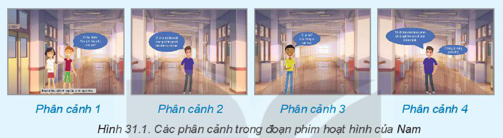
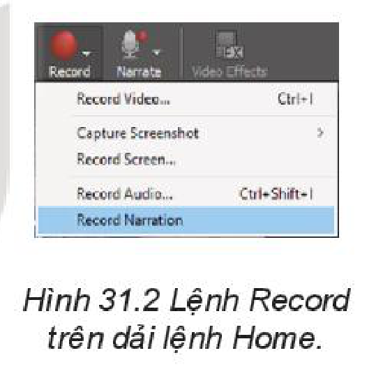
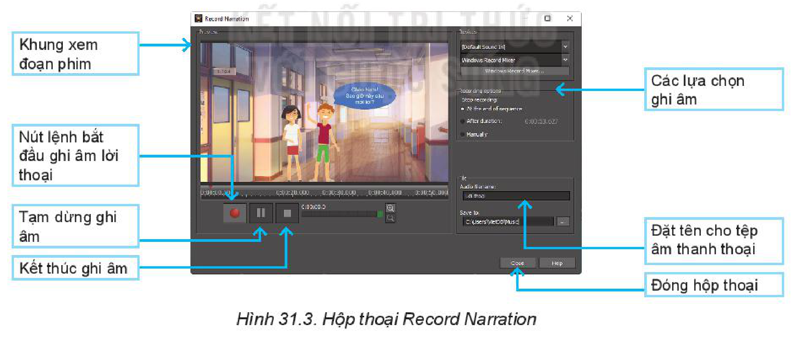
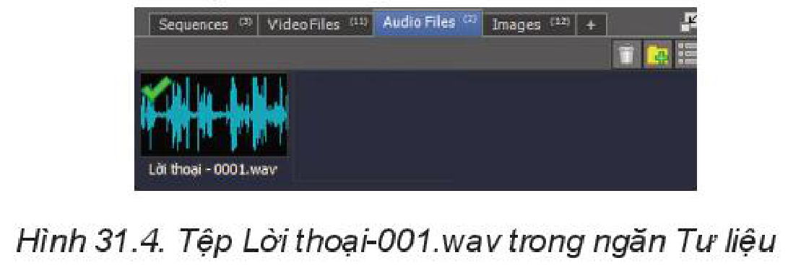
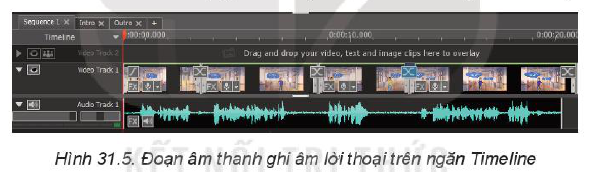

<!-- pdf:150 -->

# BÀI 31: THỰC HÀNH TẠO PHIM HOẠT HÌNH

## 🎯 Sau bài học này em sẽ:

- Tạo được đoạn phim hoạt hình từ ảnh, có hội thoại giữa các nhân vật và có phụ đề.

## 🔴 Khởi động

> Để tăng thêm tính hấp dẫn của đoạn phim Mùa hè đáng nhớ, Nam đã bổ sung một đoạn phim hoạt hình vào đầu đoạn phim đó như Hình 31.1.

*Hình 31.1. Các phân cảnh trong đoạn phim hoạt hình của Nam*

> Làm thế nào để thực hiện được đoạn phim hoạt hình có hội thoại giữa các nhân vật và phụ đề như Hình 31.1?

## Nhiệm vụ 1. Xây dựng kịch bản, chuẩn bị tư liệu

Hướng dẫn:

<!-- term: Kịch bản phim hoạt hình -->
Để tạo được một đoạn phim hoạt hình, em cần xây dựng kịch bản cho đoạn phim đó.

<!-- term: Kịch bản phim hoạt hình -->
Kịch bản phải được xây dựng sao cho khả thi, phù hợp với các tính năng sẵn có của phần mềm làm phim mà em đang sử dụng.

Bảng 31.1 là kịch bản chi tiết cho đoạn phim hoạt hình trong hoạt động Khởi động, cũng sẽ là ví dụ sử dụng để hướng dẫn trong bài thực hành này:

**Bảng 31.1.** *Kịch bản chi tiết của đoạn phim hoạt hình*

| Phân cảnh | Hình ảnh | Lời thoại/Âm thanh | Phụ đề |
| --- | --- | --- | --- |
| 1 | Tú và Lan | Tú: Chào Nam! Sao giờ này cậu mới tới? | Trưa thứ 7, tại hành lang câu lạc bộ ngoại khoá |
| 2 | Nam | Nam: Ừ! Vì tớ mải làm một món quà bất ngờ để đem tới cho các bạn | Không có |
| 3 | ... | ... | ... |

<!-- pdf:151 -->

Em hãy:

1) Suy nghĩ về ý tưởng cho đoạn phim của mình.

2) Xây dựng kịch bản theo bảng như mẫu trên.

3) Chuẩn bị các tư liệu cần thiết theo kịch bản.

> Chủ đề gợi ý: bảo vệ môi trường; nếp sống văn minh; văn hoá ứng xử nơi công cộng; tấm gương đạo đức; ca ngợi tình bạn;...

## Nhiệm vụ 2. Tạo đoạn phim hoạt hình từ các tư liệu theo kịch bản

Hướng dẫn:

– Khởi động phần mềm làm phim **VideoPad**.

– Bằng các kiến thức đã học, em hãy tạo đoạn phim hoạt hình theo đúng kịch bản mà em đã viết ở Nhiệm vụ 1. Trong quá trình thực hiện, có thể chỉnh sửa lại kịch bản cho phù hợp.

*Lưu ý:* Nên sử dụng tính năng **Video Wizard** và chọn một mẫu phim phù hợp trong danh sách các mẫu có sẵn. Căn chỉnh thời lượng và lựa chọn hiệu ứng giữa các phân cảnh cho phù hợp.

## Nhiệm vụ 3. Bổ sung phụ đề và hội thoại

Hướng dẫn:

*Bước 1.* Ghi âm lời hội thoại. Chọn dải lệnh **Home** → chọn lệnh **Record** → chọn lệnh **Record Narration**.

Hộp thoại **Record Narration** sẽ hiện ra với các tính năng như sau:

*Hình 31.2 Lệnh Record trên dải lệnh Home.*

*Hình 31.3. Hộp thoại Record Narration*

– Trước tiên, chọn lựa chọn dừng ghi âm khi kết thúc đoạn phim (At the end of sequence).

– Tiếp theo, gõ tên cho tệp âm thanh này, chẳng hạn “Lời thoại”.

<!-- pdf:152 -->

– Nháy chọn nút để bắt đầu ghi âm lời thoại. Khi đó, vừa quan sát các phân cảnh trong phim trên **Ngăn xem**, vừa đọc lời thoại tương ứng để ghi âm.

*Lưu ý:* Lời hội thoại cần khớp với các phân cảnh trên phim. Do đó, có thể em sẽ cần căn chỉnh lại thời lượng các phân cảnh tại ngăn **Timeline**.

Trong quá trình ghi âm, có thể nháy chọn lệnh tạm dừng, sau đó lại nháy chọn để tiếp tục.

– Sau khi ghi âm xong, nháy chọn lệnh kết thúc. Khi chọn lệnh kết thúc, đoạn ghi âm vừa thực hiện sẽ được lưu lại trong ngăn Tư liệu, với tên ta đã đặt trong hộp thoại **Record Narration** (Hình 31.4).

*Hình 31.4. Tệp Lời thoại-001.wav trong ngăn Tư liệu*

– Chọn lệnh **Close** để đóng Hộp thoại **Record Narration** sau khi kết thúc ghi âm.

Em sẽ thấy trên ngăn **Timeline** sẽ xuất hiện đoạn ghi âm em vừa thực hiện (Hình 31.5). Cũng tại ngăn **Timeline** này, em có thể thay đổi độ rộng các băng hình phân cảnh để căn chỉnh thời lượng của các phân cảnh cho khớp với lời thoại đã ghi âm.

*Hình 31.5. Đoạn âm thanh ghi âm lời thoại trên ngăn Timeline*

– Xem lại đoạn phim tại ngăn **Preview**, kiểm tra, chỉnh sửa cho tới khi các lời thoại đã khớp với các phân cảnh.

*Bước 2.* Bổ sung phụ đề.
<!-- ocr-ok: đã đối chiếu ảnh trang 152, OCR đọc nhầm "Bổ" thành "Bỗ" -->

– Thực hiện bổ sung phụ đề cho đoạn phim theo kịch bản bằng cách đã học.

*Bước 3.* Lưu lại dự án và xuất bản phim hoạt hình.

– Lưu lại dự án và xuất bản phim hoạt hình của em.

## ✏️ Luyện tập

Chia sẻ đoạn phim của em với bạn bè, cùng lắng nghe các ý kiến góp ý và chỉnh sửa nếu cần để đoạn phim hoàn thiện hơn.

## 🚀 Vận dụng

Tạo mới một bộ phim hoàn chỉnh phục vụ học tập hoặc giải trí với thời lượng dưới 3 phút và đáp ứng những yêu cầu sau:

– Về tư liệu: ảnh, video clip, có nhạc nền góp phần làm bộ phim sinh động, hấp dẫn.

– Về kĩ thuật: có hiệu ứng chuyển cảnh phù hợp, có phụ đề, có thuyết minh hoặc hội thoại giữa các nhân vật.

## 📷 Danh sách hình trong bài

| Mã hình | Trang PDF | Vị trí trong bài | Chú thích gốc |
| --- | --- | --- | --- |
| H11-tin_hoc_thud-b31-01 | 150 | Khởi động | Hình 31.1. Các phân cảnh trong đoạn phim hoạt hình của Nam |
| H11-tin_hoc_thud-b31-02 | 151 | Nhiệm vụ 3 | Hình 31.2 Lệnh Record trên dải lệnh Home. |
| H11-tin_hoc_thud-b31-03 | 151 | Nhiệm vụ 3 | Hình 31.3. Hộp thoại Record Narration |
| H11-tin_hoc_thud-b31-04 | 152 | Nhiệm vụ 3 | Hình 31.4. Tệp Lời thoại-001.wav trong ngăn Tư liệu |
| H11-tin_hoc_thud-b31-05 | 152 | Nhiệm vụ 3 | Hình 31.5. Đoạn âm thanh ghi âm lời thoại trên ngăn Timeline |
