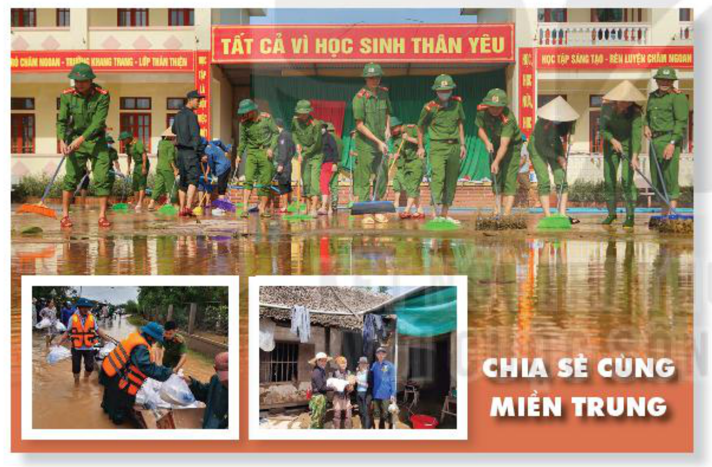
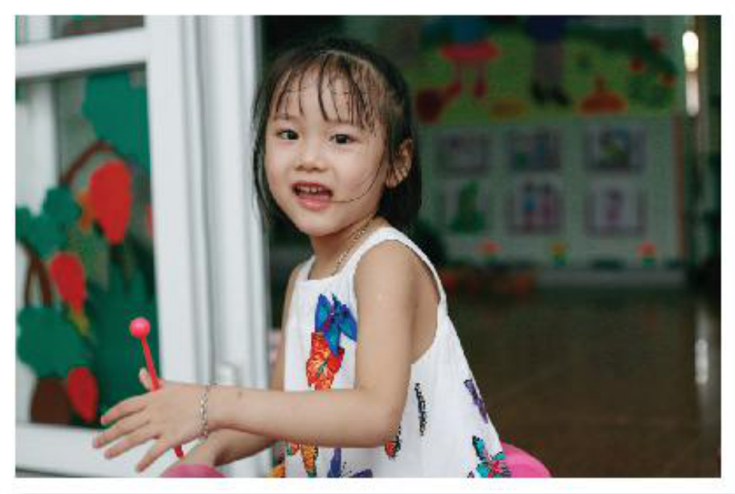
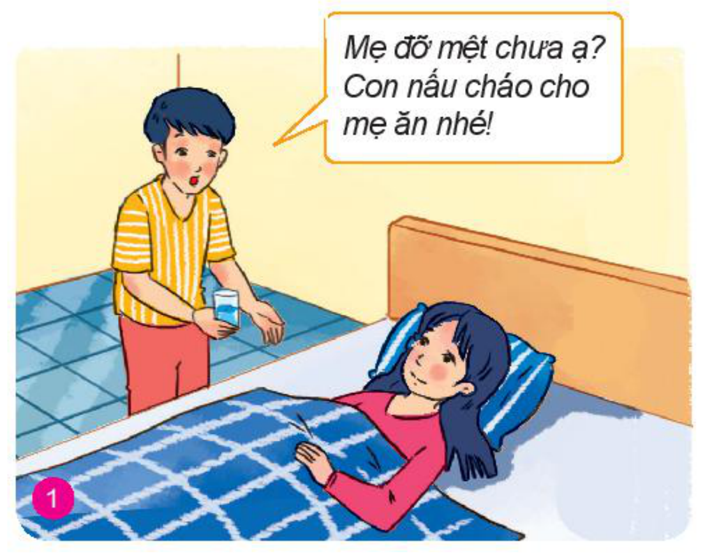
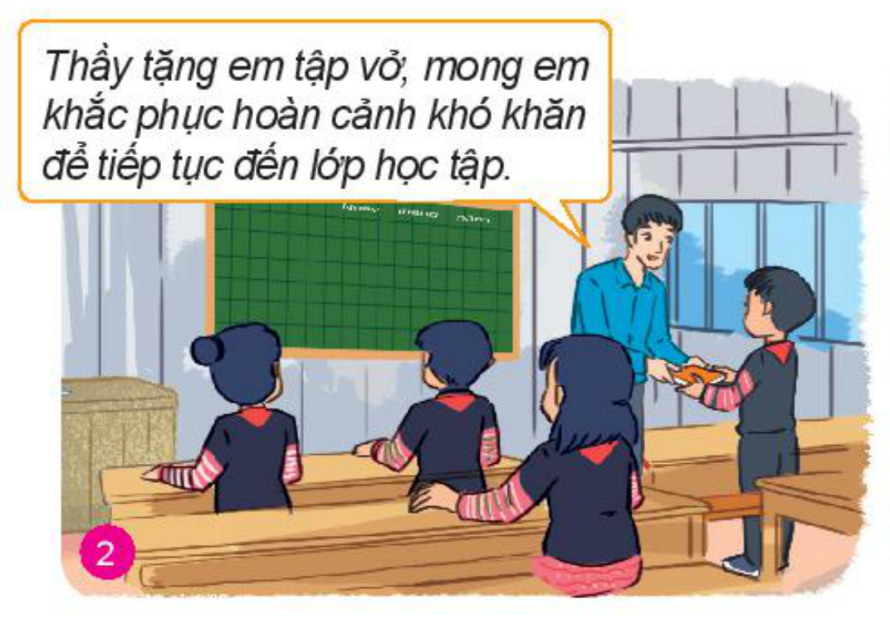
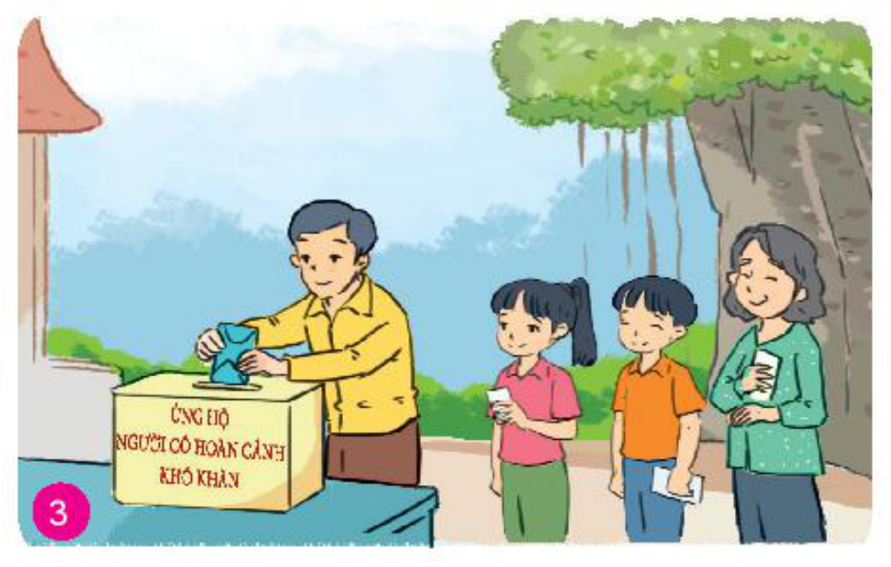

<!-- pdf:10 -->

# BÀI 2: YÊU THƯƠNG CON NGƯỜI

## 🎯 Sau bài học này, học sinh có thể:

- Nêu được khái niệm và biểu hiện của tình yêu thương con người.
- Trình bày được giá trị của tình yêu thương con người.
- Thực hiện được những việc làm thể hiện tình yêu thương con người.
- Đánh giá được thái độ, hành vi thể hiện tình yêu thương của người khác.
- Phê phán những biểu hiện trái với tình yêu thương con người.

## 🔴 Khởi động

Quan sát hình ảnh và trả lời câu hỏi

> ❓
>
> a) Hình ảnh bên gợi cho em nhớ tới sự việc nào xảy ra ở nước ta?
>
> b) Trước sự việc đó, Nhà nước và Nhân dân ta đã có những hành động gì?
>
> c) Em hãy chia sẻ cảm xúc của mình trước những hành động đó.

## KHÁM PHÁ

## 1. Yêu thương con người và biểu hiện của tình yêu thương con người

\* *Thế nào là yêu thương con người?*

Em hãy đọc thông tin dưới đây và trả lời câu hỏi

> Bé Nguyễn Hải An, 7 tuổi bị căn bệnh u thần kinh đệm cầu não lan toả – một căn bệnh hiện tại chưa có phương pháp điều trị tối ưu. Sau một thời gian điều trị tại bệnh viện nhưng không qua khỏi, thực hiện ước nguyện của bé khi còn sống, mẹ bé và gia đình đã quyết định hiến tặng giác mạc của bé. Hai giác mạc của Hải An sau đó đã được ghép cho một cụ bà 73 tuổi và một người đàn ông 42 tuổi.

<!-- pdf:11 -->

> Việc mẹ bé và gia đình đã cố gắng vượt qua nỗi đau, quyết định hiến tặng giác mạc để trao ánh sáng cho người khác với mục đích cứu người, làm việc thiện đã viết nên câu chuyện đẹp về lòng nhân ái, biết sống vì người khác, đem lại hạnh phúc cho người khác để sự sống mãi tiếp nối, trường tồn. Cô Thuỳ Dương, mẹ của bé chia sẻ: “Việc hiến tạng là di nguyện của con. Lúc con còn tỉnh táo, hai mẹ con hay thủ thỉ và bé đã nói ra mong muốn của mình về việc hiến tạng, một phần là muốn cống hiến cho xã hội, giúp người; một phần là muốn mẹ tiếp tục sống tiếp vì con còn trên thế gian”. Như một hiệu ứng kì diệu, sau khi biết nghĩa cử cao đẹp của bé Hải An, đã có hàng nghìn người trên cả nước đăng kí hiến tạng sau khi qua đời.

> ❓
>
> a) Ước nguyện của bé Hải An là gì? Em có suy nghĩ như thế nào về ước nguyện đó?
>
> b) Theo em, yêu thương con người là gì?

\* *Biểu hiện của tình yêu thương con người*

– Qua thông tin về bé Nguyễn Hải An và bằng trải nghiệm của bản thân, em hãy chỉ ra những biểu hiện của tình yêu thương con người theo bảng mẫu sau:

| Hình thức | Biểu hiện |
| --- | --- |
| Lời nói | ... |
| Việc làm | ... |
| Thái độ | ... |
<!-- ocr-ok: đối chiếu ảnh trang PDF 11 bảng Hình thức - Biểu hiện -->

– Quan sát hình ảnh và cho biết: Tình yêu thương con người được biểu hiện như thế nào trong các mối quan hệ: gia đình, nhà trường, xã hội. Em cần làm gì để thể hiện tình yêu thương con người?

> 💬 *Hình 1: “Mẹ đỡ mệt chưa ạ? Con nấu cháo cho mẹ ăn nhé!”*
<!-- ocr-ok: đối chiếu ảnh trang PDF 11 lời thoại trong hình 1 -->

<!-- pdf:12 -->

> 💬 *Hình 2: “Thầy tặng em tập vở, mong em khắc phục hoàn cảnh khó khăn để tiếp tục đến lớp học tập.” Hình 3: Mọi người xếp hàng quyên góp vào thùng “Ủng hộ người có hoàn cảnh khó khăn”.*
<!-- ocr-ok: đối chiếu ảnh trang PDF 12 lời thoại và nội dung hình 2, 3 -->

– Em hãy nêu biểu hiện trái với yêu thương con người.

## 2. Giá trị của tình yêu thương con người

Em hãy đọc thông tin dưới đây, thảo luận và trả lời câu hỏi

> Các chương trình nhân ái trên truyền hình như những nhịp cầu, mang phép màu đến với những người nghèo khổ, bất hạnh. Đó là thông điệp của lòng yêu thương lan toả tới những trái tim biết rung cảm, thấu hiểu và chia sẻ với những mảnh đời khốn khó.
>
> Chương trình "Cặp lá yêu thương" là dự án hỗ trợ các em học sinh có hoàn cảnh khó khăn, vươn lên trong cuộc sống để tiếp tục tới trường. Chương trình "Xin chào cuộc sống" chữa lành những vết thương bằng chính tình yêu thương dành cho những em bé khuyết tật. Sau mỗi ca phẫu thuật giúp các em bước ra khỏi nỗi bất hạnh, trở về với tuổi thơ bình thường như các em đáng được hưởng. Chương trình "Cùng xây ước mơ" giúp giảm bớt những căn nhà dột nát, xiêu vẹo. Trên mảnh đất ấy, sẽ là những ngôi nhà mới khang trang được dựng lên từ những viên gạch tình nghĩa, từ bàn tay, khối óc và tấm lòng của tất cả cộng đồng,... để mỗi ngôi nhà thật sự trở thành một mái ấm, một chốn an cư, ươm mầm cho một cuộc đời mới tươi sáng và ấm áp hơn.

> ❓ Theo em, tình yêu thương con người có ý nghĩa như thế nào đối với mỗi người và xã hội?

> – **Yêu thương con người** là sự quan tâm, giúp đỡ, làm những điều tốt đẹp cho người khác, nhất là những người gặp khó khăn, hoạn nạn.

<!-- term: Biểu hiện của tình yêu thương con người -->
> – Biểu hiện của tình yêu thương con người thể hiện ở sự đồng cảm, chia sẻ, sẵn sàng giúp đỡ lẫn nhau; tham gia các hoạt động nhân đạo, từ thiện; biết tha thứ cho lỗi lầm của người khác khi họ sửa chữa; khi cần thiết có thể hi sinh quyền lợi của bản thân vì người khác;...

<!-- pdf:13 -->

<!-- term: Giá trị của tình yêu thương con người -->
> – Tình yêu thương con người mang lại niềm vui, sự tin tưởng vào bản thân và cuộc sống; giúp con người có thêm sức mạnh vượt qua khó khăn, hoạn nạn; làm cho mối quan hệ giữa con người với con người thêm gần gũi, gắn bó; góp phần xây dựng cộng đồng an toàn, lành mạnh và tốt đẹp hơn. Người biết yêu thương con người sẽ được mọi người yêu quý và kính trọng. Yêu thương con người là truyền thống quý báu của dân tộc, cần được giữ gìn và phát huy.

## ✏️ Luyện tập

1. Tìm các câu ca dao, tục ngữ về yêu thương con người và thảo luận về ý nghĩa của những câu ca dao, tục ngữ đó.

2. Em đồng tình hoặc không đồng tình với việc làm của bạn nào dưới đây? Vì sao?

> 1. Gia đình Hà có bốn người: bố, mẹ, Hà và em trai. Để hai chị em Hà có nhiều thời gian học tập và vui chơi, bố mẹ thường làm hết việc nhà. Mấy hôm nay, mẹ bị ốm nên mọi việc đều do một mình bố xoay xở, còn hai chị em Hà vẫn mải chơi, không giúp đỡ bố cũng không quan tâm, động viên mẹ.

> 2. Lan là học sinh khuyết tật mới chuyển đến lớp. Em thường ngồi một chỗ xem các bạn vui đùa, chạy nhảy. Thấy vậy, Mai đến trò chuyện và cùng chơi với Lan.
<!-- ocr-ok: đối chiếu ảnh trang PDF 13 mục Luyện tập 2.2 -->

> 3. Cạnh nhà Phúc có một bà cụ neo đơn. Phúc thường sang chơi với cụ mỗi khi rảnh rỗi. Cuối tuần được nghỉ, Phúc rủ các bạn hàng xóm sang quét dọn nhà cửa, nhổ cỏ vườn và nói chuyện để cụ đỡ buồn.

3. Sắm vai xử lí tình huống
<!-- ocr-ok: đối chiếu ảnh trang PDF 13 mục Luyện tập 3 -->

> 1. Bố mẹ cho em tiền ủng hộ những người có hoàn cảnh khó khăn nhưng bạn rủ em dùng số tiền đó để chơi điện tử.

> 2. Gia đình Hoa rất khó khăn, mẹ bạn bị bệnh hiểm nghèo. Lớp em tổ chức đi thăm, tặng quà, động viên Hoa nhưng một số bạn trong lớp không muốn tham gia.

## 🚀 Vận dụng

1. Em hãy vẽ một bức tranh mang thông điệp yêu thương con người để giới thiệu với bạn bè và thầy cô.

2. Em hãy lập kế hoạch và thực hiện việc giúp đỡ một bạn có hoàn cảnh khó khăn trong lớp, trường hoặc ở địa phương.

## 📷 Danh sách hình trong bài

| Mã hình | Trang PDF | Trang sách | Chú thích |
| --- | --- | --- | --- |
| H6-giao_duc_cong_dan-b02-01 | 10 | 9 | Chia sẻ cùng miền Trung |
| H6-giao_duc_cong_dan-b02-02 | 11 | 10 | Bé Nguyễn Hải An |
| H6-giao_duc_cong_dan-b02-03 | 11 | 10 | Hình 1: Con chăm sóc, nấu cháo cho mẹ bị ốm |
| H6-giao_duc_cong_dan-b02-04 | 12 | 11 | Hình 2: Thầy giáo tặng tập vở cho học sinh có hoàn cảnh khó khăn |
| H6-giao_duc_cong_dan-b02-05 | 12 | 11 | Hình 3: Quyên góp ủng hộ người có hoàn cảnh khó khăn |
