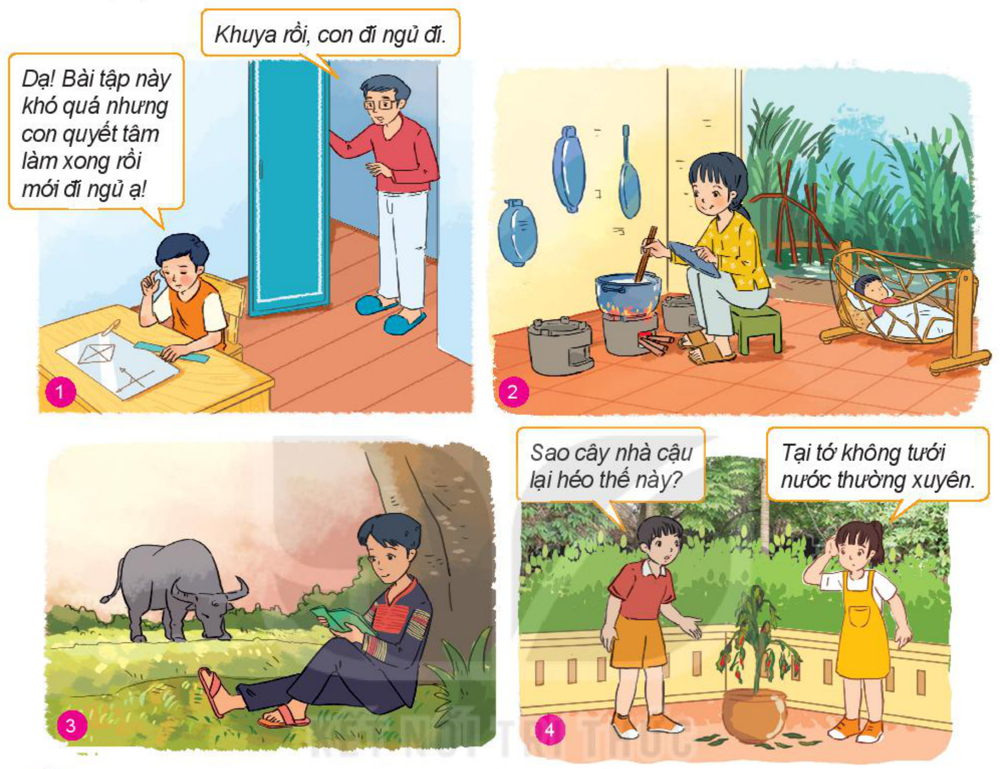
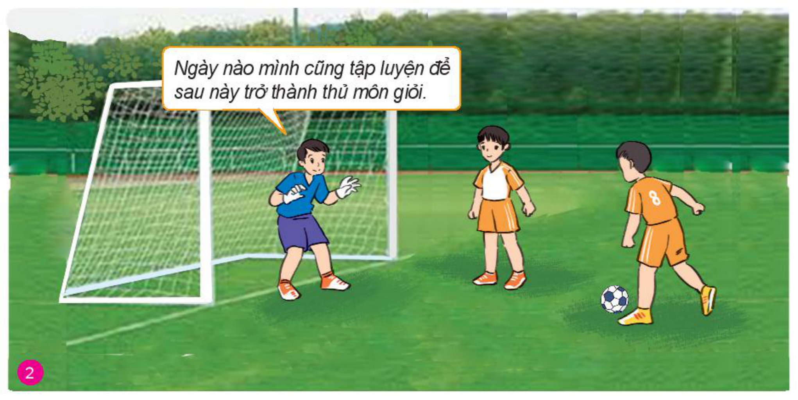

<!-- pdf:14 -->

# BÀI 3: SIÊNG NĂNG, KIÊN TRÌ

## 🎯 Sau bài học này, học sinh có thể:

- Nêu được khái niệm, biểu hiện của siêng năng, kiên trì.
- Nhận biết được ý nghĩa của siêng năng, kiên trì.
- Siêng năng, kiên trì trong lao động, học tập và cuộc sống hằng ngày.
- Đánh giá được sự siêng năng, kiên trì của bản thân và người khác trong học tập, lao động.
- Quý trọng những người siêng năng, kiên trì; góp ý cho những bạn có biểu hiện lười biếng hay nản lòng để khắc phục hạn chế này.

## 🔴 Khởi động

Em hãy cùng các bạn tham gia trò chơi “Ai nhanh hơn”.

– Tìm những câu ca dao, tục ngữ nói về siêng năng, kiên trì. Ai tìm được nhanh và nhiều câu đúng hơn sẽ chiến thắng.

– Chia sẻ hiểu biết của em về ý nghĩa của những câu ca dao, tục ngữ đã tìm được.

## KHÁM PHÁ

## 1. Siêng năng, kiên trì và biểu hiện của siêng năng, kiên trì

\* *Thế nào là siêng năng, kiên trì?*

Em hãy đọc thông tin sau và trả lời câu hỏi

**TRẠNG NGUYÊN MẠC ĐĨNH CHI**

> Mạc Đĩnh Chi là vị trạng nguyên nổi tiếng trong lịch sử Việt Nam. Vốn lanh lợi, thông minh, ham học nhưng vì nhà nghèo không được đi học, Mạc Đĩnh Chi thường phải tranh thủ ghé qua lớp học ở gần nhà, đứng ngoài cửa nghe thầy giảng. Ban ngày đi nhặt củi kiếm sống, tối về cậu lại lo ôn luyện, học bài. Nhà nghèo không có đèn, cậu bắt đom đóm bỏ vào vỏ trứng lấy ánh sáng để học. Không có giấy, cậu dùng lá để tập viết. Nhờ siêng năng, kiên trì, nỗ lực vượt qua mọi khó khăn để học tập, Mạc Đĩnh Chi đã thi đỗ Trạng nguyên – học vị Tiến sĩ cao nhất.
>
> *(Phỏng theo Các vị trạng nguyên, bảng nhãn, thám hoa qua các triều đại phong kiến Việt Nam, NXB Văn hoá – Thông tin, 2006)*

> ❓
>
> a) Mạc Đĩnh Chi đã nỗ lực như thế nào để thi đỗ Trạng nguyên?
>
> b) Em hiểu thế nào là siêng năng, kiên trì?

<!-- pdf:15 -->

\* *Biểu hiện của siêng năng, kiên trì*

Em hãy quan sát tranh để trả lời câu hỏi

> 💬 *Tranh 1: Bố nhắc: “Khuya rồi, con đi ngủ đi.” – Bạn nhỏ đáp: “Dạ! Bài tập này khó quá nhưng con quyết tâm làm xong rồi mới đi ngủ ạ!”*
>
> *Tranh 2: Bạn gái vừa trông em ngủ trong nôi vừa nấu cơm giúp gia đình.*
>
> *Tranh 3: Bạn nhỏ dân tộc thiểu số vừa chăn trâu vừa chăm chú đọc sách dưới gốc cây.*
>
> *Tranh 4: Bạn nam hỏi: “Sao cây nhà cậu lại héo thế này?” – Bạn nữ đáp: “Tại tớ không tưới nước thường xuyên.”*
<!-- ocr-ok: đối chiếu ảnh trang PDF 15 lời thoại và nội dung tranh 1–4 -->

> ❓
>
> a) Xác định các hành vi, việc làm thể hiện siêng năng, kiên trì và chưa thể hiện siêng năng, kiên trì trong mỗi bức tranh.
>
> b) Kể thêm các biểu hiện siêng năng, kiên trì trong học tập, lao động và trong cuộc sống mà em biết.

## 2. Ý nghĩa của siêng năng, kiên trì

Em hãy đọc các trường hợp dưới đây và cho biết sự siêng năng, kiên trì của Hoa và Vân đã đem lại kết quả như thế nào?

> 1. Hoa mới theo bố mẹ chuyển từ quê lên Hà Nội học. Thời gian đầu chuyển cấp học và môi trường mới còn bỡ ngỡ nên Hoa học môn Tiếng Anh chưa tốt. Không nản lòng, Hoa đã lên kế hoạch mỗi ngày dành ít nhất 30 phút để học tiếng Anh. Cuối tuần, bạn ra Hồ Gươm mạnh dạn giao tiếp với người nước ngoài. Kiên trì từng ngày, chỉ sau một học kì, trình độ tiếng Anh của Hoa đã tiến bộ rõ rệt.

<!-- pdf:16 -->

> 2. Vân có số cân nặng nhiều hơn so với các bạn cùng trang lứa. Được mọi người góp ý, Vân quyết tâm giảm cân. Hằng ngày, Vân dậy sớm tập thể dục. Có những hôm trời mùa đông giá lạnh, Vân vẫn không bỏ buổi tập nào. Bên cạnh đó, Vân thực hiện nghiêm túc chế độ ăn uống khoa học như: hạn chế ăn đồ ngọt, ăn ít tinh bột, ăn nhiều rau xanh, hoa quả,... Nhờ siêng năng, kiên trì tập luyện kết hợp với ăn uống khoa học, Vân đã giảm cân và có ngoại hình cân đối.

> – **Siêng năng** là đức tính của con người biểu hiện ở sự cần cù, tự giác, miệt mài, làm việc thường xuyên, đều đặn.

> – **Kiên trì** là sự quyết tâm làm đến cùng dù gặp khó khăn, gian khổ.

<!-- term: Ý nghĩa của siêng năng, kiên trì -->
> – Siêng năng, kiên trì sẽ giúp con người thành công trong công việc và cuộc sống. Người siêng năng, kiên trì sẽ được mọi người tin tưởng và yêu quý.

<!-- term: Cách rèn luyện tính siêng năng, kiên trì -->
> – Mỗi khi làm việc gì, em cần có mục đích và cách thực hiện rõ ràng. Hãy chăm chỉ, kiên trì thực hiện, nếu gặp khó khăn hãy thử bằng nhiều cách để thực hiện thành công, không bỏ dở giữa chừng.

## ✏️ Luyện tập

1. Em hãy quan sát tranh và trả lời câu hỏi

> 🖼️ *Tranh 1: Mẹ nói: “Cô giáo nói kết quả học tập của con chưa tốt, mẹ thấy con chơi điện tử nhiều quá!” – Bạn nhỏ đang cầm tay cầm chơi điện tử ấp úng đáp: “Dạ, con...”*
<!-- ocr-ok: đối chiếu ảnh trang PDF 16 lời thoại trong tranh 1 -->

> ❓ Theo em, bạn trong tranh cần làm gì để có kết quả học tập tốt hơn?
<!-- ocr-ok: đối chiếu ảnh trang PDF 16 câu hỏi dưới tranh 1 -->

<!-- pdf:17 -->

> 💬 *Tranh 2: Bạn Nam đang bắt bóng ở khung thành: “Ngày nào mình cũng tập luyện để sau này trở thành thủ môn giỏi.”*
<!-- ocr-ok: đối chiếu ảnh trang PDF 17 lời thoại trong tranh 2 -->

> ❓ Bạn Nam đã siêng năng, kiên trì như thế nào để thực hiện ước mơ của mình?
<!-- ocr-ok: đối chiếu ảnh trang PDF 17 câu hỏi dưới tranh 2 -->

2. Xử lí tình huống
<!-- ocr-ok: đối chiếu ảnh trang PDF 17 mục Luyện tập 2 -->

> 1. Năm học này, Hân dự định đăng kí tham gia cuộc thi hùng biện bằng tiếng Anh do nhà trường tổ chức. Nhưng Hân lo lắng vì vốn từ vựng tiếng Anh của mình còn hạn chế nên đắn đo không biết có nên dự thi hay không.
>
> ❓
>
> a) Theo em, Hân có nên tham gia cuộc thi không? Tại sao?
>
> b) Hân cần làm gì để thực hiện được mục tiêu của mình?

> 2. Lớp 6A có phong trào thi đua giải các bài toán khó. Mặc dù là thành viên trong lớp nhưng Hoà thường xuyên bỏ qua, không làm những bài toán khó vì ngại suy nghĩ.
>
> ❓
>
> a) Việc làm của Hoà trong tình huống trên thể hiện bạn thiếu đức tính gì?
>
> b) Nếu là bạn của Hoà, em sẽ khuyên Hoà điều gì?

## 🚀 Vận dụng

1. Em hãy sưu tầm một tấm gương về siêng năng, kiên trì và viết bài học rút ra từ tấm gương đó.
<!-- ocr-ok: đối chiếu ảnh trang PDF 17 mục Vận dụng 1 -->

2. Em hãy xây dựng và thực hiện kế hoạch khắc phục những biểu hiện chưa siêng năng, kiên trì của bản thân, sau đó chia sẻ kết quả thực hiện với thầy cô và các bạn.

## 📷 Danh sách hình trong bài

| Mã hình | Trang PDF | Trang sách | Chú thích |
| --- | --- | --- | --- |
| H6-giao_duc_cong_dan-b03-01 | 15 | 14 | Tranh 1–4: Biểu hiện của siêng năng, kiên trì |
| H6-giao_duc_cong_dan-b03-02 | 17 | 16 | Tranh 2: Bạn Nam tập luyện để trở thành thủ môn giỏi |
