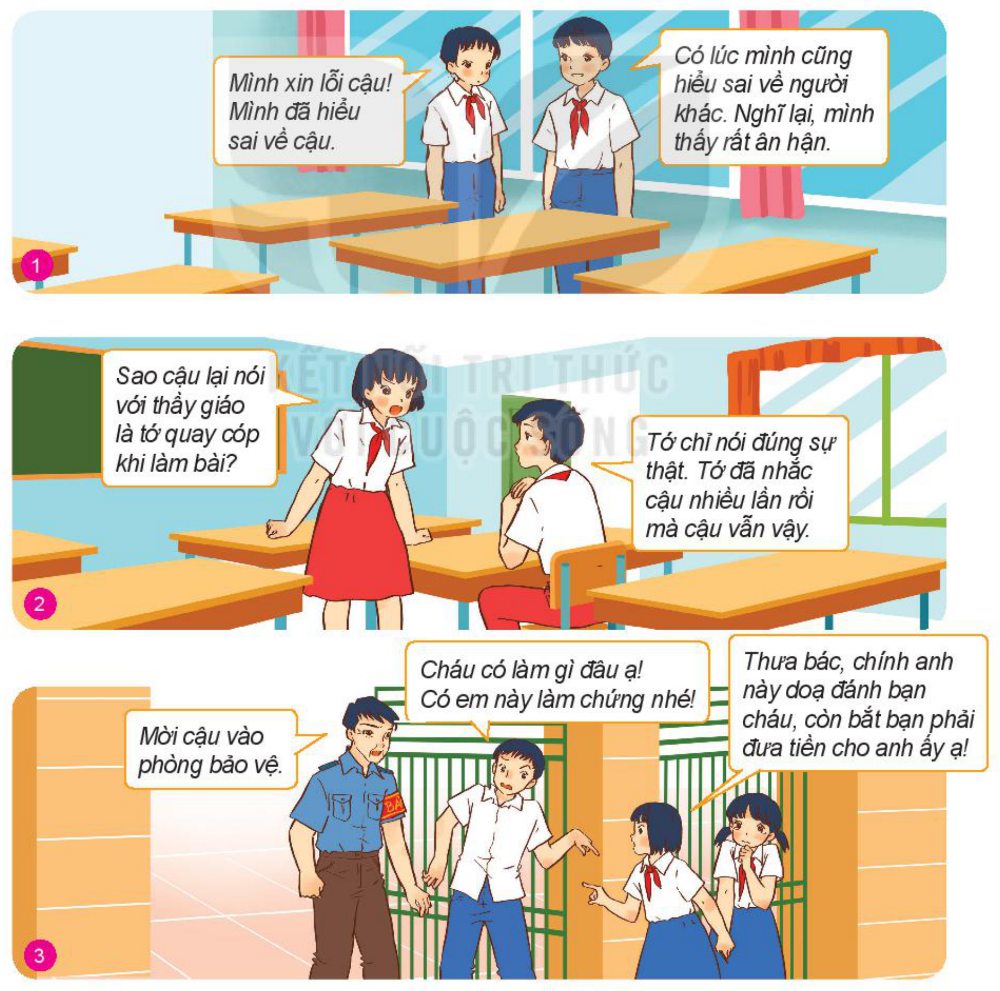
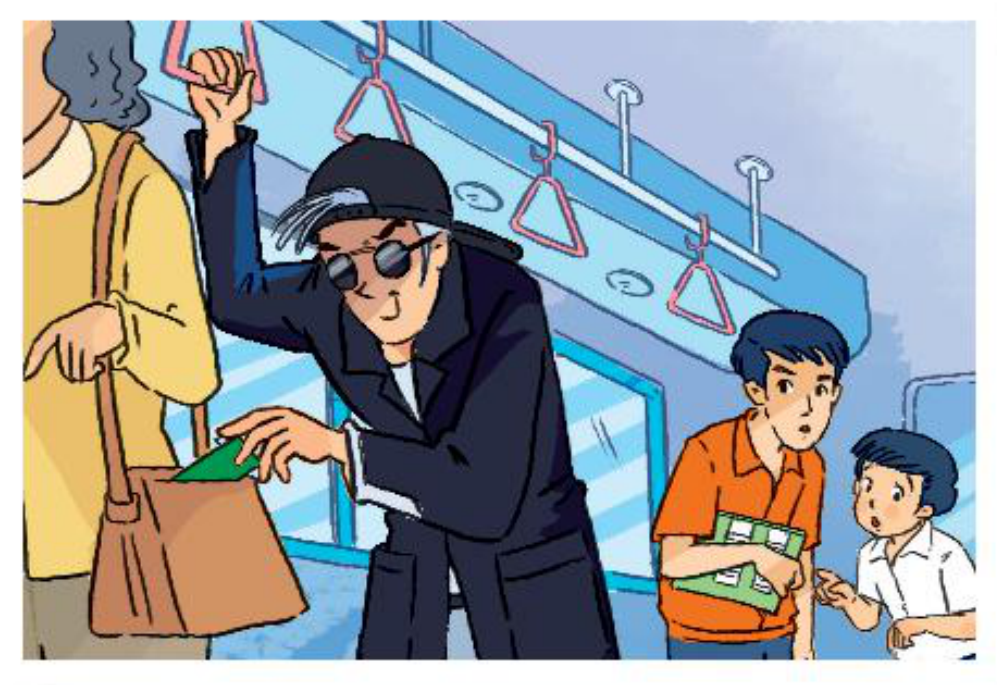

<!-- pdf:18 -->

# BÀI 4: TÔN TRỌNG SỰ THẬT

## 🎯 Sau bài học này, học sinh có thể:

- Nhận biết được một số biểu hiện của tôn trọng sự thật.
- Hiểu vì sao phải tôn trọng sự thật.
- Luôn nói thật với người thân, thầy cô, bạn bè và người có trách nhiệm.
- Không đồng tình với việc nói dối hoặc che giấu sự thật.

## 🔴 Khởi động

Em cùng các bạn chơi trò chơi “Truyền tin”.

> **Cách chơi:** Mỗi đội gồm 5 – 7 người, quản trò sẽ nói nhỏ một câu nói dễ nhầm cho người đầu hàng. Nhiệm vụ của người nghe là phải truyền tai nhau câu nói đó. Người cuối cùng sẽ nói to câu đó, đội nói đúng sẽ thắng cuộc.

> ❓
>
> 1/ Để trở thành người thắng cuộc, các thành viên tham gia trò chơi cần tuân thủ điều gì?
>
> 2/ Em rút ra bài học gì từ trò chơi?

## KHÁM PHÁ

## 1. Tôn trọng sự thật và biểu hiện của tôn trọng sự thật

\* *Thế nào là tôn trọng sự thật?*

Em hãy đọc câu chuyện sau và trả lời câu hỏi

**DÙ SAO TRÁI ĐẤT VẪN QUAY!**

> Ga-li-lê (Galilei, 1564 – 1642) là nhà toán học, vật lí học, thiên văn học và triết học người I-ta-li-a – người mở đầu cho cuộc cách mạng khoa học hiện đại. Thời ấy, mọi người quan niệm Trái Đất đứng yên và là trung tâm của vũ trụ; Mặt Trời, Mặt Trăng và các vì sao quay xung quanh Trái Đất. Trái lại, nhà bác học Cô-péc-ních (Copernicus) đã phát hiện ra và khẳng định rằng, Mặt Trời mới là trung tâm của vũ trụ, Trái Đất và các hành tinh đều quay quanh Mặt Trời. Với việc cải tiến kính viễn vọng để quan sát bầu trời, Ga-li-lê đã chứng minh và bảo vệ cho quan điểm của

<!-- pdf:19 -->

> Cô-péc-ních. Tuy nhiên, do phát ngôn trái với những quan điểm phổ biến thời bấy giờ, Ga-li-lê đã bị buộc phải quỳ trước Toà án La Mã, thề từ bỏ quan điểm của mình và tuyên bố Trái Đất không quay. Nhưng sau đó, ông vẫn tuyên bố: "Dù sao Trái Đất vẫn quay!".
>
> *(Lê Nguyên Long, Phạm Ngọc Toàn, Tiếng Việt 4, tập hai, NXB Giáo dục Việt Nam, 2019)*

> ❓ Nhà bác học Ga-li-lê đã tôn trọng sự thật như thế nào?
<!-- ocr-ok: đối chiếu ảnh trang PDF 19 câu hỏi sau câu chuyện Ga-li-lê -->

\* *Biểu hiện của tôn trọng sự thật*

– Em hãy tìm biểu hiện tôn trọng sự thật trong các bức tranh dưới đây.

– Em hãy kể thêm các biểu hiện của tôn trọng sự thật.

> 💬 *Tranh 1: Bạn nam 1: “Mình xin lỗi cậu! Mình đã hiểu sai về cậu.” – Bạn nam 2: “Có lúc mình cũng hiểu sai về người khác. Nghĩ lại, mình thấy rất ân hận.”*
>
> *Tranh 2: Bạn nữ: “Sao cậu lại nói với thầy giáo là tớ quay cóp khi làm bài?” – Bạn nam: “Tớ chỉ nói đúng sự thật. Tớ đã nhắc cậu nhiều lần rồi mà cậu vẫn vậy.”*
>
> *Tranh 3: Bác bảo vệ: “Mời cậu vào phòng bảo vệ.” – Học sinh lớn: “Cháu có làm gì đâu ạ! Có em này làm chứng nhé!” – Bạn nữ dũng cảm chỉ tay nói: “Thưa bác, chính anh này doạ đánh bạn cháu, còn bắt bạn phải đưa tiền cho anh ấy ạ!”*
<!-- ocr-ok: đối chiếu ảnh trang PDF 19 lời thoại trong tranh 1–3 -->

<!-- pdf:20 -->

## 2. Ý nghĩa của tôn trọng sự thật

Đọc đoạn hội thoại dưới đây để trả lời câu hỏi

> Bố của Toàn là một tấm gương về lòng trung thực. Ông thường dạy Toàn phải tôn trọng sự thật. Một lần, Toàn hỏi bố:
>
> – Bố ơi, câu nói “Thẳng thắn, thật thà thường thua thiệt” có đúng không ạ?
>
> Bố Toàn ôn tồn trả lời:
>
> – Không đúng đâu con. Người thẳng thắn, thật thà, biết tôn trọng sự thật sẽ nhận được nhiều điều tốt đẹp bởi tôn trọng sự thật, làm chứng cho sự thật là bảo vệ cho những điều đúng đắn, tránh oan sai, nhầm lẫn, giúp cuộc sống trở nên tốt đẹp hơn. Đôi khi, người thẳng thắn, thật thà phải chịu thiệt thòi, thậm chí còn bị người xấu hãm hại. Nhưng khi con sống thật, con sẽ được mọi người yêu quý, tin tưởng. Nếu con giả dối, mọi người sẽ ghét bỏ, xa lánh con. Sự dối trá là nguyên nhân của những xung đột, đổ vỡ. Các nhà khoa học còn chứng minh được rằng: Nói thật, sống trung thực giúp tâm hồn thanh thản, bình an và sức khoẻ tốt hơn!
>
> – Vâng ạ, con cảm ơn bố!

> ❓
>
> a) Nêu suy nghĩ của em về nội dung đoạn hội thoại.
>
> b) Theo em, việc tôn trọng sự thật có ý nghĩa như thế nào trong cuộc sống?

## 3. Cách tôn trọng sự thật

Em hãy đọc các thông tin dưới đây để:

– Nhận xét về cách ứng xử của mỗi nhân vật trong các thông tin.

– Thảo luận về cách tôn trọng sự thật.

> 1. Thấy tên trộm đang móc túi của hành khách trên xe buýt, Vũ đi đến bên chú phụ xe, thì thầm: “Chú ơi, cháu nhìn thấy người áo đen kia đang móc túi ạ!”.

<!-- pdf:21 -->

> 2. Giờ ra chơi, Nam ném đá làm vỡ cửa kính lớp học. Thầy giáo biết sự việc xảy ra nên hỏi cả lớp: “Ai đã làm vỡ cửa kính lớp học?”. Cả lớp im lặng, căng thẳng. Dũng nhắc khẽ: “Nam, cậu nhận lỗi đi!”. Nam tỉnh bơ: “Thầy không biết, chẳng tội gì tớ phải nhận”. Thầy giáo hỏi: “Nam, em có biết là ai không?”. Nam vội trả lời: “Thưa thầy, em thấy có một anh ném đá vào cửa kính lớp học rồi chạy đi ạ!”. Thầy hỏi Dũng: “Lớp trưởng, đúng là như vậy chứ?”. Dũng đứng dậy: “Thưa thầy, em đã biết người làm điều đó. Sau giờ học, bạn ấy sẽ gặp riêng thầy để nhận lỗi ạ!”.

> 3. Dung cùng mẹ đến nhà bác Mai chơi. Bác bóc bánh giò mời hai mẹ con. Dung lắc đầu, từ chối: “Cháu cảm ơn bác, nhưng nhà cháu không có ai thích món này. Ăn bánh giò béo, ngấy lắm ạ!”. Mẹ Dung từ tốn: “Bác cho em xin miếng nhỏ thôi, mẹ con em vừa mới ăn sáng ở nhà”.
>
> 💬 *Lời thoại trong tranh: “Ăn bánh giò béo, ngấy lắm ạ!”*

> – **Sự thật** là những gì có thật trong cuộc sống hiện thực và phản ánh đúng hiện thực cuộc sống.

<!-- term: Tôn trọng sự thật -->
> – **Biểu hiện của tôn trọng sự thật** là: suy nghĩ, nói và làm theo đúng sự thật.

<!-- term: Tôn trọng sự thật -->
<!-- term: Ý nghĩa của tôn trọng sự thật -->
> – Tôn trọng sự thật sẽ góp phần bảo vệ cuộc sống, bảo vệ những giá trị đúng đắn, tránh nhầm lẫn, oan sai; giúp con người tin tưởng, gắn kết với nhau hơn; làm cho tâm hồn thanh thản và cuộc sống trở nên tốt đẹp hơn.

<!-- term: Cách tôn trọng sự thật -->
> – Luôn nói thật với người thân, thầy cô, bạn bè và người có trách nhiệm bằng thái độ dũng cảm, khéo léo, tinh tế và nhân ái.

## ✏️ Luyện tập

1. Em hãy đọc các trường hợp sau và trả lời câu hỏi:

> 1. Hoa là một lớp trưởng thẳng thắn. Khi thấy bạn nào trong lớp mắc khuyết điểm, Hoa đều ghi vào sổ tay và báo với cô giáo chủ nhiệm. Một số bạn trong lớp tỏ ra không đồng tình với Hoa và đề nghị thay lớp trưởng.
>
> ❓ Em hãy nhận xét về việc làm của bạn Hoa và các bạn trong lớp.

<!-- pdf:22 -->

> 2. Mai là người thông minh, chân thành, cởi mở nên được bạn bè yêu quý, tin cậy. Nếu bạn nào có lỗi, Mai nhẹ nhàng góp ý để bạn nhận lỗi và sửa lỗi. Nhiều bạn tâm sự những nỗi niềm thầm kín, riêng tư, Mai lắng nghe, chia sẻ và không bao giờ nói lại những chuyện đó với người khác.
>
> ❓ Theo em, vì sao Mai được bạn bè yêu quý?

2. Xử lí tình huống

> 1. Hà tâm sự với Hùng về những mâu thuẫn, khó khăn trong gia đình mình và muốn Hùng không nói với ai. Gần đây, Hà học hành sa sút, bị cô giáo nhắc nhở. Hùng rất muốn nói sự thật về hoàn cảnh của Hà cho cô giáo biết để cô cảm thông và giúp đỡ. Nhưng Hùng băn khoăn không biết có nên nói không.
>
> 💬 *Lời thoại trong tranh: Cô giáo hỏi Hà: “Sao gần đây em không chú tâm học vậy?”*
>
> ❓
>
> a) Theo em, Hùng có nên nói với cô giáo về hoàn cảnh của Hà không? Vì sao?
>
> b) Nếu là Hùng, em sẽ làm gì?

> 2. Lan thấy có một người đàn ông mới chuyển đến khu tập thể. Ông ta lân la làm quen với các bé gái, cho bánh kẹo, đồ chơi rồi rủ về nhà chơi. Lan băn khoăn không biết có nên nói với người lớn không.
>
> ❓ Theo em, Lan nên làm gì trong tình huống trên?

## 🚀 Vận dụng

1. Em hãy viết về việc làm thể hiện tôn trọng sự thật hoặc chưa tôn trọng sự thật của bản thân và chia sẻ cảm xúc, suy nghĩ của em sau mỗi việc làm đó.

2. Em hãy viết cảm nhận của em về câu ca dao dưới đây:

> Những người tính nết thật thà
>
> Đi đâu cũng được người ta tin dùng.

## 📷 Danh sách hình trong bài

| Mã hình | Trang PDF | Trang sách | Chú thích |
| --- | --- | --- | --- |
| H6-giao_duc_cong_dan-b04-01 | 19 | 18 | Tranh 1–3: Biểu hiện của tôn trọng sự thật |
| H6-giao_duc_cong_dan-b04-02 | 20 | 19 | Tranh tình huống 1: Vũ báo chú phụ xe khi thấy kẻ móc túi trên xe buýt |
