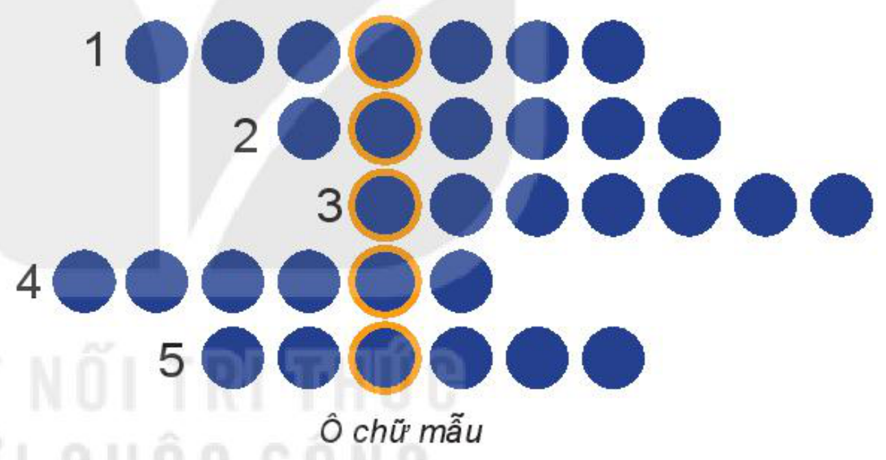
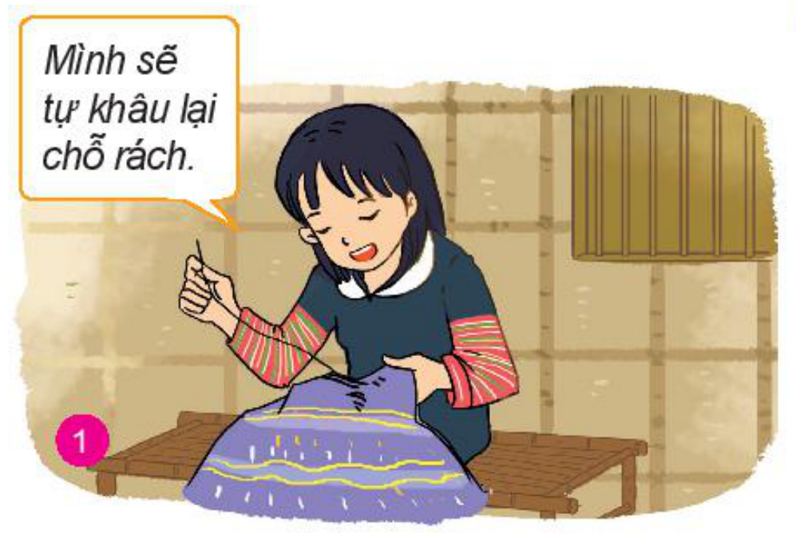
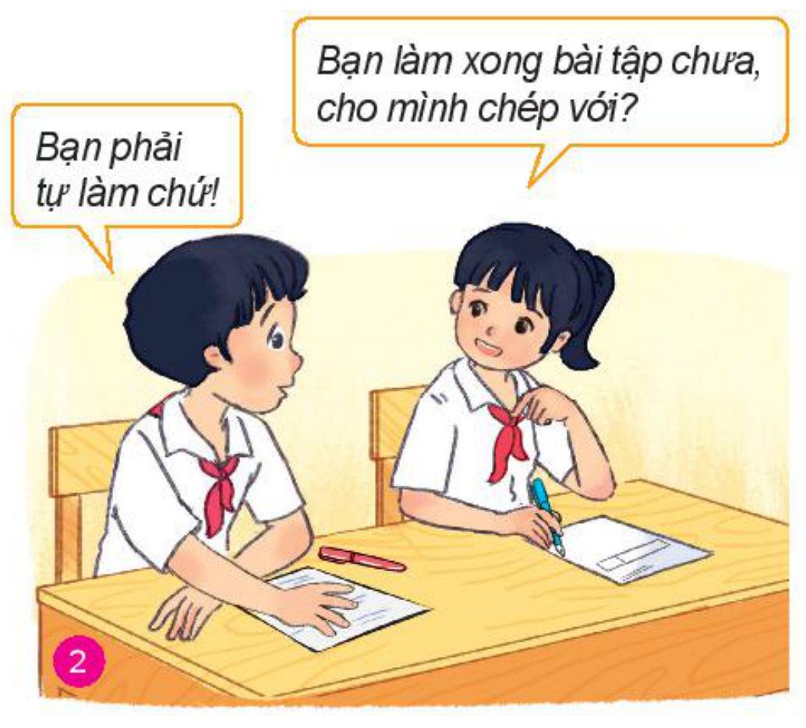
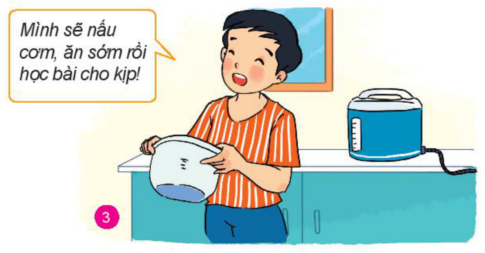

<!-- pdf:23 -->

# BÀI 5: TỰ LẬP

## 🎯 Sau bài học này, học sinh có thể:

- Nêu được khái niệm tự lập.
- Liệt kê được các biểu hiện của người có tính tự lập.
- Hiểu vì sao phải tự lập.
- Đánh giá được khả năng tự lập của bản thân và người khác.
- Tự thực hiện được nhiệm vụ của bản thân trong học tập, sinh hoạt hằng ngày, hoạt động tập thể ở trường và trong cuộc sống cộng đồng; không dựa dẫm, ỷ lại và phụ thuộc vào người khác.

## 🔴 Khởi động

Em hãy cùng các bạn tham gia trò chơi “Giải ô chữ”.
<!-- ocr-ok: đối chiếu ảnh trang PDF 23 mục Khởi động -->

– Giải ô chữ để tìm từ chìa khoá. Ai tìm được từ chìa khoá nhanh nhất sẽ chiến thắng.
<!-- ocr-ok: đối chiếu ảnh trang PDF 23 hướng dẫn trò chơi Giải ô chữ -->

– Chia sẻ hiểu biết của em về từ chìa khoá đó.
<!-- ocr-ok: đối chiếu ảnh trang PDF 23 yêu cầu chia sẻ từ chìa khoá -->

1. Hàng ngang số 1 gồm 7 chữ cái, chỉ thành tích nổi bật của học sinh hơn mức bình thường.

2. Hàng ngang số 2 gồm 6 chữ cái, chỉ sự đối lập với ỷ lại.

3. Hàng ngang số 3 gồm 7 chữ cái, chỉ sự đồng nghĩa với làm việc.

4. Hàng ngang số 4 gồm 6 chữ cái, chỉ hoạt động chính của học sinh ở trường học.

5. Hàng ngang số 5 gồm 6 chữ cái, chỉ thái độ tôn trọng và đúng mực đối với người lớn tuổi.

## KHÁM PHÁ

## 1. Tự lập và biểu hiện của tự lập

\* *Thế nào là tự lập?*

Em hãy đọc câu chuyện sau và trả lời câu hỏi

<!-- pdf:24 -->

**HAI BÀN TAY**

> Trước khi ra đi tìm đường cứu nước, Bác Hồ còn rất trẻ, mang tên Nguyễn Tất Thành. Lúc đó, anh Thành có một người bạn thân tên là Lê. Một lần, cùng nhau đi chơi phố, đột nhiên Thành nhìn thẳng vào mắt bạn, hỏi:
>
> – Anh Lê, anh có yêu nước không?
>
> Câu hỏi đột ngột khiến anh bạn ngạc nhiên, lúng túng trong giây lát rồi trả lời:
>
> – Tất nhiên là có chứ!
>
> – Anh có thể giữ bí mật không?
>
> Người bạn đáp:
>
> – Có.
>
> Anh Thành nói tiếp:
>
> – Tôi muốn sang nước Pháp và các nước khác. Sau khi xem xét họ làm như thế nào, tôi sẽ trở về giúp đồng bào chúng ta. Nhưng nếu đi một mình, thật ra cũng có nhiều mạo hiểm như khi đau ốm. Anh muốn đi với tôi không?
>
> – Nhưng bạn ơi, chúng ta lấy đâu ra tiền mà đi?
>
> – Đây, tiền đây. Anh Thành vừa nói vừa giơ hai bàn tay – Chúng ta sẽ làm bất cứ việc gì để sống và đi. Thế anh cùng đi với tôi chứ?
>
> Bị lôi cuốn vì lòng hăng hái của bạn, anh Lê đồng ý, nhưng sau khi suy nghĩ lại về cuộc phiêu lưu đó, anh Lê không có đủ can đảm để giữ lời hứa.
>
> Vài ngày sau, người thanh niên Nguyễn Tất Thành đã ra đi tìm đường cứu nước...
>
> *(Theo Bác Hồ kính yêu, NXB Kim Đồng, Hà Nội, 1980)*

> ❓
>
> a) Vì sao Bác Hồ quyết tâm ra đi tìm đường cứu nước với hai bàn tay trắng?
>
> b) Từ câu chuyện về Bác Hồ, em hiểu thế nào là tự lập?

\* *Biểu hiện của tự lập*

Em hãy quan sát các bức tranh, đọc thông tin dưới đây để trả lời câu hỏi

> 💬 *Tranh 1: “Mình sẽ tự khâu lại chỗ rách.”*
>
> *Tranh 2: Bạn nữ hỏi: “Bạn làm xong bài tập chưa, cho mình chép với?” – Bạn nam đáp: “Bạn phải tự làm chứ!”*
<!-- ocr-ok: đối chiếu ảnh trang PDF 24 lời thoại trong tranh 1–2 -->

<!-- pdf:25 -->

> 💬 *Tranh 3: “Mình sẽ nấu cơm, ăn sớm rồi học bài cho kịp!”*

> Hải là con trong một gia đình khá giả. Nhà có bác giúp việc nhưng không vì thế mà Hải ỷ lại, dựa dẫm vào bác. Bạn luôn tự giác dọn dẹp phòng, gấp quần áo, chăn màn,... Những lúc rảnh rỗi, Hải còn phụ giúp bác nhặt rau, nấu cơm, lau nhà. Trong học tập, Hải luôn tự hoàn thành tốt các nhiệm vụ được giao.

> ❓
>
> a) Em hãy xác định những biểu hiện của tự lập và chưa tự lập trong các bức tranh và thông tin trên.
>
> b) Em còn biết những biểu hiện nào khác của tính tự lập?

## 2. Ý nghĩa của tự lập

Em hãy đọc các trường hợp dưới đây và trả lời câu hỏi

> 1. Bố của Hưng mất sớm, mẹ vất vả lao động nuôi hai anh em ăn học. Hưng luôn ý thức phải tự làm tốt các việc cá nhân của mình đồng thời giúp đỡ mẹ mọi việc trong gia đình. Khi mẹ ốm phải nằm viện, Hưng lo toan hết việc nhà, chăm sóc mẹ và em chu đáo. Năm học nào Hưng cũng đạt danh hiệu Học sinh Giỏi.
>
> ❓
>
> a) Hưng đã thể hiện tính tự lập như thế nào?
>
> b) Tính tự lập đã đem lại điều gì cho Hưng?

> 2. Anh Luận là người dân tộc Mường được bình chọn là Doanh nhân trẻ xuất sắc. Tuy gia đình khó khăn nhưng anh vẫn cố gắng học và đã thi đỗ vào trường đại học. Để có tiền đóng học phí và sinh hoạt, anh đã làm thêm nhiều việc: phát tờ rơi, gia sư, phục vụ bàn,... Ra trường, anh trở về quê hương làm thuê, tự tích luỹ tiền và bắt đầu kinh doanh cà phê. Doanh nghiệp của anh ngày càng phát triển, tạo công ăn việc làm cho nhiều người ở buôn làng.
>
> ❓ Tính tự lập của anh Luận đã mang lại điều gì cho anh và cho xã hội?

Từ các trường hợp trên, em hãy cùng bạn thảo luận và cho biết ý nghĩa của tự lập đối với bản thân, gia đình và xã hội.

<!-- pdf:26 -->

> – **Tự lập** là tự làm lấy các công việc của mình trong cuộc sống.

> – **Biểu hiện của tính tự lập** là sự tự tin, bản lĩnh cá nhân, dám đương đầu với những khó khăn, thử thách; có ý chí nỗ lực phấn đấu vươn lên trong cuộc sống; không trông chờ, dựa dẫm, ỷ lại, phụ thuộc vào người khác.

<!-- term: Ý nghĩa của tính tự lập -->
> – Người có tính tự lập thường thành công trong cuộc sống và xứng đáng nhận được sự tôn trọng của mọi người.

> – Học sinh cần rèn luyện tính tự lập trong học tập, công việc và sinh hoạt hằng ngày.

## ✏️ Luyện tập

1. Em hãy nêu một số biểu hiện về tự lập và trái với tự lập trong học tập và trong sinh hoạt hằng ngày.

2. Em hãy kể về hành vi ỷ lại, dựa dẫm và phụ thuộc vào người khác mà em đã gặp hoặc nghe kể trong học tập, cuộc sống. Em rút ra bài học gì từ những hành vi đó?

3. Xử lí tình huống

> 1. Tan học sớm, Hoa rủ các bạn vào nhà mình ăn cơm trưa. Về tới nhà, Hoa chợt nhớ ra là lúc sáng mẹ về quê thăm bà ốm nên không nấu cơm sẵn như mọi ngày. Hoa và các bạn cùng vào bếp nhưng loay hoay mãi không biết nấu gì để ăn trưa vì từ trước tới giờ đều được mẹ làm giúp.
>
> ❓ Nếu là Hoa, em sẽ làm gì?

> 2. Mặc dù nhà ngay gần trường nhưng hằng ngày bố mẹ vẫn phải đưa đón An đi học. Thấy vậy, Hải hỏi: “Sao cậu không tự đi học?”. An trả lời: “Mình là con trai duy nhất trong nhà, bố mẹ không chăm mình thì còn chăm ai. Mình mới học lớp 6, bố mẹ chăm sóc như vậy là đương nhiên”.
>
> ❓ Nếu là Hải, em sẽ nói gì với An?

## 🚀 Vận dụng

1. Em hãy lập và thực hiện kế hoạch rèn luyện tính tự lập của bản thân theo gợi ý sau: các lĩnh vực rèn luyện (học tập, sinh hoạt hằng ngày); công việc thực hiện; biện pháp thực hiện; kết quả rèn luyện.

2. Sắp tới kì nghỉ hè, bố mẹ dự định cho em về quê ngoại một tháng sống cùng với ông bà. Em hãy thiết kế một cuốn sổ tay để nhắc bản thân trong sinh hoạt và học tập. (Nội dung chính của sổ tay: thời gian, nội dung nhắc nhở, cách thức thực hiện, tự đánh giá)

## 📷 Danh sách hình trong bài

| Mã hình | Trang PDF | Trang sách | Chú thích |
| --- | --- | --- | --- |
| H6-giao_duc_cong_dan-b05-01 | 23 | 22 | Ô chữ mẫu |
| H6-giao_duc_cong_dan-b05-02 | 24 | 23 | Tranh 1: Tự khâu lại chỗ quần áo bị rách |
| H6-giao_duc_cong_dan-b05-03 | 24 | 23 | Tranh 2: Tự làm bài tập, không cho bạn chép bài |
| H6-giao_duc_cong_dan-b05-04 | 25 | 24 | Tranh 3: Tự nấu cơm và chủ động học bài |
