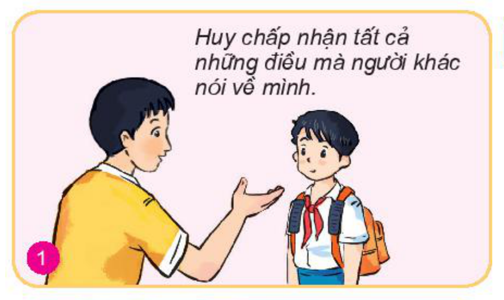
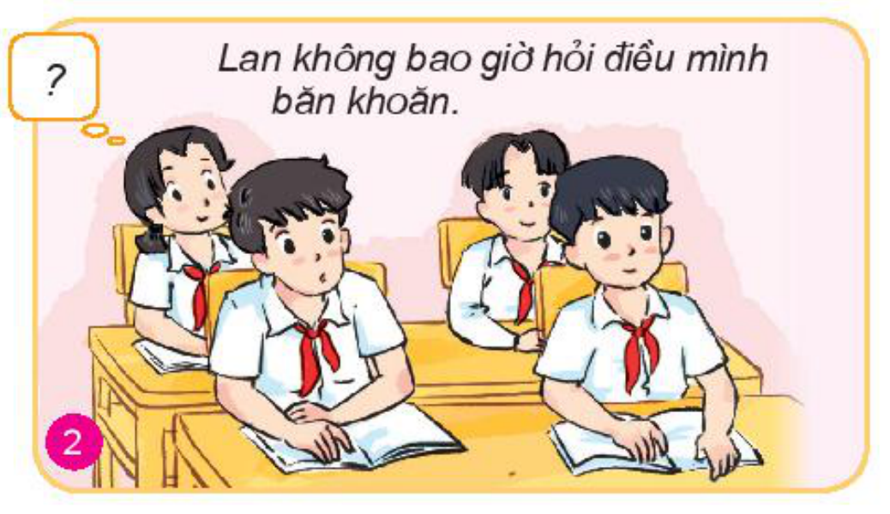

<!-- pdf:27 -->

# BÀI 6: TỰ NHẬN THỨC BẢN THÂN

## 🎯 Sau bài học này, học sinh có thể:

- Nêu được thế nào là tự nhận thức bản thân; biết được ý nghĩa của tự nhận thức bản thân.
- Tự nhận thức được điểm mạnh, điểm yếu, giá trị, vị trí, tình cảm, các mối quan hệ của bản thân.
- Biết tôn trọng bản thân; xây dựng được kế hoạch phát huy điểm mạnh và hạn chế điểm yếu của bản thân.

## 🔴 Khởi động

Em hãy viết lời giới thiệu những điều hài lòng, chưa hài lòng về bản thân và chia sẻ với bạn bên cạnh.

## KHÁM PHÁ

## 1. Thế nào là tự nhận thức bản thân?

Em hãy đọc câu chuyện sau và trả lời câu hỏi

**"CON GÀ" ĐẠI BÀNG**

> Ngày xưa, bên sườn núi có một tổ chim đại bàng với những quả trứng lớn. Bỗng xảy ra trận động đất khiến một quả trứng đại bàng lăn xuống chân núi và rơi vào chỗ gà mẹ đang ấp. Gà mẹ đã ấp luôn cả quả trứng lớn ấy. Ổ trứng gà mẹ ấp ủ đã nở ra một đàn gà và một chú đại bàng đáng yêu. Gà mẹ yêu thương và nuôi dạy đại bàng như các con của mình. Đại bàng yêu gia đình và ngôi nhà đang sống nhưng tâm hồn nó vẫn khao khát một điều gì đó cao xa hơn. Cho đến một ngày, nó thấy những chú chim có hình dáng giống mình đang sải cánh trên bầu trời.
>
> Đại bàng kêu lên:
>
> – Ôi! Ước gì mình có thể bay như những chú chim đó.
>
> Đàn gà cười ầm lên:
>
> – Anh không thể bay như những chú chim đó được. Anh là một con gà và gà không thể bay cao.
>
> Đại bàng tiếp tục ngước nhìn gia đình thật của nó, mơ ước có thể bay cao cùng họ. Mỗi lần đại bàng nói ra mơ ước của mình, đàn gà lại bảo đó là điều không thể xảy ra. Cuối cùng đại bàng tin rằng đó là thật. Rồi đại bàng không mơ ước nữa và tiếp tục sống như một con gà.
>
> *(Phỏng theo truyện dân gian Sudan)*

<!-- pdf:28 -->

> ❓
>
> a) Vì sao “con gà” đại bàng không thực hiện được mong ước có thể bay như những chú chim đại bàng?
>
> b) Qua câu chuyện, em rút ra bài học gì cho bản thân?

**Cùng chia sẻ thế nào là tự nhận thức bản thân**

Trong một cuộc tranh luận về “Thế nào là người biết tự nhận thức bản thân?”, lớp Ngân có ba ý kiến sau:

> 💬 *Ý kiến 1: “Tự nhận thức bản thân là biết nhìn nhận, đánh giá về khả năng, thái độ, hành vi, việc làm, điểm mạnh, điểm yếu,... của bản thân.”*
>
> *Ý kiến 2: “Tự nhận thức bản thân là luôn hiểu rõ mình và tự tin với điểm mạnh của mình.”*
>
> *Ý kiến 3: “Tự nhận thức bản thân là nhận ra những điểm tốt, chưa tốt của bản thân, so sánh với người khác và điều chỉnh bản thân mình cho giống họ.”*

> ❓
>
> a) Em đồng tình với ý kiến nào? Vì sao?
>
> b) Theo em, tự nhận thức bản thân là gì?

## 2. Ý nghĩa của tự nhận thức bản thân

Trong một cuộc trao đổi, thảo luận về ý nghĩa của tự nhận thức bản thân, các bạn học sinh lớp 6A đã tổng hợp được các ý kiến về ý nghĩa của tự nhận thức bản thân như sau:

Khi biết tự nhận thức bản thân, bạn sẽ:

– Ý kiến 1: Có cái nhìn trung thực về ưu điểm, nhược điểm của mình.

– Ý kiến 2: Xác định được những việc cần làm để hoàn thiện bản thân.

– Ý kiến 3: Dễ đồng cảm và chia sẻ với người khác.

– Ý kiến 4: Có những việc làm và cách ứng xử phù hợp với mọi người xung quanh.

*Em đồng ý/ không đồng ý với ý kiến nào? Vì sao?*

## 3. Cách tự nhận thức bản thân

Em hãy đọc thông tin dưới đây và trả lời câu hỏi

> 1. Với thầy cô và bạn bè, Hoa là một học sinh tiêu biểu của lớp. Thầy cô và các bạn yêu quý Hoa vì bạn học giỏi, thân thiện, khiêm tốn. Mỗi ngày, Hoa dành thời gian để ghi nhật kí. Hoa cũng thường xuyên trao đổi với người thân, thầy cô, bạn bè những điều còn băn khoăn về bản thân, về cuộc sống và lắng nghe ý kiến của mọi người để điều chỉnh bản thân. Bên cạnh đó, Hoa còn tham gia các hoạt động, thử thách mới để khám phá bản thân.
>
> 💬 *Lời thoại trong tranh: “Bạn thấy mình còn điểm nào cần phải sửa?”*

<!-- pdf:29 -->

> ❓
>
> a) Hoa đã tự nhận thức bản thân bằng cách nào?
>
> b) Em còn biết thêm những cách nào khác để tự nhận thức bản thân? Hãy chia sẻ với các bạn.

> 2. Bình rất thần tượng ca sĩ nổi tiếng và tìm mọi cách để thay đổi bản thân cho giống với ca sĩ đó từ sở thích, tính cách, trang phục, đầu tóc đến cử chỉ, điệu bộ. Thậm chí, Bình còn ghét cả những người mà ca sĩ đó ghét dù Bình chưa một lần gặp họ.
>
> ❓
>
> a) Em có nhận xét gì về hành động, việc làm của Bình?
>
> b) Em có đồng tình với hành động, việc làm đó không? Vì sao?

> – **Tự nhận thức bản thân** là biết nhìn nhận, đánh giá đúng về bản thân mình (khả năng, hiểu biết, tính cách, sở thích, thói quen, điểm mạnh, điểm yếu,...).

<!-- term: Ý nghĩa của tự nhận thức bản thân -->
> – Tự nhận thức đúng về bản thân sẽ giúp em:
> + Nhận ra điểm mạnh của bản thân để phát huy, điểm yếu để khắc phục.
> + Biết rõ mong muốn, những khả năng, khó khăn, thách thức của bản thân để có thể đặt mục tiêu, ra quyết định và giải quyết vấn đề phù hợp.

<!-- term: Cách tự nhận thức bản thân -->
> – Để tự nhận thức đúng về bản thân, em cần:
> + Đánh giá bản thân qua thái độ, hành vi, kết quả trong từng hoạt động, tình huống cụ thể.
> + Quan sát phản ứng và lắng nghe nhận xét của người khác về mình.
> + So sánh những nhận xét/ đánh giá của người khác về mình với tự nhận xét, đánh giá của mình.
> + Thân thiện, cởi mở, tích cực tham gia các hoạt động để rèn luyện và phát triển bản thân.

## ✏️ Luyện tập

1. Khám phá chính mình

Xác định những hiểu biết về bản thân bằng cách sau:

Bước 1: Tự viết lời giới thiệu về bản thân (ưu điểm, hạn chế, tính cách, sở thích,...) trên một nửa trang giấy.

Bước 2: Nhờ bạn bè hoặc người thân viết về ưu điểm, hạn chế, tính cách, sở thích,... về bản thân em trên một nửa trang giấy.

Bước 3: So sánh thông tin của em và của người khác viết về em và hoàn thành việc mô tả về bản thân (với các nội dung về ngoại hình, tính cách, sở thích, điểm mạnh, điểm cần cố gắng).

<!-- pdf:30 -->

Bước 4: Liệt kê những ưu điểm, hạn chế và đề xuất các biện pháp phát huy ưu điểm, khắc phục những hạn chế của bản thân.

2. Quan sát các bức tranh sau và trả lời câu hỏi

> 💬 *Tranh 1: Huy chấp nhận tất cả những điều mà người khác nói về mình.*
>
> *Tranh 2: Lan không bao giờ hỏi điều mình băn khoăn.*
>
> *Tranh 3: Vy học đàn vì bố mẹ muốn, chứ không phải vì Vy thích học.*
<!-- ocr-ok: đối chiếu ảnh trang PDF 30 nội dung tranh 1–3 -->

> ❓
>
> a) Em hãy nhận xét việc làm của các nhân vật trong các bức tranh và cho biết hậu quả của những việc làm đó.
>
> b) Em có lời khuyên gì đối với các nhân vật trong mỗi bức tranh để giúp họ vượt qua chính mình?

3. Những tình huống nào dưới đây cho thấy các bạn chưa biết cách tự nhận thức bản thân? Vì sao?

> 1. Minh rất muốn được hát trước lớp nhưng lại sợ bị các bạn chê là hát không hay nên Minh chưa dám thực hiện mong muốn của mình.

> 2. Sau mỗi lần cô giáo trả bài kiểm tra, Quang thường dành thời gian để so sánh, đối chiếu với bài của các bạn được điểm cao để tìm ra những điểm chưa đúng, chưa hay và nhờ các bạn giải thích những điều mà Quang chưa hiểu.

> 3. Mỗi khi nhận được lời nhận xét của các bạn trong lớp về những điều cần phải cố gắng, Loan thường tỏ ra khó chịu và không quan tâm đến những điều các bạn góp ý.

## 🚀 Vận dụng

1. Mỗi ngày hãy dành 15 phút để suy nghĩ về những trải nghiệm của bản thân, bao gồm những điều mong muốn, những điều làm tốt, những điều làm chưa tốt,... và ghi vào nhật kí. Sau mỗi tháng, em hãy xem lại nhật kí để biết bản thân đã thay đổi như thế nào.

2. Em hãy tham gia các hoạt động tập thể và ghi lại những trải nghiệm, đặc điểm, khả năng mới mà em khám phá được ở bản thân mình.

## 📷 Danh sách hình trong bài

| Mã hình | Trang PDF | Trang sách | Chú thích |
| --- | --- | --- | --- |
| H6-giao_duc_cong_dan-b06-01 | 30 | 29 | Tranh 1: Huy chấp nhận tất cả những điều mà người khác nói về mình |
| H6-giao_duc_cong_dan-b06-02 | 30 | 29 | Tranh 2: Lan không bao giờ hỏi điều mình băn khoăn |
| H6-giao_duc_cong_dan-b06-03 | 30 | 29 | Tranh 3: Vy học đàn vì bố mẹ muốn, chứ không phải vì Vy thích học |
