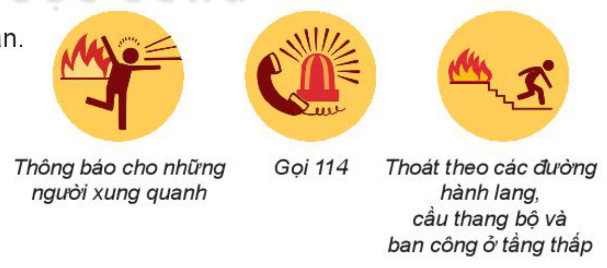
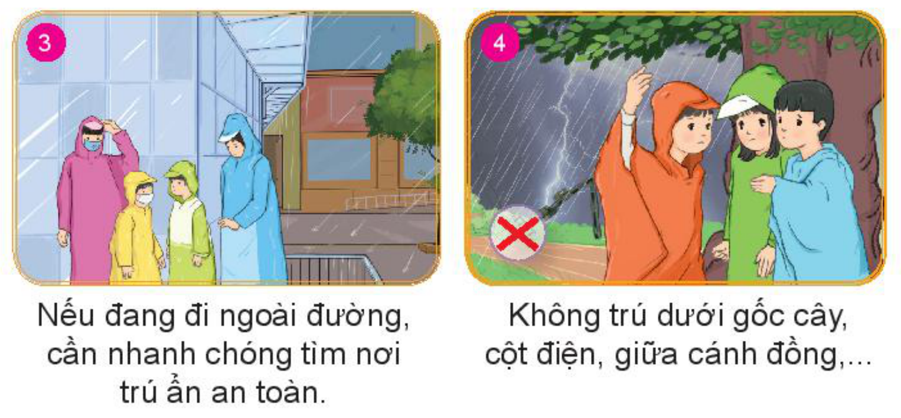
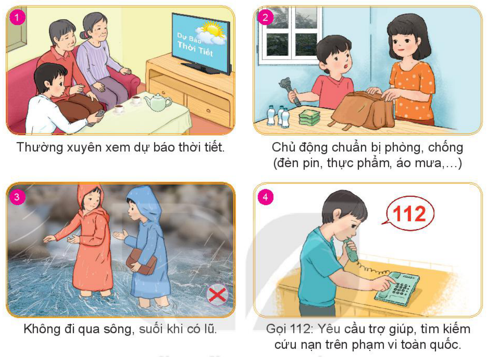

<!-- pdf:31 -->

# BÀI 7: ỨNG PHÓ VỚI TÌNH HUỐNG NGUY HIỂM

## 🎯 Sau bài học này, học sinh có thể:

- Nhận biết được các tình huống nguy hiểm và hậu quả của những tình huống nguy hiểm đối với trẻ em.
- Nêu được cách ứng phó với một số tình huống nguy hiểm.
- Thực hành được cách ứng phó trước một số tình huống nguy hiểm để đảm bảo an toàn.

## 🔴 Khởi động

Em hãy chia sẻ về một tình huống nguy hiểm mà em đã từng gặp hoặc chứng kiến theo gợi ý sau:

– Tình huống đó diễn ra khi nào?

– Em đã làm gì khi gặp tình huống đó?

## KHÁM PHÁ

## 1. Nhận biết các tình huống nguy hiểm và hậu quả của nó

Em hãy đọc các thông tin, tình huống dưới đây và trả lời câu hỏi

> 1. Khi đang chơi trước cửa nhà, Lan thấy một người phụ nữ lạ mặt giới thiệu là người quen, muốn gặp mẹ Lan để gửi đồ và trao đổi công việc. Lan mở cửa và lễ phép mời người phụ nữ lạ mặt vào nhà. Sau đó, Lan cảm thấy buồn ngủ và ngủ thiếp đi. Đến khi tỉnh dậy, Lan thấy mẹ ngồi bên cạnh, trong nhà có nhiều người, có cả công an. Lan lơ mơ hiểu ra là nhà mình vừa bị mất trộm.

> 2. Mưa dông, mưa đá, lốc xoáy, sét thường gây thiệt hại lớn về tài sản, hoa màu và con người. Nhiều ngôi nhà bị tốc mái, sập, hư hỏng nặng, khiến các gia đình rơi vào cảnh “màn trời chiếu đất”, cuộc sống bị đảo lộn. Nhiều người bị thương, thậm chí có người còn bị thiệt mạng do những hiện tượng thiên tai khốc liệt này.

> 3. Đang ngồi học bài, Hải nghe tiếng còi xe cứu hoả rú vang cả khu phố. Nhìn qua cửa sổ, thấy ngọn lửa bùng cháy dữ dội từ ngôi nhà bên cạnh, Hải cầm vội chiếc khăn ướt che mũi, men theo cầu thang chạy xuống tầng một để thoát ra ngoài.

> 4. Vào mùa mưa, ở một số tỉnh miền núi thường xảy ra lũ quét, lũ ống, sạt lở đất. Đây là loại hình thiên tai gây thiệt hại lớn về người và tài sản.

<!-- pdf:32 -->

> ❓
>
> a) Các thông tin, tình huống trên đề cập đến những tình huống nguy hiểm nào? Những tình huống này có thể gây ra hậu quả gì?
>
> b) Hãy kể thêm những tình huống nguy hiểm mà em biết hoặc đã trải qua trong cuộc sống hằng ngày.

## 2. Cách ứng phó trước những tình huống nguy hiểm

\* *Ứng phó khi bị bắt cóc*

Em hãy đọc tình huống sau và trả lời câu hỏi

> Chiều nay, Hoa đi học về muộn hơn mọi ngày. Khi đi đến đoạn đường vắng, em bị một kẻ lạ mặt bất ngờ kéo tay định lôi lên xe máy.

> ❓
>
> a) Nếu là Hoa, trong trường hợp trên, em sẽ lựa chọn cách nào dưới đây để thoát khỏi nguy hiểm? Vì sao?
>
> – Gào khóc thật to để người khác nghe thấy.
>
> – Nói thật to và rõ: “Dừng lại ngay” hoặc “Cứu tôi với” để người xung quanh phát hiện ra, tới cứu giúp.
>
> – Bỏ chạy.
>
> b) Em cần làm gì để tránh gặp phải tình huống trên?

\* *Ứng phó khi có hoả hoạn*

Em hãy quan sát các chỉ dẫn về phòng cháy, chữa cháy dưới đây để thảo luận cách ứng phó trong các trường hợp:

– Khi phát hiện có cháy nổ, hoả hoạn.

– Khi bị mắc kẹt trong đám cháy.

– Khi bị lửa bén vào quần áo.

> 🖼️ *Các chỉ dẫn phòng cháy, chữa cháy: (1) Thông báo cho những người xung quanh; (2) Gọi 114; (3) Thoát theo các đường hành lang, cầu thang bộ và ban công ở tầng thấp; (4) Nếu đám cháy lan đến nơi mình đứng, cần dùng khăn thấm nước che mặt, che người; (5) Nếu bị bén lửa thì nằm ngay xuống đất và lăn qua lăn lại; (6) Đi khom hoặc bò trên đường di chuyển để thoát khỏi đám cháy; (7) Đóng các cửa trên đường di chuyển để tránh lửa lan rộng ra.*
<!-- ocr-ok: đối chiếu ảnh trang PDF 32 các chỉ dẫn phòng cháy chữa cháy -->

<!-- pdf:33 -->

\* *Ứng phó khi bị đuối nước*

Em hãy đọc thông tin sau và trả lời câu hỏi

> Hè này, Lan được tham gia lớp học bơi. Thầy giáo đặc biệt lưu ý đến cách ứng phó và cứu người khi bị đuối nước, đó là:
>
> – Bình tĩnh, hít thật nhiều hơi vào phổi, cố gắng nín thở càng lâu càng tốt, thả lỏng người để nước đẩy sát lên mặt nước.
>
> – Dùng tay hoặc chân làm mái chèo, quạt nước đẩy đầu nhô khỏi mặt nước hoặc cũng có thể quạt nước xiên, đẩy người trôi đi dễ dàng bởi vì trong nước người trở nên nhẹ hơn so với trên cạn.
>
> – Khi chuyển động lên xuống, há miệng to hít vào nhanh và sâu khi ở trên mặt nước, ngậm miệng, thở ra từ từ bằng mũi hoặc bằng miệng khi ở dưới mặt nước.
>
> – Khi thấy có người bị đuối nước thì cần nhanh chóng tìm kiếm sự trợ giúp từ những người xung quanh.

> ❓
>
> a) Thông tin trên cho biết em cần làm gì:
>
> – Khi bản thân bị đuối nước?
>
> – Khi gặp người bị đuối nước?
>
> b) Em có thể tránh được nguy cơ đuối nước bằng cách nào?

\* *Ứng phó khi gặp mưa dông, lốc, sét*

Em hãy quan sát các bức tranh dưới đây và cho biết cần làm gì khi có mưa dông, lốc, sét.

> 🖼️ *Tranh 1: Ở trong nhà khi trời mưa dông, lốc, sét. Tranh 2: Tắt thiết bị điện trong nhà (điện thoại di động, tivi,...). Tranh 3: Nếu đang đi ngoài đường, cần nhanh chóng tìm nơi trú ẩn an toàn. Tranh 4: Không trú dưới gốc cây, cột điện, giữa cánh đồng,...*
<!-- ocr-ok: đối chiếu ảnh trang PDF 33 nội dung tranh 1–4 -->

> ❓ Em còn biết cách ứng phó nào khác khi gặp mưa dông, lốc, sét?

<!-- pdf:34 -->

\* *Ứng phó khi gặp lũ quét, lũ ống, sạt lở đất*

Em hãy quan sát các bức tranh dưới đây và cho biết cần làm gì khi xảy ra lũ quét, lũ ống, sạt lở đất.

> 🖼️ *Tranh 1: Thường xuyên xem dự báo thời tiết. Tranh 2: Chủ động chuẩn bị phòng, chống (đèn pin, thực phẩm, áo mưa,...). Tranh 3: Không đi qua sông, suối khi có lũ. Tranh 4: Gọi 112: Yêu cầu trợ giúp, tìm kiếm cứu nạn trên phạm vi toàn quốc.*

> ❓ Em còn biết cách ứng phó nào khác khi gặp lũ quét, lũ ống, sạt lở đất?
<!-- ocr-ok: đối chiếu ảnh trang PDF 34 câu hỏi thảo luận lũ quét -->

> – **Tình huống nguy hiểm** là những sự việc bất ngờ xảy ra, có nguy cơ đe doạ nghiêm trọng đến sức khoẻ, tính mạng, gây thiệt hại về tài sản, môi trường cho bản thân, gia đình và cộng đồng xã hội.

> – **Tình huống nguy hiểm từ tự nhiên** là những hiện tượng tự nhiên có thể gây tổn thất về người, tài sản, môi trường, điều kiện sống và làm gián đoạn các hoạt động kinh tế, xã hội.

> – **Tình huống nguy hiểm từ con người** là những mối nguy hiểm bất ngờ, xuất phát từ những hành vi cố ý hoặc vô tình từ con người gây tổn thất cho con người và xã hội.

<!-- term: Kĩ năng ứng phó với tình huống nguy hiểm -->
> – Chủ động tìm hiểu, học tập các kĩ năng ứng phó trong mỗi tình huống nguy hiểm sẽ giúp chúng ta bình tĩnh, tự tin, thoát khỏi nguy hiểm trong cuộc sống.

<!-- pdf:35 -->

<!-- term: Các số điện thoại khẩn cấp -->
> – Luôn ghi nhớ các số điện thoại của người thân, các số điện thoại khẩn cấp:
>
> 111: Tổng đài quốc gia bảo vệ trẻ em
>
> 112: Yêu cầu trợ giúp, tìm kiếm cứu nạn trên phạm vi toàn quốc
>
> 113: Gọi công an hoặc cảnh sát khi có việc liên quan tới an ninh, trật tự
>
> 114: Gọi cơ quan phòng cháy, chữa cháy, cứu hộ, cứu nạn
>
> 115: Gọi cấp cứu y tế.

## ✏️ Luyện tập

1. Chơi trò chơi “Tiếp sức” kể về những tình huống nguy hiểm trong thực tiễn cuộc sống.

2. Hãy nhận xét sự nguy hiểm có thể xảy ra và cách xử lí của mỗi nhân vật trong các tình huống dưới đây:

a) Thấy chuông báo cháy của chung cư vang lên, Hằng chạy ngay ra thang máy để thoát hiểm.

b) Trời nắng nóng, sau khi chơi đá bóng, các bạn rủ nhau xuống sông tắm nhưng Nam từ chối và khuyên các bạn không nên tắm sông.

c) Hoà vẫn lội qua suối để về nhà dù trời đang mưa to và có thể xảy ra lũ quét.

3. Xử lí tình huống

> 1. Đang trên đường đi học về, Hồng gặp một người lạ, tự xưng là bạn của mẹ và đề nghị đưa Hồng về nhà.
>
> ❓ Nếu là Hồng, em sẽ làm gì?
<!-- ocr-ok: đối chiếu ảnh trang PDF 35 tình huống 3.1 -->

> 2. Tan học, Mai đạp xe về nhà. Bỗng mây đen kéo tới, sấm chớp ầm ầm, mưa rơi nặng hạt. Mai thấy một vài người trú tạm vào gốc cây to bên đường, người thì mặc áo mưa rồi đi tiếp.
>
> ❓ Nếu là Mai, em sẽ làm gì trong tình huống này?

> 3. Trời đang mưa đá, một số bạn trong lớp rủ em chạy ra sân trường nhặt đá.
>
> ❓ Em sẽ làm gì trong tình huống này?

## 🚀 Vận dụng

1. Em hãy cùng các bạn thiết kế một sản phẩm tuyên truyền kĩ năng ứng phó với một tình huống nguy hiểm.

2. Em hãy tìm hiểu về những tình huống nguy hiểm thường xảy ra ở địa phương em và nêu cách ứng phó với tình huống đó theo bảng mẫu sau:

| Tình huống nguy hiểm | Cách ứng phó |
| --- | --- |
| ... | ... |

## 📷 Danh sách hình trong bài

| Mã hình | Trang PDF | Trang sách | Chú thích |
| --- | --- | --- | --- |
| H6-giao_duc_cong_dan-b07-01 | 32 | 31 | Các chỉ dẫn ứng phó khi phát hiện cháy nổ, hoả hoạn (hàng trên) |
| H6-giao_duc_cong_dan-b07-02 | 32 | 31 | Các chỉ dẫn thoát hiểm khi có đám cháy, hoả hoạn (hàng dưới) |
| H6-giao_duc_cong_dan-b07-03 | 33 | 32 | Tranh 1–2: Ứng phó khi gặp mưa dông, lốc, sét (ở trong nhà và tắt thiết bị điện) |
| H6-giao_duc_cong_dan-b07-04 | 33 | 32 | Tranh 3–4: Ứng phó khi gặp mưa dông, lốc, sét (tìm nơi trú ẩn an toàn) |
| H6-giao_duc_cong_dan-b07-05 | 34 | 33 | Tranh 1–4: Ứng phó khi gặp lũ quét, lũ ống, sạt lở đất |
