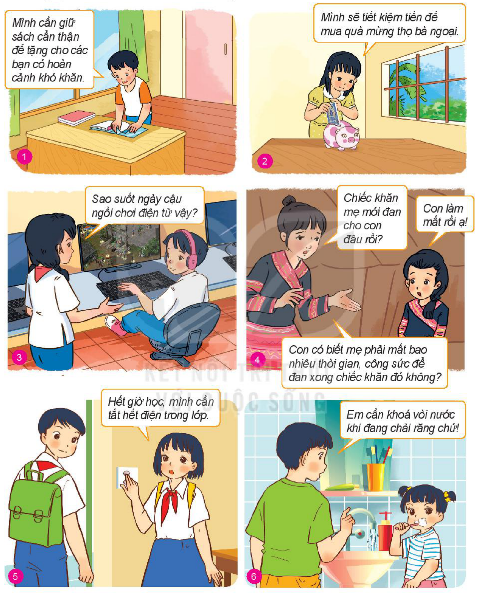
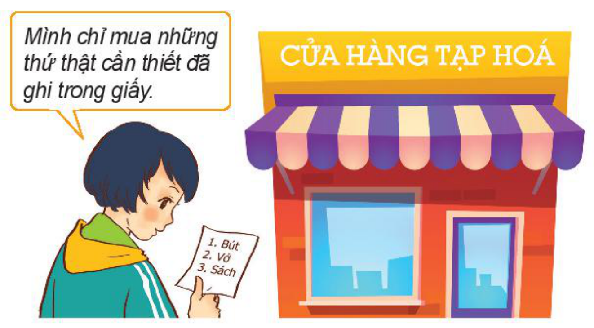
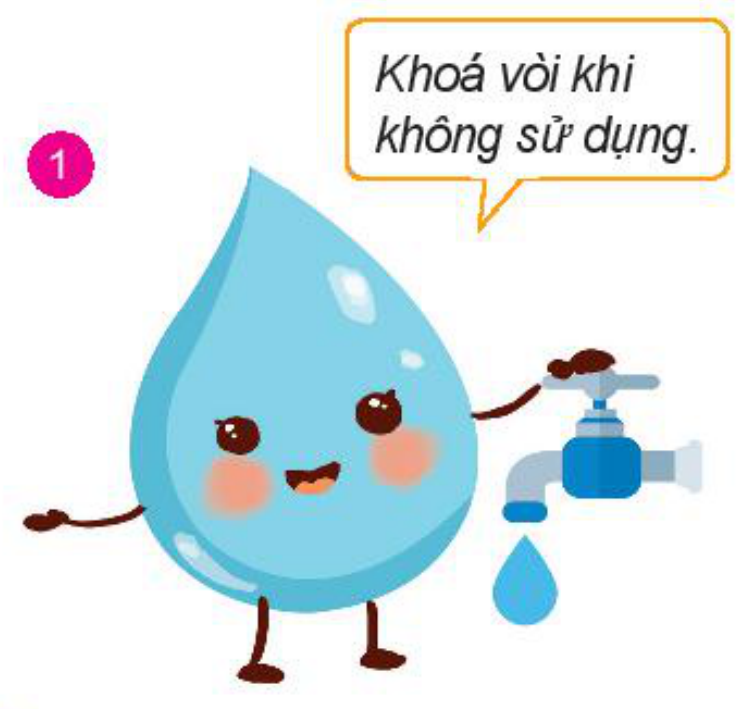
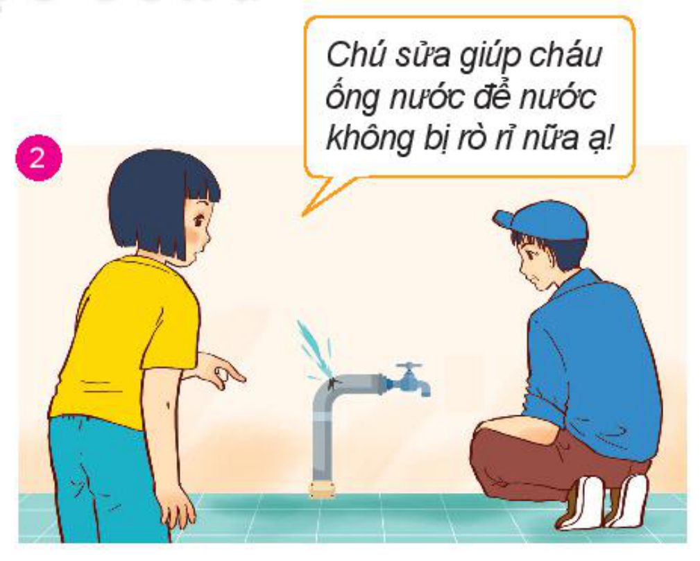

<!-- pdf:36 -->

# BÀI 8: TIẾT KIỆM

## 🎯 Sau bài học này, học sinh có thể:

- Nêu được khái niệm tiết kiệm và biểu hiện của tiết kiệm (tiền bạc, đồ dùng, thời gian, điện, nước,...).
- Hiểu vì sao phải tiết kiệm.
- Thực hành tiết kiệm trong cuộc sống, học tập.
- Nhận xét, đánh giá được việc thực hành tiết kiệm của bản thân và những người xung quanh, phê phán những biểu hiện lãng phí.

## 🔴 Khởi động

Em hãy cùng các bạn nghe/ hát bài hát "Đội em làm kế hoạch nhỏ" (sáng tác: Phong Nhã).

Em có suy nghĩ gì về ý nghĩa của hoạt động "làm kế hoạch nhỏ" của các bạn thiếu niên trong bài hát?

## KHÁM PHÁ

## 1. Tiết kiệm và biểu hiện của tiết kiệm

\* *Thế nào là tiết kiệm?*

Em hãy đọc câu chuyện và trả lời câu hỏi

> Mấy hôm nay, em Trang bị bệnh khiến cả nhà ai cũng lo lắng. Bố đi làm xa, mẹ bối rối vì thiếu tiền chữa bệnh cho em, Hải mở tủ lấy ra một chiếc hộp nhỏ đưa cho mẹ và nói:
>
> – Mẹ cầm lấy tiền để mua thuốc cho em ạ!
>
> Mẹ ngạc nhiên hỏi:
>
> – Tiền ở đâu mà con có vậy?
>
> Hải nhỏ nhẹ nói:
>
> – Tiền con bán giấy vụn, chai lọ, tiền được mừng tuổi,... con đều cất vào hộp để mua xe đạp nhưng việc chữa bệnh cho em cần thiết hơn ạ!
>
> Mẹ mỉm cười khen Hải:
>
> – Mẹ cảm ơn con, con ngoan quá, còn nhỏ đã biết tiết kiệm, thương bố mẹ, thương em.

> ❓
>
> a) Em có suy nghĩ gì về hành động của bạn Hải?
>
> b) Em hiểu thế nào là tiết kiệm?

<!-- pdf:37 -->

\* *Biểu hiện của tiết kiệm*

Em hãy quan sát các bức tranh dưới đây và trả lời câu hỏi

> 💬 *Tranh 1: “Mình cần giữ sách cẩn thận để tặng cho các bạn có hoàn cảnh khó khăn.”*
>
> *Tranh 2: “Mình sẽ tiết kiệm tiền để mua quà mừng thọ bà ngoại.”*
>
> *Tranh 3: “Sao suốt ngày cậu ngồi chơi điện tử vậy?”*
>
> *Tranh 4: Mẹ hỏi: “Chiếc khăn mẹ mới đan cho con đâu rồi?” – Con đáp: “Con làm mất rồi ạ!” – Mẹ nhắc: “Con có biết mẹ phải mất bao nhiêu thời gian, công sức để đan xong chiếc khăn đó không?”*
>
> *Tranh 5: “Hết giờ học, mình cần tắt hết điện trong lớp.”*
>
> *Tranh 6: “Em cần khoá vòi nước khi đang chải răng chứ!”*
<!-- ocr-ok: đối chiếu ảnh trang PDF 37 lời thoại trong tranh 1–6 -->

> ❓
>
> a) Em hãy chỉ ra những biểu hiện của tiết kiệm và chưa tiết kiệm trong các bức tranh trên.
>
> b) Em hãy kể thêm những biểu hiện của tiết kiệm và lãng phí.

<!-- pdf:38 -->

## 2. Ý nghĩa của tiết kiệm

Em hãy nghiên cứu các trường hợp dưới đây và trả lời câu hỏi

> 1. Anh Hoà là chủ cửa hàng tạp hoá, có thu nhập khá cao nhưng kiếm được bao nhiêu anh đều tiêu hết. Gần đây, công việc kinh doanh của anh không thuận lợi, anh lại lâm bệnh phải nằm viện. Cuộc sống của anh trở nên vô cùng khó khăn vì không có đủ tiền để thanh toán viện phí và trang trải các khoản chi tiêu cần thiết.
>
> ❓
>
> a) Em có nhận xét gì về cách chi tiêu của anh Hoà?
>
> b) Cách chi tiêu đó đã dẫn đến hậu quả gì?

> 2. Quang được mọi người yêu mến vì không chỉ học giỏi mà còn tham gia tích cực các hoạt động của trường, lớp. Bạn chia sẻ: “Mình luôn tiết kiệm thời gian, sắp xếp công việc hợp lí để thực hiện được những việc cần làm, những điều mình muốn”.
>
> ❓ Từ câu chuyện của bạn Quang, em hãy rút ra ý nghĩa của việc tiết kiệm thời gian.

> 3. Phong trào “Hộ gia đình tiết kiệm điện, tiết kiệm năng lượng” đã lan toả từ gia đình đến cộng đồng. Nhờ những hành động tiết kiệm điện, tiết kiệm năng lượng của mỗi người đã góp phần giảm mức tiêu thụ điện, tiêu thụ năng lượng, giảm thiểu khí thải ô nhiễm môi trường, tiết kiệm một phần lớn chi phí cho gia đình và quốc gia.
>
> ❓ Em hãy nêu ý nghĩa của việc tiết kiệm điện, tiết kiệm năng lượng.

<!-- pdf:39 -->

## 3. Cách thực hiện tiết kiệm

\* *Thực hiện tiết kiệm tiền*

> 💬 *Lời thoại trong tranh (trước Cửa hàng tạp hoá, tay cầm giấy ghi “1. Bút; 2. Vở; 3. Sách”): “Mình chỉ mua những thứ thật cần thiết đã ghi trong giấy.”*
<!-- ocr-ok: đối chiếu ảnh trang PDF 39 lời thoại và chữ trong tranh tiết kiệm tiền -->

> ❓ Bạn gái làm gì để tiết kiệm tiền? Hãy chia sẻ cách tiết kiệm tiền của em.

\* *Thực hiện tiết kiệm thời gian*

> 💬 *Bạn nữ hỏi: “Sao cậu có nhiều thời gian để vừa học giỏi vừa làm việc nhà và tham gia các hoạt động của trường, lớp vậy?” – Bạn nam đáp: “Tớ lập thời gian biểu và luôn thực hiện theo thời gian biểu đó, tránh xa tivi, điện thoại khi các việc cần làm chưa hoàn thành.”*

> ❓ Bạn nam đã thực hiện tiết kiệm thời gian như thế nào? Em hãy chia sẻ cách tiết kiệm thời gian của bản thân.

\* *Thực hiện tiết kiệm nước*

> 💬 *Tranh 1: “Khoá vòi khi không sử dụng.” Tranh 2: “Chú sửa giúp cháu ống nước để nước không bị rò rỉ nữa ạ!”*

> ❓
>
> a) Nội dung các bức tranh nhắc em cần làm gì để tiết kiệm nước?
>
> b) Em hãy nêu thêm những cách khác để tiết kiệm nước.

<!-- pdf:40 -->

\* *Thực hiện tiết kiệm điện*

Em hãy tham gia thảo luận cách thực hiện tiết kiệm điện cùng các bạn trong nhóm:

Minh: Tắt tất cả các phương tiện, thiết bị dùng điện khi không cần thiết.

Oanh: Sử dụng bóng đèn tiết kiệm điện.

Ninh: Tận dụng ánh sáng tự nhiên để không phải bật đèn.

> ❓ Em hãy nêu thêm những cách khác để tiết kiệm điện.

> – **Tiết kiệm** là biết sử dụng một cách hợp lí, đúng mức của cải vật chất, thời gian, sức lực của mình và của người khác.

<!-- term: Biểu hiện của tiết kiệm -->
> – Tiết kiệm biểu hiện ở việc: chi tiêu hợp lí; tắt các thiết bị điện và khoá vòi nước khi không sử dụng; sắp xếp thời gian làm việc khoa học; sử dụng hợp lí và khai thác hiệu quả tài nguyên (nước, khoáng sản,...); bảo quản đồ dùng học tập, lao động khi sử dụng; bảo vệ của công;...

<!-- term: Ý nghĩa của tiết kiệm -->
> – Tiết kiệm giúp chúng ta quý trọng thành quả lao động của bản thân và của người khác; đảm bảo cho cuộc sống ổn định, ấm no, hạnh phúc và thành công.

## ✏️ Luyện tập

1. Em hãy cùng các bạn trong nhóm thực hiện nhiệm vụ sau:

– Liệt kê những biểu hiện lãng phí đồ dùng học tập và cách tiết kiệm đồ dùng học tập của học sinh.

– Liệt kê những biểu hiện lãng phí thời gian và cách tiết kiệm thời gian của học sinh.

2. Em hãy nhận xét hành vi của các bạn dưới đây:

a. Khi ăn tự chọn ở nhà hàng, Lan chỉ lấy vừa đủ thức ăn.

b. Dương thường bật điều hoà, quạt trần, tivi suốt ngày ngay cả khi ra sân chơi với các bạn.

c. Quân rủ Tuấn ra quán chơi điện tử, tiêu hết cả số tiền mẹ mới cho để mua sách.

<!-- pdf:41 -->

3. Xử lí tình huống

> 1. Gia đình Lan sống bằng những đồng lương ít ỏi của bố. Mấy hôm nữa là đến sinh nhật Lan, nhóm bạn thân trong lớp gợi ý Lan tổ chức sinh nhật ở nhà hàng cho “sang trọng”.
>
> ❓ Nếu là Lan, em sẽ làm gì?

> 2. Từ hôm được mẹ mua cho chiếc điện thoại để tiện liên lạc, Hùng không muốn rời nó lúc nào. Ngoài những giờ học trên lớp, Hùng lại mở điện thoại lướt web, lên mạng xã hội tán chuyện với bạn bè, chơi điện tử nên đã sao nhãng chuyện học hành. Cô giáo và bố mẹ đã nhắc nhở nhưng Hùng vẫn không thay đổi vì cho rằng đó là cách để thư giãn, giảm bớt căng thẳng sau giờ học.
>
> ❓
>
> a) Em có nhận xét gì về việc sử dụng thời gian của Hùng? Điều này sẽ ảnh hưởng gì đến kết quả học tập?
>
> b) Em có lời khuyên gì cho Hùng?

> 3. Tuyết luôn nhận mình là người sống tiết kiệm, thích mua hàng giá rẻ nhưng không rõ nguồn gốc, xuất xứ. Bạn thường không chia sẻ đồ dùng của mình với các bạn vì cho rằng cần phải tiết kiệm.
>
> ❓ Em có đồng tình với cách tiết kiệm của Tuyết không? Vì sao?

## 🚀 Vận dụng

1. Em hãy cùng các bạn trong lớp xây dựng và thực hiện dự án thực hành tiết kiệm "Làm kế hoạch nhỏ" (ví dụ: thu gom sách, báo, truyện cũ,...).

2. Em hãy cùng các bạn thiết kế một sản phẩm tuyên truyền về tiết kiệm điện, nước.

## 📷 Danh sách hình trong bài

| Mã hình | Trang PDF | Trang sách | Chú thích |
| --- | --- | --- | --- |
| H6-giao_duc_cong_dan-b08-01 | 37 | 36 | Tranh 1–6: Các biểu hiện của tiết kiệm và chưa tiết kiệm |
| H6-giao_duc_cong_dan-b08-02 | 39 | 38 | Tranh minh hoạ cách thực hiện tiết kiệm tiền |
| H6-giao_duc_cong_dan-b08-03 | 39 | 38 | Tranh 1: Khoá vòi khi không sử dụng |
| H6-giao_duc_cong_dan-b08-04 | 39 | 38 | Tranh 2: Nhờ sửa ống nước bị rò rỉ để tiết kiệm nước |
