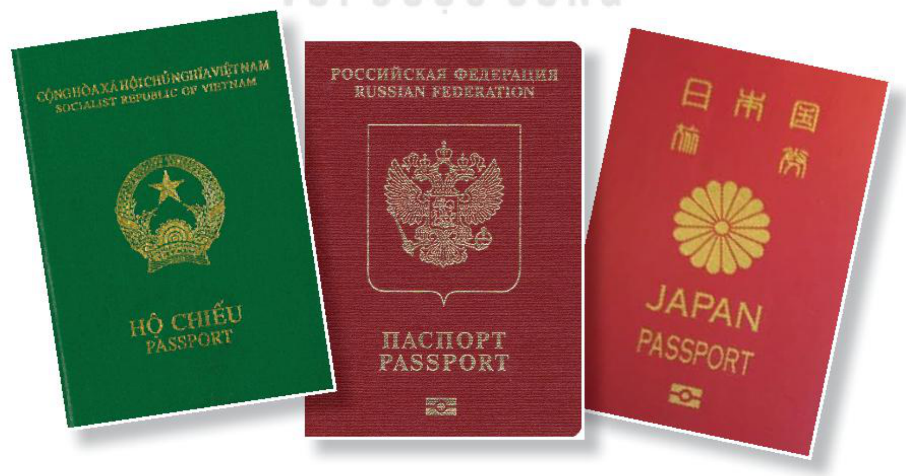
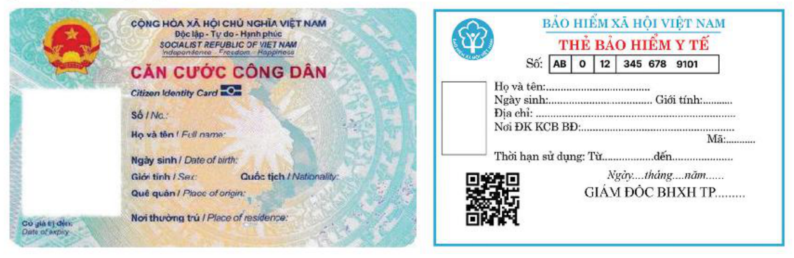
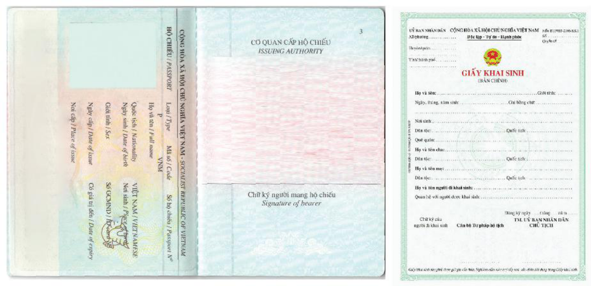

<!-- pdf:42 -->

# BÀI 9: CÔNG DÂN NƯỚC CỘNG HOÀ XÃ HỘI CHỦ NGHĨA VIỆT NAM

## 🎯 Sau bài học này, học sinh có thể:

- Nêu được khái niệm công dân.
- Nêu được căn cứ xác định công dân nước Cộng hoà xã hội chủ nghĩa Việt Nam.

## 🔴 Khởi động

Trước diễn biến phức tạp của đại dịch Covid-19 (năm 2020, 2021), Chính phủ Việt Nam đã tổ chức nhiều chuyến bay đón công dân Việt Nam từ những vùng dịch nguy hiểm trên thế giới về nước an toàn.

Theo em, vì sao Chính phủ Việt Nam quan tâm đến việc đưa công dân Việt Nam về nước? Hãy chia sẻ cảm xúc của em khi được là công dân Việt Nam.

## KHÁM PHÁ

## 1. Tìm hiểu khái niệm công dân

Em hãy quan sát các cuốn hộ chiếu dưới đây và cho biết đó là hộ chiếu của quốc gia nào. Ý nghĩa của những cuốn hộ chiếu đó?

<!-- pdf:43 -->

Em hãy đọc tình huống sau và trả lời câu hỏi

Nhóm của Toàn đang thảo luận về khái niệm công dân, một số ý kiến được nêu ra:

– Minh: Công dân là những người dân sống trong cùng một nước.

– Thắng: Công dân là những người dân sống trong một nước, có cùng màu da, cùng tiếng nói.

– Toàn: Công dân là người mang quốc tịch của quốc gia, có các quyền và nghĩa vụ do pháp luật quốc gia đó quy định.

> ❓ Theo em, ý kiến của bạn nào thể hiện đầy đủ khái niệm công dân? Giải thích vì sao.
<!-- ocr-ok: đối chiếu ảnh trang PDF 43 câu hỏi mục 1 -->

## 2. Căn cứ xác định công dân nước Cộng hoà xã hội chủ nghĩa Việt Nam

Đọc các thông tin pháp luật dưới đây để trả lời câu hỏi

> **Thông tin:**
>
> *Luật Quốc tịch Việt Nam năm 2008, sửa đổi, bổ sung năm 2014 (trích)*
>
> *Điều 5. Quan hệ giữa Nhà nước và công dân (trích)*
>
> 1. Người có quốc tịch Việt Nam là công dân Việt Nam.
>
> *Điều 15. Quốc tịch của trẻ em khi sinh ra có cha mẹ là công dân Việt Nam*
>
> Trẻ em sinh ra trong hoặc ngoài lãnh thổ Việt Nam mà khi sinh ra có cha mẹ đều là công dân Việt Nam thì có quốc tịch Việt Nam.
>
> *Điều 16. Quốc tịch của trẻ em khi sinh ra có cha hoặc mẹ là công dân Việt Nam*
>
> 1. Trẻ em sinh ra trong hoặc ngoài lãnh thổ Việt Nam mà khi sinh ra có cha hoặc mẹ là công dân Việt Nam còn người kia là người không quốc tịch hoặc có mẹ là công dân Việt Nam còn cha không rõ là ai thì có quốc tịch Việt Nam.
>
> 2. Trẻ em khi sinh ra có cha hoặc mẹ là công dân Việt Nam còn người kia là công dân nước ngoài thì có quốc tịch Việt Nam, nếu có sự thoả thuận bằng văn bản của cha mẹ vào thời điểm đăng kí khai sinh cho con. Trường hợp trẻ em được sinh ra trên lãnh thổ Việt Nam mà cha mẹ không thoả thuận được việc lựa chọn quốc tịch cho con thì trẻ em đó có quốc tịch Việt Nam.
>
> *Điều 17. Quốc tịch của trẻ em khi sinh ra có cha mẹ là người không quốc tịch*
>
> 1. Trẻ em sinh ra trên lãnh thổ Việt Nam mà khi sinh ra có cha mẹ đều là người không quốc tịch, nhưng có nơi thường trú tại Việt Nam thì có quốc tịch Việt Nam.

<!-- pdf:44 -->

> 2. Trẻ em sinh ra trên lãnh thổ Việt Nam mà khi sinh ra có mẹ là người không quốc tịch, nhưng có nơi thường trú tại Việt Nam, còn cha không rõ là ai thì có quốc tịch Việt Nam.
>
> *Điều 18. Quốc tịch của trẻ sơ sinh bị bỏ rơi, trẻ em được tìm thấy trên lãnh thổ Việt Nam (trích)*
>
> 1. Trẻ sơ sinh bị bỏ rơi, trẻ em được tìm thấy trên lãnh thổ Việt Nam mà không rõ cha mẹ là ai thì có quốc tịch Việt Nam.

> ❓
>
> a) Căn cứ nào để xác định một người là công dân Việt Nam?
>
> b) Trong những trường hợp dưới đây, trường hợp nào trẻ em là công dân Việt Nam?
>
> – Trẻ em khi sinh ra có cả cha và mẹ là công dân Việt Nam.
>
> – Trẻ em khi sinh ra có cha là công dân Việt Nam, mẹ là công dân nước ngoài.
>
> – Trẻ em khi sinh ra có mẹ là công dân Việt Nam, cha là người không quốc tịch.
>
> – Trẻ em sinh ra trên lãnh thổ Việt Nam có cha mẹ là người không có quốc tịch nhưng có nơi thường trú tại Việt Nam.
>
> – Trẻ em bị bỏ rơi ở Việt Nam, không rõ cha, mẹ là ai.

> – **Công dân** là người dân của một nước, có các quyền và nghĩa vụ được pháp luật quy định.

> – **Quốc tịch** là căn cứ xác định công dân của một nước, thể hiện mối quan hệ giữa Nhà nước và công dân nước đó.

> – **Công dân nước Cộng hoà xã hội chủ nghĩa Việt Nam** là người có quốc tịch Việt Nam.

## ✏️ Luyện tập

1. Quan sát các mẫu giấy tờ dưới đây và cho biết: Quốc tịch của một người được ghi nhận ở giấy tờ nào?

<!-- pdf:45 -->

2. Xử lí tình huống
<!-- ocr-ok: đối chiếu ảnh trang PDF 45 mục Luyện tập 2 -->

> 1. Bố mẹ Hùng là người Nga đến Việt Nam làm ăn, sinh sống. Hùng sinh ra và lớn lên ở Việt Nam. Có người nói Hùng là người Việt gốc Nga, không phải là công dân Việt Nam.
>
> ❓ Theo em, Hùng có phải là công dân Việt Nam không? Giải thích vì sao.

> 2. Bố của Lân là người Việt Nam, mẹ là người Đức. Lân sinh ra và lớn lên ở Việt Nam. Nhìn khuôn mặt Lân có nhiều nét của người châu Âu, các bạn trong lớp băn khoăn không biết Lân là công dân nước nào.
>
> ❓ Theo em, Lân có phải là công dân Việt Nam không? Giải thích vì sao.

## 🚀 Vận dụng

1. Em hãy vẽ một bức tranh hoặc sưu tầm tranh ảnh có nội dung thể hiện thông điệp tự hào là công dân Việt Nam.

2. Sưu tầm câu chuyện về tấm gương học sinh tiêu biểu thực hiện tốt Năm điều Bác Hồ dạy thiếu niên, nhi đồng. Viết những điều bản thân em đã học được từ tấm gương đó.

## 📷 Danh sách hình trong bài

| Mã hình | Trang PDF | Trang sách | Chú thích |
| --- | --- | --- | --- |
| H6-giao_duc_cong_dan-b09-01 | 42 | 41 | Hộ chiếu của Việt Nam, Liên bang Nga và Nhật Bản |
| H6-giao_duc_cong_dan-b09-02 | 44 | 43 | Mẫu thẻ Căn cước công dân và Thẻ bảo hiểm y tế |
| H6-giao_duc_cong_dan-b09-03 | 45 | 44 | Mẫu trang thông tin Hộ chiếu và Giấy khai sinh |
