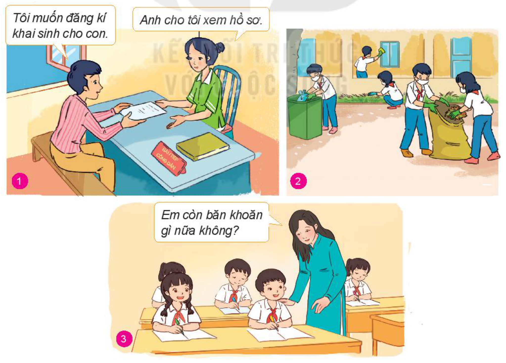
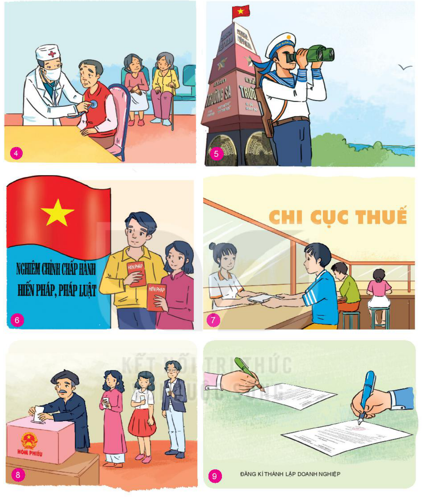

<!-- pdf:46 -->

# BÀI 10: QUYỀN VÀ NGHĨA VỤ CƠ BẢN CỦA CÔNG DÂN

## 🎯 Sau bài học này, học sinh có thể:

- Nêu được quy định của Hiến pháp nước Cộng hoà xã hội chủ nghĩa Việt Nam về quyền và nghĩa vụ cơ bản của công dân.
- Thực hiện được quyền và nghĩa vụ cơ bản của công dân phù hợp với lứa tuổi.

## 🔴 Khởi động

Lớp 6A có một số bạn nhà xa nên thường đi xe đạp điện đến trường. Trong đó, một vài bạn không đội mũ bảo hiểm.

Theo em, học sinh lớp 6 có được sử dụng xe đạp điện không?

Người điều khiển xe đạp điện khi tham gia giao thông có bắt buộc phải đội mũ bảo hiểm không? Vì sao?

## KHÁM PHÁ

## 1. Quyền và nghĩa vụ cơ bản của công dân theo Hiến pháp năm 2013

Hiến pháp năm 2013 được Quốc hội nước Cộng hoà xã hội chủ nghĩa Việt Nam khoá XIII, kì họp thứ 6 thông qua ngày 28–11–2013. Quyền và nghĩa vụ cơ bản của công dân được quy định trong Chương II. Đó là các quyền cơ bản về chính trị, dân sự, kinh tế, văn hoá, xã hội được công nhận, tôn trọng, bảo vệ, bảo đảm theo Hiến pháp và pháp luật.

Em hãy đọc thông tin kết hợp với quan sát các hình ảnh dưới đây để xác định các nhóm quyền và nêu nội dung các quyền và nghĩa vụ cơ bản của công dân Việt Nam được quy định trong Hiến pháp năm 2013; Hãy ghép các hình ảnh với nhóm quyền và nghĩa vụ phù hợp.

<!-- term: Nhóm quyền chính trị của công dân -->
> 1. Nhóm quyền chính trị: quyền bầu cử, ứng cử vào các cơ quan quyền lực nhà nước (Điều 27); quyền tham gia quản lí nhà nước (Điều 28); quyền tự do ngôn luận, tự do báo chí (Điều 25); quyền tự do tín ngưỡng, tôn giáo (Điều 24);...

<!-- pdf:47 -->

<!-- term: Nhóm quyền dân sự của công dân -->
> 2. Nhóm quyền dân sự: quyền sống (Điều 19); quyền bất khả xâm phạm về thân thể, được pháp luật bảo hộ về sức khoẻ, danh dự và nhân phẩm (Điều 20); quyền bất khả xâm phạm về đời sống riêng tư, bí mật cá nhân và bí mật gia đình (Điều 21); quyền bất khả xâm phạm về chỗ ở (Điều 22); quyền tự do đi lại và cư trú (Điều 23); quyền bình đẳng giới (Điều 26); quyền tự do kết hôn và li hôn (Điều 36);...

<!-- term: Nhóm quyền về kinh tế của công dân -->
> 3. Nhóm quyền về kinh tế: quyền tự do kinh doanh (Điều 33); quyền có việc làm (Điều 35); quyền sở hữu về thu nhập hợp pháp, của cải để dành, nhà ở, tư liệu sinh hoạt, tư liệu sản xuất (Điều 32);...

<!-- term: Nhóm quyền văn hoá, xã hội của công dân -->
> 4. Nhóm quyền văn hoá, xã hội: quyền học tập (Điều 39); quyền nghiên cứu khoa học và công nghệ, sáng tạo văn học, nghệ thuật (Điều 40); quyền được đảm bảo an sinh xã hội (Điều 34); quyền được bảo vệ, chăm sóc sức khoẻ (Điều 38);...

> 5. Các nghĩa vụ cơ bản mà công dân phải thực hiện: trung thành với Tổ quốc (Điều 44); thực hiện nghĩa vụ quân sự và tham gia xây dựng nền quốc phòng toàn dân (Điều 45); tuân theo Hiến pháp và pháp luật (Điều 46); nộp thuế (Điều 47); bảo vệ môi trường (Điều 43); nghĩa vụ học tập (Điều 39);...

> 💬 *Hình 1 (tại Bàn tiếp công dân): Người dân: “Tôi muốn đăng kí khai sinh cho con.” – Cán bộ: “Anh cho tôi xem hồ sơ.” Hình 2: Học sinh dọn vệ sinh, thu gom rác bảo vệ môi trường. Hình 3: Cô giáo giảng bài trên lớp: “Em còn băn khoăn gì nữa không?”*
<!-- ocr-ok: đối chiếu ảnh trang PDF 47 lời thoại và nội dung hình 1–3 -->

<!-- pdf:48 -->

> 🖼️ *Hình 4: Bác sĩ khám sức khoẻ cho người cao tuổi. Hình 5: Chiến sĩ Hải quân canh gác bảo vệ chủ quyền tại đảo Trường Sa. Hình 6: Công dân nghiêm chỉnh chấp hành Hiến pháp, pháp luật. Hình 7: Công dân làm thủ tục nộp thuế tại Chi cục Thuế. Hình 8: Công dân bỏ phiếu bầu cử tại hòm phiếu. Hình 9: Kí hồ sơ đăng kí thành lập doanh nghiệp.*
<!-- ocr-ok: đối chiếu ảnh trang PDF 48 mô tả hình 4–9 -->

## 2. Thực hiện quyền, nghĩa vụ cơ bản của công dân

Em hãy đọc các thông tin, tình huống dưới đây và trả lời câu hỏi

– Hương là học sinh lớp 6, ngoài việc học tốt, bạn còn chăm chỉ lao động, giúp đỡ bố mẹ làm việc nhà.

– Thấy bác lao công đang quét dọn sân trường, Bình vứt luôn vỏ hộp sữa xuống sân để bác dọn.

<!-- pdf:49 -->

– Biết Phương định bóc thư của bạn khác để xem, Minh đã khuyên Phương không nên làm như vậy vì sẽ xâm phạm quyền bí mật thư tín.

– Ngày nào bố mẹ cũng phải nhắc Thắng học bài nhưng bạn chỉ ôn bài khi sắp tới kì kiểm tra.

– Nhiều lần chứng kiến chú Hưng đánh con, nên Hà đã gọi điện báo với Tổng đài điện thoại quốc gia bảo vệ trẻ em 111.

– Gia đình Liên tìm mọi cách để anh trai không phải thực hiện nghĩa vụ quân sự. Biết chuyện, Liên không tán thành và khuyên anh nên thực hiện nghĩa vụ quân sự.

– Nhà trường tổ chức lấy ý kiến của học sinh nhưng Trang không tham gia vì cho rằng ý kiến của trẻ em sẽ không được thực hiện.

– Hùng luôn tích cực học tập và rèn luyện để sau này trở thành người công dân có ích cho xã hội.

> ❓
>
> a) Em hãy xác định những ai đã thực hiện đúng, ai thực hiện chưa đúng quyền và nghĩa vụ cơ bản của công dân? Vì sao?
>
> b) Là học sinh, em đã được hưởng những quyền và phải thực hiện các nghĩa vụ cơ bản nào của công dân? Em đã làm gì để thực hiện đúng các nghĩa vụ đó?

> – **Quyền cơ bản của công dân** là những lợi ích cơ bản mà công dân được hưởng, được Nhà nước bảo vệ và đảm bảo theo Hiến pháp và pháp luật.

> – **Nghĩa vụ cơ bản của công dân** là những việc mà Nhà nước bắt buộc công dân phải thực hiện theo quy định của Hiến pháp và pháp luật.

> – Các quyền con người, quyền công dân về chính trị, dân sự, kinh tế, văn hoá, xã hội được công nhận, tôn trọng, bảo vệ, bảo đảm theo Hiến pháp và pháp luật nước Cộng hoà xã hội chủ nghĩa Việt Nam.

<!-- term: Mối quan hệ giữa quyền và nghĩa vụ công dân -->
> – Quyền công dân không tách rời nghĩa vụ công dân. Công dân được hưởng các quyền và phải thực hiện các nghĩa vụ do Nhà nước quy định. Mọi người có nghĩa vụ tôn trọng quyền của người khác.

> – Việc thực hiện quyền công dân không được xâm phạm lợi ích quốc gia, dân tộc, quyền và lợi ích hợp pháp của người khác.

<!-- term: Bình đẳng trước pháp luật -->
> – Mọi người đều bình đẳng trước pháp luật. Không ai bị phân biệt đối xử trong đời sống chính trị, dân sự, kinh tế, văn hoá, xã hội.

<!-- pdf:50 -->

## ✏️ Luyện tập

1. Em hãy tìm hiểu và ghi chép nội dung các quyền và nghĩa vụ cơ bản của công dân được quy định trong Hiến pháp năm 2013.

2. Em hãy cho biết, bạn nào dưới đây thực hiện tốt, bạn nào thực hiện chưa tốt quyền và nghĩa vụ cơ bản của công dân.

a. Ngoài giờ học ở trường, Kim thường tự học ở nhà và dành thời gian làm việc nhà giúp bố mẹ.

b. Mặc dù nhà rất nghèo nhưng bố mẹ vẫn cố gắng để Thu được tới trường. Tuy nhiên, Thu cho rằng: “Nhà mình nghèo, có cố gắng học cũng không mang lại ích lợi gì”. Thu đến trường chỉ vì bố mẹ muốn, do vậy kết quả học tập của Thu rất kém.

c. Nam thường quát mắng, doạ nạt và đánh em gái vì em hay khóc và bày đồ chơi bừa bãi.

d. Hưng là học sinh cá biệt, hay nghịch. Hôm nay, Hưng rủ các bạn đá bóng trong sân trường và làm vỡ cửa kính lớp học. Cô giáo chủ nhiệm gửi giấy thông báo và nhờ Hưng đưa cho bố mẹ. Trên đường về, Hưng đã bóc thư ra xem trước.

3. Xử lí tình huống
<!-- ocr-ok: đối chiếu ảnh trang PDF 50 mục Luyện tập 3 -->

> 1. Lan là một học sinh hoạt bát, tích cực tham gia các hoạt động của lớp và liên đội nhưng mẹ Lan thường ngăn cấm không cho Lan tham gia các hoạt động tập thể vì cho rằng sẽ ảnh hưởng đến việc học tập.
>
> ❓ Theo em, Lan nên làm gì để mẹ không ngăn cấm mình tham gia hoạt động tập thể?

> 2. Mặc dù công việc của bố mẹ Hà rất vất vả nhưng Hà ít khi làm việc nhà để giúp đỡ bố mẹ vì nghĩ rằng mình chỉ cần có nghĩa vụ học giỏi là đủ.
>
> ❓
>
> a) Em suy nghĩ gì về việc làm của Hà?
>
> b) Theo em, Hà cần làm gì để thực hiện tốt quyền và nghĩa vụ của học sinh?

## 🚀 Vận dụng

1. Em hãy vẽ bức tranh hoặc sưu tầm một câu chuyện thể hiện một việc làm thực hiện tốt quyền và nghĩa vụ cơ bản của công dân và thuyết minh về bức tranh, câu chuyện đó.

2. Em hãy viết khoảng nửa trang giấy về nghĩa vụ của học sinh và những việc em đã làm để thực hiện nghĩa vụ đó.

## 📷 Danh sách hình trong bài

| Mã hình | Trang PDF | Trang sách | Chú thích |
| --- | --- | --- | --- |
| H6-giao_duc_cong_dan-b10-01 | 47 | 46 | Hình 1–3: Minh hoạ quyền và nghĩa vụ cơ bản của công dân |
| H6-giao_duc_cong_dan-b10-02 | 48 | 47 | Hình 4–9: Minh hoạ quyền và nghĩa vụ cơ bản của công dân |
