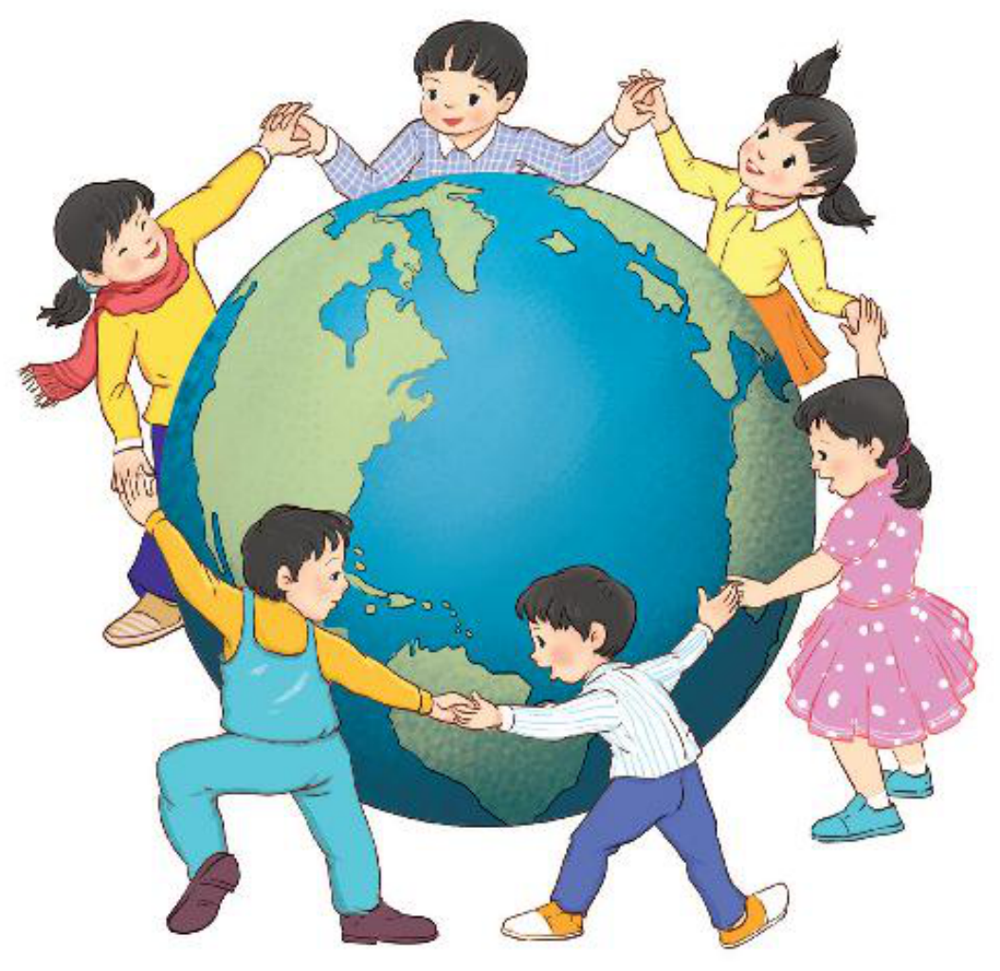
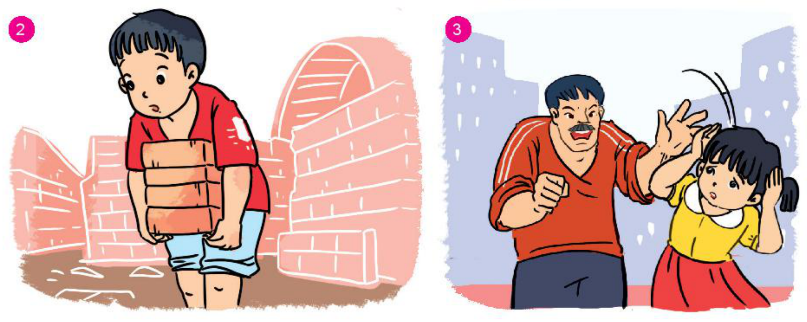
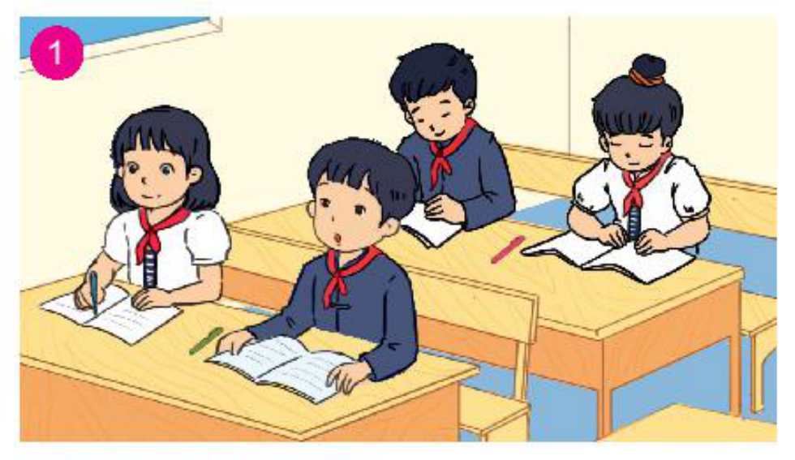
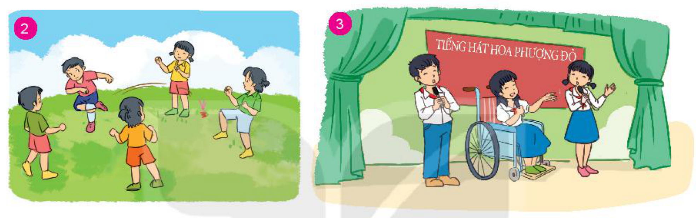
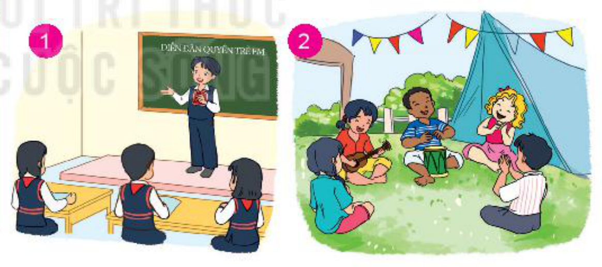

<!-- pdf:51 -->

# BÀI 11: QUYỀN CƠ BẢN CỦA TRẺ EM

## 🎯 Sau bài học này, học sinh có thể:

- Nêu được các quyền cơ bản của trẻ em.
- Nêu được ý nghĩa của quyền trẻ em và thực hiện quyền trẻ em.

## 🔴 Khởi động

Cùng nghe bài hát “Quyền trẻ em” (sáng tác: Trịnh Vĩnh Thành).

Em hãy ghi lại tên các quyền trẻ em được nhắc tới trong bài hát.

## KHÁM PHÁ

## 1. Tìm hiểu các nhóm quyền cơ bản của trẻ em

Ngày 20–11–1989 Đại hội đồng Liên hợp quốc đã thông qua Công ước quốc tế về quyền trẻ em. Việt Nam là quốc gia đầu tiên ở châu Á và là quốc gia thứ hai trên thế giới phê chuẩn Công ước của Liên hợp quốc về quyền trẻ em vào ngày 20–2–1990.

Căn cứ theo Hiến pháp nước Cộng hoà xã hội chủ nghĩa Việt Nam và tiếp thu những nội dung của Công ước về quyền trẻ em, Quốc hội đã xây dựng và ban hành Luật Trẻ em năm 2016. Theo đó, trẻ em có bốn nhóm quyền cơ bản sau: Nhóm quyền được sống còn; Nhóm quyền được bảo vệ; Nhóm quyền được phát triển; Nhóm quyền được tham gia.

<!-- pdf:52 -->

\* *Nhóm quyền được sống còn*

Em hãy đọc thông tin kết hợp với quan sát các hình ảnh dưới đây để xác định các quyền trong nhóm quyền được sống còn của trẻ em.

> Trẻ em có quyền được sống và được đáp ứng các nhu cầu cơ bản để tồn tại như: có nơi ở, được khai sinh, nuôi dưỡng, chăm sóc sức khoẻ,... Trẻ em còn non nớt về thể chất và tinh thần nên gặp nhiều nguy cơ nhất cho sự sống còn. Vì vậy, trẻ em rất cần được quan tâm, chăm sóc về dinh dưỡng, y tế và tình cảm để duy trì sự sống.
>
> 💬 *Hình 1: Bác sĩ khám sức khoẻ cho trẻ em. Hình 2: Bố chăm sóc con: “Con ăn nhiều cho mau khoẻ nhé!”*

\* *Nhóm quyền được bảo vệ*

Em hãy đọc thông tin kết hợp với quan sát các hình ảnh dưới đây để xác định các quyền trong nhóm quyền được bảo vệ của trẻ em.

> Trẻ em còn non nớt về thể chất, trí tuệ, nhân cách và sự trải nghiệm cuộc sống nên phải được bảo vệ để chống lại tất cả các hình thức bóc lột lao động, xâm hại tình dục, lạm dụng ma tuý, sao nhãng và bị bỏ rơi, bị bắt cóc,... Trẻ em cần được bảo vệ khỏi sự can thiệp vô cớ vào thư tín và sự riêng tư.

> 💬 *Hình 1: Bạn nhỏ hỏi bố: “Sao bố lại đọc nhật kí của con?” Hình 2: Em nhỏ phải bê chồng gạch nặng quá sức. Hình 3: Người lớn giơ tay doạ đánh trẻ em.*
<!-- ocr-ok: đối chiếu ảnh trang PDF 52 lời thoại và nội dung hình 1–3 -->

<!-- pdf:53 -->

\* *Nhóm quyền được phát triển*

Em hãy đọc thông tin kết hợp với quan sát các hình ảnh dưới đây để xác định các quyền trong nhóm quyền được phát triển của trẻ em.

> Trẻ em có quyền được tạo điều kiện để phát triển toàn diện, bao gồm việc học tập, vui chơi, tham gia các hoạt động văn hoá, tiếp nhận thông tin, tự do tư tưởng, tự do tín ngưỡng và tôn giáo. Trẻ em cần có sự yêu thương và cảm thông của cha mẹ để phát triển hài hoà.

\* *Nhóm quyền được tham gia*

Em hãy đọc thông tin kết hợp với quan sát các hình ảnh dưới đây để xác định các quyền trong nhóm quyền được tham gia của trẻ em.

> Trẻ em có quyền được tham gia vào những công việc có ảnh hưởng đến cuộc sống của các em như: được bày tỏ ý kiến, được lắng nghe, tôn trọng, được kết giao, được bàn bạc và quyết định,...

## 2. Ý nghĩa của quyền trẻ em và thực hiện quyền trẻ em

Em hãy đọc các thông tin sau và trả lời câu hỏi

> 1. Công ước Liên hợp quốc về quyền trẻ em đã thể hiện sự quan tâm của cộng đồng quốc tế đối với trẻ em. Công ước đảm bảo cho trẻ em được sống, được phát triển trong bầu không khí hạnh phúc, yêu thương, an toàn, lành mạnh, bình đẳng; được tham gia vào các hoạt động xã hội; được phát triển đầy đủ, toàn diện về thể chất và tinh thần.

<!-- pdf:54 -->

> 2. Thời phong kiến, pháp luật chủ yếu bảo hộ quyền lợi của giai cấp thống trị, quyền trẻ em không được đảm bảo. Nhiều gia đình vì quá nghèo, không đủ điều kiện nuôi dưỡng nên đã phải bán con cho các gia đình giàu có. Các em phải làm việc vất vả, không được ăn no, không được học hành, hay bị đánh, mắng,...

> ❓
>
> a) Em hãy cho biết, quyền trẻ em có ý nghĩa như thế nào?
>
> b) Theo em, điều gì sẽ xảy ra nếu quyền trẻ em không được thực hiện?

> – **Quyền cơ bản của trẻ em** là những lợi ích cơ bản mà trẻ em được hưởng và được Nhà nước bảo vệ.

> – Công ước của Liên hợp quốc về quyền trẻ em năm 1989 và Luật Trẻ em năm 2016 đã ghi nhận các quyền cơ bản của trẻ em. Các quyền đó có thể chia thành bốn nhóm:

> + **Nhóm quyền sống còn**: là những quyền được sống và được đáp ứng các nhu cầu cơ bản để tồn tại như được nuôi dưỡng, chăm sóc sức khoẻ,...

> + **Nhóm quyền bảo vệ**: là những quyền nhằm bảo vệ trẻ em khỏi mọi hình thức phân biệt đối xử, bị bỏ rơi, bị bóc lột và xâm hại.

> + **Nhóm quyền phát triển**: là những quyền được đáp ứng các nhu cầu cho sự phát triển một cách toàn diện như được học tập, được vui chơi giải trí, tham gia các hoạt động văn hoá, nghệ thuật,...

> + **Nhóm quyền tham gia**: là những quyền được tham gia vào những công việc có ảnh hưởng đến cuộc sống của trẻ em như được bày tỏ ý kiến, nguyện vọng của mình.

<!-- term: Ý nghĩa của quyền trẻ em -->
> – Quyền trẻ em là điều kiện cần thiết để trẻ em được phát triển đầy đủ, toàn diện về thể chất và tinh thần. Thực hiện quyền trẻ em đảm bảo cho trẻ em được sống, được phát triển trong bầu không khí hạnh phúc, yêu thương, an toàn, lành mạnh, bình đẳng.

<!-- term: Bổn phận của trẻ em -->
> – Bổn phận của trẻ em: yêu quý, kính trọng, hiếu thảo với ông bà, cha mẹ; kính trọng thầy, cô giáo; lễ phép với người lớn, thương yêu em nhỏ, đoàn kết với bạn bè; giúp đỡ gia đình và những người gặp khó khăn theo khả năng của mình; chăm chỉ học tập, rèn luyện thân thể; sống khiêm tốn, trung thực và có đạo đức; tôn trọng pháp luật; tuân theo nội quy của nhà trường; tôn trọng, giữ gìn bản sắc văn hoá dân tộc; yêu quê hương, đất nước, yêu đồng bào, có ý thức xây dựng, bảo vệ Tổ quốc và đoàn kết quốc tế;...

<!-- pdf:55 -->

## ✏️ Luyện tập

1. Trò chơi “Tiếp sức” kể về bốn nhóm quyền của trẻ em

Mỗi nhóm lựa chọn một trong bốn nhóm quyền của trẻ em (quyền được sống còn, quyền được bảo vệ, quyền được phát triển, quyền được tham gia) để kể về từng quyền cụ thể của trẻ em ở nhóm quyền đó.

2. Em hãy sắp xếp các quyền cụ thể của trẻ em dưới đây theo bốn nhóm quyền theo bảng mẫu:

| Nhóm quyền được sống còn | Nhóm quyền được bảo vệ | Nhóm quyền được phát triển | Nhóm quyền được tham gia |
| --- | --- | --- | --- |
| ... | ... | ... | ... |

a. Trẻ em đến tuổi đi học được tới trường.

b. Trẻ em mồ côi được chăm sóc tại cơ sở bảo trợ.

c. Trẻ em có năng khiếu múa hát được học ở các trường nghệ thuật.

d. Trẻ em được viết thư kết bạn, giao lưu với bạn bè năm châu.

e. Trẻ em không phải làm các công việc nặng nhọc, quá sức so với bản thân.

g. Trẻ em được tiêm phòng vắc xin theo quy định của Nhà nước.

h. Trẻ em có quyền có quốc tịch.

i. Trẻ em khuyết tật được học ở các trường chuyên biệt.

k. Trẻ em có quyền được bày tỏ ý kiến, quan điểm cá nhân.

l. Trẻ em được bảo vệ, chống lại việc bóc lột, xâm hại.

3. Em hãy kể về một tấm gương thực hiện tốt quyền của trẻ em. Em học được điều gì từ tấm gương đó?

4. Xử lí tình huống

> Bố mẹ mua cho Quân rất nhiều sách tham khảo, Quân không thích đọc nên mang sách cho bạn. Khi biết chuyện, bố mẹ rất tức giận và đã mắng Quân. Quân cảm thấy rất ấm ức vì cho rằng mình là trẻ em nên có quyền cho bạn sách, bố mẹ không được phản đối.
>
> ❓
>
> a) Quân hiểu về quyền trẻ em trong tình huống này đúng hay sai? Vì sao?
>
> b) Nếu là Quân, em sẽ ứng xử như thế nào?

## 🚀 Vận dụng

1. Em hãy sưu tầm hoặc vẽ tranh về quyền trẻ em và chia sẻ ý nghĩa của bức tranh đó.

2. Em hãy viết thư tư vấn cho một bạn hay bị bố đánh và doạ cho nghỉ học để giúp bạn được hưởng các quyền cơ bản của trẻ em.

## 📷 Danh sách hình trong bài

| Mã hình | Trang PDF | Trang sách | Chú thích |
| --- | --- | --- | --- |
| H6-giao_duc_cong_dan-b11-01 | 51 | 50 | Tranh minh hoạ quyền cơ bản của trẻ em |
| H6-giao_duc_cong_dan-b11-02 | 52 | 51 | Hình 2–3 (Nhóm quyền được bảo vệ): Bảo vệ trẻ em khỏi bóc lột lao động và bạo lực |
| H6-giao_duc_cong_dan-b11-03 | 53 | 52 | Hình 1 (Nhóm quyền được phát triển): Quyền được học tập |
| H6-giao_duc_cong_dan-b11-04 | 53 | 52 | Hình 2–3 (Nhóm quyền được phát triển): Quyền vui chơi giải trí và tham gia văn nghệ |
| H6-giao_duc_cong_dan-b11-05 | 53 | 52 | Hình 1–2 (Nhóm quyền được tham gia): Quyền bày tỏ ý kiến và kết giao bạn bè |
