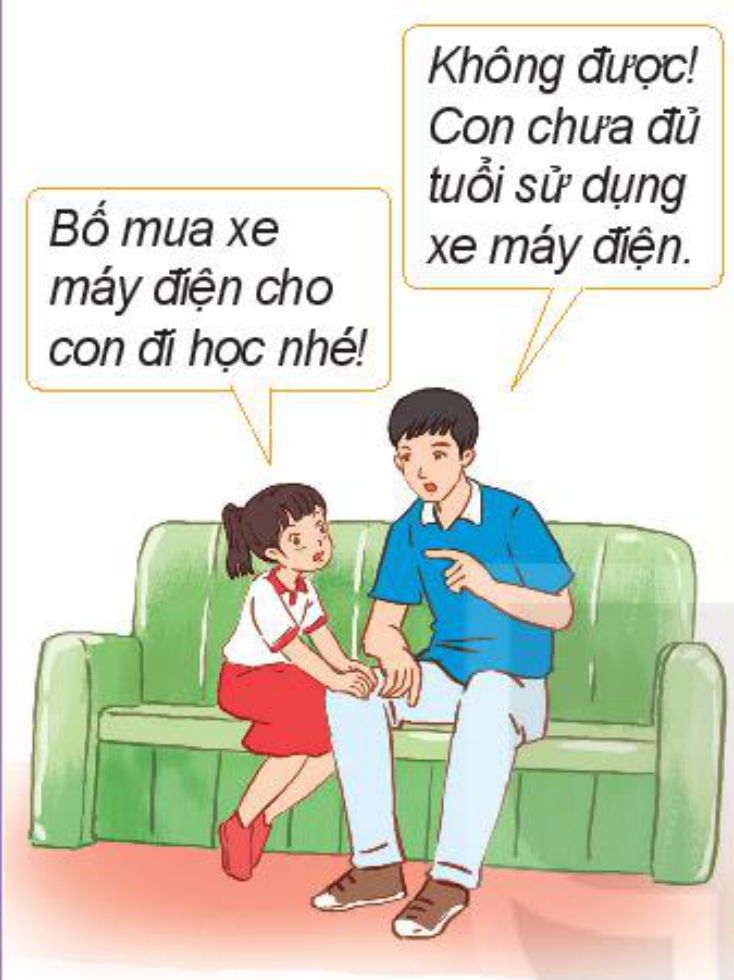
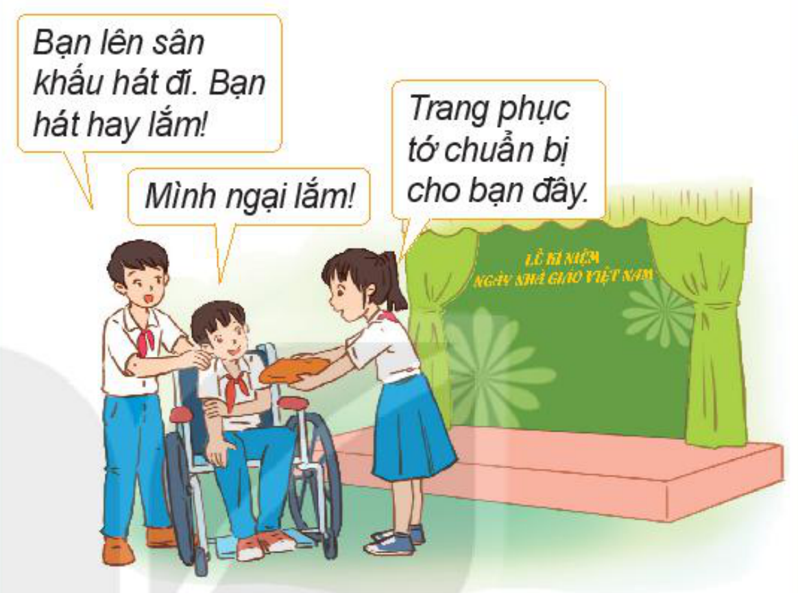

<!-- pdf:56 -->

# BÀI 12: THỰC HIỆN QUYỀN TRẺ EM

## 🎯 Sau bài học này, học sinh có thể:

- Nêu được trách nhiệm của gia đình, nhà trường, xã hội trong việc thực hiện quyền trẻ em.
- Phân biệt được hành vi thực hiện quyền trẻ em và hành vi vi phạm quyền trẻ em.
- Thực hiện tốt quyền và bổn phận của trẻ em.
- Nhận xét, đánh giá được việc thực hiện quyền trẻ em của bản thân, gia đình, nhà trường, cộng đồng; bày tỏ được nhu cầu để thực hiện tốt hơn quyền trẻ em.

## 🔴 Khởi động

Cùng nghe bài hát “Dấu chấm hỏi” (sáng tác: Thế Hiển).

Bạn nhỏ trong bài hát không được hưởng những quyền nào của trẻ em? Theo em, ai sẽ chịu trách nhiệm đảm bảo quyền trẻ em cho bạn nhỏ này?

## KHÁM PHÁ

## 1. Trách nhiệm của học sinh trong việc thực hiện quyền và bổn phận của trẻ em

Em hãy đọc các tình huống dưới đây và trả lời câu hỏi

> 1. Đã vài lần Long trông thấy chú Hưng hàng xóm đánh đập con trai. Long rất thương em nên đã kể lại chuyện này với bố và nhờ bố tìm cách để giúp đỡ em.
>
> 💬 *Lời thoại trong tranh: “Bố ơi, chú Hưng hàng xóm lại đang đánh con chú ấy ạ!”*

<!-- pdf:57 -->

> 2. Lên lớp 6, Lan đòi bố mua xe máy điện để đi học nhưng bố không đồng ý vì Lan chưa đủ tuổi sử dụng. Lan nghĩ bố không thương mình nên giận dỗi, nhịn ăn.

> 💬 *Tình huống 2: Lan nói: “Bố mua xe máy điện cho con đi học nhé!” – Bố đáp: “Không được! Con chưa đủ tuổi sử dụng xe máy điện.”*

> 3. Do phải ngồi xe lăn từ nhỏ nên Hoàng tự ti, ngại giao tiếp. Nhà trường tổ chức cuộc thi văn nghệ chào mừng ngày Nhà giáo Việt Nam, biết Hoàng có giọng hát hay, các bạn trong lớp đã động viên, khích lệ, chuẩn bị cả trang phục để Hoàng tham gia thi khiến bạn rất cảm động.

> 💬 *Tình huống 3: Bạn nam nói: “Bạn lên sân khấu hát đi. Bạn hát hay lắm!” – Hoàng đáp: “Mình ngại lắm!” – Bạn nữ đưa áo nói: “Trang phục tớ chuẩn bị cho bạn đây.”*
<!-- ocr-ok: đối chiếu ảnh trang PDF 57 lời thoại trong tranh tình huống 3 -->

> ❓
>
> a) Em hãy cho biết, trong các tình huống trên, bạn nào đã thực hiện đúng, bạn nào thực hiện chưa đúng quyền và bổn phận của trẻ em. Vì sao?
>
> b) Theo em, học sinh có trách nhiệm như thế nào trong việc thực hiện quyền và bổn phận của trẻ em?

## 2. Trách nhiệm của gia đình, nhà trường và xã hội trong việc thực hiện quyền trẻ em

Em hãy đọc thông tin, tình huống sau và trả lời câu hỏi

> 1. Nghỉ hè về thăm quê, An được ông bà dẫn đi tham quan và kể cho nghe nhiều câu chuyện thú vị về các di tích lịch sử ở địa phương. Ông bà còn dạy An cách trồng rau và chăm sóc vật nuôi trong nhà. Đây thật là một kì nghỉ vui vẻ, bổ ích.

<!-- pdf:58 -->

> 2. Trường học của Lâm có kế hoạch tổ chức hoạt động ngoại khoá cho học sinh. Để tổ chức các hoạt động phù hợp với học sinh, nhà trường đã đưa ra một số nội dung hoạt động ngoại khoá để các em đóng góp ý kiến và lựa chọn nội dung mà các em thấy hứng thú nhất.

> 3. Chính quyền xã K đã tổ chức cuộc thi tìm hiểu về pháp luật giao thông nhằm nâng cao hiểu biết và ý thức tham gia giao thông an toàn của học sinh. Cùng với những phần quà có ý nghĩa, Ban tổ chức còn tuyên truyền đến từng thôn xóm để các gia đình động viên con em mình tham gia cuộc thi.

> 4. Nhận được tin báo của anh Hải, cơ quan công an đã điều tra, bắt giữ vợ chồng ông Nam về hành vi thường xuyên đánh đập con nuôi là bé Tùng. Toà án đã xét xử và tuyên phạt án tù vợ chồng ông Nam về hành vi hành hạ người khác và hành vi cố ý gây thương tích hoặc gây tổn hại cho sức khoẻ của người khác.

> ❓
>
> a) Theo em, gia đình, nhà trường và xã hội có trách nhiệm như thế nào trong việc thực hiện quyền trẻ em?
>
> b) Theo em, những hành vi xâm phạm quyền trẻ em sẽ bị xử lí như thế nào?

<!-- term: Thực hiện quyền trẻ em -->
> Thực hiện các quyền trẻ em là trách nhiệm chung của mỗi cá nhân, gia đình, nhà trường và xã hội. Cụ thể:

<!-- term: Trách nhiệm của học sinh trong việc thực hiện quyền trẻ em -->
> – Đối với học sinh: tích cực, chủ động thực hiện các quyền trẻ em để phát triển và bảo vệ bản thân; đồng tình ủng hộ các hành vi thực hiện đúng quyền trẻ em và phê phán những hành vi vi phạm quyền trẻ em,...

<!-- term: Trách nhiệm của gia đình trong việc thực hiện quyền trẻ em -->
> – Đối với gia đình: tiến hành khai sinh, chăm sóc, nuôi dưỡng, giáo dục trẻ em; tạo điều kiện, khuyến khích trẻ em tham gia các hoạt động học tập, vui chơi giải trí, phát triển năng khiếu phù hợp; quản lí và bảo vệ trẻ em khỏi các nguy cơ bị xâm hại, bị lạm dụng, bị mua bán,...

<!-- term: Trách nhiệm của nhà trường trong việc thực hiện quyền trẻ em -->
> – Đối với nhà trường: quản lí, chăm sóc sức khoẻ, giáo dục trẻ em; đảm bảo môi trường học tập an toàn cho học sinh,...

<!-- term: Trách nhiệm của xã hội trong việc thực hiện quyền trẻ em -->
> – Đối với xã hội: đảm bảo các quyền trẻ em được thực hiện; xử lí nghiêm minh các hành vi vi phạm quyền trẻ em; xây dựng, thực hiện các chính sách về quyền trẻ em, cung cấp các dịch vụ an toàn, bảo vệ quyền lợi của trẻ,...

<!-- pdf:59 -->

## ✏️ Luyện tập

1. Em hãy nêu một số biểu hiện thực hiện tốt và thực hiện chưa tốt quyền trẻ em ở gia đình, trường học và địa phương em.

2. Em tán thành hoặc không tán thành ý kiến nào dưới đây? Vì sao?

a. Trẻ em có quyền được học tập, vui chơi giải trí, không cần làm gì.

b. Trẻ em khuyết tật cũng được hưởng các quyền như những trẻ em khác.

c. Cha mẹ có quyền ưu tiên, chiều chuộng con trai hơn con gái.

d. Lôi kéo trẻ em vào con đường nghiện hút là sai trái.

e. Cho con đi học hay không là quyền của cha mẹ.

3. Xử lí tình huống

> 1. Giờ ra chơi, Quân và các bạn ra sân trường đá cầu. Trong lúc đỡ cầu, Quân vô tình giẫm phải chân của Hưng. Mặc dù Quân đã xin lỗi nhưng Hưng vẫn tỏ thái độ khó chịu và mắng chửi Quân bằng những lời lẽ rất khó nghe, thậm chí Hưng còn đe doạ Quân.
>
> ❓ Nếu là Quân, em sẽ làm gì?

> 2. Trường Lan tổ chức cho học sinh đi tham quan di tích lịch sử. Tuy nhiên, bố của Lan không muốn cho Lan đi vì địa điểm tham quan ở xa. Lan rất buồn và không biết phải làm gì để bố đồng ý cho mình đi.
>
> ❓ Nếu là Lan, em sẽ làm gì để bố đồng ý cho mình đi tham quan cùng các bạn?

## 🚀 Vận dụng

1. Em hãy tìm hiểu và trang bị cho bản thân các kiến thức và kĩ năng phòng, chống xâm hại trẻ em. Ghi lại những việc trẻ em nên làm và không nên làm để phòng, chống nguy cơ xâm hại trẻ em theo bảng mẫu sau:

| Việc trẻ em nên làm để phòng, chống nguy cơ bị xâm hại | Việc trẻ em không nên làm để phòng, chống nguy cơ bị xâm hại |
| --- | --- |
| ... | ... |

2. Em hãy tự nhận xét việc thực hiện bổn phận của mình đối với gia đình và thầy, cô giáo. Điều gì em đã thực hiện tốt và điều gì chưa thực hiện tốt? Hãy xây dựng kế hoạch rèn luyện để khắc phục những điều chưa tốt theo bảng mẫu sau:

| Đối tượng | Việc đã thực hiện tốt | Việc chưa thực hiện tốt | Kế hoạch rèn luyện |
| --- | --- | --- | --- |
| Gia đình | ... | ... | ... |
| Thầy, cô giáo | ... | ... | ... |

## 📷 Danh sách hình trong bài

| Mã hình | Trang PDF | Trang sách | Chú thích |
| --- | --- | --- | --- |
| H6-giao_duc_cong_dan-b12-01 | 57 | 56 | Tranh tình huống 2: Bố giải thích cho Lan chưa đủ tuổi sử dụng xe máy điện |
| H6-giao_duc_cong_dan-b12-02 | 57 | 56 | Tranh tình huống 3: Các bạn trong lớp động viên, hỗ trợ Hoàng tham gia văn nghệ |
