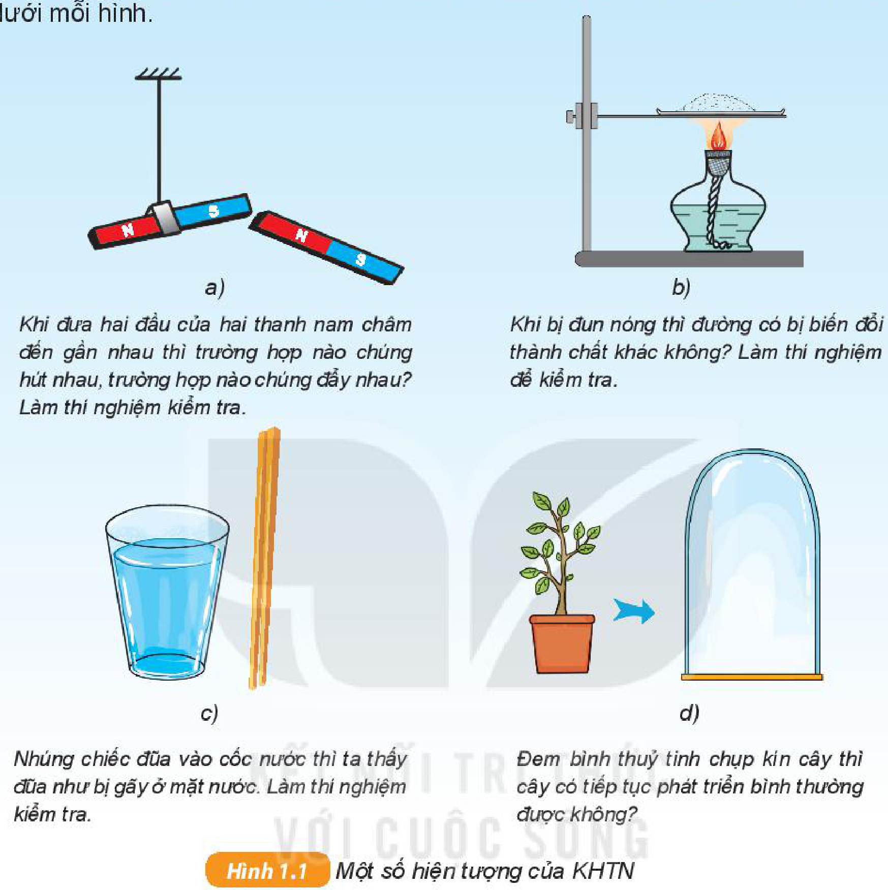
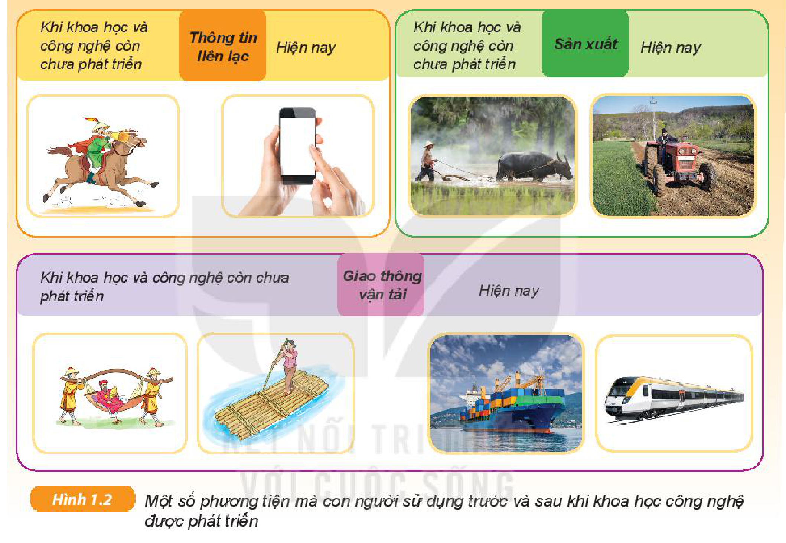
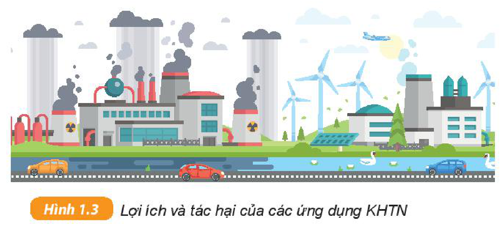
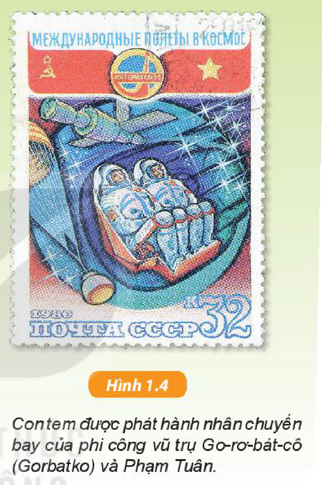

<!-- pdf:8 -->

# BÀI 1: GIỚI THIỆU VỀ KHOA HỌC TỰ NHIÊN

## 🎯 Mục tiêu

- Nêu được khái niệm Khoa học tự nhiên (KHTN).
- Dựa vào các đặc điểm đặc trưng, phân biệt được vật sống và vật không sống.
- Phân biệt được các lĩnh vực KHTN dựa vào đối tượng nghiên cứu.
- Trình bày được vai trò của KHTN trong cuộc sống.

## 🔴 Mở đầu

Em hãy nêu tên các phát minh khoa học và công nghệ được ứng dụng vào các đồ dùng hằng ngày ở hình bên. Nếu không có những phát minh này thì cuộc sống của con người sẽ như thế nào?

## I. Khái niệm Khoa học tự nhiên

Các vật quanh ta đều chuyển động và biến đổi không ngừng: Trái Đất quay quanh Mặt Trời; hạt thóc nảy mầm phát triển thành cây lúa; con người được sinh ra, lớn lên,... Các chuyển động và biến đổi trong tự nhiên gọi là *hiện tượng tự nhiên*. Hiện tượng tự nhiên rất phong phú và đa dạng, nhưng có một tính chất chung là xảy ra theo các quy luật xác định. <!-- term: Hiện tượng tự nhiên -->

KHTN là một nhánh của khoa học, nghiên cứu các hiện tượng tự nhiên, tìm ra các tính chất, các quy luật của chúng.

## II. Vật sống và vật không sống

Vật sống có khả năng trao đổi chất với môi trường, lớn lên và sinh sản,... Vật không sống không có các khả năng trên. <!-- term: Vật sống --> <!-- term: Vật không sống -->

> ❓ Hãy cho biết trong các vật sau đây, vật nào là vật sống, vật nào là vật không sống.
>
> 1. Con người
> 2. Trái Đất
> 3. Cái bàn
> 4. Cây lúa
> 5. Con voi
> 6. Cây cầu

<!-- pdf:9 -->

## III. Các lĩnh vực chính của khoa học tự nhiên

> ✋ Hình 1.1 dưới đây mô tả một số hiện tượng. Các em hãy đọc và thực hiện yêu cầu ghi dưới mỗi hình.
>
> 
>
> - *a) Khi đưa hai đầu của hai thanh nam châm đến gần nhau thì trường hợp nào chúng hút nhau, trường hợp nào chúng đẩy nhau? Làm thí nghiệm kiểm tra.*
> - *b) Khi bị đun nóng thì đường có bị biến đổi thành chất khác không? Làm thí nghiệm để kiểm tra.*
> - *c) Nhúng chiếc đũa vào cốc nước thì ta thấy đũa như bị gãy ở mặt nước. Làm thí nghiệm kiểm tra.*
> - *d) Đem bình thuỷ tinh chụp kín cây thì cây có tiếp tục phát triển bình thường được không?*
>
> Hình 1.1. Một số hiện tượng của KHTN

KHTN bao gồm rất nhiều lĩnh vực: *Sinh học* nghiên cứu về vật sống; *Hoá học* nghiên cứu các chất và sự biến đổi của chúng; *Vật lí học* nghiên cứu về chuyển động, lực và năng lượng; *Khoa học Trái Đất* nghiên cứu về cấu tạo của Trái Đất và bầu khí quyển bao quanh nó; *Thiên văn học* nghiên cứu các thiên thể;... <!-- term: Sinh học --> <!-- term: Hoá học --> <!-- term: Vật lí học --> <!-- term: Khoa học Trái Đất --> <!-- term: Thiên văn học -->

Bảng 1.1. Bảng phân loại các hiện tượng tự nhiên

| Hiện tượng | Sinh học | Hoá học | Vật lí học |
|---|---|---|---|
| a | ? | ? | ? |
| b | ? | ? | ? |
| c | ? | ? | ? |
| d | ? | ? | ? |
<!-- ocr-ok: đã đối chiếu ảnh trang 9, Bảng 1.1 có các ô dấu hỏi ngắn dưới nhóm cột Lĩnh vực KHTN -->

> ✋ Em hãy chép Bảng 1.1 vào vở rồi sắp xếp các hiện tượng ở Hình 1.1 vào ba lĩnh vực chính của KHTN bằng cách đánh dấu “X” vào bảng.

<!-- pdf:10 -->

## IV. Khoa học tự nhiên với công nghệ và đời sống

Các thành tựu của KHTN được áp dụng vào công nghệ để chế tạo ra các phương tiện phục vụ cho mọi lĩnh vực của đời sống con người. Khoa học và công nghệ càng tiến bộ thì đời sống con người càng được cải thiện.

> ❓ Dựa vào Hình 1.2, hãy so sánh các phương tiện mà con người sử dụng trong một số lĩnh vực của đời sống khi khoa học và công nghệ còn chưa phát triển và hiện nay. Tìm thêm ví dụ minh hoạ.
>
> 
>
> Hình 1.2. Một số phương tiện mà con người sử dụng trước và sau khi khoa học công nghệ được phát triển

Tuy nhiên, nếu không được sử dụng đúng phương pháp, đúng mục đích, thì các ứng dụng của KHTN cũng có thể gây hại tới môi trường tự nhiên và con người (Hình 1.3).

Hình 1.3. Lợi ích và tác hại của các ứng dụng KHTN

> ❓ Chỉ ra những lợi ích và tác hại của ứng dụng khoa học tự nhiên trong Hình 1.3 đối với con người và môi trường sống.

<!-- pdf:11 -->

> ✋ Hãy cùng các bạn trong nhóm học tập phân công mỗi người tìm đọc tiểu sử của một trong năm nhà khoa học nổi tiếng dưới đây, rồi viết tóm tắt về quốc tịch, ngày sinh, phát minh quan trọng và điều mà em thích nhất về nhà khoa học đó: 1. Niu-tơn (Newton); 2. Đác-uyn (Darwin); 3. Pa-xtơ (Pasteur); 4. Ma-ri Quy-ri (Marie Curie); 5. Anh-xtanh (Einstein). Nếu có thể, hãy cùng nhau làm một tờ báo tường để giới thiệu các kết quả tìm hiểu của mình kèm theo tranh ảnh về các thành tựu của KHTN.

> 🔭 Em có biết?
>
> Nhờ những thành tựu to lớn của khoa học và công nghệ mà trong thời gian qua, con người đã có những bước tiến lớn trên con đường chinh phục vũ trụ. Sau đây là một số mốc thời gian về chinh phục vũ trụ của con người:
>
> 1. Năm 1957, nước Nga (Liên Xô cũ) phóng thành công vệ tinh nhân tạo đầu tiên của Trái Đất Spút-nhích (Sputnik), mở đầu cho thời kì chinh phục vũ trụ của con người.
> 2. Năm 1961, Ga-ga-rin (Gagarin), người Nga, phi công vũ trụ đầu tiên của loài người bay vòng quanh Trái Đất trên tàu vũ trụ Vô-xtốc (Vostok) 1 (Phương Đông 1).
> 3. Năm 1969, Am-xtrong (Armstrong), người Mĩ, là người đầu tiên đặt chân lên Mặt Trăng.
> 4. Năm 1980, Phạm Tuân là người châu Á đầu tiên bay vào vũ trụ trên tàu Xôi-uýt (Soyuz) 37 (Liên Hợp 37) trong 8 ngày.
> 5. Từ năm 1971 tới nay, con người không ngừng đưa lên vũ trụ các trạm không gian, tạo điều kiện cho các nhà khoa học có thể sống và làm việc lâu ngày trong vũ trụ.
>
> 
>
> Hình 1.4. Con tem được phát hành nhân chuyến bay của phi công vũ trụ Go-rơ-bát-cô (Gorbatko) và Phạm Tuân.

## 📌 Em đã học

- Khoa học tự nhiên nghiên cứu các hiện tượng tự nhiên, tìm ra các tính chất, các quy luật của chúng.
- Các lĩnh vực chủ yếu của KHTN là Sinh học, Hoá học, Vật lí học, khoa học Trái Đất và Thiên văn học.
- Các thành tựu của khoa học được áp dụng vào công nghệ, để chế tạo ra các phương tiện phục vụ cho đời sống con người.

## ✏️ Em có thể

Mỗi em có thể sưu tầm một tài liệu, tranh, ảnh về sự phát triển nhờ khoa học, công nghệ của các lĩnh vực mà em quan tâm như: giao thông vận tải, du hành vũ trụ, thông tin liên lạc, giải trí,...

## 📷 Danh sách hình trong bài

| Mã hình | Trang PDF | Trang sách | Chú thích |
|---|---|---|---|
| H6-khoa_hoc_tu_nhien-b01-01 | 9 | 8 | Hình 1.1. Một số hiện tượng của KHTN |
| H6-khoa_hoc_tu_nhien-b01-02 | 10 | 9 | Hình 1.2. Một số phương tiện mà con người sử dụng trước và sau khi khoa học công nghệ được phát triển |
| H6-khoa_hoc_tu_nhien-b01-03 | 10 | 9 | Hình 1.3. Lợi ích và tác hại của các ứng dụng KHTN |
| H6-khoa_hoc_tu_nhien-b01-04 | 11 | 10 | Hình 1.4. Con tem được phát hành nhân chuyến bay của phi công vũ trụ Go-rơ-bát-cô (Gorbatko) và Phạm Tuân. |
