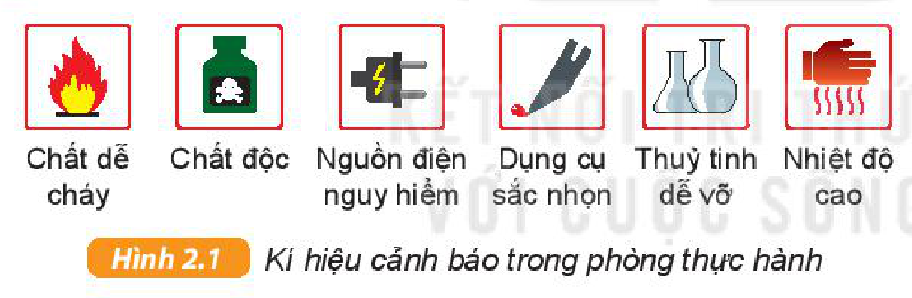
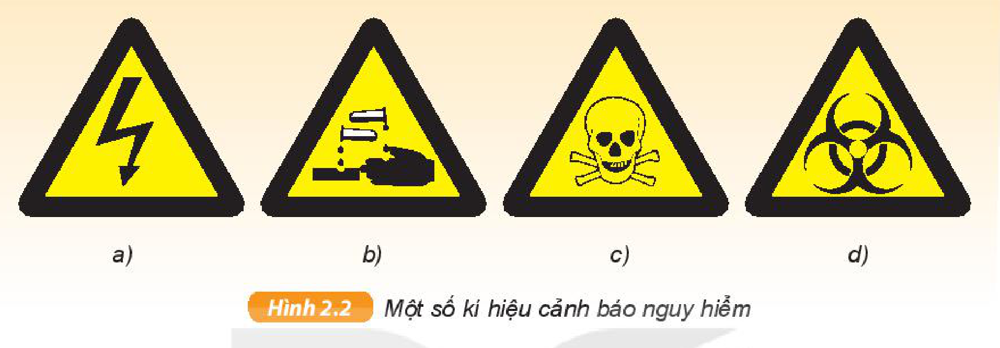

<!-- pdf:12 -->

# BÀI 2: AN TOÀN TRONG PHÒNG THỰC HÀNH

## 🎯 Mục tiêu

- Nêu được các quy định an toàn khi học trong phòng thực hành.
- Phân biệt được các kí hiệu cảnh báo trong phòng thực hành.
- Đọc và phân biệt được các hình ảnh quy định an toàn trong phòng thực hành.

## 🔴 Mở đầu

Theo em, những hoạt động nào trong phòng thực hành ở hình bên là không an toàn?

Khi làm thí nghiệm, chúng ta phải tiếp xúc với: *nguồn điện; nguồn nhiệt; hoá chất; chất dễ cháy nổ; dụng cụ sắc nhọn; động vật;...* Vì thế, chúng ta cần phải biết các quy định an toàn để phòng tránh rủi ro và tai nạn có thể xảy ra khi học tập trong phòng thực hành (Hình 2.1). <!-- term: Kí hiệu cảnh báo trong phòng thực hành --> <!-- term: Quy định an toàn trong phòng thực hành -->

## I. Một số kí hiệu cảnh báo trong phòng thực hành

Chất dễ cháy — Chất độc — Nguồn điện nguy hiểm — Dụng cụ sắc nhọn — Thuỷ tinh dễ vỡ — Nhiệt độ cao. <!-- term: Kí hiệu cảnh báo trong phòng thực hành -->
<!-- ocr-ok: đã đối chiếu ảnh trang 12, OCR dính chữ các nhãn dưới Hình 2.1 -->

Hình 2.1. Kí hiệu cảnh báo trong phòng thực hành

> ❓ Em hãy cho biết mỗi biển báo dưới đây có ý nghĩa gì.
>
> Cả 3 biển báo này có đặc điểm gì chung?
>
> a) b) c)
<!-- ocr-ok: đã đối chiếu ảnh trang 12, OCR đọc sai nhiều dấu trong hộp câu hỏi (mối/sấy/biên) -->

## II. Một số quy định an toàn trong phòng thực hành

- Mặc trang phục gọn gàng, nữ buộc tóc cao, đeo găng tay, khẩu trang, kính bảo vệ mắt và thiết bị bảo vệ khác (nếu cần thiết).
- Chỉ tiến hành thí nghiệm khi có người hướng dẫn.
- Không ăn uống, đùa nghịch trong phòng thí nghiệm; không nếm hoặc ngửi hoá chất.
- Nhận biết các vật liệu nguy hiểm trước khi làm thí nghiệm (vật sắc nhọn, chất dễ cháy nổ, chất độc, nguồn điện nguy hiểm,...).
- Sau khi làm xong thí nghiệm, thu gom chất thải để đúng nơi quy định, lau dọn sạch sẽ chỗ làm việc; sắp xếp dụng cụ gọn gàng, đúng chỗ; rửa sạch tay bằng xà phòng. <!-- term: Quy định an toàn trong phòng thực hành -->

<!-- pdf:13 -->

> ❓ 1. Tại sao cần đeo kính bảo vệ mắt, đeo găng tay và mặc áo choàng (nếu có) khi làm thí nghiệm với hoá chất?
>
> 2. a) Tại sao chúng ta cần tuân thủ những nội quy, quy định trong phòng thực hành?
>
> b) Hãy chỉ ra nội dung cảnh báo về *chất độc, chất ăn mòn, chất độc sinh học, nguy hiểm về điện* ứng với mỗi kí hiệu trong hình dưới đây.
>
> 
>
> Hình 2.2. Một số kí hiệu cảnh báo nguy hiểm

> ✋ Vẽ hai cột, cột (1) là “*An toàn*” và cột (2) là “*Không an toàn*” trên Phiếu học tập. Sắp xếp các tình huống dưới đây (chỉ cần ghi a, b, c,...) vào đúng cột.
>
> a) Thực hiện theo chỉ dẫn của giáo viên. Báo cáo với giáo viên ngay nếu thấy mối nguy hiểm (một sự cố bất thường, làm nứt, vỡ dụng cụ thuỷ tinh, đổ tràn hoá chất ra bàn,...).
>
> b) Dùng tay kiểm tra mức độ nóng của vật khi đang đun.
>
> c) Ngửi hoặc nếm để tìm hiểu xem hoá chất có mùi, vị lạ không.
>
> d) Đọc kĩ nhãn ghi trên mỗi lọ chứa hoá chất. Cẩn thận khi làm thí nghiệm với các hoá chất có tính ăn mòn. Rửa tay kĩ sau khi xử lí hoá chất.
>
> e) Cẩn thận khi cầm dụng cụ thuỷ tinh, dao và các dụng cụ sắc nhọn khác.
>
> g) Luôn rửa tay bằng xà phòng sau khi chạm vào thực vật hoặc động vật.
>
> h) Dọn dẹp và cất thiết bị sau khi hoàn thành thí nghiệm. Bỏ chất thải thí nghiệm vào đúng nơi quy định.

## 📌 Em đã học

- Các quy định, các kí hiệu cảnh báo về an toàn trong phòng thực hành.
- Phải tuân thủ nội quy phòng thực hành để tránh những rủi ro có thể xảy ra.

## ✏️ Em có thể

Phân biệt được các kí hiệu cảnh báo trong phòng thực hành. Thực hiện được các quy định an toàn trong phòng thực hành.

## 📷 Danh sách hình trong bài

| Mã hình | Trang PDF | Trang sách | Chú thích |
|---|---|---|---|
| H6-khoa_hoc_tu_nhien-b02-01 | 12 | 11 | Hình 2.1. Kí hiệu cảnh báo trong phòng thực hành |
| H6-khoa_hoc_tu_nhien-b02-02 | 13 | 12 | Hình 2.2. Một số kí hiệu cảnh báo nguy hiểm |
