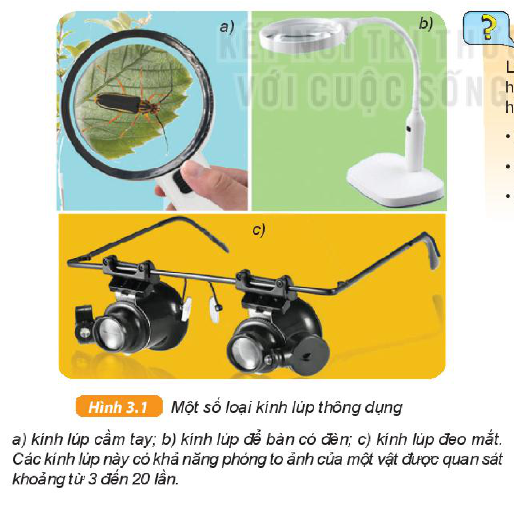
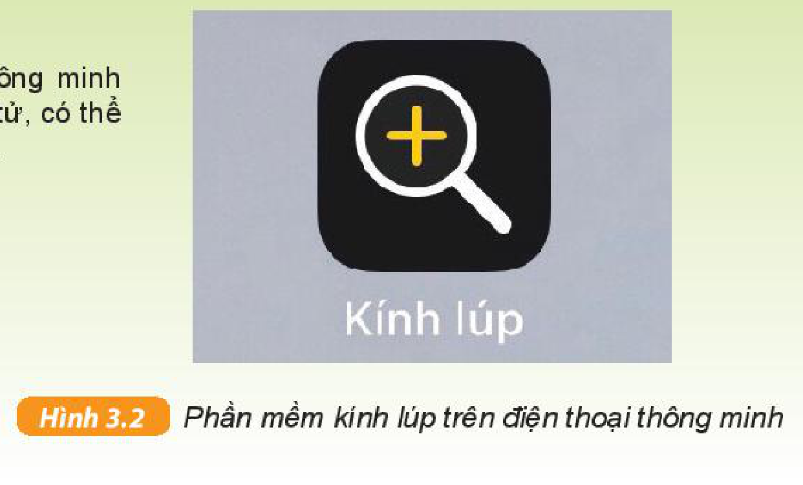

<!-- pdf:14 -->

# BÀI 3: SỬ DỤNG KÍNH LÚP

## 🎯 Mục tiêu

- Biết cách sử dụng kính lúp.

## 🔴 Mở đầu

Muốn nhìn rõ dấu vân tay, một con bọ cánh cứng nhỏ hoặc gân của một chiếc lá thì theo em phải dùng dụng cụ nào?

## I. Tìm hiểu về kính lúp

Kính lúp cầm tay đơn giản là một tấm kính có phần rìa mỏng hơn phần giữa, thường được bảo vệ bởi một khung và có tay cầm. <!-- term: Kính lúp -->

Ngoài việc phục vụ học tập, nghiên cứu khoa học, kính lúp còn được sử dụng rất phổ biến trong đời sống (dùng để đọc sách, soi mẫu vải, nghiên cứu tem, sửa chữa đồng hồ, sửa chữa vi mạch điện tử,...).

Hình 3.1. Một số loại kính lúp thông dụng
<!-- ocr-ok: đã đối chiếu ảnh trang 14, OCR không đọc được chữ trắng trên nền cam nhãn Hình 3.1 -->

*a) kính lúp cầm tay; b) kính lúp để bàn có đèn; c) kính lúp đeo mắt. Các kính lúp này có khả năng phóng to ảnh của một vật được quan sát khoảng từ 3 đến 20 lần.*

> ❓ Lựa chọn loại kính lúp phù hợp trong Hình 3.1 để thực hiện các công việc sau:
>
> - Đọc chữ nhỏ trong sách;
> - Sửa chữa đồng hồ;
> - Soi mẫu vải.

<!-- pdf:15 -->

## II. Sử dụng và bảo quản kính lúp

### 1. Sử dụng

- Đặt kính lúp gần sát vật mẫu, mắt nhìn vào mặt kính.
- Từ từ dịch kính ra xa vật, cho đến khi nhìn thấy vật rõ nét.

### 2. Bảo quản

- Lau chùi, vệ sinh kính thường xuyên bằng khăn mềm.
- Sử dụng nước sạch hoặc nước rửa kính lúp chuyên dụng (nếu có).
- Không để mặt kính lúp tiếp xúc với các vật nhám, bẩn.

> ✋ 1. Dùng kính lúp quan sát một dòng chữ thật nhỏ.
>
> 2. Giữ kính lúp phía trên chiếc lá, điều chỉnh kính để em có thể nhìn rõ các chi tiết trên lá.
>
> a) Từ từ dịch chuyển kính lúp ra xa chiếc lá, em có nhìn rõ chi tiết hơn trước không?
>
> b) Bây giờ, nếu tiếp tục dịch chuyển kính xa chiếc lá hơn một chút, ảnh của chiếc lá sẽ rõ nét hơn hay mờ đi? Khi đó, kích thước của chiếc lá nhìn thấy qua kính to hơn hay nhỏ đi?

> ⚠️ Không nhìn Mặt Trời qua kính lúp để tránh bị tổn thương mắt.
<!-- ocr-ok: đã đối chiếu ảnh trang 15, OCR đọc nhầm dấu (đẻ/tồn) -->

> 🔭 Em có biết?
>
> Trong một số điện thoại thông minh có phần mềm kính lúp điện tử, có thể phóng to ảnh lên đến 10 lần.
>
> 
>
> Hình 3.2. Phần mềm kính lúp trên điện thoại thông minh

## 📌 Em đã học

- Kính lúp là dụng cụ có thể phóng to ảnh của vật được quan sát khoảng từ 3 đến 20 lần. Do đó, người ta thường sử dụng kính lúp để quan sát các vật có kích thước nhỏ. <!-- term: Kính lúp -->
- Cần sử dụng và bảo quản kính lúp đúng cách.

## ✏️ Em có thể

Dùng kính lúp quan sát và mô tả gân của một chiếc lá.

## 📷 Danh sách hình trong bài

| Mã hình | Trang PDF | Trang sách | Chú thích |
|---|---|---|---|
| H6-khoa_hoc_tu_nhien-b03-01 | 14 | 13 | Hình 3.1. Một số loại kính lúp thông dụng
<!-- ocr-ok: đã đối chiếu ảnh trang 14, OCR không đọc được chữ trắng trên nền cam nhãn Hình 3.1 --> |
| H6-khoa_hoc_tu_nhien-b03-02 | 15 | 14 | Hình 3.2. Phần mềm kính lúp trên điện thoại thông minh |
