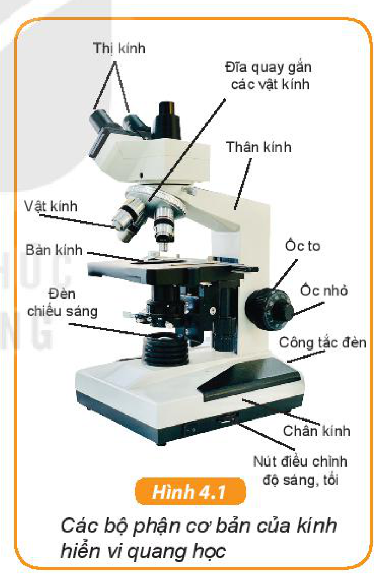
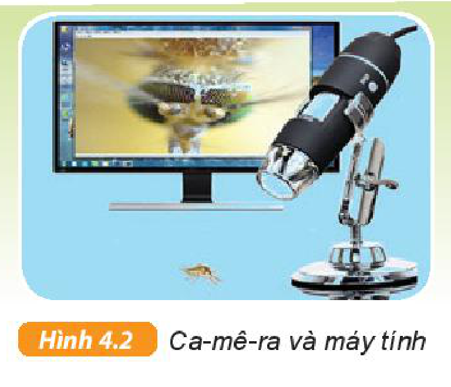

<!-- pdf:16 -->

# BÀI 4: SỬ DỤNG KÍNH HIỂN VI QUANG HỌC

## 🎯 Mục tiêu

- Biết cách sử dụng kính hiển vi quang học.

## 🔴 Mở đầu

Để quan sát gân của một lá cây ta có thể dùng kính lúp. Tuy nhiên, để quan sát tế bào của chiếc lá này, thì ta phải làm thế nào?

## I. Tìm hiểu về kính hiển vi quang học

Kính hiển vi quang học có thể phóng to ảnh của vật được quan sát khoảng từ 40 lần đến 3 000 lần. <!-- term: Kính hiển vi quang học -->

Một kính hiển vi gồm các bộ phận chính (Hình 4.1):

- Ống kính gồm:
  - Thị kính (kính để mắt vào quan sát): có ghi 5x (gấp 5 lần), 10x (gấp 10 lần),... <!-- term: Thị kính -->
  - Đĩa quay gắn các vật kính.
  - Vật kính (kính sát với vật cần quan sát): có ghi 10x, 40x,... <!-- term: Vật kính -->
- Ốc điều chỉnh gồm: ốc to và ốc nhỏ.
- Bàn kính: nơi đặt tiêu bản để quan sát, có kẹp giữ.

Ngoài ra còn có đèn để chiếu sáng mẫu vật, thân kính và chân kính làm giá đỡ các bộ phận khác.

Hình 4.1. Các bộ phận cơ bản của kính hiển vi quang học

> ❓ Những mẫu vật nào sau đây không thể quan sát bằng kính lúp mà phải dùng kính hiển vi quang học? Giải thích tại sao.
>
> a) Côn trùng (như ruồi, kiến, ong).
>
> b) Giun, sán dây.
>
> c) Các tép cam, tép bưởi.
>
> d) Các tế bào thực vật, động vật.

<!-- pdf:17 -->

## II. Sử dụng kính hiển vi quang học

Bước 1: Chọn vật kính thích hợp (10x, 40x hoặc 100x) theo mục đích quan sát.

Bước 2: Bật công tắc đèn và điều chỉnh độ sáng của đèn phù hợp.

Bước 3: Đặt tiêu bản lên bàn kính, dùng kẹp để giữ tiêu bản. Vặn ốc to theo chiều kim đồng hồ để hạ vật kính gần sát vào tiêu bản (cẩn thận không để mặt của vật kính chạm vào tiêu bản).

Bước 4: Mắt nhìn vào thị kính, vặn ốc to theo chiều ngược lại để đưa vật kính lên từ từ, đến khi nhìn thấy mẫu vật cần quan sát.

Bước 5: Vặn ốc nhỏ thật chậm, đến khi nhìn thấy mẫu vật thật rõ nét.

> ✋ Quan sát tế bào lá cây bằng kính hiển vi quang học:
>
> a) Trình bày các thao tác trước khi tiến hành quan sát.
>
> b) Mô tả hình dạng các tế bào lá cây mà em nhìn thấy.

## III. Bảo quản kính hiển vi quang học

- Khi di chuyển kính hiển vi, một tay cầm vào thân kính, tay kia đỡ chân đế của kính. Phải để kính hiển vi trên bề mặt phẳng.
- Không được để tay ướt hay bẩn lên kính hiển vi.
- Lau thị kính và vật kính bằng giấy chuyên dụng trước và sau khi dùng.

> 🔭 Em có biết?
>
> Ca-mê-ra (camera) (Hình 4.2) có khả năng phóng to từ 40 lần đến 1 000 lần, cho phép vừa quan sát vừa chụp ảnh và lưu vào máy tính. Em hãy tìm hiểu thêm các thông tin về loại thiết bị này để chia sẻ với các bạn trong lớp.
>
> 
>
> Hình 4.2. Ca-mê-ra và máy tính

## 📌 Em đã học

- Kính hiển vi quang học là dụng cụ có thể phóng to ảnh của vật được quan sát khoảng từ 40 lần đến 3 000 lần. <!-- term: Kính hiển vi quang học -->
- Cần sử dụng và bảo quản kính hiển vi quang học đúng cách.

## ✏️ Em có thể

Sử dụng được kính hiển vi quang học để quan sát tế bào thực vật, động vật.

## 📷 Danh sách hình trong bài

| Mã hình | Trang PDF | Trang sách | Chú thích |
|---|---|---|---|
| H6-khoa_hoc_tu_nhien-b04-01 | 16 | 15 | Hình 4.1. Các bộ phận cơ bản của kính hiển vi quang học |
| H6-khoa_hoc_tu_nhien-b04-02 | 17 | 16 | Hình 4.2. Ca-mê-ra và máy tính |
