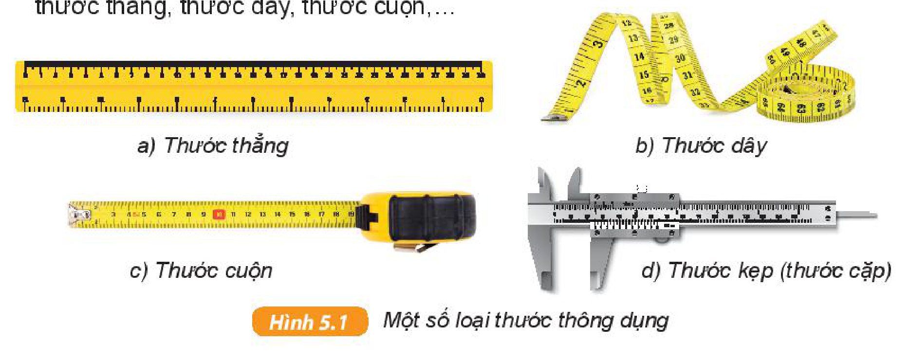
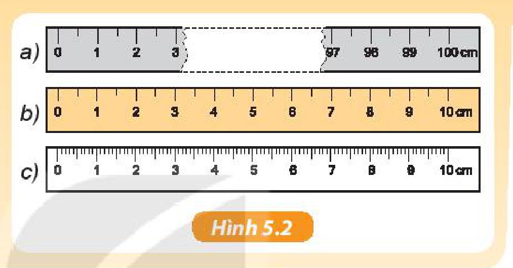
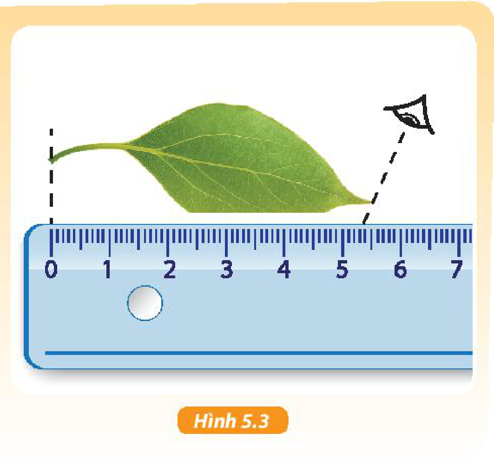
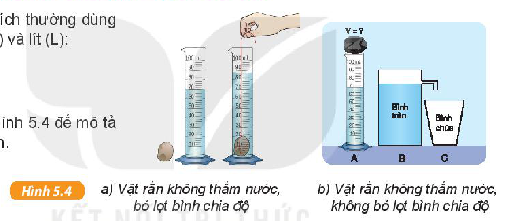

<!-- pdf:18 -->

# BÀI 5: ĐO CHIỀU DÀI

## 🎯 Mục tiêu

- Lấy được ví dụ chứng tỏ giác quan của chúng ta có thể cảm nhận sai một số hiện tượng.
- Nêu được cách đo, đơn vị đo và dụng cụ thường dùng để đo chiều dài.
- Dùng thước để chỉ ra một số thao tác sai khi đo và nêu được cách khắc phục một số thao tác sai đó.
- Đo được chiều dài bằng thước.
- Hiểu được tầm quan trọng của việc ước lượng trước khi đo; ước lượng được chiều dài trong một số trường hợp đơn giản.

## 🔴 Mở đầu

Quan sát hình bên, em thấy đoạn thẳng AB hay CD dài hơn? Muốn biết chính xác, ta phải làm gì?

## I. Đơn vị độ dài

Trong Hệ đơn vị đo lường hợp pháp của nước ta, đơn vị độ dài là **mét**, kí hiệu là m.

Một số đơn vị đo độ dài khác thường gặp:

- 1 milimét (mm) $= 0,001\text{ m}$ ($1\text{ m} = 1\,000\text{ mm}$)
- 1 xentimét (cm) $= 0,01\text{ m}$ ($1\text{ m} = 100\text{ cm}$)
- 1 đềximét (dm) $= 0,1\text{ m}$ ($1\text{ m} = 10\text{ dm}$)
- 1 kilômét (km) $= 1\,000\text{ m}$ ($1\text{ m} = 0,001\text{ km}$)
<!-- ocr-ok: đã đối chiếu ảnh trang 18, biểu thức đổi đơn vị viết bằng LaTeX -->

> ❓ Trong thực tế, để đo các độ dài sau đây, người ta thường sử dụng đơn vị nào?
>
> a) Độ cao cửa sổ trong phòng học.
>
> b) Độ sâu của một hồ bơi.
>
> c) Chu vi của quả cam.
>
> d) Độ dày của cuốn sách.
>
> e) Khoảng cách giữa Hà Nội và Huế.

## II. Dụng cụ đo chiều dài

Tuỳ theo mục đích đo lường, người ta có thể sử dụng các loại thước đo khác nhau như thước thẳng, thước dây, thước cuộn,... <!-- term: Thước đo chiều dài -->

*a) Thước thẳng; b) Thước dây; c) Thước cuộn; d) Thước kẹp (thước cặp)*

Hình 5.1. Một số loại thước thông dụng

<!-- pdf:19 -->

Trước khi đo, ta cần lưu ý đến giới hạn đo (GHĐ) và độ chia nhỏ nhất (ĐCNN) của thước, để chọn thước đo phù hợp với kích thước và hình dạng của vật cần đo.

GHĐ của thước là độ dài lớn nhất ghi trên thước.

ĐCNN của thước là độ dài giữa hai vạch chia liên tiếp trên thước.

> ⚠️ Lưu ý
>
> Ngoài việc chọn dụng cụ đo phù hợp với kích thước và hình dạng của vật cần đo, chúng ta cần lưu ý:
>
> - Nên chọn dụng cụ đo có GHĐ lớn hơn giá trị cần đo một chút để chỉ đo một lần.
> - Muốn đo tới đơn vị đo nào, nên chọn dụng cụ đo có ĐCNN bằng đơn vị đo đó.

> ❓ 1. Xác định GHĐ và ĐCNN của các thước đo trong Hình 5.2.
>
> 2. Dùng loại thước đo thích hợp nào trong Hình 5.1 để đo các độ dài sau đây?
>
> a) Bước chân của em.
>
> b) Chu vi ngoài của miệng cốc.
>
> c) Độ cao cửa ra vào của lớp học.
>
> d) Đường kính trong của miệng cốc.
>
> e) Đường kính ngoài của ống nhựa.
>
> 
>
> Hình 5.2

## III. Cách đo chiều dài

Để thu được kết quả đo chính xác, ta cần thực hiện các bước như sau:

Bước 1: Ước lượng chiều dài cần đo để chọn thước đo thích hợp.

Bước 2: Đặt thước dọc theo chiều dài cần đo, vạch số 0 của thước ngang với một đầu của vật.

Bước 3: Mắt nhìn theo hướng vuông góc với cạnh thước ở đầu kia của vật.

Bước 4: Đọc kết quả đo theo vạch chia gần nhất với đầu kia của vật.

Bước 5: Ghi kết quả đo theo ĐCNN của thước.

> ❓ 1. Tại sao cần ước lượng chiều dài trước khi đo?
>
> 2. Một học sinh tiến hành đo chiều dài của một chiếc lá như trong Hình 5.3. Em hãy phân tích và nêu nhận xét về cách đặt thước và đặt mắt của bạn. Hãy chỉ ra các lỗi (nếu có) trong phép đo này.
>
> 
>
> Hình 5.3

<!-- pdf:20 -->

> ✋ Đo chiều dài và độ dày của quyển sách Khoa học tự nhiên 6.
>
> Mẫu báo cáo thực hành:
>
> 1. Ước lượng chiều dài, độ dày của sách
>
> 2. Chọn dụng cụ đo
>
> - Tên dụng cụ đo: \_\_\_\_\_\_\_
> - GHĐ: \_\_\_\_\_\_\_
> - ĐCNN: \_\_\_\_\_\_\_
>
> 3. Thực hiện đo và ghi kết quả đo theo mẫu Bảng 5.1.
>
> Bảng 5.1. Bảng ghi kết quả thí nghiệm
>
> | Kết quả đo | Lần đo 1 | Lần đo 2 | Lần đo 3 | Giá trị trung bình |
> |---|---|---|---|---|
> | Chiều dài | $l_1 = ?$ | $l_2 = ?$ | $l_3 = ?$ | $l_{\text{TB}} = ?$ |
> | Độ dày | $d_1 = ?$ | $d_2 = ?$ | $d_3 = ?$ | $d_{\text{TB}} = ?$ |

## IV. Vận dụng cách đo chiều dài vào đo thể tích

Đơn vị đo thể tích thường dùng là mét khối ($\text{m}^3$) và lít ($\text{L}$): <!-- term: Đơn vị đo thể tích -->

$1\text{ m}^3 = 1\,000\text{ L}$

$1\text{ mL} = 1\text{ cm}^3$

Hãy dựa vào Hình 5.4 để mô tả cách đo thể tích.

Hình 5.4. *a) Vật rắn không thấm nước, bỏ lọt bình chia độ; b) Vật rắn không thấm nước, không bỏ lọt bình chia độ*
<!-- ocr-ok: đã đối chiếu ảnh trang 20, OCR không đọc được nhãn Hình 5.4 và đọc nhầm dấu (thầm/lợt) -->

> 🔭 Em có biết?
>
> Từ năm 1960, các nhà khoa học chính thức sử dụng hệ thống đơn vị đo lường quốc tế, gọi tắt là hệ SI (viết tắt từ tiếng Pháp ***Système International d'unités***). <!-- term: Hệ SI -->
>
> Ngoài đơn vị đo độ dài là mét, một số quốc gia còn dùng các đơn vị đo độ dài khác:
>
> - 1 in (inch) $= 2,54\text{ cm}$
> - 1 dặm (mile) $= 1\,609\text{ m}$ ($\approx 1,6\text{ km}$)

## 📌 Em đã học

- Đơn vị cơ bản đo độ dài trong Hệ đơn vị đo lường hợp pháp của nước ta là mét, kí hiệu là m.
- Để đo chiều dài có thể sử dụng thước thẳng, thước cuộn, thước dây,...
- GHĐ của thước là độ dài lớn nhất ghi trên thước.
- ĐCNN của thước là độ dài giữa hai vạch chia liên tiếp trên thước.
- Khi đo cần thực hiện đúng các quy tắc đo (5 bước).

## ✏️ Em có thể

Đo được chiều dài, thể tích của một số vật thường gặp trong cuộc sống.

## 📷 Danh sách hình trong bài

| Mã hình | Trang PDF | Trang sách | Chú thích |
|---|---|---|---|
| H6-khoa_hoc_tu_nhien-b05-01 | 18 | 17 | Hình 5.1. Một số loại thước thông dụng |
| H6-khoa_hoc_tu_nhien-b05-02 | 19 | 18 | Hình 5.2. Các thước đo có GHĐ và ĐCNN khác nhau |
| H6-khoa_hoc_tu_nhien-b05-03 | 19 | 18 | Hình 5.3. Cách đặt thước và đặt mắt khi đo chiều dài chiếc lá |
| H6-khoa_hoc_tu_nhien-b05-04 | 20 | 19 | Hình 5.4. a) Vật rắn không thấm nước, bỏ lọt bình chia độ; b) Vật rắn không thấm nước, không bỏ lọt bình chia độ |
