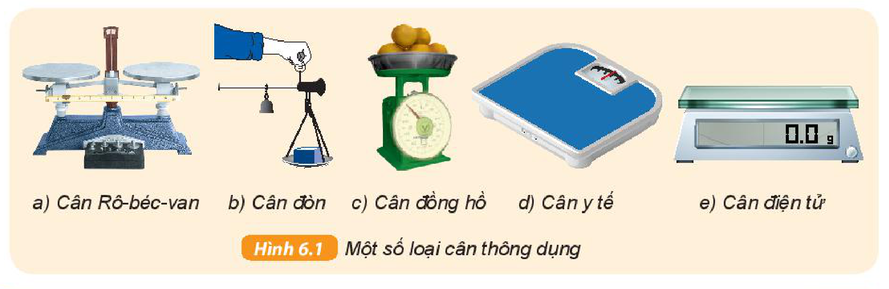
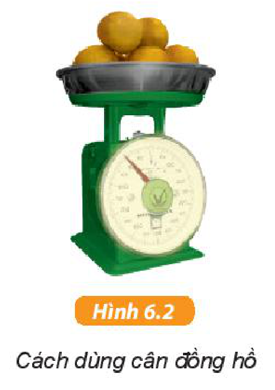

<!-- pdf:21 -->

# BÀI 6: ĐO KHỐI LƯỢNG

## 🎯 Mục tiêu

- Nêu được cách đo, đơn vị đo và dụng cụ thường dùng để đo khối lượng.
- Dùng cân để chỉ ra một số thao tác sai khi đo và nêu được cách khắc phục một số thao tác sai đó.
- Đo được khối lượng bằng cân.
- Hiểu được tầm quan trọng của việc ước lượng trước khi đo; ước lượng được khối lượng trong một số trường hợp đơn giản.

## 🔴 Mở đầu

Một bạn lần lượt rót sữa, nước vào đầy hai cốc giống nhau. Làm thế nào để so sánh chính xác khối lượng của hai cốc?
<!-- ocr-ok: đã đối chiếu ảnh trang 21, OCR mất dấu mũ ở nhiều từ (lân/đây/giông/thê/khôi) -->

## I. Đơn vị khối lượng

Khối lượng là số đo lượng chất của vật.
<!-- ocr-ok: đã đối chiếu ảnh trang 21, câu ngắn và OCR mất dấu mũ (khôi/sô/chât) -->

Trong Hệ đơn vị đo lường hợp pháp của nước ta, đơn vị cơ bản đo khối lượng là **kilôgam**, kí hiệu là kg.

Các đơn vị đo khối lượng khác:

- 1 miligam (mg) $= 0,001\text{ g}$
- 1 gam (g) $= 0,001\text{ kg}$
- 1 héctôgam (1 lạng) $= 100\text{ g}$
- 1 tạ $= 100\text{ kg}$
- 1 tấn (1 t) $= 1\,000\text{ kg}$
<!-- ocr-ok: đã đối chiếu ảnh trang 21, biểu thức đổi đơn vị khối lượng viết bằng LaTeX -->

## II. Dụng cụ đo khối lượng

Dụng cụ thường dùng để đo khối lượng là các loại cân như: cân Rô-béc-van (Roberval), cân đồng hồ, cân đòn, cân y tế, cân điện tử,... <!-- term: Cân -->

*a) Cân Rô-béc-van; b) Cân đòn; c) Cân đồng hồ; d) Cân y tế; e) Cân điện tử*

Hình 6.1. Một số loại cân thông dụng
<!-- ocr-ok: đã đối chiếu ảnh trang 21, OCR không đọc được chữ trắng trên nền cam nhãn Hình 6.1 -->

> ✋ 1. Hãy mô tả một tình huống cho thấy sự cần thiết của việc ước lượng khối lượng trong đời sống.
>
> 2. Thử dự đoán khối lượng của một bạn khác trong nhóm dựa vào sự so sánh với khối lượng đã biết của cơ thể em.

<!-- pdf:22 -->

## III. Cách đo khối lượng

### 1. Dùng cân đồng hồ

Bước 1: Ước lượng khối lượng của vật để chọn cân có GHĐ và ĐCNN thích hợp.

Bước 2: Vặn ốc điều chỉnh để kim cân chỉ đúng vạch số 0.

Bước 3: Đặt vật cần cân lên đĩa cân.

Bước 4: Mắt nhìn vuông góc với vạch chia trên mặt cân ở đầu kim cân.

Bước 5: Đọc và ghi kết quả đo.

Hình 6.2. Cách dùng cân đồng hồ
<!-- ocr-ok: đã đối chiếu ảnh trang 22, OCR không đọc được chữ trắng nhãn Hình 6.2 -->

> ✋ 1. Ước lượng khối lượng của nước chứa đầy trong một chai nhựa. Kiểm tra kết quả ước lượng bằng cách sử dụng cân đồng hồ.
>
> 2. Theo em, cần lưu ý điều gì để thu kết quả đo chính xác hơn? Tại sao?
>
> 3. Do ước lượng không đúng nên một học sinh đã để vật có khối lượng rất lớn lên đĩa cân đồng hồ. Hãy nêu tác hại có thể gây ra cho cân.

### 2. Dùng cân điện tử

Tuỳ vào từng loại cân mà chúng ta có các cách sử dụng khác nhau.

- Ước lượng khối lượng cần đo để chọn đơn vị thích hợp (nhấn nút “UNITS” – Chọn g, kg,...).
- Đặt mẫu vật cần cân nhẹ nhàng trên đĩa cân (nếu mẫu vật cần cân được chứa trong vật chứa thì đặt vật chứa lên đĩa cân rồi nhấn nút "TARE" để cân tự động khấu trừ khối lượng của vật chứa).
- Sử dụng kẹp hoặc găng tay để đặt bình đựng hoá chất/dụng cụ đựng vật mẫu lên đĩa cân, bàn cân (tránh để dầu, mỡ hoặc bột dính vào vật cần đo sẽ làm sai lệch kết quả đo).

> ❓ Các thao tác nào dưới đây là **sai** khi dùng cân đồng hồ hoặc cân điện tử? Nêu cách khắc phục để thu được kết quả đo chính xác.
>
> a) Đặt cân trên bề mặt không bằng phẳng.
>
> b) Đặt mắt nhìn theo hướng vuông góc với mặt đồng hồ.
>
> c) Để vật cồng kềnh trên đĩa cân.
>
> d) Để vật lệch một bên trên đĩa cân.
>
> e) Đọc kết quả khi cân ổn định.

## 📌 Em đã học

- Đơn vị cơ bản đo khối lượng trong Hệ đơn vị đo lường hợp pháp của nước ta là kilôgam, kí hiệu là kg.
- Để đo khối lượng ta dùng cân. Các loại cân thông dụng gồm: cân Rô-béc-van, cân đồng hồ, cân y tế, cân điện tử,... <!-- term: Cân -->
- Cần thực hiện phép đo đúng cách để thu được kết quả đo chính xác.

## ✏️ Em có thể

Đo khối lượng vật bằng cân phù hợp.

## 📷 Danh sách hình trong bài

| Mã hình | Trang PDF | Trang sách | Chú thích |
|---|---|---|---|
| H6-khoa_hoc_tu_nhien-b06-01 | 21 | 20 | Hình 6.1. Một số loại cân thông dụng |
| H6-khoa_hoc_tu_nhien-b06-02 | 22 | 21 | Hình 6.2. Cách dùng cân đồng hồ
<!-- ocr-ok: đã đối chiếu ảnh trang 22, OCR không đọc được chữ trắng nhãn Hình 6.2 --> |
