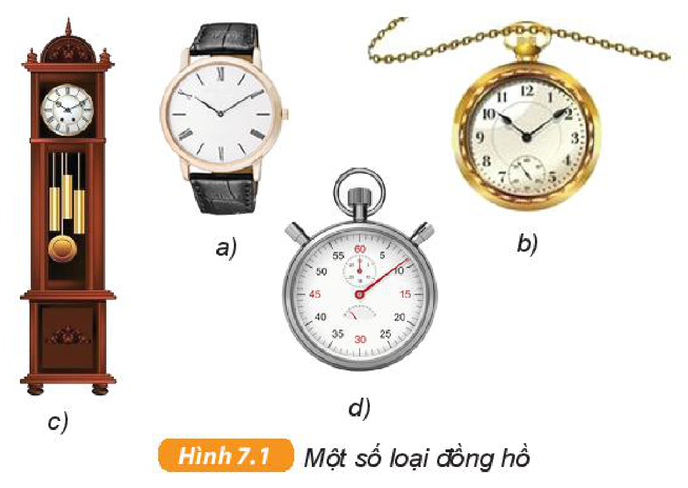
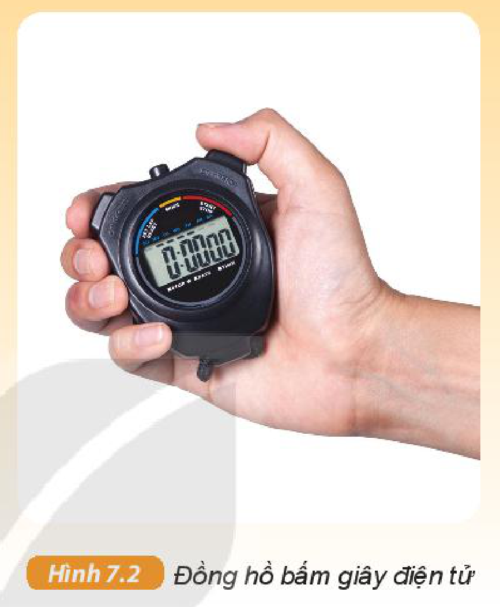

<!-- pdf:23 -->

# BÀI 7: ĐO THỜI GIAN

## 🎯 Mục tiêu

- Nêu được cách đo, đơn vị đo và dụng cụ thường dùng để đo thời gian.
- Dùng đồng hồ để chỉ ra một số thao tác sai khi đo và nêu được cách khắc phục một số thao tác sai đó.
- Đo được thời gian bằng đồng hồ.
- Hiểu được tầm quan trọng của việc ước lượng trước khi đo; ước lượng được thời gian trong một số trường hợp đơn giản.

## 🔴 Mở đầu

*Đồng hồ mặt trời đo thời gian dựa vào bóng của vật dưới ánh nắng mặt trời — Đồng hồ cát đo thời gian dựa vào lượng cát chảy xuống — Đồng hồ điện tử.*

Hãy nêu những ưu điểm và hạn chế của từng dụng cụ đo thời gian ở hình bên.

## I. Đơn vị thời gian

Trong Hệ đơn vị đo lường hợp pháp của nước ta, đơn vị cơ bản đo thời gian là **giây**, kí hiệu là s. <!-- term: Thời gian -->

Trong thực tế, thời gian còn được đo bằng nhiều đơn vị khác như: *phút (min), giờ (h), ngày, tháng, năm, thế kỉ,...* <!-- term: Thời gian -->

## II. Dụng cụ đo thời gian

Đồng hồ là dụng cụ đo thời gian. <!-- term: Đồng hồ -->

Có nhiều loại đồng hồ khác nhau: đồng hồ đeo tay, đồng hồ quả lắc, đồng hồ điện tử, đồng hồ bấm giây,... <!-- term: Đồng hồ -->

Hình 7.1. Một số loại đồng hồ
<!-- ocr-ok: đã đối chiếu ảnh trang 23, OCR không đọc được chữ trắng nhãn Hình 7.1 -->

<!-- pdf:24 -->

> ✋ 1. Hãy mô tả một tình huống cho thấy sự cần thiết của việc ước lượng thời gian trong đời sống.
>
> 2. Hãy ước lượng thời gian đi bộ một vòng quanh lớp học (có thể dùng cách đếm thầm từ 1 giây, 2 giây,...). Sau đó, kiểm tra kết quả ước lượng bằng đồng hồ.

> ❓ 1. Muốn đo thời gian thực hiện các thí nghiệm trong phòng thí nghiệm và các sự kiện thể thao, người ta thường sử dụng loại đồng hồ nào? Tại sao?
>
> 2. Các thao tác nào dưới đây là cần thiết khi dùng đồng hồ bấm giây?
>
> a) Nhấn nút Start (bắt đầu) để bắt đầu tính thời gian.
>
> b) Nhấn nút Stop (dừng) đúng thời điểm kết thúc sự kiện.
>
> c) Nhấn nút Reset (tái thiết lập) để đưa đồng hồ bấm giây về số 0 trước khi tiến hành đo.
>
> 
>
> Hình 7.2. Đồng hồ bấm giây điện tử

> ✋ Dùng đồng hồ bấm giây đo thời gian hát bài "Đội ca" của Đội Thiếu niên Tiền phong Hồ Chí Minh.

> 🔭 Em có biết?
>
> - Thời gian giữa hai nhịp tim liên tiếp của người bình thường khoảng: $0,8\text{ s}$.
> - Thời gian của một cái chớp mắt khoảng: $0,1\text{ s}$.
> - Thời gian của một tia chớp khoảng: $0,32\text{ s}$.
> - 1 canh (đơn vị đo thời gian cổ ở Việt Nam) $= 2\text{ h}$.

## 📌 Em đã học

- Trong Hệ đơn vị đo lường hợp pháp của nước ta, đơn vị cơ bản đo thời gian là giây, kí hiệu là s.
- Đồng hồ là dụng cụ đo thời gian.

## ✏️ Em có thể

Sử dụng được các loại đồng hồ thông thường đo thời gian.

## 📷 Danh sách hình trong bài

| Mã hình | Trang PDF | Trang sách | Chú thích |
|---|---|---|---|
| H6-khoa_hoc_tu_nhien-b07-01 | 23 | 22 | Hình 7.1. Một số loại đồng hồ
<!-- ocr-ok: đã đối chiếu ảnh trang 23, OCR không đọc được chữ trắng nhãn Hình 7.1 --> |
| H6-khoa_hoc_tu_nhien-b07-02 | 24 | 23 | Hình 7.2. Đồng hồ bấm giây điện tử |
