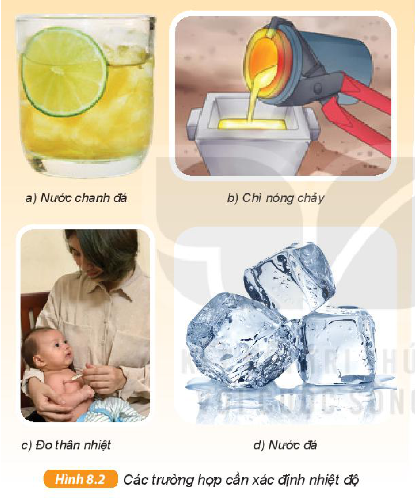
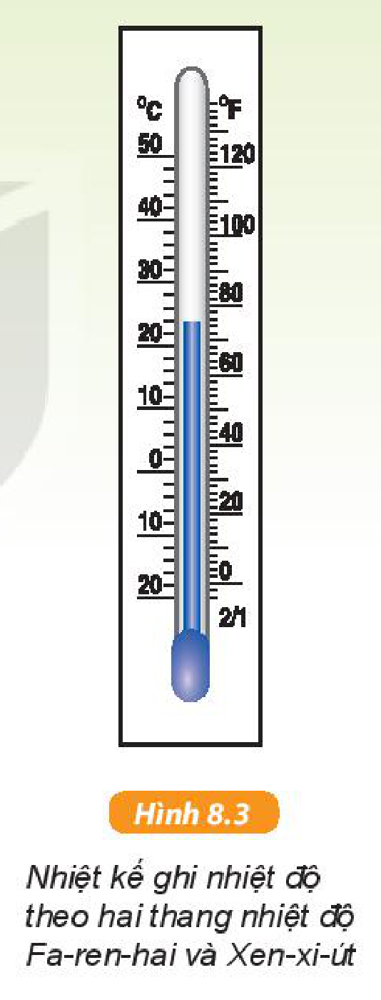
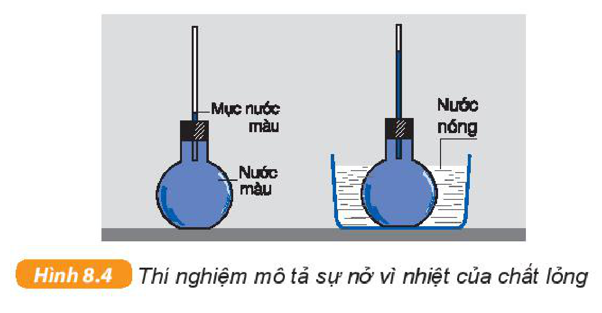
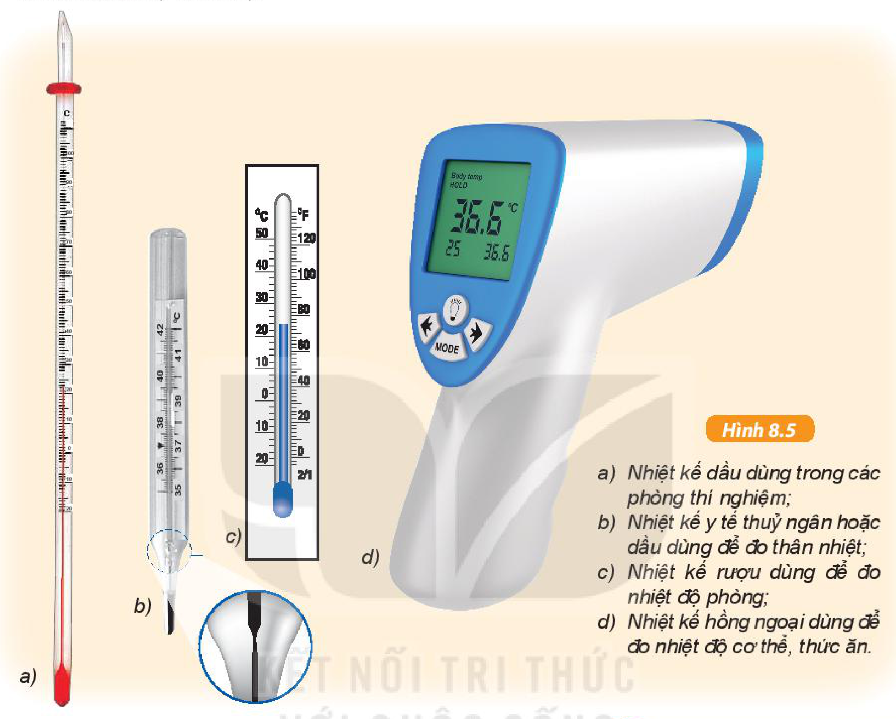
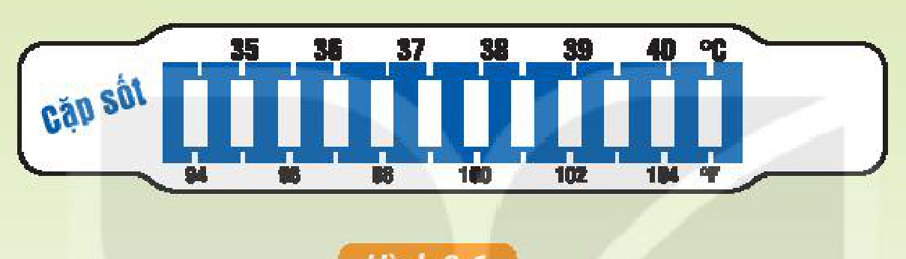
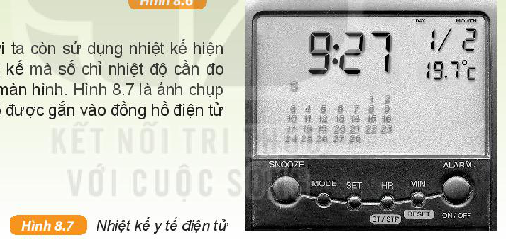

<!-- pdf:25 -->

# BÀI 8: ĐO NHIỆT ĐỘ

## 🎯 Mục tiêu

- Lấy được ví dụ chứng tỏ giác quan của chúng ta có thể cảm nhận sai một số hiện tượng.
- Phát biểu được: Nhiệt độ là số đo độ “nóng”, “lạnh” của vật.
- Nêu được cách xác định nhiệt độ trong thang nhiệt độ Xen-xi-út.
- Nêu được sự nở vì nhiệt của chất lỏng được dùng làm cơ sở để đo nhiệt độ.
- Đo được nhiệt độ bằng nhiệt kế.
- Hiểu được tầm quan trọng của việc ước lượng trước khi đo; ước lượng được nhiệt độ trong một số trường hợp đơn giản.

## 🔴 Mở đầu

Nhúng ngón tay trái vào bình nước lạnh, ngón tay phải vào bình nước ấm rồi rút hai ngón tay ra, cùng nhúng vào bình đựng nước nguội thì các ngón tay có cảm giác nóng, lạnh như thế nào? Từ đó rút ra kết luận về cảm giác nóng, lạnh của tay.

## I. Đo nhiệt độ

Để xác định mức độ nóng, lạnh của vật, người ta dùng khái niệm nhiệt độ: Vật càng nóng thì nhiệt độ của vật càng cao.

**Thang nhiệt độ**

Năm 1742, Xen-xi-út (Celsius) đã đề nghị chia khoảng cách giữa nhiệt độ của nước đá đang tan và nhiệt độ của hơi nước đang sôi thành 100 phần bằng nhau, mỗi phần ứng với 1 độ, kí hiệu là $1\text{ }^\circ\text{C}$. Thang nhiệt độ này gọi là thang nhiệt độ Xen-xi-út, còn gọi là nhiệt giai Xen-xi-út. Chữ C trong kí hiệu $^\circ\text{C}$ là chữ cái đầu của tên nhà vật lí. Trong thang nhiệt độ này, những nhiệt độ thấp hơn $0\text{ }^\circ\text{C}$ được gọi là nhiệt độ âm. <!-- term: Thang nhiệt độ Xen-xi-út --> <!-- term: Nhiệt độ âm -->

Hình 8.1. Xen-xi-út *(Anders Celsius, 1701 – 1744), nhà khoa học Thuỵ Điển, người phát minh thang nhiệt độ Xen-xi-út vào năm 1742.*

> 🔭 Em có biết?
>
> Bảng sau đây cho biết một số nhiệt độ theo thang nhiệt độ Xen-xi-út.
>
> | Đối tượng | Nhiệt độ ($^\circ\text{C}$) |
> |---|---|
> | Nhiệt độ tự nhiên thấp nhất trên Trái Đất (đo tại trạm khí tượng Vô-xtốc ở Nam Cực) | $-89\text{ }^\circ\text{C}$ |
> | Nước đá đang tan | $0\text{ }^\circ\text{C}$ |
> | Nhiệt độ cơ thể người (thân nhiệt) | $37\text{ }^\circ\text{C}$ |
> | Sa mạc Lút ở I-ran, nơi nóng nhất Trái Đất | $71\text{ }^\circ\text{C}$ |
> | Nhiệt độ cao nhất của một ngọn nến | $1\,027\text{ }^\circ\text{C}$ |
> | Nhiệt độ tại bề mặt Mặt Trời | $5\,500\text{ }^\circ\text{C}$ |

<!-- pdf:26 -->

> ❓ 1. Nêu một tình huống cho thấy sự cần thiết của việc ước lượng nhiệt độ trong đời sống.
>
> 2. Nhìn hơi nước bốc lên từ cốc nước nóng, em có thể ước lượng nhiệt độ của nước trong cốc được không? Việc ước lượng này có ích lợi gì?
>
> 3. Trong các nhiệt độ sau: $0\text{ }^\circ\text{C}$, $5\text{ }^\circ\text{C}$, $36,5\text{ }^\circ\text{C}$, $327\text{ }^\circ\text{C}$, hãy chọn nhiệt độ có thể thích hợp cho mỗi trường hợp ở Hình 8.2.
>
> 
>
> *a) Nước chanh đá; b) Chì nóng chảy; c) Đo thân nhiệt; d) Nước đá*
>
> Hình 8.2. Các trường hợp cần xác định nhiệt độ

> 🔭 Em có biết?
>
> Ở các nước nói tiếng Anh, người ta đo nhiệt độ theo độ Fa-ren-hai (Fahrenheit), kí hiệu là $^\circ\text{F}$. Trong nhiệt giai Fa-ren-hai, nhiệt độ của nước đá đang tan là $32\text{ }^\circ\text{F}$, của hơi nước đang sôi là $212\text{ }^\circ\text{F}$ (có 180 khoảng chia). <!-- term: Thang nhiệt độ Fa-ren-hai -->
>
> Cách quy đổi từ $^\circ\text{C}$ sang $^\circ\text{F}$:
>
> $t\text{ }(^\circ\text{F}) = (t\text{ }(^\circ\text{C}) \times 1,8) + 32$
>
> 
>
> Hình 8.3. Nhiệt kế ghi nhiệt độ theo hai thang nhiệt độ Fa-ren-hai và Xen-xi-út

## II. Dụng cụ đo nhiệt độ

### 1. Sự nở vì nhiệt của chất lỏng

Thí nghiệm Hình 8.4 cho thấy chất lỏng nở ra khi nóng lên, nhiệt độ càng cao thì chất lỏng nở ra càng nhiều. Hiện tượng nở vì nhiệt của chất lỏng được dùng làm cơ sở để chế tạo các dụng cụ đo nhiệt độ. <!-- term: Sự nở vì nhiệt của chất lỏng -->

Hình 8.4. Thí nghiệm mô tả sự nở vì nhiệt của chất lỏng

<!-- pdf:27 -->

### 2. Các loại nhiệt kế

Dụng cụ đo nhiệt độ được gọi là nhiệt kế.

Tuỳ theo mục đích sử dụng và giới hạn nhiệt độ muốn đo, người ta chế tạo nhiều loại nhiệt kế khác nhau (Hình 8.5).

Hình 8.5: *a) Nhiệt kế dầu dùng trong các phòng thí nghiệm; b) Nhiệt kế y tế thuỷ ngân hoặc dầu dùng để đo thân nhiệt; c) Nhiệt kế rượu dùng để đo nhiệt độ phòng; d) Nhiệt kế hồng ngoại dùng để đo nhiệt độ cơ thể, thức ăn.*

## III. Sử dụng nhiệt kế y tế

### 1. Nhiệt kế y tế thuỷ ngân

Bước 1: Dùng bông y tế lau sạch thân và bầu nhiệt kế.

Bước 2: Vẩy mạnh cho thuỷ ngân bên trong nhiệt kế tụt xuống.

Bước 3: Dùng tay phải cầm thân nhiệt kế, đặt bầu nhiệt kế vào nách trái, kẹp cánh tay lại để giữ nhiệt kế.

Bước 4: Chờ khoảng 2 – 3 phút, lấy nhiệt kế ra đọc nhiệt độ.

> ⚠️ Lưu ý
>
> Cẩn thận khi vẩy nhiệt kế tránh va chạm với các vật khác. Khi đọc kết quả tránh cầm vào bầu nhiệt kế. Thuỷ ngân là chất độc dễ bay hơi. Nếu em làm vỡ nhiệt kế, đừng sờ vào thuỷ ngân hoặc các mảnh thuỷ tinh, cần báo ngay cho giáo viên hoặc người phụ trách phòng thí nghiệm.

> ❓ Chỉ ra thao tác **sai** khi dùng nhiệt kế trong các tình huống dưới đây:
>
> a) Vẩy mạnh nhiệt kế trước khi đo.
>
> b) Sau khi lấy nhiệt kế ra khỏi môi trường cần đo phải đợi một lúc sau mới đọc kết quả đo.
>
> c) Dùng tay nắm chặt bầu nhiệt kế.

<!-- pdf:28 -->

### 2. Nhiệt kế y tế điện tử

Bước 1: Lau sạch đầu kim loại của nhiệt kế.

Bước 2: Bấm nút khởi động.

Bước 3: Đặt đầu kim loại của nhiệt kế xuống lưỡi.

Bước 4: Chờ khi có tín hiệu “bíp”, rút nhiệt kế ra đọc nhiệt độ.

Bước 5: Tắt nút khởi động.

> 🔭 Em có biết?
>
> Có một số chất có đặc điểm đổi màu theo nhiệt độ. Người ta sử dụng tính chất này để chế tạo ra nhiệt kế, gọi là nhiệt kế đổi màu. Nhiệt kế này thường được dùng trong y tế, thay cho nhiệt kế thuỷ ngân. Chỉ cần dán một băng giấy nhỏ có phủ một lớp chất đổi màu theo nhiệt độ (Hình 8.6) lên trán người bệnh là có thể biết được nhiệt độ cơ thể của họ. <!-- term: Nhiệt kế đổi màu -->
>
> 
>
> Hình 8.6
>
> Hiện nay, người ta còn sử dụng nhiệt kế hiện số, là loại nhiệt kế mà số chỉ nhiệt độ cần đo hiện ngay trên màn hình. Hình 8.7 là ảnh chụp nhiệt kế hiện số được gắn vào đồng hồ điện tử để bàn. <!-- term: Nhiệt kế hiện số -->
>
> 
>
> Hình 8.7. Nhiệt kế y tế điện tử

## 📌 Em đã học

- Nhiệt độ là số đo mức độ nóng, lạnh của một vật.
- Đơn vị đo nhiệt độ thường dùng ở nước ta là độ C, kí hiệu là $^\circ\text{C}$.
- Nhiệt kế là dụng cụ để đo nhiệt độ. Có nhiều loại nhiệt kế khác nhau.

## ✏️ Em có thể

Xác định được nhiệt độ của đối tượng cần đo bằng nhiệt kế.

## 📷 Danh sách hình trong bài

| Mã hình | Trang PDF | Trang sách | Chú thích |
|---|---|---|---|
| H6-khoa_hoc_tu_nhien-b08-01 | 25 | 24 | Hình 8.1. Xen-xi-út (Anders Celsius, 1701 – 1744) |
| H6-khoa_hoc_tu_nhien-b08-02 | 26 | 25 | Hình 8.2. Các trường hợp cần xác định nhiệt độ |
| H6-khoa_hoc_tu_nhien-b08-03 | 26 | 25 | Hình 8.3. Nhiệt kế ghi nhiệt độ theo hai thang nhiệt độ Fa-ren-hai và Xen-xi-út |
| H6-khoa_hoc_tu_nhien-b08-04 | 26 | 25 | Hình 8.4. Thí nghiệm mô tả sự nở vì nhiệt của chất lỏng |
| H6-khoa_hoc_tu_nhien-b08-05 | 27 | 26 | Hình 8.5. Một số loại nhiệt kế |
| H6-khoa_hoc_tu_nhien-b08-06 | 28 | 27 | Hình 8.6. Băng giấy nhiệt kế đổi màu (cặp sốt) |
| H6-khoa_hoc_tu_nhien-b08-07 | 28 | 27 | Hình 8.7. Nhiệt kế y tế điện tử |
