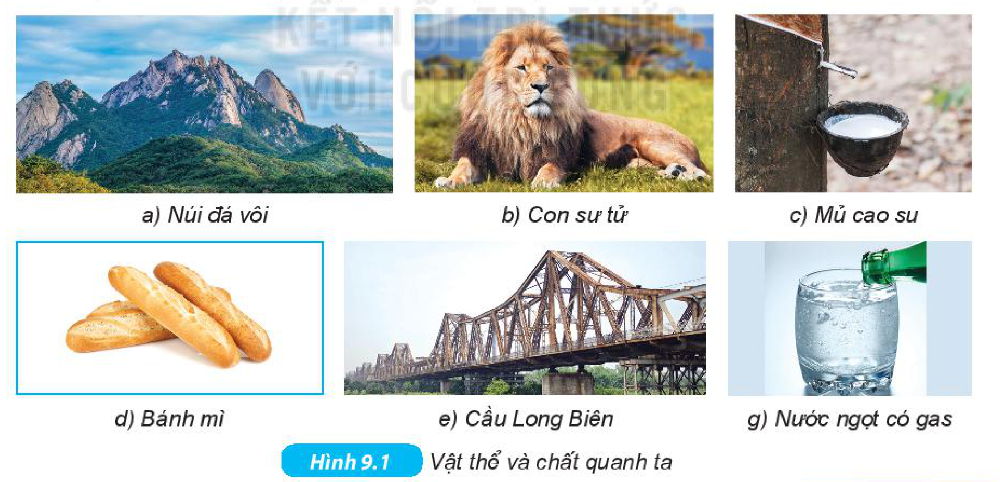
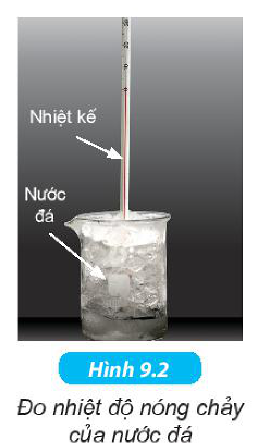
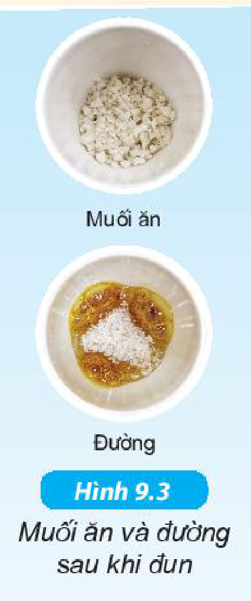

<!-- pdf:29 -->

# BÀI 9: SỰ ĐA DẠNG CỦA CHẤT

## 🎯 Mục tiêu

- Nêu được sự đa dạng của chất.
- Nêu được một số tính chất vật lí và tính chất hoá học của chất.

## 🔴 Mở đầu

Xung quanh ta có nhiều chất khác nhau. Mỗi chất có những tính chất đặc trưng nào để phân biệt chất này với chất khác?

## I. Chất quanh ta

Thế giới xung quanh chúng ta gồm các vật thể vô cùng đa dạng. Tuỳ theo cách phân loại ta có thể phân chia thành vật thể tự nhiên hay vật thể nhân tạo, vật sống hay vật không sống,... **Vật sống** có các khả năng như trao đổi chất với môi trường, lớn lên và sinh sản, ví dụ: thực vật, động vật,... **Vật không sống** không có các khả năng trên, ví dụ: các vật dụng trong gia đình, cây cầu, đồi núi,... Các vật thể được tạo thành từ một hay nhiều chất khác nhau. Ví dụ: giọt nước cất được tạo thành từ một chất là nước; cây kem được làm từ nhiều chất: nước, đường,... <!-- term: Vật thể tự nhiên --> <!-- term: Vật thể nhân tạo --> <!-- term: Chất -->

Ngày nay, khoa học đã biết hàng chục triệu chất khác nhau. Nhiều chất có sẵn trong tự nhiên như trong nước, muối khoáng, dầu mỏ, đất, đá,... hoặc do con người điều chế như một số chất có trong dược phẩm, mĩ phẩm, sơn,...

*a) Núi đá vôi; b) Con sư tử; c) Mủ cao su; d) Bánh mì; e) Cầu Long Biên; g) Nước ngọt có gas*

Hình 9.1. Vật thể và chất quanh ta

> ❓ 1. Quan sát Hình 9.1, cho biết đâu là vật thể tự nhiên, vật thể nhân tạo, vật không sống và vật sống.
>
> 2. Hãy kể ra một số chất có trong vật thể mà em biết.

<!-- pdf:30 -->

## II. Một số tính chất của chất

Mỗi chất có những tính chất nhất định. Bằng các giác quan ta nhận thấy nước là chất lỏng, không màu, không mùi, không vị. Dùng nhiệt kế, ta đo được nhiệt độ nóng chảy của nước đá (Hình 9.2), nhiệt độ sôi của nước lỏng,... Thể (rắn, lỏng, khí), màu sắc, mùi, vị, nhiệt độ nóng chảy, nhiệt độ sôi,... là những ví dụ về **tính chất vật lí** của chất.

Đá vôi rắn chắc, khi nung tạo ra chất mới là vôi sống xốp và mềm hơn. Than đá là chất rắn màu đen, khi cháy tạo ra chất mới là khí carbon dioxide không nhìn thấy bằng mắt thường. Đó là những ví dụ về **tính chất hoá học** của chất.

Hình 9.2. Đo nhiệt độ nóng chảy của nước đá

> ❓ 1. Sự biến đổi tạo ra chất mới là tính chất hoá học hay tính chất vật lí?
>
> 2. Nhận xét nào sau đây nói về tính chất hoá học của sắt?
>
> a) Đinh sắt cứng, màu trắng xám, bị nam châm hút.
>
> b) Để lâu ngoài không khí, lớp ngoài của đinh sắt biến thành gỉ sắt màu nâu, giòn và xốp.

> ✋ Tìm hiểu một số tính chất của đường và muối ăn
>
> *Chuẩn bị:* đường, muối ăn, nước, 2 cốc thuỷ tinh, 2 bát sứ, 1 đèn cồn.
>
> *Tiến hành:*
>
> - Quan sát màu sắc, thể (rắn, lỏng hay khí) của muối ăn và đường trong các lọ đựng muối ăn và đường tương ứng.
> - Cho 1 thìa muối ăn vào cốc nước thứ nhất, 1 thìa đường vào cốc nước thứ hai, khuấy đều và quan sát.
> - Cho 3 – 5 thìa muối ăn vào bát sứ thứ nhất, 3 – 5 thìa đường vào bát sứ thứ hai. Đun nóng hai bát. Khi bát đựng muối có tiếng nổ lách tách thì ngừng đun; Khi bát đựng đường có khói bốc lên thì ngừng đun.
>
> 
>
> Hình 9.3. Muối ăn và đường sau khi đun
>
> *Quan sát hiện tượng và trả lời:*
>
> 1. Hãy mô tả màu sắc, mùi, thể và tính tan của đường và muối ăn.
>
> 2. Khi đun nóng, chất trong bát nào đã biến đổi thành chất khác? Đây là tính chất vật lí hay tính chất hoá học của chất?

## 📌 Em đã học

- Chất tạo nên vật thể. Ở đâu có vật thể là ở đó có chất. <!-- term: Chất -->
- Mỗi chất đều có các tính chất vật lí và tính chất hoá học nhất định, đặc trưng cho chất.
- Các tính chất của chất như thể (rắn, lỏng, khí), màu sắc, mùi, vị, nhiệt độ nóng chảy, nhiệt độ sôi, tính dẫn điện, dẫn nhiệt,... là các tính chất vật lí của chất.
- Sự biến đổi của một chất tạo ra chất mới thể hiện tính chất hoá học của chất đó.

## ✏️ Em có thể

Làm ra “nước hàng” (nước màu dùng để kho thịt cá, làm caramen) bằng cách đun đường đến khi chuyển màu nâu sẫm rồi pha thêm nước.

## 📷 Danh sách hình trong bài

| Mã hình | Trang PDF | Trang sách | Chú thích |
|---|---|---|---|
| H6-khoa_hoc_tu_nhien-b09-01 | 29 | 28 | Hình 9.1. Vật thể và chất quanh ta |
| H6-khoa_hoc_tu_nhien-b09-02 | 30 | 29 | Hình 9.2. Đo nhiệt độ nóng chảy của nước đá |
| H6-khoa_hoc_tu_nhien-b09-03 | 30 | 29 | Hình 9.3. Muối ăn và đường sau khi đun |
