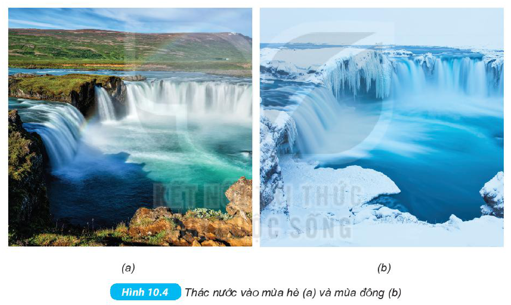
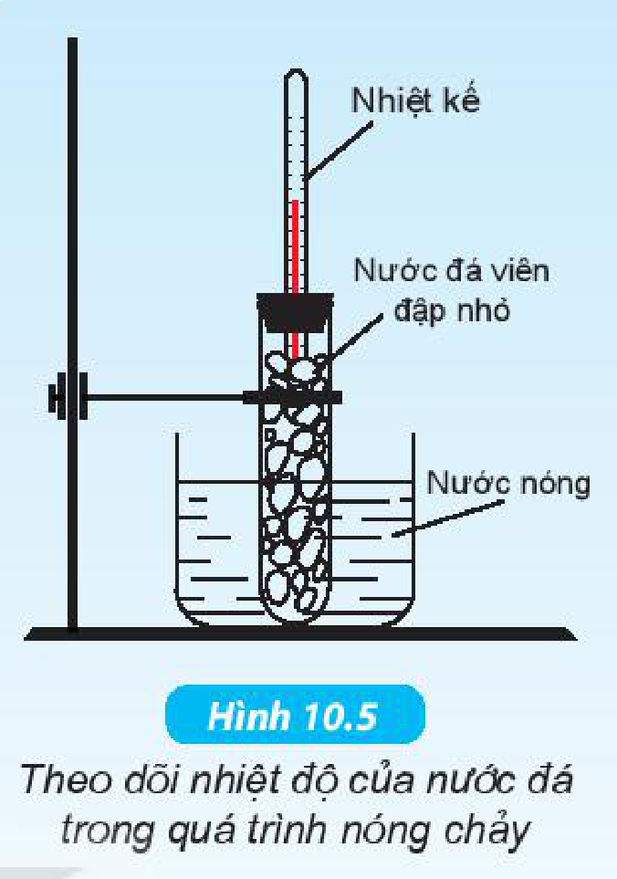
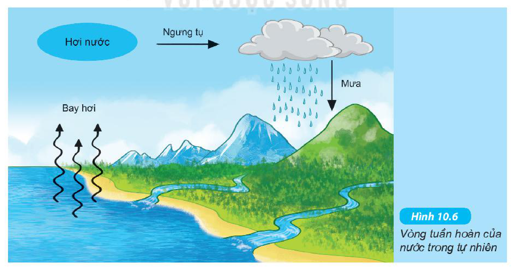
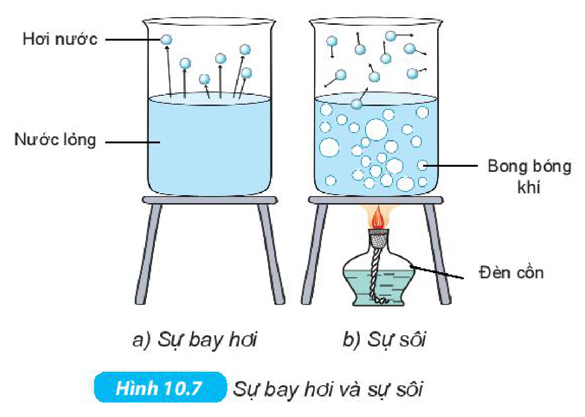
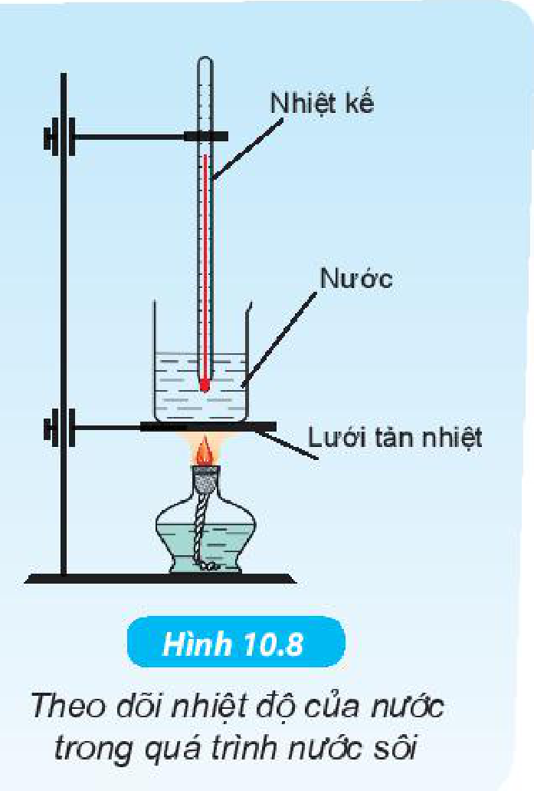

<!-- pdf:31 -->

# BÀI 10: CÁC THỂ CỦA CHẤT VÀ SỰ CHUYỂN THỂ

## 🎯 Mục tiêu

- Trình bày và đưa được ví dụ về một số đặc điểm cơ bản ba thể của chất.
- Nêu được khái niệm về sự nóng chảy, sự đông đặc, sự hoá hơi (sự sôi, sự bay hơi) và sự ngưng tụ.
- Trình bày được quá trình diễn ra sự chuyển thể.
- Tiến hành được thí nghiệm về sự chuyển thể của chất.

## 🔴 Mở đầu

Giữa các thể của nước có sự chuyển đổi qua lại lẫn nhau ở những điều kiện nhất định. Sự chuyển thể của nước tạo ra những hiện tượng tự nhiên nào trên Trái Đất?

## I. Các thể của chất: thể rắn, thể lỏng và thể khí

Nước có thể tồn tại ở thể rắn (nước đá, băng, tuyết), thể lỏng, thể khí (hơi nước). Mọi chất được tìm thấy trên Trái Đất cũng thường ở thể rắn, thể lỏng, hoặc thể khí. Ví dụ: đất đá ở thể rắn; xăng, dầu ở thể lỏng; không khí, hơi xăng ở thể khí. Cơ thể động vật có xương ở thể rắn, máu ở thể lỏng.

Bảng 10.1. Một số ví dụ về ba thể của chất trong vật thể

| Thể rắn | Thể lỏng | Thể khí |
|---|---|---|
| Sắt | Nước | Không khí trong lốp xe |
| Đá | Dầu ăn | Khí trong khinh khí cầu |

> ❓ 1. Hãy nêu một số ví dụ về chất ở thể rắn, lỏng và khí mà em biết.
>
> 2. Em có thể dùng chất ở thể lỏng để tạo nên vật có hình dạng cố định không?

> ✋ Tìm hiểu một số tính chất của chất ở thể rắn, lỏng và khí
>
> *Chuẩn bị:* 1 miếng gỗ nhỏ, 2 xi-lanh, nước có pha màu.
>
> *Tiến hành:*
>
> 
>
> Hình 10.1. Ấn hai đầu miếng gỗ. Quan sát xem miếng gỗ có bị ép vào không?
>
> 
>
> Hình 10.2. Hút nước màu đầy xi-lanh, bịt đầu xi-lanh và ấn pít-tông. Quan sát sự chuyển động của pít-tông.
>
> 
>
> Hình 10.3. Hút không khí đầy xi-lanh, bịt đầu xi-lanh và ấn pít-tông. Quan sát sự chuyển động của pít-tông.
>
> *Hãy rút ra nhận xét về hình dạng, khả năng chịu nén của chất ở thể rắn, thể lỏng và thể khí.*

<!-- pdf:32 -->

Bảng 10.2. Một số tính chất của chất ở thể rắn, lỏng và khí

| Tính chất | Thể rắn | Thể lỏng | Thể khí |
|---|---|---|---|
| Hình dạng | Hình dạng cố định | Có hình dạng của phần vật chứa nó | Có hình dạng của vật chứa nó |
| Khả năng lan truyền (hay khả năng chảy) | Không chảy được (không tự di chuyển) | Có thể rót được và chảy tràn trên bề mặt | Dễ dàng lan toả trong không gian theo mọi hướng |
| Khả năng chịu nén | Rất khó nén | Khó nén | Dễ bị nén |
<!-- term: Thể rắn --> <!-- term: Thể lỏng --> <!-- term: Thể khí -->

> ❓ 1. Khi mở lọ nước hoa, một lát sau có thể ngửi thấy mùi nước hoa. Điều này thể hiện tính chất gì của chất ở thể khí?
>
> 2. Nước từ nhà máy nước được dẫn đến các hộ dân qua các đường ống. Điều này thể hiện tính chất gì của chất ở thể lỏng?
>
> 3. Ta có thể đi được trên mặt nước đóng băng đủ dày. Điều này thể hiện tính chất gì của chất ở thể rắn?

> 🔭 Em có biết?
>
> Cấu tạo hạt của chất:
>
> Các chất đều được cấu tạo bởi các “hạt” vô cùng nhỏ, không nhìn thấy bằng mắt thường. Nếu biểu diễn các hạt này bằng các hình cầu, ta có thể mô tả các thể của chất một cách dễ dàng. <!-- term: Cấu tạo hạt của chất -->
>
> - Ở thể rắn, các hạt được sắp xếp theo một trật tự nhất định và chỉ dao động quanh một vị trí cố định. Trật tự này thay đổi thì vật thể bị phá vỡ. <!-- term: Thể rắn -->
> - Ở thể lỏng, các hạt không ở vị trí cố định, có thể di chuyển và trượt lên nhau. <!-- term: Thể lỏng -->
> - Ở thể khí, các hạt di chuyển tự do và chiếm đầy vật chứa nó. <!-- term: Thể khí -->

<!-- pdf:33 -->

## II. Sự chuyển thể của chất

### 1. Sự nóng chảy và sự đông đặc

Vào những ngày trời rất lạnh, nhiều khu vực ở nước ta như Sa Pa (Lào Cai), Mẫu Sơn (Lạng Sơn),... có hiện tượng nước đóng băng, tuyết rơi, nước đã chuyển từ thể lỏng sang thể rắn. Khi trời ấm lên, băng tuyết lại tan ra, nước đã chuyển từ thể rắn sang thể lỏng.

Các chất khác cũng có thể chuyển từ thể rắn sang thể lỏng hoặc ngược lại. Quá trình chất ở thể rắn chuyển sang thể lỏng gọi là **sự nóng chảy**. Quá trình này xảy ra ở một nhiệt độ xác định gọi là nhiệt độ nóng chảy. Ngược lại, quá trình chất chuyển từ thể lỏng sang thể rắn gọi là **sự đông đặc**. Quá trình này xảy ra ở một nhiệt độ xác định gọi là nhiệt độ đông đặc.

Mỗi chất nóng chảy và đông đặc ở cùng một nhiệt độ. Ví dụ, nước nóng chảy và đông đặc cùng ở $0\text{ }^\circ\text{C}$.

Hình 10.4. Thác nước vào mùa hè (a) và mùa đông (b)
<!-- ocr-ok: đã đối chiếu ảnh trang 33, OCR không đọc được dòng chú thích Hình 10.4 -->

> ❓ 1. Nhiệt độ nóng chảy của sắt (iron), thiếc (tin) và thuỷ ngân (mercury) lần lượt là $1\,538\text{ }^\circ\text{C}$, $232\text{ }^\circ\text{C}$, $-39\text{ }^\circ\text{C}$. Hãy dự đoán chất nào là chất lỏng ở nhiệt độ thường.
>
> 2. Khi để cục nước đá ở nhiệt độ phòng em thấy có hiện tượng gì? Tại sao?
>
> 3. Quan sát Hình 10.4 và trình bày sự chuyển thể đã diễn ra ở thác nước khi chuyển sang mùa hè (hình a) và khi chuyển sang mùa đông (hình b).

<!-- pdf:34 -->

> ✋ Theo dõi nhiệt độ của nước đá trong quá trình nóng chảy
>
> *Chuẩn bị:* nước đá viên, nước nóng, 1 ống nghiệm, 1 cốc thuỷ tinh, nhiệt kế (có dải đo từ dưới $-5\text{ }^\circ\text{C}$ đến trên $50\text{ }^\circ\text{C}$).
>
> *Tiến hành:* Cho nước đá viên đập nhỏ vào ống nghiệm. Cắm nhiệt kế vào giữa khối nước đá. Đặt ống nghiệm vào cốc thuỷ tinh có chứa nước nóng.
>
> 
>
> Hình 10.5. Theo dõi nhiệt độ của nước đá trong quá trình nóng chảy
>
> *Em hãy:*
>
> 1. Ghi lại nhiệt độ và thể của nước trong ống nghiệm theo mẫu bảng sau:
>
> | Thời gian | Nhiệt độ | Thể của nước |
> |---|---|---|
> | Ban đầu | ? | ? |
> | 1 phút | ? | ? |
> | 2 phút | ? | ? |
> | ... | ? | ? |
> | 10 phút | ? | ? |
>
> 2. Nhận xét về nhiệt độ của nước đá trong quá trình nóng chảy.

### 2. Sự hoá hơi và sự ngưng tụ

Trong tự nhiên, nước lỏng và hơi nước chuyển hoá qua lại không ngừng. Nước lỏng trên bề mặt Trái Đất bay hơi và bị cuốn theo gió bay lên cao. Khi gặp lạnh, chúng ngưng tụ lại thành mây (gồm các giọt nước nhỏ li ti). Lúc mây tập trung đủ lớn, đủ nặng rơi xuống thành mưa. Sự bay hơi và ngưng tụ cũng xảy ra với nhiều chất khác. <!-- term: Vòng tuần hoàn của nước trong tự nhiên -->

Hình 10.6. Vòng tuần hoàn của nước trong tự nhiên

<!-- pdf:35 -->

Quá trình chất chuyển từ thể hơi sang thể lỏng gọi là **sự ngưng tụ**. Ngược lại, quá trình chất chuyển từ thể lỏng sang thể hơi gọi là **sự hoá hơi**. Khi sự hoá hơi xảy ra trên bề mặt chất lỏng thì gọi là sự bay hơi, khi xảy ra cả trên bề mặt và trong lòng khối chất lỏng thì gọi là **sự sôi**. <!-- term: Sự bay hơi -->

Sự ngưng tụ và sự bay hơi xảy ra tại mọi nhiệt độ còn sự sôi chỉ xảy ra ở nhiệt độ sôi.

*a) Sự bay hơi; b) Sự sôi*
<!-- ocr-ok: đã đối chiếu ảnh trang 35, OCR không đọc được nhãn con trong Hình 10.7 -->

Hình 10.7. Sự bay hơi và sự sôi
<!-- ocr-ok: đã đối chiếu ảnh trang 35, OCR không đọc được dòng chú thích Hình 10.7 -->

> ❓ 1. Nêu điểm giống và khác nhau giữa sự bay hơi và sự ngưng tụ.
>
> 2. Nêu điểm giống và khác nhau giữa sự bay hơi và sự sôi.

> 🔭 Em có biết?
>
> Từ mô hình hạt của chất, có thể giải thích sự chuyển thể của chất.
>
> Ở thể rắn, các hạt dao động xung quanh một vị trí cố định. Khi nhiệt độ tăng, các hạt dao động mạnh dần. Đến nhiệt độ nóng chảy, các hạt di chuyển tự do và trượt lên nhau. Khi đó, chất bị nóng chảy.
>
> Khi nhiệt độ giảm, các hạt chất ở thể lỏng chuyển động chậm dần. Tại nhiệt độ đông đặc, các hạt chỉ dao động quanh vị trí cố định và được sắp xếp một cách trật tự. Khi đó, chất bị đông đặc.
>
> Tương tự, có thể giải thích sự chuyển thể của chất từ thể lỏng sang thể khí.
>
> $\text{Chất rắn} \xrightleftharpoons[\text{Đông đặc}]{\text{Nóng chảy}} \text{Chất lỏng} \xrightleftharpoons[\text{Ngưng tụ}]{\text{Hoá hơi}} \text{Chất khí}$

<!-- pdf:36 -->

> ✋ Theo dõi nhiệt độ của nước trong quá trình nước sôi
>
> *Chuẩn bị:* nước cất, cốc thuỷ tinh chịu nhiệt, nhiệt kế (có dải đo lên đến $100\text{ }^\circ\text{C}$), đèn cồn.
>
> *Tiến hành:* Đun nóng nước cất trong cốc chịu nhiệt. Khi nước sôi, ta sẽ thấy các bọt khí nổi lên rất nhanh và vỡ tung trên bề mặt nước.
>
> 
>
> Hình 10.8. Theo dõi nhiệt độ của nước trong quá trình nước sôi
>
> Em hãy:
>
> 1. Ghi lại nhiệt độ trên nhiệt kế trong quá trình đun nước đến sôi (1 phút ghi 1 lần, ghi khoảng 4 đến 5 lần)$^{(1)}$.
>
> 2. Nhận xét nhiệt độ của nước trong quá trình nước sôi.

> $^{(1)}$ Xem thêm về *cách đo nhiệt độ* ở Bài 8, Chương I.

> 🔭 Em có biết?
>
> - Phơi quần áo ở nơi có nắng hoặc gió thì quần áo khô nhanh hơn. Theo em, nắng và gió ảnh hưởng thế nào đến sự bay hơi nhanh, chậm của nước?
> - Nhiệt độ sôi của một chất còn phụ thuộc vào áp suất trên bề mặt chất lỏng. Ở trên núi cao, áp suất khí quyển thấp hơn bình thường, nước sôi ở nhiệt độ thấp hơn $100\text{ }^\circ\text{C}$, nên nấu cơm sẽ khó chín.

## 📌 Em đã học

- Rắn, lỏng, khí là ba thể của chất. Chúng khác nhau ở các tính chất như: hình dạng, khả năng chịu nén, khả năng lan truyền,...
- Ở điều kiện thích hợp, chất có thể chuyển từ thể này sang thể khác:
  $\text{Chất rắn} \xrightleftharpoons[\text{Đông đặc}]{\text{Nóng chảy}} \text{Chất lỏng} \xrightleftharpoons[\text{Ngưng tụ}]{\text{Hoá hơi}} \text{Chất khí}$
- Sự nóng chảy, sự đông đặc, sự sôi của một chất xảy ra tại nhiệt độ xác định.
- Sự bay hơi và ngưng tụ xảy ra tại mọi nhiệt độ.

## ✏️ Em có thể

- Giải thích vì sao chất làm bình chứa phải ở thể rắn.
- Trình bày được sự nóng chảy, hoá hơi, ngưng tụ, đông đặc trong vòng tuần hoàn của nước trên Trái Đất.

## 📷 Danh sách hình trong bài

| Mã hình | Trang PDF | Trang sách | Chú thích |
|---|---|---|---|
| H6-khoa_hoc_tu_nhien-b10-01 | 31 | 30 | Hình 10.1. Ấn hai đầu miếng gỗ |
| H6-khoa_hoc_tu_nhien-b10-02 | 31 | 30 | Hình 10.2. Hút nước màu đầy xi-lanh, bịt đầu xi-lanh và ấn pít-tông |
| H6-khoa_hoc_tu_nhien-b10-03 | 31 | 30 | Hình 10.3. Hút không khí đầy xi-lanh, bịt đầu xi-lanh và ấn pít-tông |
| H6-khoa_hoc_tu_nhien-b10-04 | 33 | 32 | Hình 10.4. Thác nước vào mùa hè (a) và mùa đông (b)
<!-- ocr-ok: đã đối chiếu ảnh trang 33, OCR không đọc được dòng chú thích Hình 10.4 --> |
| H6-khoa_hoc_tu_nhien-b10-05 | 34 | 33 | Hình 10.5. Theo dõi nhiệt độ của nước đá trong quá trình nóng chảy |
| H6-khoa_hoc_tu_nhien-b10-06 | 34 | 33 | Hình 10.6. Vòng tuần hoàn của nước trong tự nhiên |
| H6-khoa_hoc_tu_nhien-b10-07 | 35 | 34 | Hình 10.7. Sự bay hơi và sự sôi |
| H6-khoa_hoc_tu_nhien-b10-08 | 36 | 35 | Hình 10.8. Theo dõi nhiệt độ của nước trong quá trình nước sôi |
